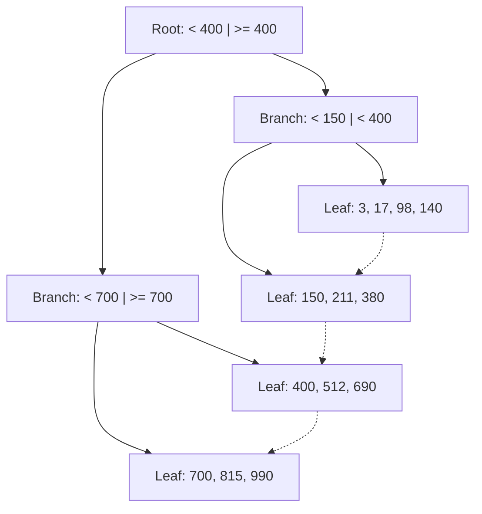

A query that takes 2 milliseconds on your laptop with 1,000 rows can take 20 seconds in production
with 50 million. Most of the time the fix is not more hardware or a cache: it is the right index.
Indexes are the single biggest performance lever a backend developer controls, and understanding
them is one of the clearest signals of seniority. This session explains how indexes work, how to
read what the database is actually doing, and how to choose the index that makes a slow query fast.

## How B-tree indexes work

Think of a 1,000-page book. To find every mention of "transaction", you could read every page (a
**full table scan**), or you could turn to the index at the back, find the word in alphabetical
order, and jump straight to pages 212, 340 and 801. A database index is the same idea: a separate,
sorted structure that maps column values to the location of the rows that contain them.

The default index type in PostgreSQL, and in most relational databases, is the **B-tree** (balanced
tree). Its structure:

- **Leaf nodes** hold the indexed values in sorted order, each with a pointer to its row in the
  table (the **heap** in PostgreSQL terms). Leaves are linked to their neighbours, like a doubly
  linked list, so the database can walk a range in order.
- **Branch nodes** above them hold separator values that say "values below X are to the left".
- The tree is **balanced**: every leaf is at the same depth, and that depth grows *logarithmically*.
  A few levels are enough for millions of rows.



Finding `id = 512` takes three hops (root, branch, leaf) instead of reading every row. Because
leaves are sorted and linked, a B-tree also serves **range queries** (`created_at > '2026-01-01'`),
**sorting** (`ORDER BY created_at` can read the index in order and skip the sort step), and prefix
matches (`LIKE 'abc%'`, with the right operator class).

Indexes are not free. Every `INSERT`, `UPDATE` of an indexed column, and `DELETE` must update every
index on the table, and each index takes disk space and memory. A table with fifteen indexes writes
slowly. The goal is the *fewest* indexes that serve your real queries.

> [!NOTE]
> PostgreSQL has other index types for other shapes of data: GIN for full-text search, arrays and
> JSONB; GiST for geometric and range types; BRIN for huge, naturally ordered tables. See the
> [PostgreSQL docs — Indexes](https://www.postgresql.org/docs/current/indexes.html). B-tree covers
> the vast majority of everyday needs.

## EXPLAIN and EXPLAIN ANALYZE

SQL is declarative: you say *what*, and the **query planner** decides *how*. It estimates the cost
of different strategies using table statistics and picks the cheapest. `EXPLAIN` shows you that
chosen plan without running the query; `EXPLAIN ANALYZE` *runs* it and adds the real timings and
row counts.

```sql
EXPLAIN ANALYZE
SELECT * FROM orders WHERE customer_id = 4242;
```

Without an index:

```text
Seq Scan on orders  (cost=0.00..180932.00 rows=48 width=64) (actual time=0.41..612.80 rows=51 loops=1)
  Filter: (customer_id = 4242)
  Rows Removed by Filter: 4999949
Execution Time: 612.95 ms
```

After `CREATE INDEX ON orders (customer_id);`:

```text
Index Scan using orders_customer_id_idx on orders  (cost=0.43..196.10 rows=48 width=64) (actual time=0.03..0.11 rows=51 loops=1)
  Index Cond: (customer_id = 4242)
Execution Time: 0.14 ms
```

How to read a plan:

- **Read it inside-out.** The most indented nodes run first and feed their parents.
- **Node types tell the story.** `Seq Scan` reads the whole table. `Index Scan` walks the index and
  fetches each row. `Index Only Scan` answers from the index alone. `Bitmap Heap Scan` collects many
  matching row locations then reads them in page order. Joins appear as `Nested Loop`, `Hash Join`
  or `Merge Join`.
- **Compare estimated `rows` with actual `rows`.** A big mismatch means stale or insufficient
  statistics, and the planner chose based on wrong information. `ANALYZE orders;` refreshes them.
- **`Rows Removed by Filter`** in the millions is the classic sign of a missing index.

> [!WARNING]
> `EXPLAIN ANALYZE` really executes the statement. On an `UPDATE` or `DELETE`, wrap it in
> `BEGIN; ... ROLLBACK;`, or you will have changed production data while "just looking".

> [!TIP]
> A `Seq Scan` is not always bad. If a query needs most of a table, or the table is tiny, reading it
> sequentially is genuinely faster than jumping around through an index. The planner knows this.

## Composite, partial and covering indexes

A **composite index** covers several columns, for example `(customer_id, created_at)`. It is sorted
by the first column, then by the second within each first value, exactly like a phone book sorted by
surname then first name. That ordering gives the most important rule in indexing, explained in depth
by [Use The Index, Luke](https://use-the-index-luke.com/):

> [!NOTE]
> A composite index is usable for conditions on a **leftmost prefix** of its columns. An index on
> `(customer_id, created_at)` helps `WHERE customer_id = 7` and `WHERE customer_id = 7 AND
> created_at > ...`, but it barely helps `WHERE created_at > ...` alone, just as a phone book sorted
> by surname does not help you find everyone named "Maria".

Column order rule of thumb: put columns tested with **equality** first, and the **range** or
`ORDER BY` column last. Then this query is served entirely by one index walk, with no sort:

```sql
CREATE INDEX orders_customer_created_idx ON orders (customer_id, created_at DESC);

SELECT id, total FROM orders
WHERE customer_id = 7
ORDER BY created_at DESC
LIMIT 20;
```

A **partial index** indexes only rows matching a condition. If 98% of orders are `'delivered'` and
queries only look for the few `'pending'` ones, index only those:

```sql
CREATE INDEX orders_pending_idx ON orders (created_at) WHERE status = 'pending';
```

It is tiny, cheap to maintain, and fast. Partial unique indexes also express rules such as "only one
active subscription per user": `CREATE UNIQUE INDEX ON subscriptions (user_id) WHERE active;`.

A **covering index** contains every column a query needs, so PostgreSQL can answer with an **Index
Only Scan** and never touch the table. PostgreSQL's `INCLUDE` clause adds non-key payload columns:

```sql
CREATE INDEX orders_customer_cover_idx ON orders (customer_id, created_at DESC) INCLUDE (total);
```

| Index kind | Use it when |
|---|---|
| Single-column | One column is filtered on frequently |
| Composite | Queries filter on several columns together, or filter then sort |
| Partial | Queries always target a small, well-defined subset of rows |
| Covering (`INCLUDE`) | A hot query reads only a few columns and must be as fast as possible |

## Common anti-patterns

Most slow queries in real codebases fall into a handful of patterns.

**Functions on indexed columns.** `WHERE lower(email) = 'ada@x.io'` cannot use an index on `email`,
because the index stores `email`, not `lower(email)`. Either store normalised values, or create an
**expression index**: `CREATE INDEX ON users (lower(email));`. The same applies to
`WHERE date(created_at) = '2026-03-01'`; write it as a range instead:
`created_at >= '2026-03-01' AND created_at < '2026-03-02'`.

**Leading wildcards.** `LIKE '%smith'` cannot use a B-tree, which is sorted from the start of the
string. Use full-text search or a trigram index for "contains" searches.

**Wrong column order.** An index on `(created_at, customer_id)` for queries that filter on
`customer_id` alone. Fix the order or add the right index.

**Over-indexing.** One index per column "just in case" slows every write and rarely helps, because a
query usually uses one index per table. Look at real slow queries and index for those. PostgreSQL's
`pg_stat_user_indexes` view shows indexes that are never scanned.

**Big `OFFSET` pagination.** `OFFSET 100000 LIMIT 20` still reads and throws away 100,000 rows. Use
**keyset pagination**: remember the last value seen and ask for `WHERE created_at < :last LIMIT 20`.

**N+1 queries from the application.** One query for a list, then one more per row. Each query is
fast, but a thousand of them are not. The fix is a join or a batched `WHERE id = ANY(:ids)`; you will
meet it again in the ORM session.

> [!EXAMPLE]
> A login endpoint got slow as users grew. The plan showed `Seq Scan on users ... Filter:
> (lower(email) = ...)` with millions of rows removed. The column had a plain index on `email`.
> Adding `CREATE UNIQUE INDEX users_email_lower_idx ON users (lower(email));` turned it into an
> `Index Scan`, and the lookup went from reading the whole table to a few index pages.

## Practice: speed up three slow queries on a large table

You will generate a 5-million-row table and make three queries fast, measuring each change. Allow
about 90 minutes.

### Step 1: Create the data

```sql
CREATE TABLE orders (
  id          BIGINT GENERATED ALWAYS AS IDENTITY PRIMARY KEY,
  customer_id INT NOT NULL,
  status      TEXT NOT NULL,
  email       TEXT NOT NULL,
  total       NUMERIC(10, 2) NOT NULL,
  created_at  TIMESTAMPTZ NOT NULL
);

INSERT INTO orders (customer_id, status, email, total, created_at)
SELECT (random() * 100000)::int,
       CASE WHEN random() < 0.02 THEN 'pending' ELSE 'delivered' END,
       'User' || g || '@Example.com',
       round((random() * 200)::numeric, 2),
       now() - random() * interval '3 years'
FROM generate_series(1, 5000000) AS g;

ANALYZE orders;
```

### Step 2: Measure the three slow queries

Run each with `EXPLAIN ANALYZE` and write down the plan type and execution time:

```sql
-- Q1: a customer's latest orders
SELECT id, total FROM orders WHERE customer_id = 4242 ORDER BY created_at DESC LIMIT 20;
-- Q2: pending orders from the last week
SELECT * FROM orders WHERE status = 'pending' AND created_at > now() - interval '7 days';
-- Q3: case-insensitive lookup
SELECT id FROM orders WHERE lower(email) = 'user123@example.com';
```

### Step 3: Add one index per query

Decide the index *before* creating it, and write why. Hints: Q1 needs a composite index with the
right column order; Q2 suits a partial index; Q3 needs an expression index. Re-run `EXPLAIN
ANALYZE` after each and record the new plan and time.

### Step 4: Check the cost

Compare table and index sizes with `\di+` in `psql`, and time an `INSERT` of 100,000 rows before and
after your indexes. Write one sentence on the read/write trade-off you observed.

> [!TIP]
> Try a wrong index on purpose, such as `(created_at, customer_id)` for Q1, and see whether the
> planner uses it. Seeing a plan ignore your index teaches more than reading about it.

```quiz
{"questions": [
  {"question": "You have an index on (customer_id, created_at). Which query benefits least from it?", "options": ["WHERE customer_id = 7", "WHERE customer_id = 7 AND created_at > '2026-01-01'", "WHERE created_at > '2026-01-01'", "WHERE customer_id = 7 ORDER BY created_at"], "answer": 2, "explanation": "A composite index is sorted by its first column. Without a condition on customer_id, the index cannot narrow the search by its leftmost prefix."},
  {"question": "EXPLAIN ANALYZE shows estimated rows=10 but actual rows=900000. What does this suggest?", "options": ["The query is fast", "The planner's statistics are wrong or stale, so it may have chosen a bad plan; run ANALYZE", "The index is corrupt", "The query returned too few rows"], "answer": 1, "explanation": "Plans are chosen from estimates. A big gap between estimated and actual rows means the planner worked with wrong information."},
  {"question": "Why does WHERE lower(email) = 'x' ignore a plain index on email?", "options": ["Indexes do not support text", "lower() is not valid SQL", "Indexes only work with numbers", "The index stores email values, not lower(email), so the expression cannot be looked up in it"], "answer": 3, "explanation": "Index the expression itself (CREATE INDEX ON users (lower(email))) or store normalised values."},
  {"question": "Only 2% of orders are pending, and queries always filter on status = 'pending'. What is a good fit?", "options": ["A partial index WHERE status = 'pending'", "An index on every column", "No index; use OFFSET", "A full table scan"], "answer": 0, "explanation": "A partial index covers only the small subset that queries need, so it is small, fast and cheap to maintain."},
  {"question": "What is the main cost of adding many indexes to a table?", "options": ["Reads become slower", "Every write must update every index, and indexes use disk and memory", "SQL becomes harder to write", "Primary keys stop working"], "answer": 1, "explanation": "Indexes speed reads but slow inserts, updates and deletes. Index for the queries you actually run."}
]}
```
