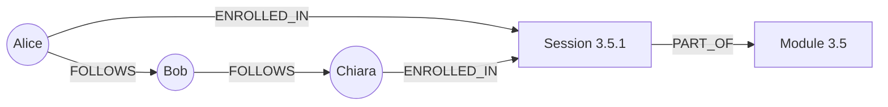

Relational databases are the right default for most applications, and you just spent a module
learning them well. But they are not the only shape data can take. "NoSQL" is an umbrella for
databases built around other data models: documents, key–value pairs, wide columns and graphs. Each
one makes some access patterns trivial and others painful. This session gives you a mental map of
the four families, so that when someone proposes "let's use MongoDB" or "let's put it in Redis",
you can ask the right questions. The best single reference here is Martin Kleppmann's
[Designing Data-Intensive Applications](https://dataintensive.net/), chapter 2 in particular.

## Document stores

Picture a filing cabinet where each folder holds *everything* about one customer: their details,
their addresses, their last orders, all on the same few sheets. You pull out one folder and you
have the whole picture, without walking to five other cabinets. That folder is a **document**.

A **document store** (MongoDB, Couchbase, Firestore, and PostgreSQL's own `jsonb` columns) stores
self-contained records, usually as JSON or a binary form of it. A document can nest objects and
arrays:

```json
{
  "_id": "u42",
  "name": "Alice",
  "plan": "pro",
  "addresses": [
    {"type": "home", "city": "Rome"},
    {"type": "work", "city": "Milan"}
  ],
  "settings": {"theme": "dark", "weekly_email": true}
}
```

What documents are good at:

- **Locality.** Loading one user is one read; no joins needed. Kleppmann calls this the *locality*
  advantage.
- **Flexible schema.** Two documents in the same collection can have different fields. This is
  better described as **schema-on-read**: the structure is checked by the code that reads the data,
  not enforced by the database on write (*schema-on-write*).
- **One-to-many trees.** Data that naturally forms a tree (a blog post with its comments, an order
  with its line items) maps cleanly.

What they are bad at: **many-to-many relationships**. If many users reference the same company,
either you copy the company's name into every user (and must update all copies when it changes) or
you store an id and do the "join" yourself in application code.

> [!WARNING]
> "Schemaless" does not mean "no schema". It means the schema lives in your code instead of the
> database. You still need to handle old documents that lack a field you added last month.

## Key–value stores

A key–value store is a giant dictionary, or a cloakroom: you hand over your coat, get a ticket
number, and later the ticket gets your coat back. The cloakroom doesn't care what the coat looks
like, and you can't ask "show me all the red coats".

The interface is tiny: `GET key`, `SET key value`, `DELETE key`, sometimes with an expiry time. In
exchange you get speed and simple scaling, because a key tells the system exactly which machine
holds the value.

[Redis](https://redis.io/docs/latest/) is the best-known example, and it goes beyond plain strings:
values can be lists, hashes, sets, sorted sets and streams, each with its own atomic operations.
Redis keeps data in memory, which makes reads and writes extremely fast. Amazon DynamoDB is a
key–value store (with some document features) designed for huge scale.

```sh
SET session:9f3a "user=42;expires=..." EX 3600   # store with a 1-hour expiry
GET session:9f3a
INCR page_views:2026-10-19                       # atomic counter
```

Typical uses: caches, sessions, rate-limit counters, feature flags, leaderboards. Anything where
you always know the key.

> [!TIP]
> The design work in a key–value store is **key naming**. A convention like
> `object-type:id:field` (`user:42:profile`) keeps keys readable and avoids collisions between
> features.

## Wide-column stores

A wide-column store (Apache Cassandra, ScyllaDB, HBase, Google Bigtable) looks like a table but
behaves very differently. Think of a huge ledger where each row is identified by a key, and each row
can have its own set of columns, potentially thousands of them, kept sorted.

In Cassandra you choose a **partition key** that decides which machine stores the row, and a
**clustering key** that decides the sort order of data inside the partition:

```sql
CREATE TABLE messages_by_chat (
  chat_id    uuid,
  sent_at    timestamp,
  sender_id  uuid,
  body       text,
  PRIMARY KEY ((chat_id), sent_at)
) WITH CLUSTERING ORDER BY (sent_at DESC);
```

"Give me the last 50 messages of chat X" becomes one fast read from one machine, even with
billions of messages in total.

The catch is that **you design tables around queries**, not around entities. If you also need
"messages by sender", you create a *second* table with a different partition key and write each
message to both. Ad-hoc queries that don't match a partition key are slow or forbidden.

> [!NOTE]
> Wide-column stores shine with very high write volumes spread over many machines: telemetry,
> event logs, messaging, time series. For a typical CRUD app with a few million rows, they add
> complexity without benefit.

## Graph databases

Some data is mostly about *connections*: who follows whom, which service calls which, which
products are bought together. In a relational database, "friends of friends of friends" means
joining a table to itself three times, and every extra hop gets more expensive and more awkward.

A **graph database** (Neo4j, Amazon Neptune) stores **nodes** (things) and **edges** (relationships
between them), both with properties. Traversing an edge is a cheap, first-class operation.



In Neo4j's Cypher language, "courses that people I follow are enrolled in" reads almost like the
picture:

```text
MATCH (me:User {name: 'Alice'})-[:FOLLOWS]->(friend)-[:ENROLLED_IN]->(s:Session)
RETURN s.title, count(friend) AS friends ORDER BY friends DESC
```

Use a graph database when the questions you ask are about paths and neighbourhoods: recommendations,
fraud rings, network dependencies, knowledge graphs. If you only need one level of relationship,
foreign keys do the job fine.

## Polyglot persistence trade-offs

**Polyglot persistence** means using several databases in one system, each for what it does best.
A typical modern stack: PostgreSQL as the source of truth, Redis for caching and sessions, a search
engine for full-text search, maybe a warehouse for analytics.

| Model | Best at | Weak at | Examples |
|---|---|---|---|
| Relational | Joins, constraints, transactions, ad-hoc queries | Horizontal write scaling | PostgreSQL, MySQL |
| Document | Self-contained records, flexible fields | Many-to-many, cross-document joins | MongoDB, `jsonb` |
| Key–value | Lookups by key, extreme speed | Any query that isn't by key | Redis, DynamoDB |
| Wide-column | Massive write volume, known queries | Ad-hoc queries | Cassandra, Bigtable |
| Graph | Multi-hop relationships | Bulk aggregation over everything | Neo4j |

Every extra database has costs that don't show up in a feature comparison:

- **Operations.** Backups, upgrades, monitoring and on-call knowledge for each one.
- **Consistency.** When the same fact lives in two stores, they *will* drift apart unless you
  design for it (events, change data capture, or rebuilding one from the other).
- **Learning.** Every developer now needs to know two or three query languages and failure modes.

> [!TIP]
> Start with PostgreSQL. It has `jsonb` with indexes for document-style data, and it can go a long
> way before you need anything else. Add a specialised store when you can name the specific query
> PostgreSQL is too slow at, with numbers.

> [!WARNING]
> "It's web scale" is not a reason. Choosing a database because a big company uses it ignores that
> they have hundreds of engineers to run it. Pick for your access patterns and your team size.

## Practice: model the same data in relational and document form

Model a small part of this learning platform, **users, their enrolments in sessions, and their
completed subchapters**, both ways, and compare.

### Step 1: List the access patterns first

Write down the queries the app needs, before any schema:

1. Show a user's profile with their progress on every session.
2. Mark a subchapter as completed for a user.
3. For one session, how many users completed it this week?
4. Rename a session.

### Step 2: The relational model

```sql
CREATE TABLE users       (id serial PRIMARY KEY, name text NOT NULL);
CREATE TABLE sessions    (id text PRIMARY KEY, title text NOT NULL);
CREATE TABLE completions (
  user_id       int  REFERENCES users(id),
  subchapter_id text NOT NULL,              -- e.g. '3.5.1.2'
  session_id    text REFERENCES sessions(id),
  completed_at  timestamptz NOT NULL DEFAULT now(),
  PRIMARY KEY (user_id, subchapter_id)
);
```

### Step 3: The document model

```json
{
  "_id": "u42",
  "name": "Alice",
  "progress": {
    "3.5.1": {
      "title": "NoSQL data models",
      "completed": [
        {"subchapter": "3.5.1.1", "at": "2026-10-18T09:12:00Z"},
        {"subchapter": "3.5.1.2", "at": "2026-10-19T08:40:00Z"}
      ]
    }
  }
}
```

### Step 4: Run each access pattern against both

Fill in a table like this one, with a sentence per cell on *how* you'd answer the query:

| Query | Relational | Document |
|---|---|---|
| 1. Profile with progress | Join users + completions + sessions | One read of one document |
| 2. Mark completed | One `INSERT` (PK prevents duplicates) | Push into an array; must avoid duplicates in code |
| 3. Completions of a session this week | `COUNT` with `WHERE`, indexable | Scan every user document, or keep a separate collection |
| 4. Rename a session | One `UPDATE` | Update the copied title in every user document |

If you want to try it for real, put the document version in a PostgreSQL `jsonb` column and write
query 3 with `jsonb_path_query`, then compare how it reads to the SQL version.

### Step 5: Decide and justify

Write three sentences: which model you'd choose for this platform, which query decided it, and what
would have to change for you to pick the other one.

> [!EXAMPLE]
> A reasonable conclusion: "Relational, because query 3 aggregates across users and query 4 changes
> shared data. A document model would win if the app only ever showed one user's own progress."

```quiz
{"questions": [
  {"question": "A document database stores each blog post with its comments embedded. Which new requirement hurts this design the most?", "options": ["Showing a post with all its comments", "Listing every comment written by one user across all posts", "Adding an optional 'edited' field to some comments", "Loading a post by its id"], "answer": 1, "explanation": "Embedding optimises for reading one post. Querying across documents by another dimension (author) needs a scan or a second copy of the data."},
  {"question": "What does 'schema-on-read' mean for a document store?", "options": ["The database has no structure at all", "The structure is interpreted by the code that reads the data, so it must cope with older shapes", "The schema is read from a file on start-up", "Every read validates the document against a JSON Schema"], "answer": 1, "explanation": "The database accepts varying shapes on write; the application imposes the structure when reading, including handling documents written before a change."},
  {"question": "In Cassandra you have messages_by_chat partitioned by chat_id. Product now needs 'all messages by sender'. What is the usual approach?", "options": ["Add an index and query by sender_id like in SQL", "Create a second table partitioned by sender_id and write each message to both", "Switch the partition key of the existing table", "Use a JOIN with the users table"], "answer": 1, "explanation": "Wide-column stores are designed per query. A new access pattern usually means a new denormalised table."},
  {"question": "Which problem is the strongest signal that a graph database could help?", "options": ["You need to store user sessions with an expiry", "You run monthly revenue totals", "You need 'people within three hops of me who share an interest', and SQL self-joins get slow and hard to read", "Your records have optional fields"], "answer": 2, "explanation": "Multi-hop traversals are what graph databases make cheap. Expiry suits key–value stores, aggregations suit relational or analytical stores."},
  {"question": "What is the main hidden cost of polyglot persistence?", "options": ["NoSQL databases are always more expensive to license", "Each additional store adds operational work and the risk of the same data drifting out of sync", "You can't use Python with more than one database", "Relational databases stop working when another database is present"], "answer": 1, "explanation": "More stores means more backups, monitoring and expertise, plus keeping duplicated data consistent. Add one when a specific need justifies it."}
]}
```
