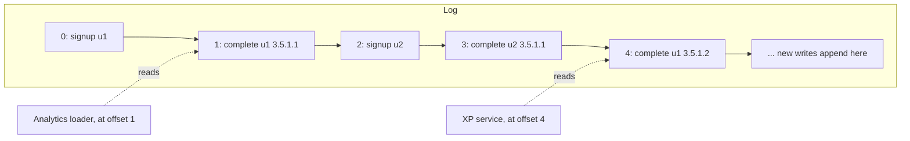
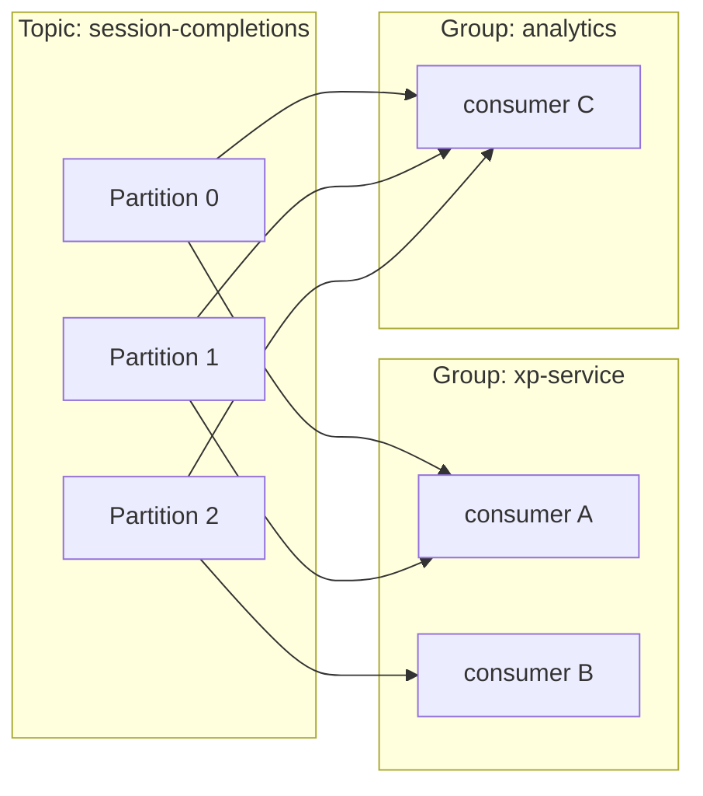

In the last session a message queue handed jobs to workers, and each message disappeared once it
was done. **Event streaming** keeps the messages. Apache Kafka stores events in an ordered,
durable log that many independent consumers can read at their own pace, and even re-read from the
start. That small change turns a job queue into the backbone of a whole company's data: the same
"user completed a session" event can feed the XP service, the analytics warehouse and a
recommendation model. This session explains how Kafka works and when it's worth its considerable
complexity.

## The log as a data structure

Forget files full of error messages for a moment. In this context a **log** is an **append-only,
ordered sequence of records**. You can only add to the end; you never edit or delete in the middle.
Each record gets a sequential number, its **offset**.

The best analogy is a ship's logbook or a bank statement. Entries are written in order and never
changed. Anyone who wants to know the current balance can replay the statement from the beginning.
Two auditors can read the same statement at different speeds, each with a bookmark showing how far
they've got.



Why this structure is so powerful, as
[Designing Data-Intensive Applications](https://dataintensive.net/) argues at length:

- **Appending is fast.** Sequential disk writes are among the fastest operations a computer can do.
- **Readers don't interfere.** Each consumer just remembers its own offset. Reading doesn't delete
  anything, so adding a new consumer doesn't affect existing ones.
- **Replay.** A new service can start at offset 0 and rebuild its state from history. A buggy
  consumer can be fixed and rewound.
- **Order.** Everyone sees events in the same order, which makes derived data consistent.

> [!NOTE]
> Databases use the same idea internally. PostgreSQL's write-ahead log (WAL) records every change
> before applying it, and replication works by shipping that log to replicas. Kafka takes the log
> out of the database and makes it a shared service.

Kafka doesn't keep data forever by default. Each topic has a **retention** policy (by time, such as
seven days, or by size), after which old segments are deleted. **Log compaction** is another option:
Kafka keeps at least the latest record for each key, which is perfect for "current state per user"
topics.

## Topics, partitions and consumer groups

A **topic** is a named log for one kind of event: `user-signups`, `session-completions`. Producers
write to topics; consumers read from them.

A single log on a single machine has limits, so each topic is split into **partitions**. Each
partition is its own ordered log, stored on a **broker** (a Kafka server) and copied to others for
safety (**replication**). Partitions are the unit of parallelism: more partitions, more consumers
reading in parallel.

Which partition does a record go to? If it has a **key**, Kafka hashes the key, so all records with
the same key land in the same partition, **in order**. Use the user id as the key and every event
for user 42 is ordered relative to each other. There is **no ordering guarantee across
partitions**.

A **consumer group** is a set of consumers that share the work of reading a topic. Kafka assigns
each partition to exactly one consumer in the group. Different groups are completely independent;
each gets every message.



Consumers **commit** their offsets back to Kafka, so after a restart they continue where they
left off. When a consumer joins or leaves a group, Kafka **rebalances**, reassigning partitions.

> [!WARNING]
> A group can't have more *active* consumers than the topic has partitions. With 3 partitions and 5
> consumers in one group, two consumers sit idle. Pick the partition count with future throughput in
> mind; increasing it later changes which partition each key maps to.

> [!TIP]
> Choose keys by the ordering you need. Events where order matters for the same entity (all of one
> user's completions) share a key. Avoid keys that concentrate traffic: if one customer produces
> half your events, keying by customer creates a single hot partition.

## Delivery guarantees

When a network or machine fails halfway through, what happens to a message? There are three
possible answers, and every messaging system picks one per use case.

| Guarantee | Meaning | How it happens in a consumer |
|---|---|---|
| At-most-once | May be lost, never duplicated | Commit the offset *before* processing |
| At-least-once | Never lost, may be duplicated | Commit the offset *after* processing |
| Exactly-once | Processed once in effect | Kafka transactions, or idempotent processing |

On the **producer** side, durability is controlled with `acks`. With `acks=all`, the leader broker
confirms a write only once all in-sync replicas have it, so a single broker failure doesn't lose
it. With **idempotent producers** (`enable.idempotence=true`), Kafka attaches sequence numbers so a
retried send doesn't create a duplicate in the log.

**Exactly-once** in Kafka is real but narrow: with transactions, a "read from topic A, write to topic
B, commit offset" cycle happens atomically *inside Kafka*. The moment your consumer also sends an
email or writes to PostgreSQL, you're back to at-least-once for that side effect, and you need the
idempotent-consumer techniques from the previous session.

> [!NOTE]
> The practical default for most teams: producers with `acks=all` and idempotence on; consumers
> that commit *after* processing and handle duplicates idempotently. That gives "effectively once"
> without relying on cross-system transactions.

## Streams vs queues

Kafka and RabbitMQ are both "messaging", so people often treat them as interchangeable. They aren't.

| | Queue (RabbitMQ, SQS, Celery) | Stream (Kafka) |
|---|---|---|
| After processing | Message is removed | Message stays until retention expires |
| Many readers | Competing consumers share messages | Each group gets every message |
| Replay | Not possible | Rewind offsets and re-read |
| Ordering | Generally per queue, weakened by retries and multiple consumers | Strict within a partition |
| Per-message routing and retries | Rich (exchanges, DLQ, delays) | Basic; you build it yourself |
| Typical job | "Do this task" (send email, resize image) | "This happened" (event history many systems consume) |

A useful way to decide: a **queue carries commands** ("send the welcome email"), consumed once by
whoever is free. A **stream carries facts** ("user 42 signed up at 09:12"), which any number of
systems may want, now or in a year.

> [!WARNING]
> Kafka is operationally heavy: brokers, replication, partition planning, monitoring consumer lag.
> For background jobs in a single application, a queue (or even a PostgreSQL table polled by
> workers) is simpler and enough. Reach for Kafka when several teams or services need the same
> event history, or volumes reach many thousands of events per second.

## Practice: produce and consume events locally with Docker

You'll run a single Kafka broker, publish completion events keyed by user, and watch two consumer
groups read them independently. See the
[Apache Kafka docs](https://kafka.apache.org/documentation/) quickstart for more commands.

### Step 1: Start Kafka

The official image runs a single-node broker with sensible defaults:

```sh
docker run -d --name kafka -p 9092:9092 apache/kafka:3.8.0
```

Kafka's command-line tools live inside the container under `/opt/kafka/bin/`.

### Step 2: Create a topic with three partitions

```sh
docker exec -it kafka /opt/kafka/bin/kafka-topics.sh --bootstrap-server localhost:9092 \
  --create --topic session-completions --partitions 3
```

### Step 3: Produce keyed events with Python

```sh
pip install confluent-kafka
```

```python
# produce.py
import json
from confluent_kafka import Producer

p = Producer({"bootstrap.servers": "localhost:9092", "acks": "all", "enable.idempotence": True})
for i in range(30):
    user = f"user-{i % 4}"
    event = {"user": user, "subchapter": f"3.5.4.{i % 5 + 1}", "seq": i}
    p.produce("session-completions", key=user, value=json.dumps(event))
p.flush()
print("sent 30 events")
```

### Step 4: Consume in a group

```python
# consume.py
import json, sys
from confluent_kafka import Consumer

c = Consumer({
    "bootstrap.servers": "localhost:9092",
    "group.id": sys.argv[1],              # e.g. xp-service
    "auto.offset.reset": "earliest",      # new groups start from the beginning
})
c.subscribe(["session-completions"])
try:
    while True:
        msg = c.poll(1.0)
        if msg is None or msg.error():
            continue
        event = json.loads(msg.value())
        print(f"p{msg.partition()} o{msg.offset()} {msg.key().decode()} {event['seq']}")
finally:
    c.close()
```

### Step 5: Experiment

1. Run `python consume.py xp-service` in one terminal, then `python produce.py`. Notice that all
   events for the same user come from the same partition, and their `seq` values are in order.
2. Start a **second** `python consume.py xp-service` and produce again. The partitions are split
   between the two consumers (watch the rebalance).
3. Run `python consume.py analytics`. It reads **all** past events from offset 0, independently of
   the `xp-service` group.
4. Inspect lag:
   `docker exec -it kafka /opt/kafka/bin/kafka-consumer-groups.sh --bootstrap-server localhost:9092 --describe --group xp-service`.

> [!EXAMPLE]
> Write down what you'd expect if you started *four* `xp-service` consumers on this three-partition
> topic, then try it. (One should sit idle.) Then explain, in one sentence, why the analytics group
> saw old events and a RabbitMQ consumer wouldn't have.

```quiz
{"questions": [
  {"question": "Why can a brand-new analytics service read last week's events from Kafka but not from a classic RabbitMQ work queue?", "options": ["Kafka compresses messages better", "Kafka keeps records in a retained log and each group tracks its own offset; a queue deletes messages once acknowledged", "RabbitMQ doesn't support Python consumers", "Kafka copies every message to each new service automatically on creation"], "answer": 1, "explanation": "Reading a Kafka log doesn't remove records, so a new consumer group can start from the earliest retained offset."},
  {"question": "You need all events for the same user to be processed in order. What should you do?", "options": ["Use one partition per event", "Use the user id as the record key so the user's events go to the same partition", "Give each consumer its own topic", "Set acks=0 on the producer"], "answer": 1, "explanation": "Kafka guarantees order only within a partition, and records with the same key are hashed to the same partition."},
  {"question": "A topic has 4 partitions. Your consumer group has 6 consumers. What happens?", "options": ["Each partition is read by 1.5 consumers", "Four consumers each get one partition; two stay idle", "Kafka creates two more partitions automatically", "All six consumers receive every message"], "answer": 1, "explanation": "Within a group, each partition is assigned to exactly one consumer, so extra consumers have nothing to read."},
  {"question": "A consumer commits its offset before processing each message and then crashes mid-processing. Which guarantee does that produce?", "options": ["Exactly-once", "At-least-once", "At-most-once", "No guarantee at all; Kafka will stop"], "answer": 2, "explanation": "The offset already moved past the message, so after restart it isn't reprocessed: it may be lost, but never duplicated."},
  {"question": "Which job is a better fit for a queue than for a stream?", "options": ["Sending each password-reset email exactly when requested, consumed by any free worker", "Keeping a replayable history of every order event for several teams", "Feeding the same click events to analytics and to a recommendation model", "Rebuilding a search index from all past product changes"], "answer": 0, "explanation": "A one-off command handled by whichever worker is free is the classic queue job. The others need retention, replay or multiple independent readers."}
]}
```
