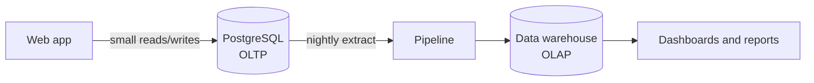
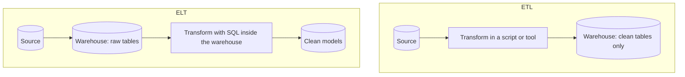
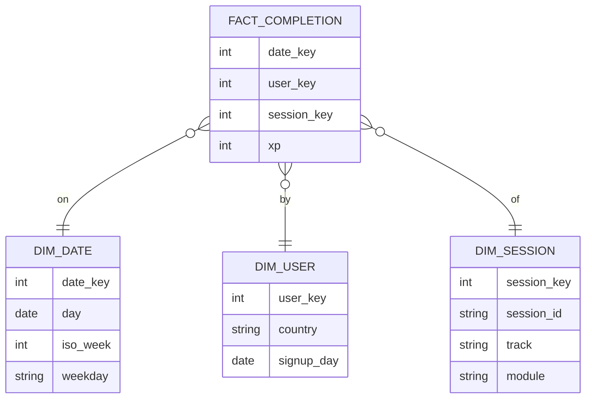

Every application you build writes data: users sign up, lessons get completed, orders get paid.
Sooner or later someone asks a different kind of question: "how many people finished a module
last month, by country?" or "which sessions do learners abandon most?". Those questions look
innocent, but if you run them against the live production database at the wrong moment, the app
slows down for everyone. This session explains why analytics needs its own shape of storage, how
data gets there, and how to build a small, honest reporting pipeline yourself.

## OLTP vs OLAP

Think of a supermarket. At the tills, hundreds of small, fast operations happen every minute:
scan an item, take a payment, print a receipt. At head office, an analyst wants to know which
products sold best in every region over the past year. Nobody would run that analysis by asking
every till to stop and add up its history. The tills are built for **many small writes**; the
analysis needs **a few huge reads**.

Databases have the same split:

- **OLTP** (Online Transaction Processing) is the till. It serves the application: insert one
  completion, update one user, read one session by id. Queries touch a handful of rows, must be
  fast (milliseconds) and must be correct under concurrency. PostgreSQL in this project is an
  OLTP database.
- **OLAP** (Online Analytical Processing) is head office. It serves analysts and dashboards:
  scan millions of rows, aggregate them, group by date and category. Queries are few, heavy and
  read-only, and a few seconds of latency is fine.

| | OLTP | OLAP |
|---|---|---|
| Typical query | Fetch or update one record by key | Aggregate over many records |
| Users | The application, end users | Analysts, BI dashboards, data scientists |
| Data freshness | Live, current state | Usually a periodic snapshot (hourly, daily) |
| Schema | Normalised, many related tables | Denormalised, star schema |
| Storage layout | Row-oriented | Usually column-oriented |
| Size | Gigabytes to a few terabytes | Often much larger, with full history |

[Designing Data-Intensive Applications](https://dataintensive.net/) describes exactly this
divergence: once companies started running heavy analytics, they moved it into a separate
database, the **data warehouse**, so the transactional system could keep doing its job.



> [!NOTE]
> "Warehouse" does not mean a specific product. It is any store optimised for analytics:
> BigQuery, Snowflake, Redshift, ClickHouse, DuckDB on a laptop, or even a separate PostgreSQL
> schema with a few summary tables.

> [!WARNING]
> Running a big `GROUP BY` over the whole completions table on your production primary at 9am is
> a classic way to cause an incident. At minimum, point analytics at a read replica; better,
> at a separate store fed by a pipeline.

## ETL vs ELT

Data has to travel from the OLTP system to the warehouse. The three steps are always the same:

- **Extract**: read data from the source (a database, an API, CSV exports, event logs).
- **Transform**: clean it, join it, rename columns, compute derived fields, aggregate.
- **Load**: write it into the destination.

The difference between ETL and ELT is *where the transform happens*.

**ETL** (Extract, Transform, Load) transforms the data on the way, in a separate processing
step, and loads only the finished result. This was the classic approach when warehouse storage
and compute were expensive: you only kept what you needed, already shaped.

**ELT** (Extract, Load, Transform) loads the raw data into the warehouse first and transforms it
there, usually with SQL. Modern cloud warehouses have cheap storage and huge compute, so it is
simpler to dump raw tables in and build clean models on top of them. If a transformation turns
out to be wrong, you rerun it from the raw copy instead of re-extracting.



> [!EXAMPLE]
> ETL: a Python job reads yesterday's completions, joins them with user countries in pandas,
> computes counts and inserts 50 summary rows into the warehouse.
>
> ELT: the job copies yesterday's raw `completions` and `users` rows into `raw.completions` and
> `raw.users`, then a SQL view `analytics.daily_completions` does the joining and counting.

Whichever you pick, a few properties make a pipeline trustworthy:

- **Idempotent runs.** Running the job twice for the same day must not double the numbers.
  Delete-then-insert for that day, or use an upsert on a `(day, ...)` key.
- **Incremental extracts.** Read only rows changed since the last run, using an `updated_at` or
  `created_at` column, instead of copying everything every night.
- **Clear time boundaries.** Decide what "a day" means (UTC? Europe/Rome?) and stick to it, or
  your daily totals will never match anyone else's.

> [!TIP]
> For a small project, ELT inside PostgreSQL is perfectly legitimate: a separate `analytics`
> schema, a nightly job, and SQL views or summary tables. You can graduate to a real warehouse
> when the data or the team outgrows it.

## Star schemas and columnar storage

### Star schemas

Your application schema is normalised: no duplicated facts, many small related tables. That is
right for writes, but analytical queries then need five joins to answer a simple question.
Warehouses usually use a **star schema** instead.

At the centre is a **fact table**: one row per event you want to measure, such as "a learner
completed a subchapter". It holds foreign keys and numeric measures (XP earned, minutes spent).
Around it sit **dimension tables**: the "who, what, where, when" you slice by, such as users,
sessions, and dates. Drawn out, the fact table is the centre of a star and the dimensions are its
points.



Dimensions are deliberately denormalised: `dim_session` stores the track and module names right
next to the session, so you never join three curriculum tables. Analysts then write the same
shape of query again and again:

```sql
SELECT d.iso_week, s.track, count(*) AS completions, sum(f.xp) AS xp
FROM fact_completion f
JOIN dim_date d    ON d.date_key = f.date_key
JOIN dim_session s ON s.session_key = f.session_key
GROUP BY d.iso_week, s.track
ORDER BY d.iso_week, s.track;
```

> [!NOTE]
> A **date dimension** looks silly at first (a table of calendar days?), but it lets you group by
> week, month, quarter, weekday or holiday without repeating date arithmetic in every query.

### Columnar storage

A normal database stores data **row by row**: all the columns of row 1 together on disk, then row
2, and so on. That is ideal for "give me user 42": one disk location, the whole record.

An analytical query, though, typically reads *three columns out of thirty* across *every row*.
With row storage, the database still has to read all thirty columns from disk. **Columnar
storage** flips the layout: all values of column A together, then all values of column B. Now
`sum(xp)` reads only the `xp` column. Values in one column are also very similar to each other
(lots of repeated countries, small integers), so they compress extremely well, which means even
less to read.

| Layout | Good at | Bad at |
|---|---|---|
| Row-oriented (PostgreSQL, MySQL) | Reading or updating whole records | Scanning a few columns over many rows |
| Column-oriented (ClickHouse, BigQuery, Redshift, DuckDB, Parquet files) | Aggregating a few columns over many rows | Updating single records frequently |

> [!WARNING]
> Columnar does not mean "faster at everything". Inserting rows one at a time into a column store
> is slow; they are designed for bulk loads. Keep your application on a row store and feed the
> column store in batches.

## Practice: build a daily report from application data

You will build a small ELT pipeline inside PostgreSQL: an `analytics` schema, a summary table
filled idempotently by a SQL statement, and a script you could schedule nightly. Use any
PostgreSQL you have; the project's `db` container works fine.

### Step 1: Create a toy source table

Open `psql` and create a stand-in for application data (skip this if you already have a
completions-like table):

```sql
CREATE TABLE IF NOT EXISTS completions (
  id            bigserial PRIMARY KEY,
  user_id       int NOT NULL,
  session_id    text NOT NULL,
  completed_at  timestamptz NOT NULL DEFAULT now()
);

INSERT INTO completions (user_id, session_id, completed_at)
SELECT (random() * 50)::int,
       '3.' || (1 + (random() * 6)::int) || '.' || (1 + (random() * 4)::int),
       now() - (random() * interval '14 days')
FROM generate_series(1, 5000);
```

### Step 2: Create the analytics schema and summary table

```sql
CREATE SCHEMA IF NOT EXISTS analytics;

CREATE TABLE IF NOT EXISTS analytics.daily_completions (
  day           date NOT NULL,
  track         text NOT NULL,
  completions   int  NOT NULL,
  active_users  int  NOT NULL,
  PRIMARY KEY (day, track)
);
```

The primary key on `(day, track)` is what makes reruns safe.

### Step 3: Write the idempotent transform

```sql
INSERT INTO analytics.daily_completions (day, track, completions, active_users)
SELECT (completed_at AT TIME ZONE 'Europe/Rome')::date AS day,
       split_part(session_id, '.', 1)                  AS track,
       count(*),
       count(DISTINCT user_id)
FROM completions
WHERE completed_at >= now() - interval '2 days'
GROUP BY 1, 2
ON CONFLICT (day, track) DO UPDATE
SET completions  = EXCLUDED.completions,
    active_users = EXCLUDED.active_users;
```

Run it twice. The numbers must not change the second time. The two-day window re-processes
yesterday as well, which catches rows that arrived late. For the first run, widen the window to
14 days to backfill.

### Step 4: Query the report

```sql
SELECT day, track, completions, active_users
FROM analytics.daily_completions
ORDER BY day DESC, track
LIMIT 20;
```

This is the query a dashboard would hit: tiny table, instant answer, no load on the source table.

### Step 5: Make it a scheduled job

Save the transform as `daily_report.sql` and run it from a shell:

```sh
psql "$DATABASE_URL" -v ON_ERROR_STOP=1 -f daily_report.sql
```

In a real project you would trigger this from a scheduler. This platform already has one:
APScheduler jobs started in the API's lifespan. A cron entry, a Celery beat task or a GitHub
Actions schedule would work just as well.

> [!EXAMPLE]
> Extension ideas: add a `dim_date` table and report by ISO week; export the summary to CSV with
> `\copy` and open it in a spreadsheet; or load the raw table into DuckDB and compare how fast the
> same `GROUP BY` runs on a columnar engine.

> [!TIP]
> Write down in a comment what "a day" means and which time zone you used. That one line saves
> hours of "why don't the numbers match?" later.

```quiz
{"questions": [
  {"question": "Why is running a large analytical GROUP BY on the production primary database risky?", "options": ["SQL cannot aggregate more than a million rows", "Heavy scans compete for CPU, memory and I/O with the small, latency-sensitive queries the app depends on", "PostgreSQL forbids GROUP BY on tables with foreign keys", "It permanently changes the data in the table"], "answer": 1, "explanation": "OLTP systems are tuned for many small queries. A long analytical scan steals resources from them, so users feel the slowdown."},
  {"question": "What is the key difference between ETL and ELT?", "options": ["ETL only works with CSV files", "ELT never transforms data", "Where the transform happens: before loading (ETL) or inside the warehouse after loading raw data (ELT)", "ETL is real-time and ELT is batch"], "answer": 2, "explanation": "Both extract, transform and load. ELT loads raw data first and transforms it in the warehouse, so you can rerun transforms from the raw copy."},
  {"question": "Your nightly job crashed halfway and you rerun it. What property prevents the report from double-counting?", "options": ["Idempotency, e.g. upserting on a (day, track) key or deleting that day before inserting", "Using a columnar database", "Running it with a bigger server", "Normalising the summary table"], "answer": 0, "explanation": "An idempotent pipeline gives the same result no matter how many times it runs for the same period."},
  {"question": "Why do column-oriented stores answer sum(xp) over 100 million rows faster than row stores?", "options": ["They keep everything in RAM", "They skip rows with NULLs", "They read only the columns the query needs, and similar values in a column compress well", "They precompute every possible sum"], "answer": 2, "explanation": "Reading one compressed column instead of every full row cuts disk I/O dramatically for analytical queries."},
  {"question": "In a star schema for learning analytics, which table should hold one row per completed subchapter?", "options": ["The date dimension", "The fact table", "The user dimension", "The session dimension"], "answer": 1, "explanation": "Facts are the measurable events; dimensions describe the who, what and when you slice them by."}
]}
```
