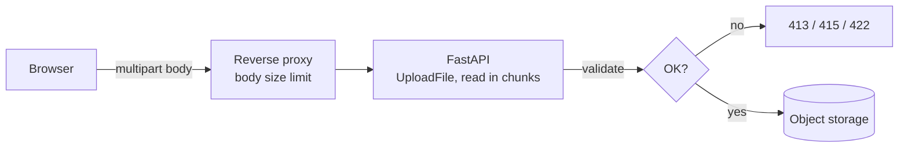
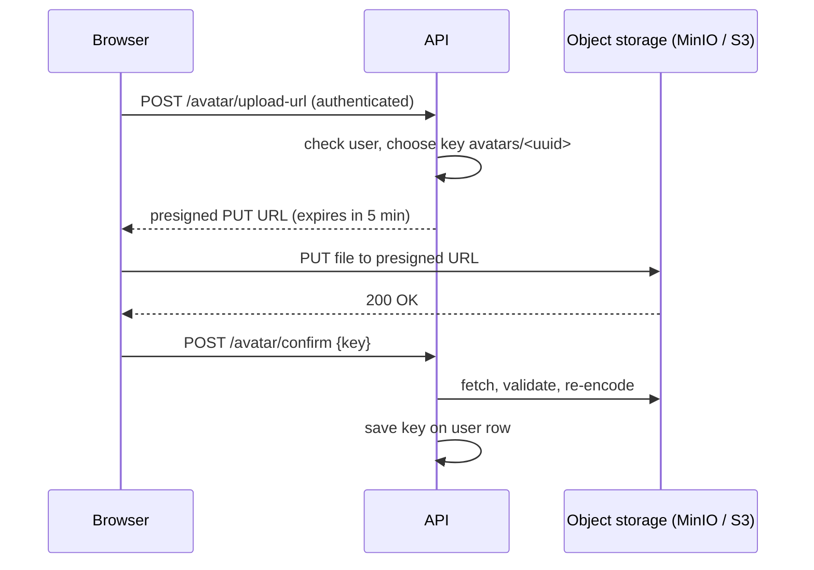

Letting users upload files sounds like a small feature: a button, a POST, save the bytes. In
reality it is one of the riskiest doors you can open in a web app. You are accepting arbitrary
data from strangers, storing it, and often serving it back to other users. This session covers
how uploads travel over HTTP, how to validate them without being fooled, and why serious apps
keep files in object storage rather than on the API server's disk.

## Multipart uploads and streaming

A normal JSON request body is one blob of text. A form with a file is different: the browser
needs to send several fields, some text, some binary, in one request. The format for that is
**`multipart/form-data`**. Picture a parcel containing several envelopes, each with its own
label: the body is split into **parts** separated by a random **boundary** string, and each part
has its own headers (`Content-Disposition` with the field name and filename, and a
`Content-Type`).

```text
POST /avatar HTTP/1.1
Content-Type: multipart/form-data; boundary=----X42

------X42
Content-Disposition: form-data; name="caption"

Me at the beach
------X42
Content-Disposition: form-data; name="file"; filename="me.png"
Content-Type: image/png

<binary PNG bytes...>
------X42--
```

In FastAPI, as the [Request Files](https://fastapi.tiangolo.com/tutorial/request-files/) tutorial
shows, you declare a parameter of type `UploadFile` (this needs the `python-multipart` package
installed). Prefer `UploadFile` over `bytes`: `bytes` loads the entire file into memory, while
`UploadFile` uses a *spooled* temporary file that stays in memory while small and moves to disk
when it grows. It also exposes `filename`, `content_type` and async `read()` / `seek()` methods.

```python
from fastapi import FastAPI, File, UploadFile

app = FastAPI()

@app.post("/avatar")
async def upload_avatar(file: UploadFile = File(...)):
    size = 0
    while chunk := await file.read(64 * 1024):   # read in 64 KB chunks
        size += len(chunk)
    return {"filename": file.filename, "size": size}
```

**Streaming** means processing the file in chunks instead of all at once. For a 2 MB avatar it
hardly matters. For a 2 GB video, reading everything into memory would crash the process, and
ten concurrent uploads would crash the server. Reading in chunks keeps memory use constant
whatever the file size, and lets you abort early (for example, as soon as the size limit is
crossed).



> [!NOTE]
> "Multipart upload" also has a second meaning in object storage: the S3 API can split one huge
> object into parts uploaded separately and then joined. Same idea (chunks), different layer.

## Validation: size, type and malware concerns

The [OWASP File Upload Cheat Sheet](https://cheatsheetseries.owasp.org/cheatsheets/File_Upload_Cheat_Sheet.html)
is the reference here. Its core message: **everything the client tells you about a file can be a
lie**. The filename, the extension and the `Content-Type` header are all just text the client
chose.

### Size

Enforce a maximum size in **several layers**: the reverse proxy (e.g. nginx
`client_max_body_size`), the application (count bytes as you stream and stop at the limit), and
the storage policy. Return `413 Content Too Large` when exceeded. Without a limit, one user can
fill your disk or exhaust memory.

### Type

- **Use an allowlist**, never a blocklist: "only `.png`, `.jpg`, `.webp`", not "anything except
  `.exe`". Attackers will always find an extension you forgot.
- **Don't trust `Content-Type`.** Check the file's actual content: most formats start with
  recognisable **magic bytes** (PNG files begin with `\x89PNG`, JPEGs with `\xFF\xD8\xFF`).
- **For images, re-encode.** Opening the image with a library such as Pillow and saving a fresh
  copy confirms it really is an image, strips metadata (including GPS location from phone photos)
  and removes anything hidden in the file.

### Names and paths

Never use the user's filename to build a path on disk. `../../app/main.py` is a valid filename
string. Generate your own name (a UUID), and if you want to show the original name, store it
separately in the database.

### Malware and serving

- **Scan** files that other users will download (documents, archives) with an antivirus engine
  such as ClamAV, ideally in a background job before the file is made available.
- **Never execute or interpret uploads.** Store them outside any directory your web server runs
  code from.
- **Serve with safe headers**: the correct `Content-Type`, `X-Content-Type-Options: nosniff`, and
  `Content-Disposition: attachment` for anything that isn't meant to be displayed inline. Serving
  user files from a separate domain also limits damage if an HTML or SVG file slips through.

> [!WARNING]
> SVG looks like an image but is XML that can contain JavaScript. If you serve an uploaded SVG
> inline from your main domain, you may have just created a stored XSS vulnerability. For
> avatars, simply don't accept SVG.

> [!WARNING]
> Archive files deserve extra suspicion: a small "zip bomb" can expand to gigabytes, and entries
> can contain `../` paths. Avoid extracting user archives unless you really need to.

## Object storage and presigned URLs

### Why not the local disk?

Saving uploads to the API container's filesystem works on your laptop and breaks in production:
containers are disposable (files vanish on redeploy), you may run several API instances (each
with a different disk), and backups and CDNs become your problem.

**Object storage** (Amazon S3 and compatible services like Cloudflare R2, Google Cloud Storage,
or [MinIO](https://min.io/docs/minio/linux/index.html) which you can run yourself) is designed for
this. Think of it as an infinitely large coat check: you hand over an object, it gets a **key**
in a **bucket** (`avatars/7f3c...webp`), and you get it back by that key. There are no real
folders and no partial edits, just put, get, delete and list, over HTTP. It is cheap, durable
and scales without you thinking about disks. Your database stores the key; the bytes live in the
bucket.

### Presigned URLs

The obvious design is browser → API → storage. But then every byte passes through your API,
which costs bandwidth and ties up workers. A **presigned URL** removes the API from the data
path. The API, which holds the storage credentials, generates a URL that grants *one specific
operation on one specific key for a limited time*, signed with its secret. The browser then
uploads or downloads directly to storage with that URL, without ever seeing the credentials.



The trade-off: the API no longer sees the bytes on the way in, so it cannot validate them during
the upload. Close that gap with a **confirm step** (or a storage event) that validates the object
after upload, keeps it in a quarantine prefix until it passes, and deletes it if it fails.
Presigned POST policies can also enforce a maximum size and content type on the storage side.

> [!TIP]
> Keep buckets **private** and serve files through short-lived presigned GET URLs or a CDN. A
> public bucket is the source of a long list of data-leak headlines.

## Practice: avatar upload with MinIO locally

You will build an avatar upload with validation and MinIO storage.

### Step 1: Start MinIO

```sh
docker run -d --name minio -p 9000:9000 -p 9001:9001 \
  -e MINIO_ROOT_USER=minioadmin -e MINIO_ROOT_PASSWORD=minioadmin \
  minio/minio server /data --console-address ":9001"
```

Open the console at `http://localhost:9001`, log in, and create a private bucket named `avatars`.

### Step 2: Install dependencies

```sh
pip install fastapi uvicorn python-multipart boto3 pillow
```

boto3 is the AWS SDK for Python; because MinIO speaks the S3 API, you just point it at
`http://localhost:9000`.

### Step 3: The upload endpoint

```python
import io, uuid
import boto3
from fastapi import FastAPI, HTTPException, UploadFile
from PIL import Image

app = FastAPI()
s3 = boto3.client("s3", endpoint_url="http://localhost:9000",
                  aws_access_key_id="minioadmin", aws_secret_access_key="minioadmin")
MAX_BYTES = 2 * 1024 * 1024
MAGIC = (b"\x89PNG", b"\xff\xd8\xff")  # PNG, JPEG

@app.post("/avatar")
async def upload_avatar(file: UploadFile):
    data = bytearray()
    while chunk := await file.read(64 * 1024):
        data += chunk
        if len(data) > MAX_BYTES:
            raise HTTPException(413, "Avatar must be at most 2 MB")
    if not data.startswith(MAGIC):
        raise HTTPException(415, "Only PNG or JPEG")
    try:
        img = Image.open(io.BytesIO(data))
        img.thumbnail((256, 256))
        out = io.BytesIO()
        img.convert("RGB").save(out, "WEBP")  # re-encode: drops metadata and hidden payloads
    except Exception:
        raise HTTPException(422, "Not a valid image")
    key = f"{uuid.uuid4()}.webp"
    s3.put_object(Bucket="avatars", Key=key, Body=out.getvalue(), ContentType="image/webp")
    return {"key": key}
```

### Step 4: Serve it with a presigned URL

```python
@app.get("/avatar/{key}")
def avatar_url(key: str):
    url = s3.generate_presigned_url("get_object", Params={"Bucket": "avatars", "Key": key},
                                    ExpiresIn=300)
    return {"url": url}
```

### Step 5: Attack your own endpoint

Try each of these with `curl -F "file=@..." localhost:8000/avatar` and check you get the right
error:

1. A 5 MB photo (expect 413).
2. A text file renamed to `cat.png` (expect 415).
3. A real PNG with its first bytes kept but the rest corrupted (expect 422).
4. A file named `../../etc/passwd.png` (the stored key must still be a UUID).

Then open the presigned URL in a browser, wait five minutes and try again: it should be refused.

> [!EXAMPLE]
> Stretch goal: switch to the direct-to-storage flow. Add `POST /avatar/upload-url` returning
> `s3.generate_presigned_url("put_object", ...)` for a key under `incoming/`, upload from the
> browser with `fetch(url, {method: "PUT", body: file})`, then a confirm endpoint that downloads,
> validates and re-encodes the object into the final key.

```quiz
{"questions": [
  {"question": "Why prefer UploadFile over a bytes parameter for uploads in FastAPI?", "options": ["bytes cannot hold binary data", "UploadFile is spooled to disk when large and can be read in chunks, so memory stays bounded", "UploadFile automatically scans for malware", "bytes only works with JSON"], "answer": 1, "explanation": "bytes loads the whole file into memory; UploadFile keeps memory use predictable and lets you stream."},
  {"question": "A client uploads evil.php with Content-Type: image/png. What should your validation rely on?", "options": ["The Content-Type header, since browsers set it", "The file extension", "An allowlist plus the actual content: magic bytes and, for images, re-encoding with an image library", "The original filename, sanitised with a regex"], "answer": 2, "explanation": "Headers, names and extensions are all client-controlled. Check the bytes themselves."},
  {"question": "What does a presigned URL let you do?", "options": ["Let the browser upload or download one specific object directly to storage for a limited time, without sharing credentials", "Make a bucket permanently public", "Encrypt a file before upload", "Skip all validation safely"], "answer": 0, "explanation": "The API signs a time-limited permission for one operation on one key; the bytes then bypass the API."},
  {"question": "Why is saving uploads to the API container's local disk a problem in production?", "options": ["Disks are too slow for images", "Python cannot write binary files", "Object storage is required by HTTP", "Containers are replaced on deploy and multiple instances don't share a disk, so files get lost or are only on one server"], "answer": 3, "explanation": "Object storage gives a shared, durable place for files that outlives any single container."},
  {"question": "Why should an avatar feature reject SVG uploads?", "options": ["SVG files are always too large", "SVG is XML that can contain scripts, risking stored XSS if served inline", "Browsers cannot display SVG", "SVG cannot be stored in S3"], "answer": 1, "explanation": "SVG is a document format, not just pixels. Raster formats re-encoded on the server are much safer."}
]}
```
