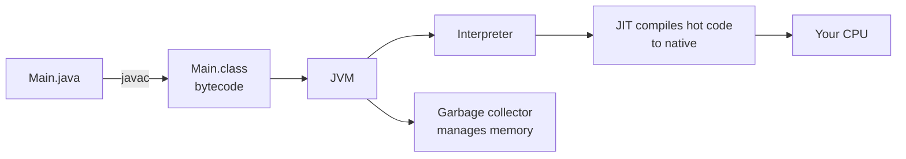
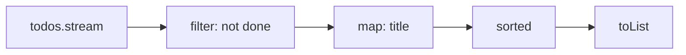

You already know one backend language well. Learning a second one is less about syntax and more
about seeing the same ideas (types, objects, errors, collections, builds) from a different angle.
Java is a great second language for a Python developer because it makes explicit many things
Python leaves implicit: every type is declared, every error path is visible, and the build is a
first-class part of the project. This session gets you writing real Java programs with the
features modern Java actually uses.

## Why Java: the JVM, static typing, a huge enterprise ecosystem

### The JVM

Python code is run by an interpreter. Java takes a two-step route. The compiler `javac` turns
your `.java` source into **bytecode** (`.class` files), a compact instruction set for an
imaginary machine: the **Java Virtual Machine (JVM)**. The JVM then runs that bytecode on your
real machine, and its **JIT (just-in-time) compiler** watches which code runs most and compiles
those "hot" parts into fast native machine code while the program runs.

The analogy: bytecode is a recipe written in a universal kitchen language, and every kitchen
(Linux, macOS, Windows, ARM, x86) has a JVM chef who can follow it. "Write once, run anywhere"
was Java's original promise, and it still holds.



### Static typing

In Python, `x = 3` and later `x = "three"` is fine. In Java, every variable has a type fixed at
compile time: `int x = 3;` and assigning a string to `x` is a compile error. You already met this
idea with Python type hints and mypy, but in Java the compiler *enforces* it and you cannot run
the program until it type-checks. That catches a whole class of bugs before your code ever runs,
and gives IDEs perfect information for autocomplete and refactoring. Since Java 10, `var` lets the
compiler infer a local variable's type (`var names = new ArrayList<String>();`), so it is less
verbose than its reputation, while staying fully static.

### The ecosystem

Java runs a huge share of enterprise backends: banks, insurers, airlines, e-commerce, Android's
heritage, big-data tools like Kafka and Hadoop. That means jobs, decades of battle-tested
libraries, excellent tooling (IntelliJ IDEA, profilers, debuggers), and frameworks like Spring
Boot (next session). [Dev.java](https://dev.java/learn/) is the official modern learning path,
and the [Java SE docs](https://docs.oracle.com/en/java/javase/) hold the API reference for each
release.

> [!NOTE]
> Java ships a new version every six months, with a **long-term support (LTS)** release
> periodically. Companies tend to standardise on LTS versions. Use a recent LTS (21 or newer) for
> this course so you get records, pattern matching and virtual threads. The classic
> [Java Tutorials](https://docs.oracle.com/javase/tutorial/) are still useful for fundamentals,
> but they were written for older versions and miss modern features.

## Classes, records and interfaces

Everything in Java lives inside a **class**. A class bundles **fields** (data) and **methods**
(behaviour), and **access modifiers** (`private`, `public`, `protected`, package-private) control
who can see what.

```java
public class Account {
    private final String owner;   // final: can't be reassigned after construction
    private long balanceCents;

    public Account(String owner) {   // constructor
        this.owner = owner;
    }

    public void deposit(long cents) {
        if (cents <= 0) throw new IllegalArgumentException("amount must be positive");
        balanceCents += cents;
    }

    public long balanceCents() { return balanceCents; }
}
```

Compared to Python: `this` is `self` (implicit in method signatures), fields are declared up
front with types, and `private` is enforced by the compiler, not just a naming convention.

### Records

Many classes are just data carriers: a point, a DTO, an API response. Writing constructor,
getters, `equals`, `hashCode` and `toString` by hand was the classic Java boilerplate. A
**record** (Java 16+) generates all of that from one line, and its fields are final, so it is
immutable. It is the closest thing to a frozen Python dataclass:

```java
public record Todo(long id, String title, boolean done) {
    public Todo {                       // compact constructor for validation
        if (title.isBlank()) throw new IllegalArgumentException("title required");
    }
}

var t = new Todo(1, "Learn Java", false);
System.out.println(t.title());          // accessor, not getTitle()
System.out.println(t);                  // Todo[id=1, title=Learn Java, done=false]
```

### Interfaces

An **interface** is a contract: a list of methods a class promises to provide, with no state.
It is like a Python `Protocol` or abstract base class, but checked by the compiler. Code that
depends on the interface works with any implementation, which is the foundation of testability
and of Spring's dependency injection.

```java
public interface TodoRepository {
    Todo save(Todo todo);
    java.util.Optional<Todo> findById(long id);
}

public class InMemoryTodoRepository implements TodoRepository {
    private final java.util.Map<Long, Todo> store = new java.util.HashMap<>();
    public Todo save(Todo todo) { store.put(todo.id(), todo); return todo; }
    public java.util.Optional<Todo> findById(long id) { return java.util.Optional.ofNullable(store.get(id)); }
}
```

> [!TIP]
> Prefer composition and interfaces over deep inheritance chains. A class can implement many
> interfaces but extend only one class, and shallow hierarchies are easier to change.

## Generics and the Collections framework

A **generic** type is a type with a parameter: `List<String>` is "a list of strings",
`Map<Long, Todo>` is "a map from long ids to todos". The compiler then guarantees you can't put
an integer in a `List<String>`, and you don't need casts when reading. Python's `list[str]` hints
express the same idea, but here the compiler enforces it.

The **Collections framework** is Java's standard library of data structures, built around
interfaces with several implementations:

| Interface | Python equivalent | Common implementations |
|---|---|---|
| `List<E>` | `list` | `ArrayList` (default), `LinkedList` |
| `Set<E>` | `set` | `HashSet`, `LinkedHashSet` (keeps insertion order), `TreeSet` (sorted) |
| `Map<K, V>` | `dict` | `HashMap`, `LinkedHashMap`, `TreeMap` (sorted keys) |
| `Deque<E>` | `collections.deque` | `ArrayDeque` |

```java
List<String> tags = new ArrayList<>(List.of("java", "backend"));
tags.add("jvm");
Map<String, Integer> counts = new HashMap<>();
for (String tag : tags) {
    counts.merge(tag, 1, Integer::sum);   // like counts[tag] = counts.get(tag, 0) + 1
}
```

> [!WARNING]
> `List.of(...)` and `Map.of(...)` return **immutable** collections: calling `add` throws
> `UnsupportedOperationException` at runtime. Wrap them in `new ArrayList<>(...)` when you need
> to modify them.

> [!NOTE]
> Generics only work with object types, so you write `List<Integer>`, not `List<int>`. Java
> converts between `int` and `Integer` automatically (**autoboxing**). Beware: an `Integer` can
> be `null`, and unboxing a `null` throws a `NullPointerException`.

## Exceptions, streams and lambdas

### Exceptions

Java exceptions work like Python's (`try` / `catch` / `finally`, `throw` instead of `raise`), with
one twist: **checked exceptions**. Subclasses of `Exception` (but not `RuntimeException`) must be
either caught or declared in the method signature with `throws`. The compiler forces you to
acknowledge things like `IOException`.

```java
import java.nio.file.*;
import java.io.IOException;

static List<String> readLines(Path path) throws IOException {   // caller must handle it
    return Files.readAllLines(path);
}

try (var reader = Files.newBufferedReader(Path.of("todos.csv"))) {  // try-with-resources = Python's with
    System.out.println(reader.readLine());
} catch (IOException e) {
    System.err.println("Cannot read file: " + e.getMessage());
}
```

**Unchecked** exceptions (`RuntimeException` and subclasses such as
`IllegalArgumentException`, `NullPointerException`) don't need declaring and usually signal
programming errors.

### Lambdas and streams

A **lambda** is a short anonymous function: `x -> x * 2`, like Python's `lambda x: x * 2`. A
**method reference** such as `String::toUpperCase` is a shorthand for a lambda that just calls one
method.

**Streams** let you process collections as a pipeline of steps, much like a chain of Python
comprehensions, `map` and `filter`:

```java
List<Todo> todos = List.of(new Todo(1, "Learn Java", false),
                           new Todo(2, "Learn Maven", true),
                           new Todo(3, "Learn streams", false));

List<String> open = todos.stream()
    .filter(t -> !t.done())
    .map(Todo::title)
    .sorted()
    .toList();          // [Learn Java, Learn streams]
```



Streams are **lazy**: nothing runs until a terminal operation like `toList()`, `count()` or
`collect(...)`.

> [!TIP]
> Use streams for clear transformations, and a plain `for` loop when the logic has early exits,
> several side effects or complex error handling. Readability beats cleverness.

## Build tools: Maven or Gradle

In Python you have `pip`, `pyproject.toml` and maybe `uv`. Java projects use a **build tool** that
handles dependencies, compilation, tests and packaging in one place, with a standard folder
layout: `src/main/java` for code, `src/test/java` for tests.

- **Maven** uses a declarative XML file, `pom.xml`. It is very conventional: the same lifecycle
  everywhere (`mvn compile`, `mvn test`, `mvn package`). Verbose, but predictable.
- **Gradle** uses a script (`build.gradle.kts` in Kotlin, or Groovy). It is more flexible and
  often faster thanks to incremental builds and caching, at the cost of more ways to do things.

Both download libraries from **Maven Central**, identified by coordinates
`groupId:artifactId:version`. Both produce a **JAR** (Java ARchive), a zip of your compiled
classes you run with `java -jar app.jar`.

```xml
<!-- pom.xml (excerpt) -->
<dependencies>
  <dependency>
    <groupId>org.junit.jupiter</groupId>
    <artifactId>junit-jupiter</artifactId>
    <version>5.11.0</version>
    <scope>test</scope>
  </dependency>
</dependencies>
```

> [!TIP]
> Commit the **wrapper** scripts (`mvnw` or `gradlew`). They download the exact tool version the
> project needs, so teammates and CI don't need it installed globally.

## Practice: a CLI tool in Java

Build `todo`, a small command-line to-do manager that stores tasks in a CSV file.

### Step 1: Set up

Install a recent JDK (for example via SDKMAN! or your package manager) and check with
`java -version`. Then generate a Maven project:

```sh
mvn archetype:generate -DgroupId=dev.ycdi -DartifactId=todo \
  -DarchetypeArtifactId=maven-archetype-quickstart -DinteractiveMode=false
cd todo
```

Set the Java version in `pom.xml` with `<maven.compiler.release>21</maven.compiler.release>`
in `<properties>`.

### Step 2: The model

Create the `Todo` record from this lesson in `src/main/java/dev/ycdi/Todo.java`, with
`toCsv()` and a static `fromCsv(String line)` method.

### Step 3: The repository

Write a `TodoRepository` interface and a `CsvTodoRepository` that loads all lines from
`todos.csv` with `Files.readAllLines`, and saves with `Files.write`. Let `IOException` propagate
from the repository; handle it once in `main`.

### Step 4: The commands

In `App.java`, read `args` and dispatch with a `switch`:

```java
switch (args.length == 0 ? "list" : args[0]) {
    case "add"  -> repo.add(String.join(" ", Arrays.copyOfRange(args, 1, args.length)));
    case "done" -> repo.markDone(Long.parseLong(args[1]));
    case "list" -> repo.findAll().stream()
                       .map(t -> (t.done() ? "[x] " : "[ ] ") + t.id() + " " + t.title())
                       .forEach(System.out::println);
    default -> System.err.println("usage: todo add <title> | done <id> | list");
}
```

Catch `NumberFormatException` for a bad id and print a friendly message instead of a stack trace.

### Step 5: Test and package

Add JUnit 5 and write tests for `Todo.fromCsv` (including a blank title throwing
`IllegalArgumentException`). Run `mvn test`, then `mvn package` and try:

```sh
java -cp target/todo-1.0-SNAPSHOT.jar dev.ycdi.App add Learn records
java -cp target/todo-1.0-SNAPSHOT.jar dev.ycdi.App list
```

> [!EXAMPLE]
> Stretch goal: add a `stats` command that uses a stream with
> `Collectors.partitioningBy(Todo::done, Collectors.counting())` to print how many tasks are open
> and done.

```quiz
{"questions": [
  {"question": "What does the JIT compiler in the JVM do?", "options": ["Converts Java source into bytecode before running", "Compiles frequently executed bytecode into native machine code while the program runs", "Checks types at compile time", "Downloads dependencies from Maven Central"], "answer": 1, "explanation": "javac produces bytecode ahead of time; the JIT optimises hot paths into native code at runtime."},
  {"question": "When is a record a better choice than a regular class?", "options": ["When the type is an immutable data carrier whose identity is its values", "When you need a mutable object with complex lifecycle", "When you need to extend another class", "Never; records are only for tests"], "answer": 0, "explanation": "Records generate constructor, accessors, equals, hashCode and toString for immutable data. They cannot extend other classes."},
  {"question": "A method calls Files.readAllLines, which throws IOException. What does the compiler require?", "options": ["Nothing; all exceptions are optional in Java", "The method must be static", "The exception must be caught or declared with throws in the method signature", "IOException must be converted to an error code"], "answer": 2, "explanation": "IOException is a checked exception, so callers must handle or declare it."},
  {"question": "Why does this fail at runtime: var list = List.of(\"a\"); list.add(\"b\");", "options": ["var cannot infer List types", "Strings cannot be added to lists", "add is only available on LinkedList", "List.of returns an immutable list, so add throws UnsupportedOperationException"], "answer": 3, "explanation": "Factory methods like List.of create unmodifiable collections. Copy into a new ArrayList to modify."},
  {"question": "Why should code depend on a TodoRepository interface rather than CsvTodoRepository directly?", "options": ["Interfaces run faster", "Any implementation (in-memory for tests, database in production) can be swapped in without changing the calling code", "Java requires every class to have an interface", "Interfaces store data more efficiently"], "answer": 1, "explanation": "Programming to an interface decouples callers from implementations, which enables testing and dependency injection."}
]}
```
