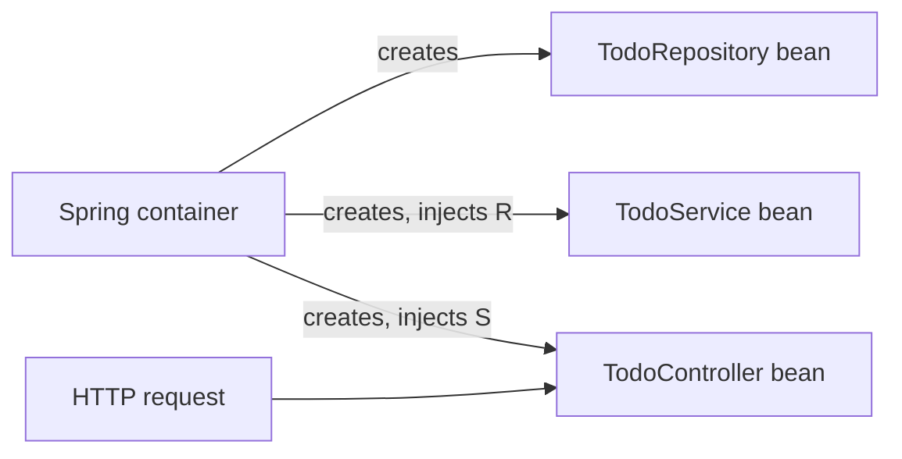
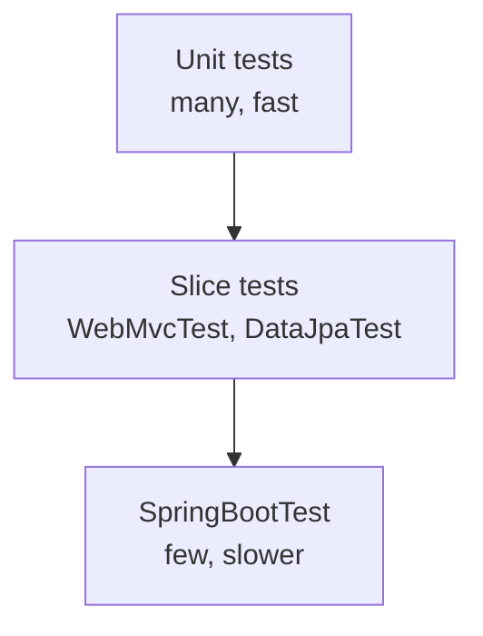

If FastAPI is a lean, modern workshop, Spring Boot is a fully equipped factory. It is the most
widely used framework for Java backends, and a huge number of enterprise job descriptions mention
it. The good news: you already know the concepts. Routes, request bodies, validation, dependency
injection, an ORM, tests: everything from the FastAPI and SQLAlchemy sessions has a direct Spring
equivalent. This session maps what you know onto Spring Boot and ends with you rewriting one
endpoint of the to-do API as a small Spring service.

## Spring Boot basics: starters, dependency injection, configuration

**Spring** is a large framework for building Java applications. **Spring Boot** sits on top of it
and makes it opinionated: sensible defaults, auto-configuration, and an embedded web server, so
`java -jar app.jar` starts a complete web service. The [Spring Boot docs](https://docs.spring.io/spring-boot/index.html)
and the task-focused [Spring guides](https://spring.io/guides) are the best starting points.

### Starters

A **starter** is a dependency that bundles everything for one capability.
`spring-boot-starter-web` brings Spring MVC, Jackson for JSON and an embedded Tomcat server;
`spring-boot-starter-data-jpa` brings Hibernate and Spring Data; `spring-boot-starter-test`
brings JUnit 5, AssertJ and Mockito. Boot's **auto-configuration** then looks at what is on the
classpath and wires sensible beans for you: add the PostgreSQL driver and a URL, and you have a
configured connection pool.

### Dependency injection

Spring's core is an **IoC (inversion of control) container**. Instead of your classes creating
their own dependencies with `new`, the container creates objects called **beans** and hands each
one the dependencies it needs. It is the same idea as FastAPI's `Depends`, applied to the whole
application.

Classes become beans when annotated with `@Component` or a specialisation (`@Service`,
`@Repository`, `@RestController`). The recommended style is **constructor injection**: declare
what you need as constructor parameters, and Spring passes it in.

```java
@Service
public class TodoService {
    private final TodoRepository repo;

    public TodoService(TodoRepository repo) {   // Spring injects the repository bean
        this.repo = repo;
    }

    public List<Todo> open() { return repo.findByDoneFalse(); }
}
```



> [!TIP]
> Constructor injection with `final` fields makes dependencies explicit and lets you build the
> class in a plain unit test with `new TodoService(fakeRepo)`, no Spring needed. Avoid field
> injection (`@Autowired` on a private field).

### Configuration

Settings live in `src/main/resources/application.properties` (or `application.yml`), and every
key can be overridden by an environment variable, which keeps you twelve-factor friendly:
`spring.datasource.url` becomes `SPRING_DATASOURCE_URL`. **Profiles** (`application-dev.yml`,
activated with `spring.profiles.active=dev`) group settings per environment.

```properties
server.port=8080
spring.datasource.url=jdbc:postgresql://localhost:5432/todos
spring.datasource.username=todos
spring.datasource.password=${DB_PASSWORD}
```

> [!NOTE]
> The quickest start is start.spring.io (Spring Initializr): pick
> Maven or Gradle, a Java version and the starters, and download a ready project.

## REST controllers and JSON

A **controller** maps HTTP requests to Java methods, exactly like FastAPI path operations.
`@RestController` says "the return values are the response body", serialised to JSON by Jackson.

```java
@RestController
@RequestMapping("/todos")
public class TodoController {
    private final TodoService service;

    public TodoController(TodoService service) { this.service = service; }

    @GetMapping
    public List<TodoDto> list(@RequestParam(defaultValue = "false") boolean openOnly) {
        return service.list(openOnly);
    }

    @GetMapping("/{id}")
    public TodoDto get(@PathVariable long id) {
        return service.get(id);   // throws TodoNotFound if missing
    }

    @PostMapping
    public ResponseEntity<TodoDto> create(@Valid @RequestBody CreateTodo body) {
        TodoDto created = service.create(body);
        return ResponseEntity.created(URI.create("/todos/" + created.id())).body(created);
    }
}

public record CreateTodo(@NotBlank @Size(max = 200) String title) {}
public record TodoDto(long id, String title, boolean done) {}
```

The mapping from FastAPI is almost one to one:

| FastAPI | Spring Boot |
|---|---|
| `@app.get("/todos/{id}")` | `@GetMapping("/todos/{id}")` |
| path parameter `id: int` | `@PathVariable long id` |
| query parameter | `@RequestParam` |
| Pydantic body model | `@RequestBody` record + `@Valid` with Bean Validation annotations |
| `status_code=201` / `Response` | `ResponseEntity` |
| `HTTPException(404)` | custom exception + `@ExceptionHandler` / `@RestControllerAdvice` |

Errors are handled centrally with a **controller advice**. Spring supports the standard
`ProblemDetail` type (RFC 9457 "problem details"), so your error format is consistent:

```java
@RestControllerAdvice
class ApiErrors {
    @ExceptionHandler(TodoNotFound.class)
    ProblemDetail notFound(TodoNotFound e) {
        return ProblemDetail.forStatusAndDetail(HttpStatus.NOT_FOUND, e.getMessage());
    }
}
```

> [!TIP]
> Keep request and response **DTOs** (records) separate from database entities, just as you kept
> Pydantic schemas separate from SQLAlchemy models. Returning entities directly leaks internal
> fields and couples your API to your schema.

## Data access with Spring Data JPA

**JPA** (Jakarta Persistence API) is Java's standard ORM specification; **Hibernate** is the most
common implementation. If SQLAlchemy's ORM made sense to you, JPA will too: classes map to
tables, a persistence context tracks changes (the unit of work), and lazy relationships can cause
N+1 queries.

```java
@Entity
@Table(name = "todos")
public class Todo {
    @Id @GeneratedValue(strategy = GenerationType.IDENTITY)
    private Long id;
    @Column(nullable = false, length = 200)
    private String title;
    private boolean done;

    protected Todo() {}                          // JPA needs a no-arg constructor
    public Todo(String title) { this.title = title; }
    // getters, and a markDone() method
}
```

> [!WARNING]
> JPA entities cannot be records: Hibernate needs a no-argument constructor and mutable state to
> track changes. Use classes for entities and records for DTOs.

**Spring Data** removes the repository boilerplate. You declare an interface, and Spring
generates the implementation at startup, including queries **derived from method names**:

```java
public interface TodoRepository extends JpaRepository<Todo, Long> {
    List<Todo> findByDoneFalse();                       // WHERE done = false
    List<Todo> findByTitleContainingIgnoreCase(String q);
}
```

`JpaRepository` already gives you `save`, `findById`, `findAll`, `deleteById`, paging and
sorting. For anything complex, write the query explicitly with `@Query`.

Mark service methods that change data with `@Transactional`: everything inside commits together
or rolls back together, and changes to loaded entities are flushed automatically at the end.

> [!WARNING]
> Never use `spring.jpa.hibernate.ddl-auto=update` in production. Manage the schema with a
> migration tool (Flyway or Liquibase, the Java counterparts of Alembic), exactly as you learned
> in the migrations session.

## Testing with JUnit 5 and Spring Boot Test

[JUnit 5](https://junit.org/junit5/docs/current/user-guide/) is Java's standard test framework:
methods annotated with `@Test`, assertions, `@BeforeEach` setup, parameterised tests. AssertJ
(`assertThat(x).isEqualTo(y)`) gives readable assertions.

Spring Boot Test adds **test slices**, which start only the part of the application you need,
much like overriding dependencies in FastAPI tests:

- **Plain unit tests**: `new TodoService(fakeRepo)`; no Spring, milliseconds.
- **`@WebMvcTest(TodoController.class)`**: only the web layer; you call endpoints with
  **MockMvc** and replace the service with a Mockito mock.
- **`@DataJpaTest`**: only JPA and repositories, against a test database.
- **`@SpringBootTest`**: the whole application context, for end-to-end integration tests.

```java
@WebMvcTest(TodoController.class)
class TodoControllerTest {
    @Autowired MockMvc mvc;
    @MockitoBean TodoService service;   // older Boot versions use @MockBean

    @Test
    void returns404ForUnknownTodo() throws Exception {
        when(service.get(99)).thenThrow(new TodoNotFound(99));
        mvc.perform(get("/todos/99"))
           .andExpect(status().isNotFound());
    }
}
```



> [!TIP]
> For repository tests, prefer a real PostgreSQL in a container (Testcontainers) over an
> in-memory database. H2 speaks a slightly different SQL, and bugs hide in the differences.

## Concurrency basics: threads, executors and virtual threads

Python's asyncio runs many tasks on one thread with `await`. Classic Java does the opposite: a
web server like Tomcat handles **each request on its own thread** from a pool. Code is simple and
blocking (call the database, wait, continue), and many threads run truly in parallel on several
CPU cores (no GIL).

The limit is cost: traditional **platform threads** map one to one onto operating system threads,
which are heavy (memory for each stack, expensive switching). A pool of a few hundred threads
caps how many slow requests you can serve at once.

**Executors** manage pools of threads for you, so you submit tasks instead of creating threads:

```java
try (ExecutorService pool = Executors.newFixedThreadPool(4)) {
    Future<Integer> f = pool.submit(() -> expensiveComputation());
    System.out.println(f.get());    // waits for the result
}
```

**Virtual threads** (final in Java 21) are lightweight threads managed by the JVM. When a virtual
thread blocks on I/O, the JVM parks it and reuses the underlying OS thread for another one. You
can have millions of them, while still writing plain blocking code: the scalability of async
without the colouring of `async`/`await`.

```java
try (var executor = Executors.newVirtualThreadPerTaskExecutor()) {
    for (int i = 0; i < 10_000; i++) {
        executor.submit(() -> callSlowService());   // each task gets its own virtual thread
    }
}
```

In recent Spring Boot versions you can serve requests on virtual threads with one setting,
`spring.threads.virtual.enabled=true`.

> [!WARNING]
> Threads share memory. Two requests updating the same `HashMap` field in a singleton bean can
> corrupt it. Keep beans stateless, use concurrent collections (`ConcurrentHashMap`) when you must
> share state, and let the database handle concurrency with transactions.

## Practice: rewrite one API endpoint as a Spring Boot microservice

Rewrite the to-do API's "list and create todos" endpoints as a standalone Spring Boot service.

### Step 1: Generate the project

On start.spring.io choose Maven, Java 21, and the dependencies
**Spring Web**, **Spring Data JPA**, **Validation**, **PostgreSQL Driver** and **Flyway
Migration**. Unzip and open it in your IDE.

### Step 2: Database and migration

Start PostgreSQL in Docker, configure `spring.datasource.*` in `application.properties`, and add
`src/main/resources/db/migration/V1__todos.sql`:

```sql
CREATE TABLE todos (
  id     bigserial PRIMARY KEY,
  title  varchar(200) NOT NULL,
  done   boolean NOT NULL DEFAULT false
);
```

### Step 3: Layers

Create the `Todo` entity, `TodoRepository`, `TodoService` (with `@Transactional` on `create`),
the `CreateTodo` and `TodoDto` records, and `TodoController` with `GET /todos` and
`POST /todos`, following this lesson's code.

### Step 4: Run and compare

```sh
./mvnw spring-boot:run
curl -s -X POST localhost:8080/todos -H 'Content-Type: application/json' -d '{"title":"Ship it"}'
curl -s localhost:8080/todos
curl -s -X POST localhost:8080/todos -H 'Content-Type: application/json' -d '{"title":""}'
```

The last call should return `400` because of `@NotBlank`. Compare JSON shapes and status codes
with your FastAPI version; they should match so a client could switch between them.

### Step 5: Tests

Write a `@WebMvcTest` for the 400 and 404 cases, and a unit test for `TodoService` with a fake
repository. Run `./mvnw test`.

### Step 6: Virtual threads

Add `spring.threads.virtual.enabled=true`, restart, and log `Thread.currentThread()` in a handler
to see `VirtualThread` in the output.

> [!EXAMPLE]
> Stretch goal: put the Spring service behind the same reverse proxy as the FastAPI app and route
> only `/todos` to it. That is the "strangler fig" pattern for migrating one endpoint at a time.

```quiz
{"questions": [
  {"question": "What does a Spring Boot starter such as spring-boot-starter-web provide?", "options": ["A code generator for controllers", "A curated bundle of dependencies for one capability, which auto-configuration then wires up", "A cloud deployment service", "A replacement for the JVM"], "answer": 1, "explanation": "Starters bundle libraries (Spring MVC, Jackson, Tomcat); auto-configuration creates sensible beans from what is on the classpath."},
  {"question": "Why is constructor injection preferred over @Autowired on private fields?", "options": ["Dependencies are explicit and final, and the class can be built in a plain unit test without Spring", "It makes the application start faster in production", "Field injection is not supported by Spring", "Constructor injection avoids the need for interfaces"], "answer": 0, "explanation": "Explicit constructor dependencies are easy to see and to replace with fakes in tests."},
  {"question": "Why can't a JPA entity be a Java record?", "options": ["Records cannot have an id field", "Records cannot be serialised to JSON", "Hibernate needs a no-arg constructor and mutable state to track changes, and records are immutable", "Records are only available in Kotlin"], "answer": 2, "explanation": "Use classes for entities and records for DTOs."},
  {"question": "You want to test only that GET /todos/99 returns 404 when the service throws TodoNotFound. Which test style fits best?", "options": ["@SpringBootTest with a real database", "@DataJpaTest", "A manual curl script", "@WebMvcTest with MockMvc and a mocked service"], "answer": 3, "explanation": "A web slice test loads only the MVC layer and lets you mock the service, so it is fast and focused."},
  {"question": "What is the main benefit of virtual threads for a blocking web service?", "options": ["They make CPU-heavy code run faster", "Blocking I/O no longer ties up an OS thread, so many more concurrent requests can be served with simple blocking code", "They remove the need for transactions", "They make shared mutable state thread-safe"], "answer": 1, "explanation": "The JVM parks a blocked virtual thread and reuses the carrier OS thread, giving async-like scalability without async/await."}
]}
```
