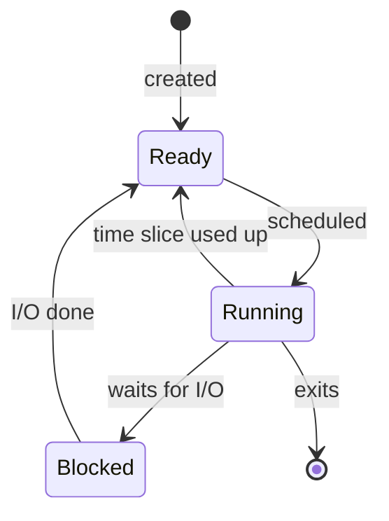
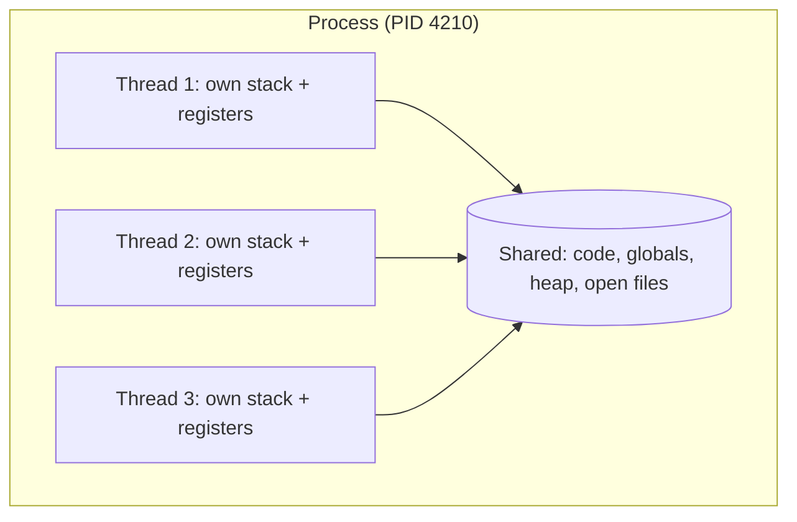
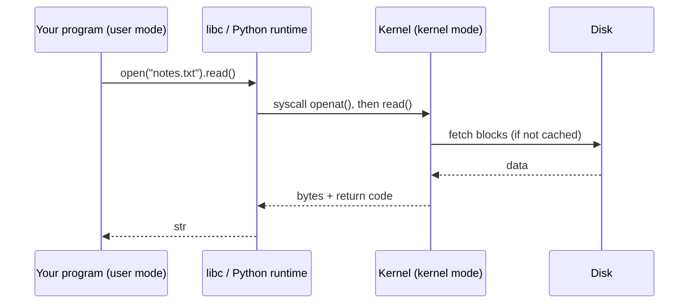

Every program you have written so far ran "on the computer". This session opens that box. The
**operating system** (OS) is the piece of software that lets dozens of programs share one CPU, one
pool of memory and one disk without trampling each other. Understanding how it does that explains
things you will meet daily as a backend developer: why a server "has 400 processes", why threads
can corrupt each other's data, why a busy machine feels slow, and what a "syscall" in a stack
trace means. Our guide is the free book [OSTEP](https://pages.cs.wisc.edu/~remzi/OSTEP/)
(*Operating Systems: Three Easy Pieces*), whose first "piece" is exactly this topic:
virtualising the CPU.

## The process abstraction

A **program** is a recipe: a file on disk full of instructions. A **process** is a cook actually
following that recipe in a kitchen: it has a current step, ingredients on the counter and pans on
the stove. The same recipe can be cooked by several cooks at once, and the same program can run as
several processes at once (open three terminal windows and you have three `zsh` processes).

Precisely, a process is *a running program plus its state*. The OS keeps track of:

- **An address space**: the memory the process can see (its code, global data, heap and stack).
- **Registers**, including the **program counter** (which instruction runs next) and the **stack
  pointer**.
- **Open resources**: file descriptors (open files, sockets, pipes), the current directory,
  environment variables.
- **Identity**: a **PID** (process ID), its parent's PID, and the user it runs as.

The OS stores this in a per-process structure (Linux calls it `task_struct`; textbooks call it the
**process control block**).

A process moves through a few **states**:



**Ready** means "could run, waiting for a CPU". **Running** means "on a CPU right now".
**Blocked** means "waiting for something slow", like a disk read or a network packet, and
therefore not worth giving a CPU to.

On Unix-like systems, new processes are born with two calls: `fork()` creates a near-identical
copy of the current process, and `exec()` replaces the copy's program with a new one. Your shell
does exactly this every time you type `ls`: it forks itself, and the child execs `/bin/ls`. The
key promise of the abstraction is **isolation**: each process believes it has the machine to
itself, and a crash in one does not corrupt another's memory.

> [!NOTE]
> **Program** = file on disk. **Process** = program in execution, with its own memory and
> resources, identified by a PID.

## Threads and shared memory

If a process is a kitchen with one cook, a **thread** is an extra cook in the *same* kitchen. All
cooks share the counter, the fridge and the pans (the address space and open files), but each has
their own place in the recipe and their own hands (a separate program counter, registers and
**stack**).



Why bother? Two reasons:

1. **Parallelism**: on a multi-core CPU, threads of one process can truly run at the same moment.
2. **Overlapping waits**: while one thread waits for the database, another can serve a different
   request.

Threads are cheaper to create than processes and communicate by just reading and writing the same
variables. That is also their great danger: if two threads update the same counter at the same
time, updates can be lost. That class of bug, the **race condition**, gets a whole session later
(4.3.1). For now, remember the trade-off:

| | Processes | Threads |
|---|---|---|
| Memory | Separate (isolated) | Shared |
| Cost to create | Higher | Lower |
| Communication | Pipes, sockets, files | Shared variables |
| A crash affects | Only that process | The whole process |
| Main risk | Overhead | Data races |

> [!EXAMPLE]
> Gunicorn or Uvicorn with `--workers 4` starts four **processes**, each running your FastAPI
> app. A database driver's connection pool, or Python's `ThreadPoolExecutor`, uses **threads**
> inside one process. Many production servers combine both.

## CPU scheduling basics

A laptop may have 8 cores and 500 processes. The **scheduler** is the part of the OS kernel that
decides which ready thread runs on which core, and for how long. It works like a teacher handing a
single microphone around a classroom: each speaker gets a short turn, then the microphone moves on,
so everyone feels heard.

Each turn is a **time slice** (a few milliseconds). When it runs out, a hardware **timer
interrupt** hands control back to the kernel, which may pick someone else. Switching from one
thread to another is a **context switch**: the kernel saves the current thread's registers and
program counter, loads the next thread's, and (when switching between processes) switches the
memory mapping too. A context switch costs microseconds, which is fast, but not free: thousands of
them per second also mean cold CPU caches.

OSTEP walks through the classic policies, each fixing a weakness of the previous one:

- **FIFO**: run jobs in arrival order. Simple, but one long job makes everyone wait.
- **Shortest Job First**: great average time, but you rarely know job length in advance.
- **Round Robin**: give everyone a time slice in turn. Fair and responsive.
- **Multi-Level Feedback Queue (MLFQ)**: learn from behaviour. Jobs that often block for I/O
  (interactive ones) keep high priority; CPU hogs drift down.

Linux's default scheduler aims for *fairness*: each runnable thread gets a fair share of CPU time,
weighted by its **nice** value (from -20, most favoured, to 19, least).

> [!TIP]
> The **load average** shown by `uptime` and `htop` is roughly "how many threads were running or
> waiting to run" averaged over 1, 5 and 15 minutes. Compare it with your core count: a load of 8
> on an 8-core box is busy but fine; a load of 30 means work is queuing.

> [!WARNING]
> More threads is not more speed. Once every core is busy, extra CPU-bound threads only add
> context switches. Threads help most when work *waits* (I/O), not when it computes.

## System calls and the kernel boundary

The CPU runs code in (at least) two privilege levels. **User mode** is where your programs live:
they cannot touch hardware directly or read another process's memory. **Kernel mode** is where the
OS lives, with full access. This boundary is what makes isolation enforceable rather than polite.

So how does your Python script read a file? It asks the kernel through a **system call**
(syscall): a controlled doorway, like a bank counter where you hand a form through a window
rather than walking into the vault. The process puts a syscall number and arguments in registers
and executes a special trap instruction; the CPU switches to kernel mode, the kernel checks the
request, does the work, and returns to user mode with a result.



Common syscalls include `openat`, `read`, `write`, `close`, `mmap`, `clone` (creates threads and
processes on Linux), `execve`, `socket`, `accept` and `exit_group`. High-level calls like
Python's `print()` end up as one or more `write()` syscalls on file descriptor 1.

> [!NOTE]
> A syscall is much slower than an ordinary function call because of the mode switch and checks.
> This is why I/O libraries **buffer**: collect many small writes in memory and issue one big
> `write()`. You will see this again in 4.1.3.

> [!TIP]
> On Linux, `strace -f -e trace=openat,read,write python app.py` prints every matching syscall a
> program makes. It is one of the best tools for "why is this program hanging?" questions: if it
> is stuck in `read()` on a socket, it is waiting for the network, not computing.

## Practice: observe processes and threads with ps and htop

Use a Linux machine or VM if you can; macOS works for most steps (`ps` flags differ slightly, and
`strace` is Linux-only). Install `htop` with your package manager if it is missing.

### Step 1: List processes

```sh
ps aux | head -15          # every process: user, PID, %CPU, %MEM, command
ps -ef --forest | less     # Linux: parent/child tree (q to quit)
echo $$                    # PID of your current shell
```

Find your shell's PID in the tree and note its parent. Who started your shell?

### Step 2: Start a multi-threaded Python program

Save this as `threads.py`:

```python
import os
import threading
import time

def burn(seconds: int) -> None:
    end = time.time() + seconds
    while time.time() < end:
        pass  # busy loop: pure CPU

def sleepy(seconds: int) -> None:
    time.sleep(seconds)  # blocked: no CPU used

print("PID", os.getpid())
workers = [threading.Thread(target=burn, args=(60,)) for _ in range(2)]
workers += [threading.Thread(target=sleepy, args=(60,)) for _ in range(2)]
for t in workers:
    t.start()
for t in workers:
    t.join()
```

Run it with `python3 threads.py &` and note the PID it prints.

### Step 3: Look at its threads

```sh
ps -T -p <PID>                       # Linux: one line per thread (SPID column)
ps -M <PID>                          # macOS equivalent
cat /proc/<PID>/status | grep -E 'State|Threads|VmRSS'   # Linux only
```

You should see five threads: the main one plus four workers.

### Step 4: Watch it live in htop

Run `htop`, press `F4` and filter by `threads.py`. Press `H` to toggle showing threads. Look at
the `S` (state) column: busy threads show `R` (running), sleeping ones `S`. Note the CPU %: two
busy threads, but because of Python's GIL (session 4.3.1) the process total stays near 100% of
*one* core rather than 200%.

### Step 5: Peek at syscalls (Linux)

```sh
strace -f -p <PID> 2>&1 | head -20
```

The sleeping threads sit in a syscall such as `clock_nanosleep`; the busy ones make few or none.

Write three sentences in your notes: what a process is, what its threads share, and why the
sleeping threads cost no CPU.
