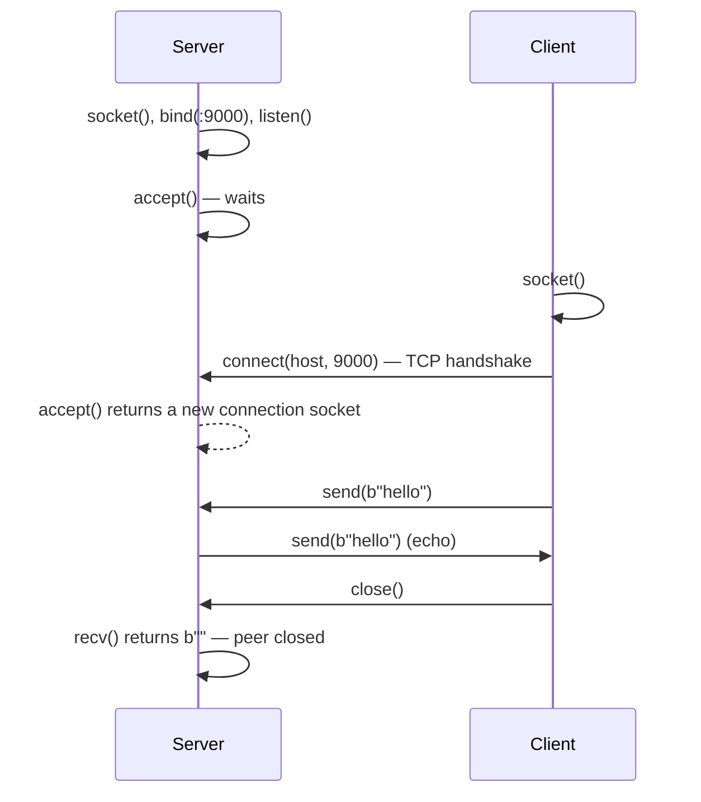
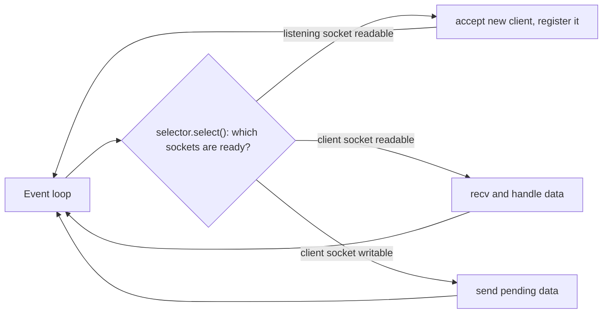

Every web framework, database driver and HTTP client you use is built on one small API that has
barely changed since the 1980s: **sockets**. Frameworks hide it well, until a connection hangs, a
message arrives cut in half, or one slow client blocks a whole server. Writing a few servers by
hand is the fastest way to understand those failures. This session follows the classic
[Beej's Guide to Network Programming](https://beej.us/guide/bgnet/) (written for C, but the calls
are identical) and uses Python's thin wrapper, the
[socket module](https://docs.python.org/3/library/socket.html).

## Sockets API

A **socket** is an endpoint for communication, like a phone handset. On Unix it is just another
file descriptor: you `read`/`write` (or `recv`/`send`) on it like a file. To make a phone call
you need a handset, a number and someone answering; the socket API has the same steps.

A TCP **server** does:

1. `socket()` — get a handset (choose address family and type: `AF_INET` + `SOCK_STREAM` = IPv4
   TCP; `AF_INET6` for IPv6; `SOCK_DGRAM` for UDP).
2. `bind()` — claim a phone number: an IP address and port.
3. `listen()` — switch the ringer on; the kernel starts queueing incoming connections (the
   **backlog**).
4. `accept()` — pick up: returns a **new** socket dedicated to that one client, plus the client's
   address. The listening socket keeps waiting for more callers.
5. `recv()` / `send()` — talk.
6. `close()` — hang up.

A TCP **client** only needs `socket()`, `connect()` to the server's address, then `send`/`recv`
and `close`.



In Python:

```python
import socket

# client
with socket.create_connection(("example.com", 80), timeout=5) as s:
    s.sendall(b"GET / HTTP/1.1\r\nHost: example.com\r\nConnection: close\r\n\r\n")
    chunks = []
    while chunk := s.recv(4096):   # b"" means the server closed
        chunks.append(chunk)
print(b"".join(chunks)[:200])
```

`create_connection` resolves the name (DNS) and connects in one call. That is a working HTTP
client in eight lines: HTTP is just text over a TCP socket.

Three details trip up everyone:

- **`recv(n)` returns *up to* n bytes**, possibly fewer, and `b""` only when the peer closed. TCP is
  a stream, so you must loop and **frame** messages yourself: a delimiter like `\n`, or a fixed-size
  length prefix.
- **`send()` may send only part of the buffer**; use `sendall()`, which loops for you.
- **Bytes, not strings**: encode text before sending (`"hi".encode()`) and decode after.

> [!TIP]
> When you restart a server quickly you may get `OSError: [Errno 98] Address already in use`,
> because the old connection is still in the `TIME_WAIT` state. Set
> `s.setsockopt(socket.SOL_SOCKET, socket.SO_REUSEADDR, 1)` before `bind()` (Python's
> `socket.create_server()` already does this on POSIX).

## Blocking vs non-blocking I/O

By default, socket calls are **blocking**: `accept()` waits until a client arrives, `recv()` waits
until data arrives. That is simple to reason about, and it is fine for a client. For a server it is
a trap: while the single thread is blocked in `recv()` waiting for client A, client B cannot even
connect. It is a shop with one assistant who waits silently while a customer decides what to buy.

There are three classic ways out:

| Approach | How it works | Trade-off |
|---|---|---|
| **Thread (or process) per client** | `accept()` in a loop, hand each connection to a new thread | Easy to write; thousands of clients means thousands of threads and lots of memory |
| **Non-blocking + readiness notification** | Mark sockets non-blocking; ask the kernel which ones are ready (`select`, `poll`, `epoll`, `kqueue`) and only touch those | Scales to many thousands of connections in one thread; more complex code |
| **Async framework** | An event loop wraps readiness notification; you write `async`/`await` code | The scalable model with readable code; covered in 4.3.2 |

A **non-blocking** socket (`sock.setblocking(False)`) never waits: if no data is available, `recv`
raises `BlockingIOError` instead. Calling it in a loop would burn CPU, so instead you ask the
kernel "tell me when any of these sockets is ready". On Linux that is `epoll`, on macOS and BSD
`kqueue`; `select` and `poll` are older, portable versions. Python's `selectors` module picks the
best one for your OS. This is called **I/O multiplexing**, and it is how Nginx, Redis, Node.js and
asyncio handle huge numbers of connections with few threads.



> [!NOTE]
> Blocking vs non-blocking is about whether *one call* waits. Synchronous vs asynchronous is about
> the *programming model*. asyncio uses non-blocking sockets and a selector under the hood, so your
> `await reader.read()` *looks* blocking but only suspends that one coroutine.

> [!WARNING]
> Always set **timeouts** on blocking sockets (`sock.settimeout(5)` or `timeout=` in
> `create_connection`). Without one, a peer that silently disappears can hang your call forever.

## Building a TCP echo server

An **echo server** sends back whatever it receives. It is the "hello world" of network
programming, and it already shows the whole lifecycle. First the blocking, one-client-at-a-time
version:

```python
import socket

with socket.create_server(("127.0.0.1", 9000)) as server:
    print("listening on 9000")
    while True:
        conn, addr = server.accept()        # blocks until a client connects
        with conn:
            print("connected", addr)
            while data := conn.recv(1024):  # blocks until data or close
                conn.sendall(data)
            print("closed", addr)
```

Test it with `nc 127.0.0.1 9000` (netcat) and type a few lines. Then open a *second* `nc` while the
first is still connected: the second one gets no echo until the first disconnects. That is the
blocking problem made visible.

Now the multiplexed version with `selectors`, which serves many clients in one thread:

```python
import selectors
import socket

sel = selectors.DefaultSelector()

def accept(server: socket.socket) -> None:
    conn, addr = server.accept()
    conn.setblocking(False)
    sel.register(conn, selectors.EVENT_READ, echo)

def echo(conn: socket.socket) -> None:
    data = conn.recv(1024)
    if data:
        conn.sendall(data)  # fine for a demo; real servers buffer partial writes
    else:
        sel.unregister(conn)
        conn.close()

server = socket.create_server(("127.0.0.1", 9000))
server.setblocking(False)
sel.register(server, selectors.EVENT_READ, accept)

while True:
    for key, _ in sel.select():
        key.data(key.fileobj)   # call the handler we registered
```

Each registration stores a callback in `data`; the loop asks which sockets are ready and calls
their handlers. Two `nc` clients now work at the same time.

> [!EXAMPLE]
> The same server with threads is just `threading.Thread(target=handle, args=(conn,),
> daemon=True).start()` after each `accept()`. For a few dozen clients that is perfectly fine and
> easier to read. Choose the selector model when you need thousands of mostly idle connections,
> like chat or websockets.

## Practice: a tiny chat server with sockets

Build a chat room: every line a client sends is broadcast to all other connected clients. You
will need **message framing** (lines ending in `\n`) and **shared state** (the list of clients).
The threaded version is shortest; the stretch goal converts it to `selectors`.

### Step 1: The server

Save as `chat_server.py`:

```python
import socket
import threading

clients: dict[socket.socket, str] = {}
lock = threading.Lock()

def broadcast(message: str, sender: socket.socket | None = None) -> None:
    data = message.encode()
    with lock:
        targets = [c for c in clients if c is not sender]
    for c in targets:
        try:
            c.sendall(data)
        except OSError:
            pass  # that client is gone; its own thread will clean up

def handle(conn: socket.socket, addr) -> None:
    name = f"{addr[0]}:{addr[1]}"
    with lock:
        clients[conn] = name
    broadcast(f"* {name} joined\n")
    buffer = b""
    try:
        while chunk := conn.recv(1024):
            buffer += chunk
            while b"\n" in buffer:                    # framing: one message per line
                line, buffer = buffer.split(b"\n", 1)
                text = line.decode(errors="replace").strip()
                if text.startswith("/nick "):
                    new = text[6:].strip() or name
                    broadcast(f"* {name} is now {new}\n")
                    name = new
                    with lock:
                        clients[conn] = name
                elif text:
                    broadcast(f"[{name}] {text}\n", sender=conn)
    finally:
        with lock:
            clients.pop(conn, None)
        conn.close()
        broadcast(f"* {name} left\n")

with socket.create_server(("127.0.0.1", 9000)) as server:
    print("chat on 127.0.0.1:9000")
    while True:
        conn, addr = server.accept()
        threading.Thread(target=handle, args=(conn, addr), daemon=True).start()
```

Notice the **lock** around the shared `clients` dict: several threads read and modify it. You
will study why that is necessary in 4.3.1.

### Step 2: Try it with three terminals

```sh
python3 chat_server.py
nc 127.0.0.1 9000        # terminal 2, then type: /nick ana
nc 127.0.0.1 9000        # terminal 3, then type: /nick bo
```

Messages typed in one `nc` should appear in the other. Close one client with Ctrl+C and check the
"left" message.

### Step 3: Break the framing on purpose

Send a partial line: `printf 'hel' | nc 127.0.0.1 9000` never completes a line, so nothing is
broadcast. Then `printf 'hello\nworld\n'` in one send produces *two* messages. Your
buffer-and-split loop is what makes both cases correct.

### Step 4: Stretch goals

- Write a Python client that reads from the keyboard and the socket at the same time (a thread for
  each, or `selectors` with `sys.stdin` on Unix).
- Port the server to the `selectors` echo design: keep a per-connection input buffer in a dict.
- Add a `/who` command that lists connected names.

Write down the two bugs you would have had without the line buffer, and why the lock is needed.
