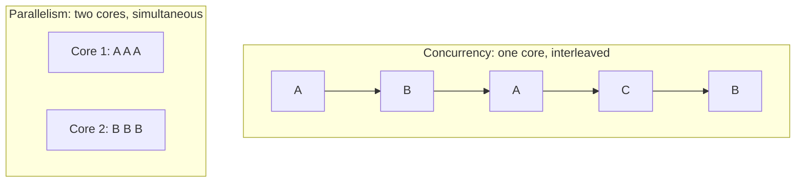
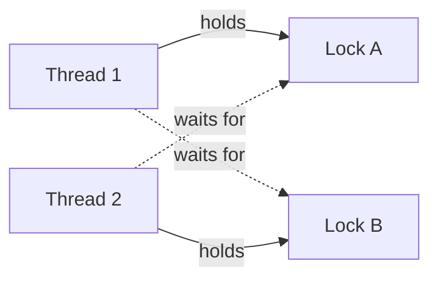

Concurrency bugs are the ones senior engineers fear most: they pass every test, show up once a
week in production, vanish when you add a log line, and corrupt data quietly. A double-booked
seat, a balance that is off by one payment, a worker that freezes forever: these are usually race
conditions or deadlocks. This session gives you the vocabulary and the tools to recognise and fix
them. It follows the concurrency "easy piece" of [OSTEP](https://pages.cs.wisc.edu/~remzi/OSTEP/)
and Python's [threading docs](https://docs.python.org/3/library/threading.html).

## Concurrency vs parallelism

A café has one barista. She takes an order, starts the espresso machine, and while it runs she
steams milk for the next customer. Several orders are *in progress* at once, but she only does one
thing at any instant. That is **concurrency**: structuring work so multiple tasks make progress in
overlapping time periods.

Now the café hires a second barista with a second machine. Two coffees are physically being made
at the same instant. That is **parallelism**: tasks executing *simultaneously*, which needs
multiple CPU cores.



Concurrency is about *dealing with* many things at once; parallelism is about *doing* many things
at once. You want concurrency when work spends time **waiting** (network, disk, database): the
waiting can overlap. You want parallelism when work is **CPU-bound** (image resizing, number
crunching) and you have spare cores.

> [!NOTE]
> Any time two flows of execution can touch the same data and their steps can interleave, you have
> the bugs in this session, whether they run in parallel or not. A single core switching threads at
> the wrong moment is enough.

## Race conditions and critical sections

A **race condition** is a bug where the result depends on the unlucky timing of concurrent steps.
The classic case is a "read, modify, write" sequence. Two threads add 1 to a counter that is 41:

| Time | Thread A | Thread B | counter |
|---|---|---|---|
| 1 | reads 41 | | 41 |
| 2 | | reads 41 | 41 |
| 3 | computes 42, writes 42 | | 42 |
| 4 | | computes 42, writes 42 | 42 |

Two increments ran, but the counter only rose by one: a **lost update**. Even `counter += 1` is
several steps at the machine (and Python bytecode) level, so it is not **atomic** (indivisible).

The piece of code that accesses shared data and must not be interleaved is a **critical
section**. Correct concurrent code ensures **mutual exclusion**: at most one thread inside a
critical section at a time.

Races are not only about counters. Real examples:

- **Check-then-act**: "if the seat is free, book it". Two users both see "free" and both book.
- **Lazy initialisation**: two threads both see `cache is None` and both build an expensive object.
- **Iterating a collection** while another thread modifies it.
- The same pattern across processes or servers: two API instances each read a row, then each
  write it back. Locks in your Python process cannot help there; you need database transactions,
  `SELECT … FOR UPDATE` or atomic updates like `UPDATE seats SET … WHERE id = 7 AND booked = false`.

> [!WARNING]
> "It worked in my tests" proves almost nothing for races. They depend on timing, load and CPU
> count. Prevent them by design (no shared mutable state, or a lock around it) rather than hoping
> testing will catch them.

## Locks, semaphores and condition variables

A **lock** (or **mutex**) is a bathroom key on a hook: whoever holds it may enter; everyone else
waits until it is returned. In Python:

```python
import threading

counter = 0
lock = threading.Lock()

def increment() -> None:
    global counter
    with lock:          # acquire; released automatically, even on exceptions
        counter += 1    # critical section
```

Always use the `with` form: if you call `acquire()` manually and an exception skips the
`release()`, every other thread waits forever. Keep critical sections short; never do slow I/O
while holding a lock if you can avoid it. A `threading.RLock` (reentrant lock) can be acquired
again by the thread that already holds it, which is handy when a locked method calls another
locked method.

A **semaphore** is a lock with a counter: a car park with N spaces. `acquire()` takes a space (or
waits if none are free), `release()` frees one. Use it to **limit concurrency**, for example "at
most 5 simultaneous calls to this rate-limited API":

```python
api_slots = threading.Semaphore(5)

def call_api(url: str) -> None:
    with api_slots:
        ...  # at most 5 threads in here at once
```

A **condition variable** lets threads wait efficiently until some state becomes true, instead of
spinning in a loop. It is paired with a lock: you check the condition while holding the lock, and
`wait()` atomically releases the lock and sleeps until another thread calls `notify()`.

```python
items: list[str] = []
cond = threading.Condition()

def producer(item: str) -> None:
    with cond:
        items.append(item)
        cond.notify()            # wake one waiting consumer

def consumer() -> str:
    with cond:
        while not items:         # always re-check in a loop (spurious wake-ups)
            cond.wait()
        return items.pop(0)
```

> [!TIP]
> In everyday Python you rarely need a raw condition variable: `queue.Queue` is a thread-safe
> producer/consumer queue built on exactly this pattern. Passing messages through a queue instead
> of sharing variables removes whole classes of races.

## Deadlocks and how to avoid them

A **deadlock** is when threads wait for each other forever. Picture two cars meeting on a narrow
bridge, each waiting for the other to reverse. In code: thread 1 holds lock A and wants B; thread 2
holds B and wants A.



Deadlock requires four conditions at once (the **Coffman conditions**): mutual exclusion,
**hold-and-wait** (holding one resource while waiting for another), **no preemption** (locks
cannot be taken away), and a **circular wait**. Break any one and deadlock is impossible. In
practice:

- **Lock ordering**: always acquire locks in the same global order (for example by account id).
  This breaks circular wait and is the most common fix.
- **Hold one lock at a time**, or acquire everything you need at once.
- **Timeouts**: `lock.acquire(timeout=2)` and back off on failure, which breaks "wait forever".
- **Avoid calling unknown code** (callbacks, plugins) while holding a lock.

> [!EXAMPLE]
> A money transfer locks the *from* account, then the *to* account. Transfer A→B and transfer B→A
> run at the same time: deadlock. Fix: lock the account with the lower id first, whatever the
> direction. Databases hit the same problem with row locks; PostgreSQL detects the cycle and aborts
> one transaction with a "deadlock detected" error, which your code should retry.

Related failures: **livelock** (threads keep reacting to each other but make no progress, like two
people stepping aside the same way in a corridor) and **starvation** (one thread never gets the
lock because others keep winning).

## Python's GIL, threads and processes

In standard CPython, the **Global Interpreter Lock** (GIL) allows only one thread at a time to
execute Python bytecode in a process. It is like a kitchen with many cooks but a single knife:
only the cook holding the knife can chop. Consequences:

- **I/O-bound work scales fine with threads.** A thread waiting on a socket, file or `time.sleep`
  releases the GIL, so others run. Many C extensions (NumPy, hashing, compression) also release
  it during heavy work.
- **CPU-bound pure-Python code does not get faster with threads.** Four threads computing still
  share one "knife". Use **processes** instead (`multiprocessing`, or
  `concurrent.futures.ProcessPoolExecutor`): each has its own interpreter and its own GIL, at the
  cost of more memory and data having to be pickled between them.
- **The GIL does not make your code thread-safe.** Threads can still switch between the bytecodes
  of `counter += 1`. You still need locks.

| Workload | Good tool in Python |
|---|---|
| Many network/DB calls | `asyncio` (4.3.2) or `ThreadPoolExecutor` |
| CPU-heavy pure Python | `ProcessPoolExecutor` / `multiprocessing` |
| CPU-heavy numeric | NumPy and friends (work happens in C) |

Python 3.13 introduced an optional **free-threaded** build of CPython without the GIL (often
installed as `python3.13t`), and Python 3.14 moved it from experimental to officially supported,
though still not the default build. You can check at runtime with `sys._is_gil_enabled()`. On such
a build, threads really do run Python code in parallel, which makes correct locking even more
important.

## Practice: reproduce and fix a race condition

### Step 1: Write a racy bank account

Save as `race.py`:

```python
import threading
import time

balance = 0

def deposit(times: int) -> None:
    global balance
    for _ in range(times):
        current = balance        # read
        time.sleep(0)            # yield the CPU, like any I/O between read and write would
        balance = current + 1    # write

threads = [threading.Thread(target=deposit, args=(1_000,)) for _ in range(8)]
for t in threads:
    t.start()
for t in threads:
    t.join()
print("expected 8000, got", balance)
```

`time.sleep(0)` stands in for real work between reading and writing (a database call, a log
line). It makes the race show up reliably instead of once in a million runs.

### Step 2: Run it several times

```sh
for i in 1 2 3; do python3 race.py; done
```

You should see numbers well below 8000, and different on each run: lost updates. Remove the
`sleep(0)` and the race may hide on your machine, but the code is just as wrong.

### Step 3: Fix it with a lock

Add `lock = threading.Lock()` at module level and wrap the read and write together:

```python
        with lock:
            current = balance
            time.sleep(0)
            balance = current + 1
```

Run it again: always 8000. Note that it is slower; the critical section serialises the work.

### Step 4: Fix it without shared state

Rewrite so each thread counts locally and returns its count via a `queue.Queue`, and the main
thread sums the results. No lock needed, because nothing mutable is shared.

### Step 5: Create and fix a deadlock

Write two functions: `ab()` takes `lock_a` then `lock_b`; `ba()` takes `lock_b` then `lock_a`, with
`time.sleep(0.1)` between the two acquisitions. Run them in two threads: the program hangs (Ctrl+C
to stop). Fix it by making both acquire `lock_a` first.

Write down in your notes: the interleaving that lost an update, and which Coffman condition your
deadlock fix broke.
