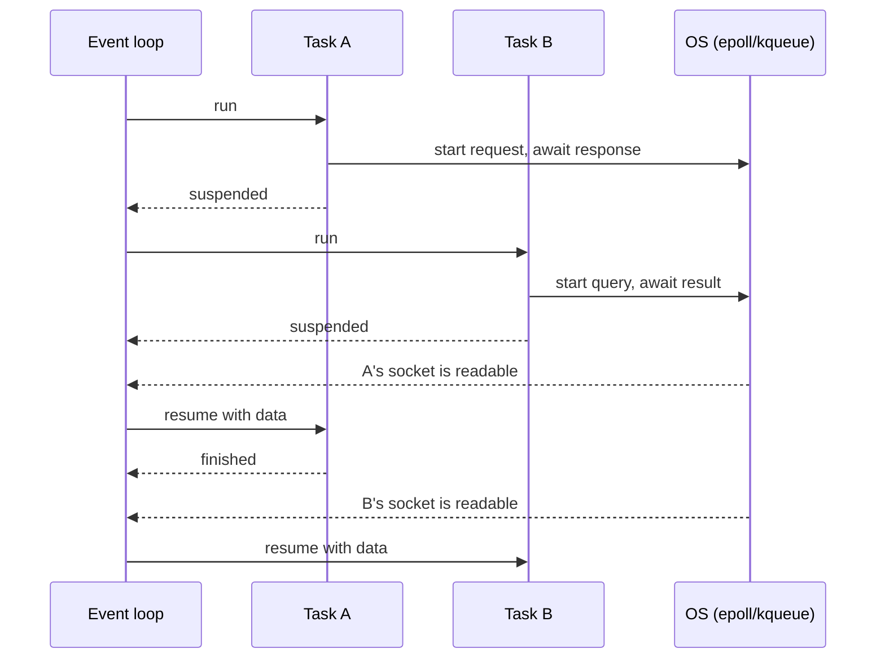

Most backend code spends its life waiting: for the database, for another API, for a file. In the
previous session you saw that threads can overlap those waits. **asyncio** is Python's other
answer: a single thread that juggles thousands of waiting tasks by switching between them only at
points you mark with `await`. It powers FastAPI, modern HTTP clients and async database drivers,
so reading and writing async code is now a core backend skill. This session is grounded in the
[Python asyncio docs](https://docs.python.org/3/library/asyncio.html) and FastAPI's
[Concurrency and async](https://fastapi.tiangolo.com/async/) guide.

## The event loop

Picture a chess master playing 30 opponents at once. She makes a move on board 1, and instead of
waiting for that opponent to think, walks to board 2, then board 3. When she comes back to board 1,
the opponent has moved. One person, many games, no time wasted standing still.

The **event loop** is that chess master. It holds a list of tasks. It runs one until the task says
"I am waiting for something" (an `await` on I/O), then parks it and runs the next ready task.
Underneath, it uses the OS readiness notification you met in 4.2.3 (`epoll` on Linux, `kqueue` on
macOS) to learn which sockets have data, and wakes the matching tasks.



The key properties:

- **One thread**, so tasks never run truly in parallel and there is no GIL contention.
- **Cooperative multitasking**: a task only gives up control at an `await`. The OS does not
  preempt it.
- **Cheap tasks**: a waiting task is just a small object, so 10,000 concurrent connections are
  realistic, where 10,000 threads would not be.

> [!WARNING]
> Because switching is cooperative, one task that never awaits **blocks everyone**. Calling
> `time.sleep(5)`, `requests.get(...)` or a slow CPU loop inside async code freezes the entire loop
> and every request on it. Use the async equivalent (`await asyncio.sleep(5)`, `httpx.AsyncClient`),
> or push blocking work to a thread with `await asyncio.to_thread(func, *args)`.

## async/await and coroutines

`async def` defines a **coroutine function**. Calling it does *not* run it; it returns a
**coroutine object**, a paused computation, like a recipe card handed to the chef rather than a
cooked meal.

```python
import asyncio

async def fetch_user(user_id: int) -> dict:
    await asyncio.sleep(1)          # pretend this is a network call
    return {"id": user_id}

coro = fetch_user(1)                # nothing has run yet
print(coro)                         # <coroutine object fetch_user at ...>
result = asyncio.run(fetch_user(1)) # starts a loop, runs it, closes the loop
```

`await` means "run this awaitable, and while it waits, let the loop do other things; give me the
result when done". You can only use `await` inside an `async def`. Things you can await are
**awaitables**: coroutines, **Tasks** and **Futures**.

`asyncio.run(main())` is the entry point of an async program: it creates an event loop, runs
`main()` to completion and closes the loop. In a FastAPI app you never call it yourself; the server
(Uvicorn) owns the loop.

The most common beginner surprise: awaiting coroutines one after another is still **sequential**.

```python
async def main() -> None:
    a = await fetch_user(1)   # waits 1 s
    b = await fetch_user(2)   # then waits another 1 s -> 2 s total
```

To overlap them, you must schedule them as concurrent tasks, which is the next section.

> [!NOTE]
> "Function colouring": async functions can call sync functions, but sync functions cannot simply
> `await` async ones. That is why libraries come in sync and async flavours (`requests` vs
> `httpx.AsyncClient`, `psycopg` sync vs async connections).

## Tasks, gather and timeouts

A **Task** wraps a coroutine and schedules it on the loop to run *concurrently*. There are three
common ways to run several things at once.

**`asyncio.gather`** runs awaitables concurrently and returns their results in the same order:

```python
async def main() -> None:
    a, b = await asyncio.gather(fetch_user(1), fetch_user(2))   # ~1 s total
```

By default, the first exception propagates to the caller (the other awaitables keep running and
are not cancelled). With `return_exceptions=True`, exceptions are returned in the results list
instead, so one failure does not hide the other results.

**`asyncio.TaskGroup`** (Python 3.11+) is the modern, safer pattern, called *structured
concurrency*: tasks live inside an `async with` block, the block waits for all of them, and if one
fails, the others are cancelled and the errors are raised together.

```python
async def main() -> None:
    async with asyncio.TaskGroup() as tg:
        t1 = tg.create_task(fetch_user(1))
        t2 = tg.create_task(fetch_user(2))
    print(t1.result(), t2.result())       # both done here
```

**`asyncio.create_task`** starts a task in the background and returns immediately. The loop only
keeps a weak reference to it, so keep your own reference (or use a TaskGroup), or it may be
garbage collected before finishing.

**Timeouts** stop one slow dependency from hanging your whole request. Python 3.11+ offers a
context manager:

```python
async def main() -> None:
    try:
        async with asyncio.timeout(2):
            user = await fetch_user(1)
    except TimeoutError:
        user = None   # degrade gracefully
```

`asyncio.wait_for(aw, timeout=2)` does the same for a single awaitable. On timeout, the inner
work is **cancelled**: asyncio raises `CancelledError` inside it at its current `await`, so
`finally` blocks and `async with` cleanups still run.

To **limit** concurrency (do not open 10,000 connections to one server at once), use an
`asyncio.Semaphore`:

```python
sem = asyncio.Semaphore(10)

async def polite_fetch(i: int) -> dict:
    async with sem:          # at most 10 inside at a time
        return await fetch_user(i)
```

> [!TIP]
> Rule of thumb: `TaskGroup` when all tasks must succeed together, `gather(...,
> return_exceptions=True)` when you want every result even if some fail, a `Semaphore` whenever
> the number of tasks comes from data rather than code.

## Async HTTP and databases

Async only pays off if the I/O libraries are async too. For HTTP, **httpx** offers an
`AsyncClient` whose API mirrors `requests`:

```python
import httpx

async def main() -> None:
    async with httpx.AsyncClient(timeout=10) as client:   # reuse one client: connection pool
        r = await client.get("https://example.com")
        print(r.status_code)
```

Create the client once and reuse it; it keeps a pool of TCP and TLS connections (remember the
handshake costs from 4.2.1). Other options include `aiohttp`.

For databases, use async drivers: **asyncpg** or **psycopg 3**'s async mode for PostgreSQL, and
SQLAlchemy 2's asyncio extension (`create_async_engine`, `AsyncSession`) on top of them. They hold a
connection **pool**; the pool size, not the number of tasks, caps how many queries run at once.

In **FastAPI**, the rule from its async guide is:

- If your path function uses libraries you can `await`, declare it `async def`.
- If it calls blocking libraries (a sync DB driver, `requests`), declare it plain `def`. FastAPI
  then runs it in a **threadpool**, so it does not block the event loop.
- Mixing is fine across endpoints. What breaks things is a blocking call *inside* `async def`.

```python
from fastapi import FastAPI
import httpx

app = FastAPI()

@app.get("/weather")
async def weather(city: str):
    async with httpx.AsyncClient() as client:   # (in real code: one shared client)
        r = await client.get("https://api.example.com/weather", params={"q": city})
    return r.json()
```

> [!EXAMPLE]
> A team's FastAPI service handled 30 requests per second fine, then fell over at 40. Profiling
> showed `async def` endpoints calling `requests.post()` to a payment provider: each call froze the
> loop for 300 ms. Switching to `httpx.AsyncClient` (or simply making those endpoints plain `def`)
> multiplied throughput without new hardware.

## Practice: fetch 100 URLs concurrently with httpx

You will measure sequential vs concurrent fetching against a local, deliberately slow server, so
results do not depend on someone else's website.

### Step 1: A slow test server

```sh
python3 -m venv .venv && . .venv/bin/activate && pip install fastapi uvicorn httpx
cat > slow.py <<'EOF'
import asyncio
from fastapi import FastAPI
app = FastAPI()

@app.get("/item/{i}")
async def item(i: int):
    await asyncio.sleep(0.5)        # every response takes 500 ms
    return {"i": i}
EOF
uvicorn slow:app --port 8001
```

### Step 2: Sequential baseline

Save as `fetch.py`:

```python
import asyncio
import time

import httpx

URLS = [f"http://127.0.0.1:8001/item/{i}" for i in range(100)]

async def sequential(client: httpx.AsyncClient) -> list[int]:
    return [(await client.get(u)).json()["i"] for u in URLS]

async def concurrent(client: httpx.AsyncClient, limit: int) -> list[int]:
    sem = asyncio.Semaphore(limit)

    async def one(url: str) -> int:
        async with sem:
            r = await client.get(url)
            r.raise_for_status()
            return r.json()["i"]

    async with asyncio.timeout(30):
        return await asyncio.gather(*(one(u) for u in URLS))

async def main() -> None:
    limits = httpx.Limits(max_connections=100)
    async with httpx.AsyncClient(timeout=10, limits=limits) as client:
        for label, coro in [("sequential", sequential(client)),
                            ("concurrent x10", concurrent(client, 10)),
                            ("concurrent x50", concurrent(client, 50))]:
            start = time.perf_counter()
            results = await coro
            print(f"{label:<15} {len(results)} results in {time.perf_counter() - start:.1f}s")

asyncio.run(main())
```

### Step 3: Run and explain

```sh
python3 fetch.py
```

Expect about 50 s sequentially (100 × 0.5 s), about 5 s with 10 at a time, and about 1 s with 50.
Write down the formula you see: time ≈ requests × latency ÷ concurrency.

### Step 4: Break it on purpose

- Replace `await asyncio.sleep(0.5)` in `slow.py` with `time.sleep(0.5)` (import `time`) and rerun
  the concurrent case. The *server's* loop is now blocked: concurrency collapses to sequential.
- Make one URL point to a non-existent port. With `gather`, see the exception; switch to
  `gather(..., return_exceptions=True)` and count failures instead.
- Set `asyncio.timeout(2)` and observe the `TimeoutError` and cancellation.

### Step 5: Reflect

Note why the semaphore and the `Limits` object both matter: one protects the remote server, the
other caps your own connection pool.
