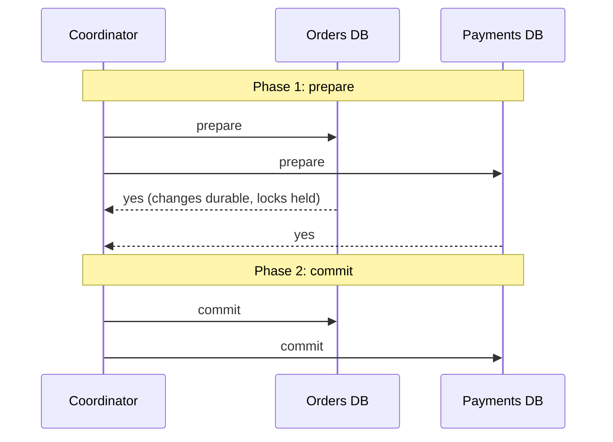
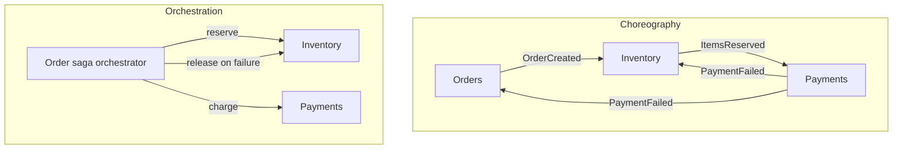
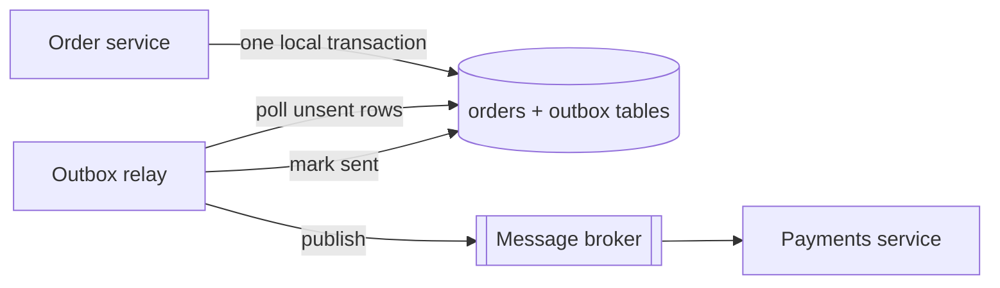

Inside one database, a transaction makes several changes all-or-nothing: you never move money out
of one account without it arriving in the other. Split the system into services, each with its
own database, and that guarantee disappears. The order service, the payment service and the
inventory service each commit separately, and any of them can fail between steps. This session
covers how real systems keep data consistent anyway: why the textbook answer (two-phase commit)
is rarely used between services, and the patterns that replaced it. The main references are Chris
Richardson's pages on the [Saga](https://microservices.io/patterns/data/saga.html) and
[Transactional Outbox](https://microservices.io/patterns/data/transactional-outbox.html) patterns.

## Two-phase commit and its limits

**Two-phase commit** (2PC) is the classic way to make a transaction atomic across several
databases. A **coordinator** runs it like a wedding officiant: first everyone is asked "do you?",
and only if *all* say yes is the marriage declared.



In phase 1, each participant does the work, writes it durably, keeps its locks and votes yes or no.
A "yes" is a **promise**: "I can commit no matter what, if you tell me to". In phase 2, if every
vote was yes, the coordinator records the decision and tells everyone to commit; otherwise it tells
everyone to abort.

It works, and it is used inside databases and in XA transactions, but it has serious limits for
services:

- **Blocking**: if the coordinator crashes after participants voted yes, they are stuck *in doubt*,
  holding locks, until it comes back. They cannot decide alone.
- **Latency and throughput**: several round trips and locks held across the network on every
  transaction.
- **Availability**: every participant must be up for any transaction to commit.
- **Technology**: message brokers and many NoSQL stores and HTTP APIs do not support it at all.
  You cannot "prepare" a call to Stripe.

> [!NOTE]
> Consensus (session 4.4.3) and 2PC solve different problems. Consensus gets replicas of the
> *same* data to agree despite failures. 2PC gets *different* resources to all commit or all abort,
> and needs every participant to say yes.

## Sagas: orchestration vs choreography

A **saga** replaces one big distributed transaction with a **sequence of local transactions**, one
per service. Each step commits on its own and triggers the next. If a step fails, the saga runs
**compensating transactions** that semantically undo the earlier steps.

Booking a holiday is a saga: book the flight, then the hotel, then the car. If no car is available,
you do not "roll back time"; you cancel the hotel and cancel the flight, perhaps paying a fee. A
compensation is a new business action, not an erasure.

For an order:

| Step | Service | Action | Compensation |
|---|---|---|---|
| 1 | Orders | Create order (PENDING) | Mark order CANCELLED |
| 2 | Inventory | Reserve items | Release reservation |
| 3 | Payments | Charge card | Refund |
| 4 | Orders | Mark order APPROVED | (last step, none needed) |

There are two ways to coordinate a saga:

**Choreography**: no central coordinator. Each service listens for events and publishes its own.
Orders publishes `OrderCreated`; Inventory reacts and publishes `ItemsReserved`; Payments reacts
and publishes `PaymentFailed`; Inventory reacts to that by releasing the items.

**Orchestration**: a central **orchestrator** (often a state machine in the order service, or a
workflow engine) tells each participant what to do and decides the next step from the reply.



| | Choreography | Orchestration |
|---|---|---|
| Coupling | Loose; services only know events | Orchestrator knows all participants |
| Visibility | Logic spread across services, hard to follow | The whole flow is in one place |
| Good for | Short sagas with 2–3 steps | Longer flows, complex rules, timeouts |
| Risk | Cyclic event dependencies | Orchestrator grows into a "god service" |

Sagas give up **isolation** (the "I" in ACID): other requests can see intermediate states, such as
an order that is PENDING with stock reserved but not yet paid. Designs handle this with explicit
states, "semantic locks" (a PENDING flag others respect), and ordering steps so the ones most
likely to fail or hardest to compensate come first.

> [!TIP]
> Workflow engines such as Temporal, AWS Step Functions or Camunda implement durable orchestration
> for you: retries, timers and state persistence. Consider one before building an orchestrator
> state machine by hand.

## Transactional outbox

Every saga step must do two things: **update its database** and **publish an event or message**.
Doing them separately is the **dual-write problem**:

```python
db.commit()               # 1. order saved
broker.publish(event)     # 2. crash here, and the event is lost forever
```

Reverse the order and a crash leaves an event announcing an order that was never saved. You cannot
put the database and the broker in one local transaction.

The **transactional outbox** pattern fixes this by making the message part of the database
transaction. Write the business change *and* a row in an `outbox` table in the same local
transaction. A separate **relay** process reads unsent outbox rows and publishes them to the
broker, marking them sent afterwards.



Now either both the order and its event are saved, or neither is. Two ways to run the relay:

- **Polling publisher**: query `SELECT … FROM outbox WHERE sent_at IS NULL ORDER BY id LIMIT 100`,
  publish, update. Simple, works anywhere.
- **Transaction log tailing**: read the database's change stream (for PostgreSQL, logical
  decoding via a tool such as Debezium) and publish outbox inserts as they commit. Lower latency,
  more infrastructure.

> [!WARNING]
> The relay can crash *after* publishing but *before* marking the row sent, and then publish it
> again. The outbox guarantees **at-least-once** delivery, never exactly-once. Consumers must
> handle duplicates, which is the next section.

## Idempotency and exactly-once myths

An operation is **idempotent** if doing it twice has the same effect as doing it once. Pressing a
lift's call button five times still calls one lift. `SET status = 'paid'` is idempotent;
`balance = balance - 50` is not.

In a distributed system, messages and requests can be **lost** or **duplicated**, and you cannot
tell which happened after a timeout. So delivery guarantees come in three flavours:

- **At-most-once**: send once, never retry. Messages may be lost.
- **At-least-once**: retry until acknowledged. Messages may be duplicated.
- **Exactly-once delivery**: not achievable over an unreliable network in general.

What *is* achievable is **exactly-once processing (effect)**: at-least-once delivery plus
idempotent handling. When a vendor advertises "exactly-once", read the fine print: it is this
combination within their boundary (Kafka's transactions, for example, cover reading from and
writing to Kafka itself, not your external side effects).

Techniques to make handlers idempotent:

- **Idempotency keys**: the client generates a unique key per logical operation and sends it with
  every retry (Stripe's API popularised the `Idempotency-Key` header). The server stores the key
  with the result; a repeat returns the stored result instead of acting again.
- **Processed-message table**: consumers record each message id in the same transaction as their
  side effects, with a unique constraint; duplicates hit the constraint and are skipped.
- **Natural idempotency**: prefer "set to X" over "add X", and upserts over inserts.
- **Version checks**: `UPDATE … WHERE id = 7 AND version = 3`, which only succeeds once.

```sql
CREATE TABLE processed_messages (message_id uuid PRIMARY KEY, processed_at timestamptz DEFAULT now());
-- in the consumer's transaction:
INSERT INTO processed_messages (message_id) VALUES ($1) ON CONFLICT DO NOTHING;
-- if 0 rows inserted: duplicate, skip; else apply the side effects, then commit
```

## Practice: implement an outbox for a payment-like flow

You will build a tiny order service with an outbox, a relay, and an idempotent "payments"
consumer, using SQLite so it runs anywhere. (The same SQL works on PostgreSQL.)

### Step 1: Schema and the write path

Save as `outbox.py`:

```python
import json
import random
import sqlite3
import uuid

db = sqlite3.connect("shop.db", isolation_level=None)
db.executescript("""
CREATE TABLE IF NOT EXISTS orders (id TEXT PRIMARY KEY, amount INTEGER, status TEXT);
CREATE TABLE IF NOT EXISTS outbox (id INTEGER PRIMARY KEY AUTOINCREMENT,
  message_id TEXT UNIQUE, topic TEXT, payload TEXT, sent_at TEXT);
CREATE TABLE IF NOT EXISTS payments (order_id TEXT PRIMARY KEY, amount INTEGER);
CREATE TABLE IF NOT EXISTS processed_messages (message_id TEXT PRIMARY KEY);
""")

def place_order(amount: int) -> str:
    order_id = str(uuid.uuid4())
    db.execute("BEGIN")
    db.execute("INSERT INTO orders VALUES (?, ?, 'PENDING')", (order_id, amount))
    db.execute("INSERT INTO outbox (message_id, topic, payload) VALUES (?, ?, ?)",
               (str(uuid.uuid4()), "OrderPlaced", json.dumps({"order_id": order_id, "amount": amount})))
    db.execute("COMMIT")      # order and event saved atomically
    return order_id
```

### Step 2: The relay, with a simulated crash

```python
broker: list[dict] = []   # stands in for Kafka/RabbitMQ

def relay_once(crash_rate: float = 0.3) -> None:
    rows = db.execute("SELECT id, message_id, topic, payload FROM outbox "
                      "WHERE sent_at IS NULL ORDER BY id").fetchall()
    for row_id, message_id, topic, payload in rows:
        broker.append({"message_id": message_id, "topic": topic, **json.loads(payload)})
        if random.random() < crash_rate:
            return            # "crash" after publishing, before marking sent
        db.execute("UPDATE outbox SET sent_at = datetime('now') WHERE id = ?", (row_id,))
```

### Step 3: The idempotent consumer

```python
def payments_consume() -> None:
    while broker:
        msg = broker.pop(0)
        db.execute("BEGIN")
        cur = db.execute("INSERT OR IGNORE INTO processed_messages VALUES (?)", (msg["message_id"],))
        if cur.rowcount == 1:   # first time we see this message
            db.execute("INSERT INTO payments VALUES (?, ?)", (msg["order_id"], msg["amount"]))
            db.execute("UPDATE orders SET status = 'PAID' WHERE id = ?", (msg["order_id"],))
        db.execute("COMMIT")

if __name__ == "__main__":
    for _ in range(20):
        place_order(random.randint(5, 100))
    unsent = "SELECT COUNT(*) FROM outbox WHERE sent_at IS NULL"
    while db.execute(unsent).fetchone()[0]:   # relay restarts after each "crash"
        relay_once()
    print("messages published:", len(broker))
    payments_consume()
    paid = db.execute("SELECT COUNT(*) FROM payments").fetchone()[0]
    print("payments recorded:", paid)
```

### Step 4: Run and verify

Delete `shop.db` and run `python3 outbox.py`. "Messages published" is usually more than 20
(duplicates from crashes), yet "payments recorded" is exactly 20, and every order is `PAID`. Check
with `sqlite3 shop.db "SELECT status, COUNT(*) FROM orders GROUP BY status;"`.

### Step 5: Break it

Remove the `processed_messages` check and insert payments unconditionally (drop the `PRIMARY
KEY` on `payments` too). Rerun: duplicates become double charges. Write down which guarantee each
piece gives you: the outbox (no lost events), the relay (at-least-once), the consumer table
(exactly-once effect).
