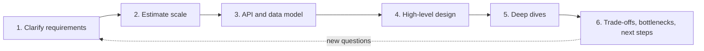
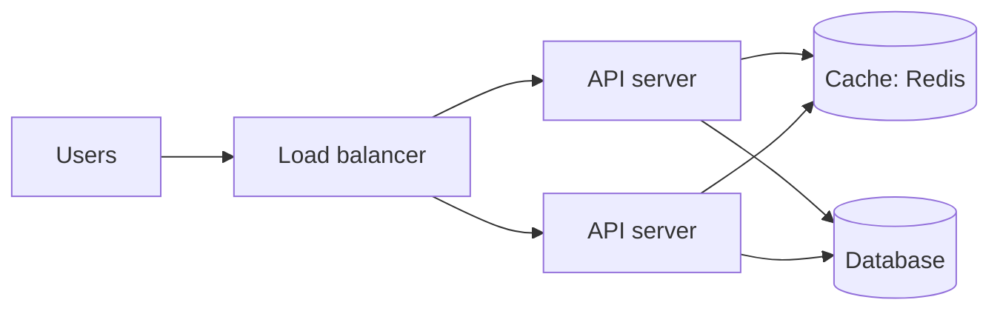

"Design Twitter." "Design a URL shortener." These open-ended questions are a fixture of senior
interviews, and, more importantly, of senior *work*: someone describes a need in two sentences, and
you have to turn it into a system that will survive real users. There is no single right answer,
so what is judged is your **process**: do you ask the right questions, estimate before choosing,
start simple and justify every complication? This session gives you a repeatable method, drawing on
the [System Design Primer](https://github.com/donnemartin/system-design-primer) and the
[roadmap.sh System Design](https://roadmap.sh/system-design) guide, and applies it end to end.



## Clarifying requirements and constraints

An architect who starts drawing before asking "how many people will live here, and what is the
budget?" designs the wrong house. The first five minutes of any design, interview or real, belong
to questions.

Split requirements into two kinds:

**Functional requirements**: what the system *does*. Write them as a short list of user actions,
and explicitly mark what is **out of scope**.

> For a URL shortener: users submit a long URL and get a short one; visiting the short URL redirects
> to the long one; optionally custom aliases and expiry. Out of scope: user accounts, analytics
> dashboards.

**Non-functional requirements**: how *well* it does it. These drive the architecture far more than
the features do:

- **Scale**: how many users, requests per second, how much data, how fast does it grow?
- **Latency**: what response time is acceptable (for a redirect, tens of milliseconds)?
- **Availability**: what happens if it is down for an hour? (Broken links everywhere.)
- **Consistency**: must every reader see a new link instantly, or is a second's delay fine?
- **Durability**: can we ever lose a mapping? (No: links printed on posters must keep working.)
- **Read/write ratio**: a shortener is read-heavy, maybe 100 redirects per link created.
- **Constraints**: budget, team size, existing tech, regulations (GDPR, data residency).

> [!TIP]
> If the interviewer or stakeholder says "you decide", state your assumptions out loud and write
> them down: "I'll assume 100 million new URLs per month and a 100:1 read/write ratio." A design
> built on explicit assumptions can be corrected; one built on silent guesses cannot.

> [!WARNING]
> The most common failure is designing for an imaginary scale. A system for 1,000 users and one for
> 100 million users are different systems. Ask before reaching for Kafka and sharding.

## Back-of-the-envelope estimation

Estimation is rough arithmetic that tells you which problems are real. You are not looking for
precision, but for the **order of magnitude**: is this 10 requests per second or 100,000? Gigabytes
or petabytes?

Handy facts to memorise:

| Fact | Value |
|---|---|
| Seconds in a day | ~86,400 ≈ 10⁵ |
| Seconds in a month | ~2.5 million |
| 1 million requests/day | ≈ 12 requests/second |
| 1 KB × 1 million | 1 GB |
| 1 KB × 1 billion | 1 TB |

And rough latencies (the Primer has a fuller "latency numbers every programmer should know" table):
reading from memory is on the order of 100 ns, a round trip inside a data centre about half a
millisecond, an SSD random read tens to a hundred microseconds, a round trip across an ocean around
100–150 ms.

> [!EXAMPLE]
> **URL shortener estimate.** Assume 100 M new URLs per month, read/write ratio 100:1.
>
> - Writes: 100 M ÷ 2.5 M seconds ≈ **40 writes/s** (peak maybe 2–5×, so ~200).
> - Reads: 40 × 100 ≈ **4,000 redirects/s** (peak ~20,000).
> - Storage per record: short code + long URL + timestamps ≈ 500 bytes.
> - Five years: 100 M × 12 × 5 = 6 billion records × 500 B ≈ **3 TB**.
> - Short code length: base62 (a–z, A–Z, 0–9) with 7 characters gives 62⁷ ≈ 3.5 trillion codes,
>   plenty for 6 billion.
>
> Conclusions: writes are trivial for one database; reads are high but very cacheable; 3 TB fits on
> a large single instance but is worth planning partitioning for.

The point is the conclusions, not the numbers. Estimation tells you that the shortener's hard part
is serving **reads** fast and reliably, not storing writes.

## High-level design, deep dives and trade-offs

With requirements and numbers in hand, define the **API** and the **data model**, then draw the
**high-level design**: the boxes and arrows of the simplest system that meets the requirements.

API:

```text
POST /api/urls        {"long_url": "...", "alias": "optional"}  -> 201 {"short": "abc1234"}
GET  /{code}          -> 301/302 Location: <long_url>   (404 if unknown or expired)
```

Data model: one table, `urls(code PRIMARY KEY, long_url, created_at, expires_at)`. Lookups are
always by primary key, which every database does well.



Then **deep dives**: pick the two or three components where the real difficulty is and design
them carefully. For a shortener:

1. **Generating codes.** Options: hash the long URL and take 7 characters (collisions must be
   detected and resolved); random codes with a uniqueness check (simple, a retry on rare
   collisions); a global counter encoded in base62 (no collisions, but codes are guessable and the
   counter is a coordination point; mitigate by handing out ranges of IDs to each server).
2. **Redirect path latency.** Cache hot codes in Redis; most traffic follows a power law, so a
   small cache serves most hits.
3. **301 vs 302.** A permanent 301 lets browsers cache the redirect (less load, but you lose click
   counts and cannot change the target); a 302 hits you every time.

Finally, **trade-offs and bottlenecks**: say what you chose, what you gave up and what would break
first as load grows. Every decision should come with a "because" tied to a requirement.

| Decision | Chosen | Because | Cost |
|---|---|---|---|
| Code generation | Random 7-char base62 + unique constraint | No coordination, not guessable | Rare retry on collision |
| Storage | PostgreSQL, single primary + replica | 3 TB over 5 years, key lookups | Plan sharding later |
| Redirect | 302 + Redis cache | Keep analytics option, fast reads | More requests reach us |

> [!NOTE]
> "It depends" is only a good answer when followed by "on X, and here is what I would choose for
> each case". Trade-offs named and resolved are what distinguish a senior design.

## Practice: design a URL shortener end to end

Produce a one- or two-page design document, as you would for a team review. Timebox it to 60–90
minutes.

### Step 1: Requirements (10 min)

Write the functional requirements (create, redirect, optional custom alias and expiry) and an
explicit out-of-scope list. Write non-functional ones with numbers: availability target,
redirect latency target (say p99 under 50 ms), durability, read/write ratio.

### Step 2: Estimates (10 min)

Redo the estimate above with your *own* assumptions (perhaps 10 M or 1 B URLs per month). Compute
writes/s, reads/s, five-year storage, and the minimum code length. Write one sentence of
conclusions.

### Step 3: API and data model (10 min)

Define the endpoints, status codes and errors (invalid URL, alias taken, expired link). Write the
`CREATE TABLE` statement with indexes. Decide what happens when the same long URL is submitted twice.

### Step 4: High-level design (15 min)

Draw it in Mermaid: clients, load balancer, API servers, cache, database. Walk through both
request paths (create, redirect) in numbered steps.

### Step 5: Deep dives (20 min)

Write half a page each on code generation (compare at least two approaches) and the redirect path
(caching, 301 vs 302, what happens on a cache miss and on a database outage).

### Step 6: Trade-offs and evolution (10 min)

Fill a decision table like the one above. List the first three bottlenecks you expect at 10× your
load. Keep this document: session 4.5.2 asks you to scale it to 100 million users.

> [!TIP]
> If you want to make it real, implement the minimal version with FastAPI and PostgreSQL in an
> afternoon. Having built it makes your design discussion concrete.
