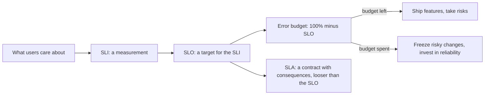
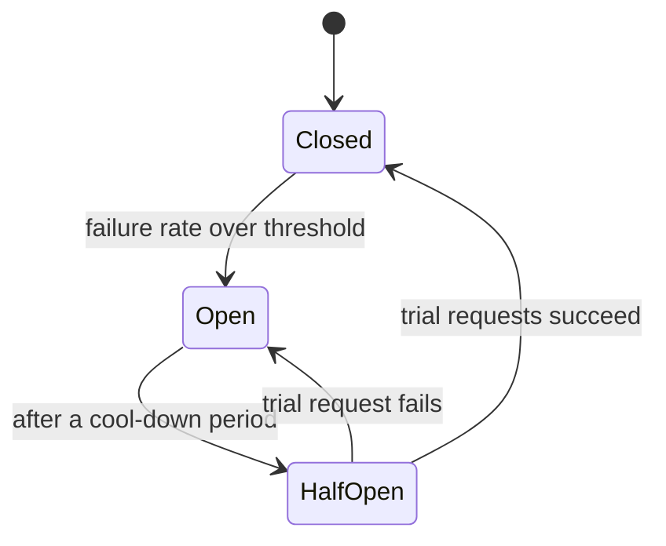

Every system fails sometimes: disks die, networks partition, a dependency has a bad day, someone
deploys a bug. Reliability engineering accepts this and asks two practical questions: _how
reliable does this actually need to be?_ and _when something breaks, how do we keep the damage
small?_ The first question is answered with SLIs, SLOs and error budgets, the core vocabulary of
Site Reliability Engineering as described in the [Google SRE Book](https://sre.google/sre-book/table-of-contents/).
The second is answered with design patterns: timeouts, retries, circuit breakers, bulkheads,
graceful degradation, and chaos experiments that prove they work.



## SLIs, SLOs, SLAs and error budgets

An analogy: a train company. The **indicator** is "percentage of trains arriving within 5 minutes
of schedule". The **objective** is "95% of trains, measured monthly". The **agreement** is the
promise on your ticket: "if your train is more than an hour late, you get a refund".

- **SLI (Service Level Indicator)**: a carefully defined measurement of some aspect of the service
  as users experience it. Usually a ratio of good events to total events: successful requests /
  all requests, or requests faster than 300 ms / all requests.
- **SLO (Service Level Objective)**: a target value for an SLI over a time window. "99.9% of
  `/checkout` requests succeed, over a rolling 28 days."
- **SLA (Service Level Agreement)**: a contract with customers that states what happens (refunds,
  credits) if you miss a level. SLAs are a business matter and should be _looser_ than your
  internal SLOs, so you get warned before you owe anyone money.

Good SLIs measure what users feel, as close to the user as you can measure it. CPU usage is not an
SLI: users don't care about your CPU. Typical SLIs for a request-driven service are
**availability** (the share of requests that succeed) and **latency** (the share served faster
than a threshold). For pipelines, **freshness** (how old the newest processed data is) and
**correctness** matter more.

> [!WARNING]
> 100% is the wrong target for almost everything. Users can't tell 99.99% from 100% because their
> own Wi-Fi, phone and ISP are less reliable than that, yet each extra "nine" costs much more
> engineering effort and slows down change. The SRE Book makes this point explicitly: pick the
> lowest reliability your users will be happy with.

### Error budgets

If your SLO is 99.9%, you are _allowed_ to fail 0.1% of the time. That allowance is the **error
budget**, and it changes the conversation between product and operations from opinions to
arithmetic.

| SLO | Allowed downtime per 30 days |
|---|---|
| 99% | 7.2 hours |
| 99.5% | 3.6 hours |
| 99.9% | 43.2 minutes |
| 99.99% | about 4.3 minutes |

As long as budget remains, the team can ship features, run experiments and take risks. When the
budget is used up, the agreed **error budget policy** kicks in: for example, only bug fixes and
reliability work until the service is back within its SLO. The
[Google SRE Workbook](https://sre.google/workbook/table-of-contents/) recommends writing that
policy down and getting it agreed _before_ it is needed, so nobody argues about it mid-incident.

> [!EXAMPLE]
> Your API's SLO is 99.9% of requests succeed over 28 days. It handles 10 million requests in that
> window, so the budget is 10,000 failed requests. A bad deploy causes 6,000 errors before it is
> rolled back. You have 4,000 left for the rest of the window, so the team decides that the next
> big migration waits for the new window, and adds a canary stage to the deploy pipeline.

Alert on the **burn rate** (how fast you are spending the budget), not on every single error. A
burn rate of 1 means you'll use exactly the budget by the end of the window; a burn rate of 10
means it will be gone in a tenth of the window, which deserves a page.

## Timeouts, retries with backoff, circuit breakers

Most large outages are not one component dying; they are one slow component dragging down
everything that calls it. These three patterns stop that spread.

**Timeouts.** Every network call needs one. Without it, a hung dependency holds your thread or
connection forever, and (by Little's law from 4.5.4) in-flight requests pile up until you run
out of workers. Set timeouts from data: a bit above the dependency's normal p99, not "30 seconds
because that's the default". Across a chain of calls, pass a **deadline** down, so a downstream
service doesn't keep working on a request the caller has already given up on.

**Retries with exponential backoff and jitter.** Many failures are transient, so retrying helps.
But naive retries are dangerous: if a service is struggling because of load, every client
retrying immediately multiplies that load. Rules of thumb:

- Retry only errors that are likely transient (timeouts, 503) and only **idempotent** operations
  (see 4.4.4), or operations protected by an idempotency key.
- Wait longer each time: 100 ms, 200 ms, 400 ms... (**exponential backoff**), with a cap.
- Add randomness (**jitter**) so thousands of clients don't retry in synchronised waves.
- Limit the attempts, and retry at **one** layer only. If three layers each retry 3 times, one
  user request can become 27 calls to the bottom service.

```python
import random, time

def call_with_retry(fn, attempts=4, base=0.1, cap=2.0):
    for i in range(attempts):
        try:
            return fn()
        except TransientError:
            if i == attempts - 1:
                raise
            time.sleep(random.uniform(0, min(cap, base * 2**i)))  # "full jitter"
```

**Circuit breakers.** Like the breaker in your house, it cuts the circuit when something is wrong,
so you stop hammering a dependency that is clearly down. It has three states:



While **open**, calls fail immediately (or go to a fallback) instead of waiting for a timeout.
That protects your own resources and gives the dependency room to recover.

> [!TIP]
> Fast failure is a feature. A request that fails in 5 ms with a clear message is much better for
> the user, and for your servers, than one that hangs for 30 seconds and then fails anyway.

## Graceful degradation and bulkheads

**Graceful degradation** means that when part of the system fails, you serve a reduced but useful
experience instead of an error page. An online shop whose recommendation service is down still
shows the product and the "buy" button, just without "customers also bought". Examples:

- Serve **stale cached data** with a "last updated" note instead of nothing.
- **Hide or disable** the broken feature and keep the rest of the page working.
- **Shed load**: under overload, reject low-priority work (background refreshes, analytics) first
  so important requests still succeed. The SRE Book's chapters on handling overload and cascading
  failures cover this in depth.

**Bulkheads** come from ship design: the hull is split into watertight compartments, so one hole
floods one compartment instead of sinking the ship. In software, you give separate pools of
resources to separate kinds of work, so one misbehaving dependency can't consume everything:

- A separate connection or thread pool per downstream service.
- Separate worker processes or queues for slow jobs (report generation, LLM calls) and fast
  requests.
- Per-tenant limits so one noisy customer can't starve the others.

> [!EXAMPLE]
> In YouCanDoIt, the AI tutor depends on an LLM that can be slow or unavailable, while the roadmap
> and progress pages only need the database. The API already maps `LLMError` to an HTTP 503 so
> the rest of the app keeps working when the model is down: that is graceful degradation. A
> bulkhead would go one step further and cap how many tutor requests may run at once, so a burst
> of slow LLM calls can never tie up the workers serving the roadmap.

## Chaos engineering basics

Timeouts, fallbacks and failovers that have never been exercised tend not to work when you need
them. **Chaos engineering** is the practice of injecting failures on purpose, in a controlled way,
to discover weaknesses before real incidents do. It became widely known through Netflix's Chaos
Monkey, which randomly terminated production instances to force teams to build services that
survive it.

It is an experiment, not random vandalism:

1. **Define steady state** using your SLIs: "p95 under 300 ms, error rate under 0.1%".
2. **Hypothesise**: "if one API replica dies, steady state holds because the load balancer
   routes around it".
3. **Inject a realistic failure**: kill a container, add 500 ms of network latency, fill a disk,
   make a dependency return errors.
4. **Observe** whether steady state held, and fix what didn't.
5. **Minimise the blast radius**: start in staging or with a small slice of traffic, have a stop
   button, and widen scope only as confidence grows.

> [!WARNING]
> Don't start chaos experiments before you have monitoring that can tell you whether steady state
> held, and a way to abort. Without those you are just causing an outage.

**Game days** are a lighter entry point: the team schedules an hour, breaks something on purpose
in a test environment, and practises detecting and responding to it, including following the
runbook (see 4.5.6).

## Practice: define SLOs for YouCanDoIt

You will write a short SLO document for this platform and measure one SLI by hand. Budget about
60 minutes and keep the result as `slo.md` in your notes.

### Step 1: List the user journeys

Who uses the app and what do they need from it? Start from the features: browsing the roadmap,
opening a session and reading its lesson, ticking subchapters (progress and XP), asking the AI
tutor, reading the news feed. Rank them: which one, if broken, would make you stop using the app
today?

### Step 2: Choose SLIs per journey

For each journey pick one or two SLIs, written as good events / total events, and say where you
would measure them (web proxy, API access log, a synthetic probe):

| Journey | SLI | Measured at |
|---|---|---|
| Read a session | Share of `GET /sessions/{id}` returning 2xx in under 500 ms | API access log |
| Tick progress | Share of `PUT /progress/{id}` returning 2xx | API access log |
| Ask the tutor | Share of `POST /ai/tutor` answered without 5xx, in under 20 s | API access log |
| News feed | Hours since the last successful refresh | Newest article timestamp |

### Step 3: Set targets, honestly

This is a personal app on a laptop or small server, so the right targets are modest. Decide a
window (for example 28 days) and a target for each SLI, and justify each in one line. The tutor
depends on a local or remote LLM, so it deserves a lower target than reading lessons; the news
refresh runs daily at 07:00, so a freshness SLO of "under 26 hours" fits better than "under 1
hour". Compute each error budget in minutes or in failed requests.

### Step 4: Write the error budget policy

Two or three sentences: what you will do when a budget is spent. For a solo project that might be
"no new features until I've found and fixed the cause, and added a test or alert for it".

### Step 5: Measure one SLI

With the stack running (`docker compose up -d`), run a crude synthetic probe for a few minutes
and compute availability and latency for the session page:

```sh
for i in $(seq 1 300); do
  curl -s -o /dev/null -w "%{http_code} %{time_total}\n" http://localhost:8000/sessions/4.5.5
  sleep 1
done > probe.txt

awk '{ total++ } $1 ~ /^2/ && $2 < 0.5 { good++ } END { printf "SLI: %.2f%% good\n", 100*good/total }' probe.txt
```

Halfway through, run `docker compose stop db` for 30 seconds and then `docker compose start db`:
a tiny chaos experiment. Did the API recover on its own? How much of your error budget did those
30 seconds cost? Write the answer in your document.

> [!TIP]
> Probe a cheap endpoint like `/health` as well. If `/health` stays green while sessions fail,
> your health check is not measuring what users feel, which is worth knowing before you wire it
> to a load balancer.
