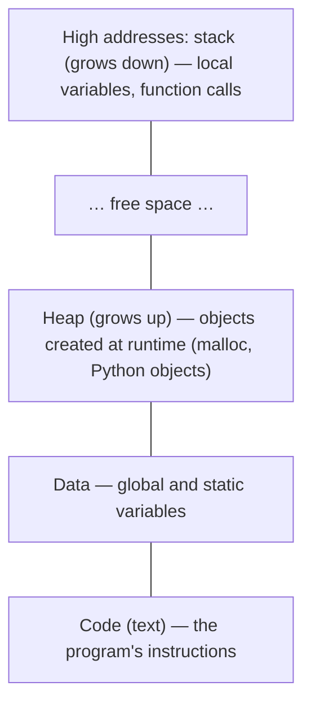
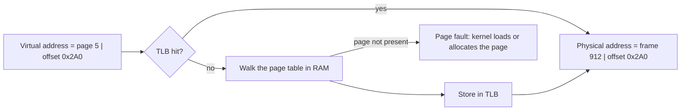
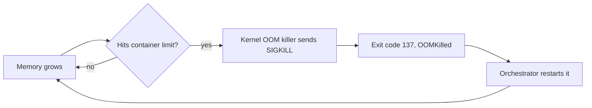

"The container was OOM-killed" is one of the most common incidents in backend work, and one of the
most confusing if you do not know how memory actually works. This session explains the illusion
every process lives in (its own private, huge memory), how the OS and CPU maintain that illusion
cheaply, how languages like Python hand out and reclaim memory, and what really happens when a
program "runs out". The OS part follows the second "easy piece" of
[OSTEP](https://pages.cs.wisc.edu/~remzi/OSTEP/), virtualising memory; the hands-on part uses
Python's [tracemalloc](https://docs.python.org/3/library/tracemalloc.html).

## Address spaces and virtual memory

Imagine a hotel where every guest is told "your room is number 1". Each guest happily writes
"room 1" on their mail, and the front desk silently translates "guest Rossi, room 1" into the real
room, 314. Guests never see each other's rooms, and the hotel can move guests around without
telling them.

That is **virtual memory**. Each process gets its own **address space**: a private range of
addresses starting from 0, as if it owned all the memory. The addresses a program uses are
**virtual addresses**. The hardware (the **MMU**, memory management unit) and the OS translate
them into **physical addresses** in real RAM on every memory access.

A typical address space is laid out like this:



Virtual memory gives three big wins:

- **Isolation**: process A literally cannot name an address in process B's memory.
- **Simplicity**: every program is compiled as if it had memory to itself, starting at the same
  layout.
- **Overcommit and laziness**: the OS can promise more memory than exists, and only find physical
  RAM for a page when it is first touched.

> [!NOTE]
> Tools report two kinds of size. **Virtual size** (VSZ/VIRT) is how much address space a
> process has reserved; it is often huge and mostly meaningless. **Resident set size** (RSS/RES)
> is how much physical RAM it actually occupies right now. When you ask "how much memory does my
> app use?", you almost always mean RSS.

## Paging and the TLB

Translating every single byte individually would need an enormous table. Instead memory is cut
into fixed-size blocks called **pages** (usually 4 KiB on x86 and Linux; Apple Silicon uses
16 KiB). Physical RAM is cut into same-sized **frames**. The OS keeps, per process, a **page
table**: a map from virtual page number to physical frame number, plus permission bits (readable,
writable, executable, present).

A virtual address is split into two parts: the **page number** (which page) and the **offset**
(where inside the page). Translation swaps the page number for a frame number and keeps the offset.



Page tables live in RAM, and real ones have several levels, so a naive translation would cost
several extra memory reads per access. The fix is the **TLB** (translation lookaside buffer), a
tiny, very fast cache inside the CPU of recent translations. Because programs tend to touch nearby
memory repeatedly (**locality**), the TLB hit rate is usually very high.

When a page is not present, the CPU raises a **page fault** and the kernel steps in. Page faults
are normal: a *minor* fault just means "first touch, give me a zeroed frame" or "it is already in
RAM, just map it". A *major* fault means the data must be read from disk (a memory-mapped file or
swap), which is thousands of times slower.

**Swap** is disk space used as overflow for RAM. When memory is tight the kernel evicts rarely
used pages to swap. A system that keeps swapping pages in and out is **thrashing**: everything
becomes painfully slow long before anything crashes.

> [!TIP]
> Locality is why "loop over an array in order" is faster than "jump randomly around a big hash
> map", even when the operation count is identical: sequential access is friendly to both the
> CPU caches and the TLB.

## Heap allocation and garbage collection

Inside a process, memory for data whose size or lifetime is not known in advance comes from the
**heap**. In C, you ask for it with `malloc()` and must give it back with `free()`. Forget to free
and you leak; free twice or use after freeing and you corrupt memory. The allocator (part of the C
library) requests big chunks from the kernel (via `brk` or `mmap`) and carves them into small
pieces.

Most modern languages automate the "give it back" step. That is **garbage collection** (GC):
memory is reclaimed automatically once nothing can reach it anymore. Two main families:

- **Reference counting**: every object counts how many references point to it; at zero it is freed
  immediately. CPython uses this as its main mechanism.
- **Tracing GC**: periodically start from the "roots" (globals, the stack), mark everything
  reachable, free the rest. Java, Go and JavaScript engines use tracing collectors.

Reference counting alone cannot free **cycles** (A points to B, B points to A, nobody else points
to either). So CPython also has a cyclic garbage collector, exposed by the `gc` module, which
periodically finds and frees unreachable cycles.

```python
import sys

data = [1, 2, 3]
alias = data
print(sys.getrefcount(data))  # 3: data, alias, and the temporary argument
del alias                      # count drops; at 0 the list would be freed
```

> [!WARNING]
> Garbage collection frees memory nobody can reach. It does **not** free memory you *can* still
> reach but forgot about. A global dict used as a cache that grows forever is perfectly reachable,
> so the GC will keep every entry. Most "leaks" in GC languages are exactly this.

Another subtlety: after Python frees objects, the process RSS often does not shrink much. The
allocator keeps the freed memory to reuse it later rather than returning it to the OS. So "memory
went up and never came down" is not proof of a leak; "memory keeps going up under steady load" is.

## Memory leaks and OOM kills

A **memory leak** is memory a program keeps holding after it no longer needs it. Typical causes in
backend code:

- Unbounded caches or module-level lists that collect every request.
- Event listeners or callbacks registered and never removed.
- Holding references to large objects in long-lived closures or exceptions.
- Native extensions that really do forget to `free()`.

The symptom is a sawtooth that never resets: memory climbs steadily with traffic, regardless of
load stabilising.

When a Linux machine truly runs out of memory (RAM plus swap), the kernel's **OOM killer** picks a
process, mostly the one using the most memory adjusted by its `oom_score_adj`, and kills it with
`SIGKILL`. There is no exception, no stack trace, no cleanup; the process just disappears.

In containers the same mechanism works per **cgroup**: if your container has a 512 MiB limit and
crosses it, the kernel kills a process inside it even though the host has plenty of free RAM.
Kubernetes reports this as `OOMKilled` with exit code 137 (128 + 9, the number of `SIGKILL`).



> [!EXAMPLE]
> A Celery worker processes image uploads. Each task loads the full image into memory and appends
> the result to a module-level `results` list "for debugging". Memory rises by a few MB per task,
> and every six hours the container is OOM-killed and restarted. The fix is not a bigger limit; it
> is deleting the list (and, as defence, recycling worker processes after N tasks).

> [!TIP]
> To confirm an OOM kill on a Linux host: `dmesg -T | grep -i -E 'killed process|out of memory'`
> or `journalctl -k | grep -i oom`. In Kubernetes: `kubectl describe pod` shows
> `Last State: Terminated, Reason: OOMKilled`.

## Practice: profile memory usage of a Python program

You will create a deliberate leak, then find it with `tracemalloc`, the standard-library module
that records where every Python allocation came from.

### Step 1: Write the leaky program

Save as `leak.py`:

```python
import tracemalloc

_cache = []  # the leak: grows forever

def handle_request(i: int) -> int:
    payload = "x" * 10_000         # ~10 KB per request
    _cache.append(payload)          # "keep it for later" (never cleaned)
    return len(payload)

tracemalloc.start()
before = tracemalloc.take_snapshot()

for i in range(5_000):
    handle_request(i)

after = tracemalloc.take_snapshot()
current, peak = tracemalloc.get_traced_memory()
print(f"current={current / 1e6:.1f} MB peak={peak / 1e6:.1f} MB")

print("Top differences:")
for stat in after.compare_to(before, "lineno")[:5]:
    print(stat)
```

### Step 2: Run it and read the output

```sh
python3 leak.py
```

`get_traced_memory()` returns the current and peak size of traced memory. The `compare_to`
list is sorted by growth; the top line should point straight at the `"x" * 10_000` line in
`handle_request` with roughly 50 MB of new allocations, and a large count. That is your leak
location.

### Step 3: Fix it and compare

Remove the `_cache.append(payload)` line and run again. Current memory should now stay small,
because each `payload` is freed as soon as the function returns (its reference count drops to 0).

### Step 4: Watch RSS from the outside

Put the leaky loop inside `while True:` with a `time.sleep(0.01)`, run it in the background, and
watch its resident memory grow:

```sh
python3 leak.py &
ps -o pid,rss,vsz,comm -p $!      # repeat a few times; RSS in KiB keeps rising
kill $!
```

### Step 5: Try startup tracing

For a program you did not write, enable tracing without code changes using
`python3 -X tracemalloc=10 app.py` (or `PYTHONTRACEMALLOC=10`), which stores 10 frames per
allocation; then take snapshots from a debug endpoint or signal handler.

Write down: what grew, which line caused it, and why the garbage collector did not save you.

```quiz
{"questions": [
  {"question": "Your service's VIRT column shows 4 GB but RES shows 200 MB. How much physical RAM is it actually using?", "options": ["About 4 GB", "About 200 MB", "4.2 GB", "Impossible to tell"], "answer": 1, "explanation": "Virtual size counts reserved address space, much of which is never backed by RAM. Resident set size is the physical memory in use."},
  {"question": "What problem does the TLB solve?", "options": ["It prevents processes from reading each other's memory", "It stores swapped-out pages", "It caches recent virtual-to-physical translations so most memory accesses do not need a page-table walk", "It garbage-collects unused pages"], "answer": 2, "explanation": "Page tables live in RAM and are multi-level; the TLB caches translations so the common case is fast."},
  {"question": "A Python service has a module-level dict that stores every user's last response forever. Why doesn't the garbage collector free it?", "options": ["The GC is disabled by default in Python", "The entries are still reachable through the dict, so they are not garbage", "Dicts are allocated outside the heap", "The GC only runs at shutdown"], "answer": 1, "explanation": "GC reclaims only unreachable objects. Reachable-but-useless data is a leak the GC cannot see."},
  {"question": "A pod restarts with exit code 137 and no Python traceback. What is the most likely explanation?", "options": ["An unhandled ValueError", "The kernel OOM killer sent SIGKILL because the container exceeded its memory limit", "A syntax error", "The disk was full"], "answer": 1, "explanation": "137 = 128 + 9 (SIGKILL). SIGKILL cannot be caught, so there is no traceback; with a memory limit this is the classic OOMKilled signature."}
]}
```
