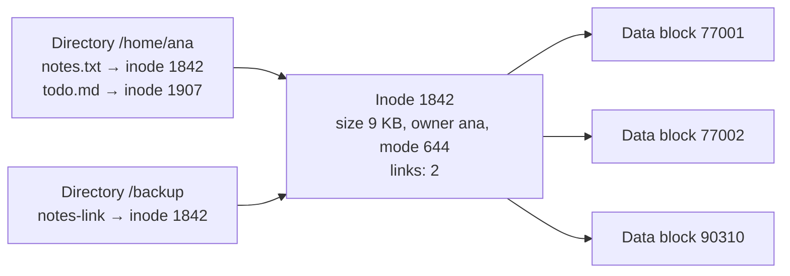

Databases, log pipelines, message queues and caches all end up writing bytes to a disk, and
almost every "the database got slow" or "we lost the last few seconds of data after a crash" story
is really a story about file systems and I/O. This session covers the third "easy piece" of
[OSTEP](https://pages.cs.wisc.edu/~remzi/OSTEP/), persistence: what a file really is, where your
`write()` goes before it reaches the disk, how hard drives and SSDs differ, and why access
*patterns* matter as much as data size.

## Files, directories and inodes

Think of a library. The books on the shelves are the data. The card catalogue has one card per
book, with its location, size and borrowing rules. The signs above the aisles ("Science →
aisle 4") map friendly names to catalogue cards.

On a Unix file system:

- The **data blocks** are the books: fixed-size chunks (commonly 4 KiB) on the disk.
- An **inode** (index node) is the catalogue card: one per file, holding its **metadata** (size,
  owner, permissions, timestamps, link count) and pointers to its data blocks. Every inode has a
  number. The inode does *not* contain the file's name.
- A **directory** is the aisle sign: a special file whose content is a list of `name → inode
  number` entries.



Because names live in directories, one inode can have several names: that is a **hard link**
(`ln a b`). The file's data is only freed when the link count reaches zero *and* no process still
has it open. A **symbolic link** (`ln -s`) is different: a tiny file whose content is a path.

When a process opens a file, the kernel returns a **file descriptor**: a small integer (0 is
stdin, 1 stdout, 2 stderr, then 3, 4, …) that indexes the process's table of open files. All
later `read()` and `write()` syscalls use that number.

> [!EXAMPLE]
> A classic production puzzle: `df` says the disk is full, but `du` cannot find the big files.
> Someone deleted a huge log file while a process still had it open. The name is gone, but the
> inode and its blocks live on until the process closes it. `lsof +L1` lists such deleted-but-open
> files; restarting (or signalling) the process frees the space.

> [!TIP]
> `ls -i` shows inode numbers and `stat file` shows the full inode metadata. A file system can
> run out of **inodes** before it runs out of bytes (millions of tiny files); `df -i` checks that.

## Buffered vs direct I/O, fsync

Disks are slow compared to RAM, so the OS hides them behind a cache in memory called the **page
cache**. When you `write()`, the kernel usually copies your bytes into the page cache, marks those
pages **dirty**, and returns immediately. A background flusher writes dirty pages to disk later,
typically within seconds. When you `read()`, the kernel serves from the page cache if it can, and
otherwise reads from disk and keeps a copy.

That is **buffered I/O**, and there are usually *two* layers of buffering:


- `f.write()` in Python goes into the **user-space buffer** of the file object. No syscall yet.
- `f.flush()` (or the buffer filling up, or closing the file) issues a `write()` syscall: now the
  data is in the **kernel page cache**. Other processes can read it, and it survives *your process*
  crashing, but **not** a power loss or kernel crash.
- `os.fsync(fd)` asks the kernel to push the file's dirty data (and metadata) to the device and
  wait until the device confirms. Only then is it **durable**.

```python
import os

with open("ledger.log", "a") as f:
    f.write("transfer 42 EUR\n")
    f.flush()              # user buffer -> page cache
    os.fsync(f.fileno())   # page cache -> disk, wait for confirmation
```

`fsync` is expensive (milliseconds on many devices), which is why databases batch many
transactions into one `fsync` (**group commit**) and write changes first to an append-only
**write-ahead log** (WAL): sequential appends plus one `fsync` per commit is far cheaper than
rewriting scattered pages.

**Direct I/O** (the `O_DIRECT` flag on Linux) bypasses the page cache entirely; the application
manages its own cache. Some databases use it because they know their access patterns better than
the kernel does. As an application developer you will rarely use it, but you should know it
exists.

> [!WARNING]
> "I wrote it, so it's saved" is false. Without `fsync`, a power cut can lose seconds of
> acknowledged writes. Settings like PostgreSQL's `synchronous_commit` or Redis's `appendfsync`
> are exactly this trade-off: durability versus write speed.

## Disks and SSDs

**Hard disk drives (HDDs)** are spinning platters with a mechanical arm, like a record player.
Reading a random block means moving the arm (**seek time**) and waiting for the platter to rotate
under it (**rotational latency**): several milliseconds each time. Once the head is in place,
reading consecutive blocks is fast. So on HDDs, **sequential I/O can be orders of magnitude faster
than random I/O**.

**Solid-state drives (SSDs)** store data in flash memory with no moving parts. Random reads are
dramatically faster than on HDDs, and NVMe SSDs can handle many requests in parallel. But SSDs have
their own quirks: flash is written in pages but erased only in larger blocks, so the drive's
firmware (the flash translation layer) constantly relocates data, and each cell wears out after a
limited number of writes. Sequential access is still usually faster than random, just with a much
smaller gap.

Two numbers describe storage performance:

| Metric | Means | Matters for |
|---|---|---|
| **IOPS** | I/O operations per second | Many small random reads/writes (databases, indexes) |
| **Throughput** | MB/s moved | Large sequential transfers (backups, logs, video) |
| **Latency** | Time per operation | Every request waiting on a disk |

And all of them are far slower than memory: a RAM access takes on the order of 100 ns, an NVMe
read on the order of tens to a hundred microseconds, and an HDD seek several milliseconds.

> [!NOTE]
> Cloud "disks" (like AWS EBS) are network-attached storage with provisioned IOPS and throughput
> limits. Running out of IOPS budget looks exactly like a slow disk: high `iowait`, growing query
> latency, CPU mostly idle.

## Practice: measure sequential vs random I/O

You will write a test file and read it sequentially and randomly, first through the page cache
and then (on Linux) with the cache dropped, to see both effects.

### Step 1: Create a 1 GiB file

```sh
dd if=/dev/urandom of=testfile bs=1M count=1024   # takes a few seconds
```

### Step 2: The benchmark script

Save as `io_bench.py`:

```python
import os
import random
import sys
import time

PATH = "testfile"
BLOCK = 4096
size = os.path.getsize(PATH)
blocks = size // BLOCK
n = 20_000

def run(offsets: list[int], label: str) -> None:
    fd = os.open(PATH, os.O_RDONLY)
    start = time.perf_counter()
    for off in offsets:
        os.pread(fd, BLOCK, off)
    elapsed = time.perf_counter() - start
    os.close(fd)
    mb = n * BLOCK / 1e6
    print(f"{label:<10} {n / elapsed:>10.0f} IOPS {mb / elapsed:>8.1f} MB/s")

sequential = [i * BLOCK for i in range(n)]
rand = [random.randrange(blocks) * BLOCK for _ in range(n)]
mode = sys.argv[1] if len(sys.argv) > 1 else "both"
if mode in ("seq", "both"):
    run(sequential, "sequential")
if mode in ("rand", "both"):
    run(rand, "random")
```

`os.pread` reads `BLOCK` bytes at a given offset in one syscall, so each iteration is one 4 KiB
read.

### Step 3: Run with a warm cache

```sh
cat testfile > /dev/null    # pull the file into the page cache
python3 io_bench.py
```

Both runs are fast and close to each other: you are measuring RAM, not disk. This is why naive
benchmarks lie.

### Step 4: Run with a cold cache (Linux)

```sh
sync && echo 3 | sudo tee /proc/sys/vm/drop_caches
python3 io_bench.py seq
sync && echo 3 | sudo tee /proc/sys/vm/drop_caches
python3 io_bench.py rand
```

Now the gap appears. Sequential reads also benefit from the kernel's **readahead** (it guesses
you will want the next blocks and fetches them early). On an SSD expect random to be several
times slower; on an HDD, far worse. On macOS, `sudo purge` drops the cache instead.

### Step 5: Try fsync cost

Write 1,000 small lines with and without `os.fsync` after each one and time both. Record the three
numbers (warm, cold sequential, cold random, fsync vs not) and one sentence on what they mean for
a database's design. Then delete `testfile`.

```quiz
{"questions": [
  {"question": "Where is a file's name stored on a Unix file system?", "options": ["In the inode", "In the first data block", "In the directory entry that maps the name to the inode number", "In the page cache"], "answer": 2, "explanation": "Inodes hold metadata and block pointers but not names; directories map names to inode numbers, which is what makes hard links possible."},
  {"question": "Your code calls f.write() then f.flush(), and a second later the server loses power. Is the data guaranteed to be on disk?", "options": ["Yes, flush writes to disk", "No: flush only moves data into the kernel page cache; only fsync waits for the device", "Yes, if the file was opened in append mode", "Only on SSDs"], "answer": 1, "explanation": "flush issues the write syscall, which lands in the page cache. Durability against power loss requires fsync."},
  {"question": "Why do databases append changes to a write-ahead log before updating their data files?", "options": ["Sequential appends with a single fsync per commit are much cheaper than random writes, while still making commits durable", "Logs compress better", "Data files cannot be written while the database is running", "To avoid using the page cache"], "answer": 0, "explanation": "The WAL turns scattered random writes into sequential appends, and the data pages can be flushed lazily later."},
  {"question": "A benchmark shows random and sequential reads at the same speed. What is the most likely reason?", "options": ["The disk is broken", "The file was already in the page cache, so you measured RAM", "Random reads are always as fast as sequential ones", "Python is too slow to notice"], "answer": 1, "explanation": "A warm page cache hides the device entirely. Drop caches or use a file larger than RAM to measure the disk."}
]}
```
