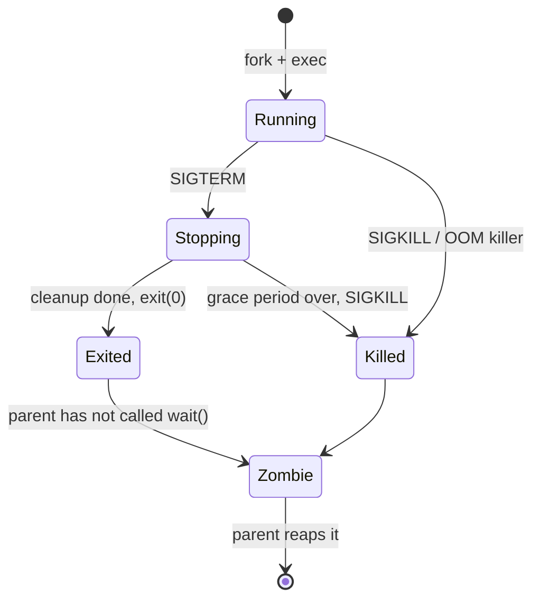

Sooner or later your code runs on a Linux server, and when it misbehaves at 2 a.m. nobody will
hand you a dashboard for everything. You will SSH in, read logs, check which user a process runs
as, restart a service and figure out why it will not start. This session gives you the working
toolkit of a developer who can also operate what they ship. The command-line foundation comes from
[The Linux Command Line](https://linuxcommand.org/tlcl.php); the operator skills map to the Linux
and server sections of [roadmap.sh DevOps](https://roadmap.sh/devops). Examples assume a
Debian/Ubuntu server; other distributions differ mostly in the package manager.

## Users, groups and permissions

Linux is a shared building. Every person has a key card (a **user**), belongs to some teams
(**groups**), and every door (file) says who may open it. Each user has a numeric **UID**; `root`
is UID 0 and may open every door. Services usually run as their own unprivileged user (`www-data`,
`postgres`) so a bug in one cannot read the others' files.

```sh
id                    # your uid, gid and groups
whoami
sudo adduser deploy   # create a user (Debian/Ubuntu helper)
sudo usermod -aG docker deploy   # add to a group (-a = append, don't replace!)
```

Every file has an **owner**, a **group** and three sets of permission bits: for the owner (`u`),
the group (`g`) and everyone else (`o`). Each set is read (`r` = 4), write (`w` = 2) and execute
(`x` = 1).

```text
-rwxr-x---  1 deploy  app  4096  Oct 19  run.sh
 │└┬┘└┬┘└┬┘
 │ │  │  └─ others: nothing
 │ │  └──── group "app": read + execute  (4+1 = 5)
 │ └─────── owner "deploy": read + write + execute (4+2+1 = 7)
 └───────── type: - file, d directory, l symlink
```

So that file is mode `750`. Change modes and owners with:

```sh
chmod 640 config.env           # owner rw, group r, others nothing
chmod u+x deploy.sh            # add execute for the owner
sudo chown deploy:app config.env
```

On a **directory**, `r` lets you list names, `w` lets you create and delete entries, and `x` lets
you enter it and reach files inside. A file can be readable yet unreachable if a parent directory
lacks `x`.

> [!WARNING]
> `chmod -R 777` "fixes" permission errors by giving every user on the box write access. Never do
> it. Find which user the process runs as (`ps -o user= -p <PID>`) and grant exactly that user or
> group what it needs.

> [!TIP]
> Use `sudo` for single privileged commands instead of logging in as root. It leaves an audit
> trail and limits the blast radius of typos.

## systemd services and journald logs

On most modern distributions, the first process (PID 1) is **systemd**. It starts everything else
and keeps services running, like a building manager who turns the lights on at opening time and
calls the repair person when something breaks. A service is described by a **unit file**:

```ini
# /etc/systemd/system/myapi.service
[Unit]
Description=My FastAPI service
After=network-online.target
Wants=network-online.target

[Service]
User=myapi
Group=myapi
WorkingDirectory=/opt/myapi
EnvironmentFile=/etc/myapi.env
ExecStart=/opt/myapi/.venv/bin/uvicorn app.main:app --host 127.0.0.1 --port 8000
Restart=on-failure
RestartSec=3

[Install]
WantedBy=multi-user.target
```

`[Service]` says *how* to run it and as whom; `Restart=on-failure` makes systemd restart it if it
crashes; `[Install]` says which boot target pulls it in when enabled. The daily commands:

```sh
sudo systemctl daemon-reload          # after creating or editing a unit file
sudo systemctl enable --now myapi     # start now and at every boot
systemctl status myapi                # state, PID, last log lines
sudo systemctl restart myapi
systemctl list-units --type=service --state=failed
```

Everything a service prints to stdout and stderr is captured by **journald**, systemd's log
collector. Read it with `journalctl`:

```sh
journalctl -u myapi                   # all logs for one unit
journalctl -u myapi -f                # follow live, like tail -f
journalctl -u myapi --since "10 min ago" -p err   # only errors, recent
journalctl -b                         # everything since the last boot
```

> [!NOTE]
> Older or specialised setups still write text logs to `/var/log` (for example
> `/var/log/nginx/error.log`). On a systemd machine, check `journalctl -u <unit>` first; it is
> where a crashing service's last words usually are.

## Package managers

A **package manager** installs software together with its dependencies from trusted repositories,
tracks what is installed and handles upgrades and removal. Think of it as an app store for the
server, with signatures to prove packages were not tampered with.

| Family | Tool | Install | Update index + upgrade |
|---|---|---|---|
| Debian, Ubuntu | `apt` | `sudo apt install nginx` | `sudo apt update && sudo apt upgrade` |
| Fedora, RHEL, Rocky | `dnf` | `sudo dnf install nginx` | `sudo dnf upgrade` |
| Alpine (common in containers) | `apk` | `apk add nginx` | `apk update && apk upgrade` |
| Arch | `pacman` | `sudo pacman -S nginx` | `sudo pacman -Syu` |

Other useful commands on Debian/Ubuntu: `apt search`, `apt show <pkg>`, `dpkg -L <pkg>` (which
files a package installed) and `apt remove`.

Do not confuse the OS package manager with language ones (`pip`, `npm`, `uv`). Use the OS one for
system software (Nginx, PostgreSQL, Git) and a language tool inside a virtual environment for your
app's libraries. Installing Python libraries system-wide with `sudo pip` can break tools the OS
itself depends on.

> [!TIP]
> Security updates matter more than new features on a server. Enable automatic security updates
> (on Ubuntu, the `unattended-upgrades` package) and schedule reboots for kernel updates.

## Signals and process lifecycle

A **signal** is a tiny asynchronous message the kernel delivers to a process, like a tap on the
shoulder. The process can catch most signals and react; a few it cannot.

| Signal | Number | Default meaning | Can be caught? |
|---|---|---|---|
| `SIGINT` | 2 | Interrupt (Ctrl+C) | Yes |
| `SIGTERM` | 15 | Please terminate (polite) | Yes |
| `SIGKILL` | 9 | Die now | **No** |
| `SIGHUP` | 1 | Terminal closed; often "reload config" | Yes |
| `SIGSTOP` / `SIGCONT` | 19 / 18 (x86 Linux) | Pause / resume | No / Yes |

`kill -TERM <PID>` sends SIGTERM (it is also the default for `kill`). Graceful shutdown is a
contract: on SIGTERM, a well-behaved server stops accepting new requests, finishes in-flight ones,
closes database connections and exits. systemd and Docker both send SIGTERM first, wait a grace
period (90 seconds by default for systemd, 10 for `docker stop`), then send SIGKILL.



When a process exits, it stays briefly as a **zombie** holding its exit code until the parent
collects it with `wait()`. If the parent dies first, the orphan is adopted by PID 1, which reaps
it. In containers, your app may *be* PID 1, which is why tools like `tini` (or `docker run
--init`) exist: to forward signals and reap zombies.

> [!WARNING]
> Reaching for `kill -9` first skips every cleanup step: half-written files, unflushed buffers,
> locks never released. Send SIGTERM, wait, and only then escalate.

## SSH and remote administration

**SSH** (Secure Shell) gives you an encrypted terminal on a remote machine. Use **key pairs**
instead of passwords: the private key stays on your laptop, the public key goes into the server's
`~/.ssh/authorized_keys`.

```sh
ssh-keygen -t ed25519 -C "ana@laptop"         # create a key pair
ssh-copy-id deploy@203.0.113.10               # install the public key
ssh deploy@203.0.113.10                       # log in
scp app.tar.gz deploy@203.0.113.10:/tmp/      # copy a file
ssh -L 5433:localhost:5432 deploy@203.0.113.10   # tunnel: local 5433 -> server's Postgres
```

A `~/.ssh/config` entry saves typing:

```text
Host prod
  HostName 203.0.113.10
  User deploy
  IdentityFile ~/.ssh/id_ed25519
```

Now `ssh prod` just works. Basic hardening of a fresh server, in `/etc/ssh/sshd_config`:
`PasswordAuthentication no` and `PermitRootLogin no`, then `sudo systemctl reload ssh` (the unit
is `sshd` on some distributions). Keep your current session open while testing a new login, so a
mistake does not lock you out. Add a firewall (`ufw allow OpenSSH && ufw enable` on Ubuntu) and
consider `fail2ban` to block brute-force attempts.

> [!TIP]
> For long-running commands over SSH, use `tmux` (or `screen`). If your connection drops, the
> session keeps running and you reattach with `tmux attach`.

## Practice: deploy a service with systemd on a VM

Get a Linux VM: a cheap cloud instance, or locally with Multipass (`multipass launch --name lab`
then `multipass shell lab`). Ubuntu is assumed.

### Step 1: Create a service user and app directory

```sh
sudo adduser --system --group --no-create-home myapi
sudo mkdir -p /opt/myapi && sudo chown myapi:myapi /opt/myapi
sudo apt update && sudo apt install -y python3-venv
```

### Step 2: Install a tiny app

```sh
sudo -u myapi python3 -m venv /opt/myapi/.venv
sudo -u myapi /opt/myapi/.venv/bin/pip install fastapi uvicorn
sudo -u myapi mkdir -p /opt/myapi/app
sudo -u myapi tee /opt/myapi/app/main.py > /dev/null <<'EOF'
import os
from fastapi import FastAPI

app = FastAPI()

@app.get("/")
def hello():
    return {"hello": os.environ.get("GREETING", "world"), "pid": os.getpid()}
EOF
echo 'GREETING=from systemd' | sudo tee /etc/myapi.env
sudo chmod 640 /etc/myapi.env && sudo chown root:myapi /etc/myapi.env
```

### Step 3: Write and enable the unit

Create `/etc/systemd/system/myapi.service` with the unit file from the systemd section above,
then:

```sh
sudo systemctl daemon-reload
sudo systemctl enable --now myapi
systemctl status myapi
curl -s localhost:8000
```

### Step 4: Break it and read the logs

Edit `ExecStart` to point at a wrong module (`app.mian:app`), `daemon-reload`, restart, and read
`journalctl -u myapi -n 30`. Note how `Restart=on-failure` keeps retrying. Fix it.

### Step 5: Signals and restarts

```sh
PID=$(systemctl show -p MainPID --value myapi)
sudo kill -TERM "$PID"; sleep 4; systemctl status myapi   # inactive: SIGTERM counts as a clean stop
sudo systemctl start myapi
PID=$(systemctl show -p MainPID --value myapi)            # the new MainPID
sudo kill -KILL "$PID"; sleep 4; systemctl status myapi   # watch it come back
sudo reboot                  # after reconnecting: is it running? (enabled = yes)
```

Record which signals caused a restart and why: for `Restart=on-failure`, systemd treats a stop by
SIGTERM (or SIGINT, SIGHUP) as clean, so it does not restart; death by SIGKILL is a failure, so it
does.

```quiz
{"questions": [
  {"question": "A file has mode 640, owner deploy, group app. Which statement is true?", "options": ["Everyone can read it", "deploy can read and write it, members of app can read it, others have no access", "Only root can read it", "Members of app can write it"], "answer": 1, "explanation": "6 = rw for the owner, 4 = r for the group, 0 = nothing for others."},
  {"question": "Your service keeps failing to start. Where do you look first on a systemd machine?", "options": ["journalctl -u <service>", "The ~/.bashrc file", "/etc/passwd", "dmesg only"], "answer": 0, "explanation": "journald captures the service's stdout/stderr, so the startup error is usually in journalctl -u for that unit."},
  {"question": "Why should a deploy script send SIGTERM before SIGKILL?", "options": ["SIGKILL is slower", "SIGTERM can be caught, letting the app finish in-flight requests and clean up; SIGKILL cannot be caught", "SIGTERM restarts the process automatically", "SIGKILL only works for root"], "answer": 1, "explanation": "SIGTERM gives the process a chance to shut down gracefully. SIGKILL ends it immediately with no cleanup."},
  {"question": "What is the main reason to disable SSH password authentication?", "options": ["Keys are shorter to type", "Passwords make SSH slower", "Key-based auth resists brute-force password guessing, which internet-facing servers face constantly", "Passwords do not work with scp"], "answer": 2, "explanation": "Public servers receive constant password-guessing attempts; key pairs make those attacks practically useless."}
]}
```
