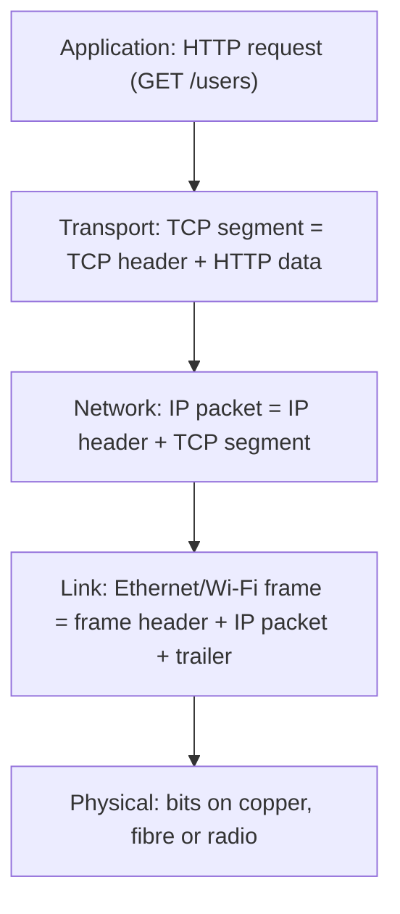
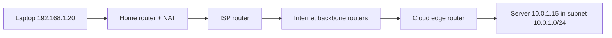
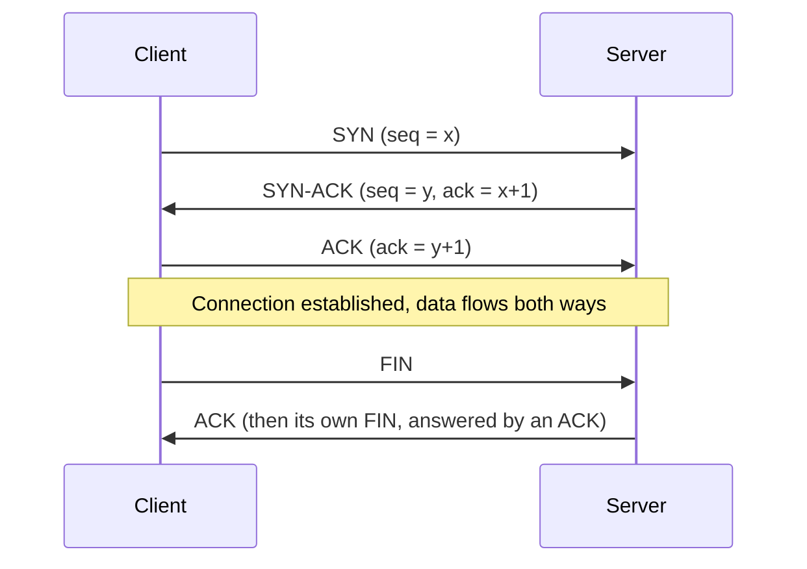

When your FastAPI app answers a request, the bytes travel through your code, the OS, a network
card, cables, Wi-Fi, a dozen routers owned by different companies, and back again, usually in
well under a second and usually without losing a byte. This session explains how: the layers that
split that huge problem into manageable pieces, how addresses and routing get a packet to the right
machine, and how TCP turns an unreliable network into a reliable stream. Two excellent free
references back it: the open textbook
[Computer Networks: A Systems Approach](https://book.systemsapproach.org/) and the
[Kurose & Ross lectures](https://gaia.cs.umass.edu/kurose_ross/online_lectures.htm).

## The layered model (OSI vs TCP/IP)

Sending a parcel internationally is a chain of independent jobs. You write a letter (content), put
it in an envelope with a name (who it is for), the post office adds a tracking label and address
(which building), and trucks and planes move the box (physical transport). Each job only talks to
its neighbours: the truck driver never reads your letter.

Networks work the same way, as a stack of **layers**. Each layer offers a service to the layer
above and uses the one below. When sending, each layer wraps the data from above in its own
**header**; this is **encapsulation**. The receiver unwraps in reverse.



There are two common models:

| OSI (7 layers, teaching model) | TCP/IP (what the internet runs) | Examples |
|---|---|---|
| 7 Application, 6 Presentation, 5 Session | Application | HTTP, DNS, TLS, SSH |
| 4 Transport | Transport | TCP, UDP, QUIC |
| 3 Network | Internet | IP (v4, v6), ICMP |
| 2 Data link, 1 Physical | Link | Ethernet, Wi-Fi |

The OSI model is the vocabulary people use ("that's a layer 7 load balancer", "an L4 problem");
the TCP/IP model is what actually runs. The magic is the **narrow waist**: everything above and
below agrees on IP, so a new application (video calls) or a new link (5G) works without changing
the rest.

> [!NOTE]
> Names for a unit of data change by layer: **frame** (link), **packet** (network), **segment**
> (TCP) or **datagram** (UDP), **message** (application). People mix them up casually, but in a
> packet capture these distinctions help you read headers.

## IP addressing, subnets and routing

An **IP address** identifies a network interface, like a postal address identifies a building.
IPv4 addresses are 32 bits, written as four numbers 0–255: `192.168.1.20`. IPv6 addresses are
128 bits, written in hex groups: `2001:db8::1`. IPv4's ~4.3 billion addresses ran out long ago,
which is why IPv6 exists and why your home uses **NAT** (many private devices share one public
address).

An address has two parts: a **network prefix** (which street) and a **host** part (which house).
**CIDR notation** says how many leading bits are the prefix:

| CIDR | Netmask | Addresses | Typical use |
|---|---|---|---|
| `10.0.0.0/8` | 255.0.0.0 | 16,777,216 | Large private network |
| `10.0.1.0/24` | 255.255.255.0 | 256 | One subnet (e.g. a VPC subnet) |
| `10.0.1.0/28` | 255.255.255.240 | 16 | Tiny subnet |
| `203.0.113.10/32` | 255.255.255.255 | 1 | A single host in a firewall rule |

A **subnet** is a group of addresses sharing a prefix; hosts in the same subnet talk directly over
the link layer. The private ranges `10.0.0.0/8`, `172.16.0.0/12` and `192.168.0.0/16` are reserved
for internal networks and never routed on the public internet. `127.0.0.1` is **localhost**.

To reach anything outside its subnet, a host sends the packet to its **default gateway** (a
router). Each **router** looks at the destination address, finds the **longest matching prefix**
in its routing table, and forwards the packet one hop closer. No router knows the whole path; each
just knows the next hop, like signposts at every junction. Between organisations, routers learn
routes from each other using **BGP**.



> [!TIP]
> `ip addr` (Linux) or `ifconfig` (macOS) shows your addresses; `ip route` or `netstat -rn` shows
> your routing table; `traceroute example.com` (or `mtr`) lists the routers along the path.

> [!EXAMPLE]
> A security group allows Postgres from `10.0.1.0/24`. Your new app server is `10.0.2.7`, so
> connections time out. The prefix `/24` covers only `10.0.1.0`–`10.0.1.255`. Reading CIDR
> correctly fixes half of all "it can't connect" tickets in the cloud.

## TCP vs UDP, handshakes and congestion control

IP is **best effort**: packets can be lost, duplicated, delayed or arrive out of order. The
transport layer decides what to do about that, and it adds **ports** so one machine can run many
services (`:443` for HTTPS, `:5432` for Postgres). A connection is identified by the 4-tuple
*(source IP, source port, destination IP, destination port)*.

**UDP** is a postcard: send it and hope. No connection, no ordering, no retransmission, minimal
header. It is used where speed matters more than perfection or where the application handles
reliability itself: DNS lookups, video calls, games, and QUIC (the transport under HTTP/3).

**TCP** is a phone call: you set up a connection, everything you say arrives in order, and
missing words are repeated. It gives a reliable, ordered **byte stream** using sequence numbers,
acknowledgements (ACKs) and retransmission. A connection starts with the **three-way handshake**:



The handshake costs one round trip before any data flows, and TLS adds more on top. That is why
**connection reuse** (HTTP keep-alive, database connection pools) matters so much for latency.

TCP has two kinds of flow management:

- **Flow control** protects the *receiver*: it advertises a **receive window** saying how much it
  can buffer, and the sender never exceeds it.
- **Congestion control** protects the *network*. The sender keeps a **congestion window** and
  grows it as ACKs come back (exponentially during **slow start**, then more gently). When it
  detects loss, it assumes the network is congested and backs off sharply. Classic algorithms
  include Reno and CUBIC (the Linux default); Google's BBR estimates bandwidth and delay instead of
  relying only on loss.

| | TCP | UDP |
|---|---|---|
| Connection setup | Handshake | None |
| Delivery | Reliable, ordered | Best effort |
| Congestion control | Built in | Up to the application |
| Typical uses | HTTP/1.1 and HTTP/2, SSH, databases | DNS, streaming, games, QUIC |

> [!WARNING]
> TCP is a byte *stream*, not a message protocol. One `send()` of 10 KB may arrive as three
> `recv()` calls, and two small sends may arrive in one. Your application must frame messages
> itself (length prefixes, delimiters like `\n`). Session 4.2.3 puts this into practice.

## Practice: inspect traffic with tcpdump or Wireshark

You will capture a real HTTP exchange and find each layer and the TCP handshake in it.
`tcpdump` is preinstalled on macOS and installable on Linux (`sudo apt install tcpdump`);
[Wireshark](https://www.wireshark.org/) gives the same data in a GUI.

### Step 1: Start a local server

```sh
python3 -m http.server 8080
```

Using plain HTTP on localhost means you can read the payload (HTTPS would be encrypted).

### Step 2: Capture on the loopback interface

In a second terminal:

```sh
sudo tcpdump -i lo -nn -A 'tcp port 8080'      # Linux (on macOS use -i lo0)
```

`-nn` shows raw numbers instead of names, `-A` prints payloads as ASCII, and the final expression
is a filter.

### Step 3: Make one request

In a third terminal: `curl -s http://127.0.0.1:8080/ > /dev/null`. Stop tcpdump with Ctrl+C.

### Step 4: Read the capture

Find, in order:

1. Three lines with flags `[S]`, `[S.]`, `[.]`: the SYN, SYN-ACK and ACK handshake. Note the
   client's random high source port.
2. A `[P.]` (push) segment whose ASCII payload starts with `GET / HTTP/1.1`: your application
   layer message inside TCP inside IP.
3. The server's response starting `HTTP/1.0 200 OK`.
4. `[F.]` segments: the connection closing.

### Step 5: Compare with UDP

Capture DNS while resolving a name:

```sh
sudo tcpdump -i any -nn 'udp port 53'      # on macOS use -i en0 (your network interface)
dig example.com                             # in another terminal
```

There is no handshake: one query datagram, one response. If you prefer a GUI, open Wireshark,
capture on loopback with the filter `tcp.port == 8080`, and use *Statistics → Flow Graph* to see
the handshake as a diagram.

Write a short note with the four TCP phases you saw and the one-line difference between the TCP
and UDP captures.

```quiz
{"questions": [
  {"question": "A load balancer routes requests based on the URL path /api vs /static. At which layer is it working?", "options": ["Layer 2 (link)", "Layer 3 (network)", "Layer 4 (transport)", "Layer 7 (application)"], "answer": 3, "explanation": "The URL path is part of the HTTP message, so reading it requires understanding the application layer."},
  {"question": "Which addresses does 10.0.1.0/24 include?", "options": ["10.0.0.0 to 10.255.255.255", "10.0.1.0 to 10.0.1.255", "Only 10.0.1.0", "10.0.1.0 to 10.0.1.24"], "answer": 1, "explanation": "/24 means the first 24 bits are fixed, leaving 8 bits (256 addresses) for hosts."},
  {"question": "Why does reusing an existing TCP connection make an API call faster?", "options": ["It skips the handshake (and TLS setup) round trips before data can flow", "Reused connections use UDP", "It disables congestion control", "It compresses the data"], "answer": 0, "explanation": "A new TCP connection costs a round trip for the handshake, plus more for TLS. Keep-alive and pools avoid paying that each time."},
  {"question": "A client sends two JSON messages with two separate send() calls. The server's single recv() returns both glued together. What is going on?", "options": ["A bug in the kernel", "TCP is a byte stream with no message boundaries, so the application must frame its messages", "UDP was used by mistake", "The packets were corrupted"], "answer": 1, "explanation": "TCP guarantees order and delivery of bytes, not preservation of message boundaries."}
]}
```
