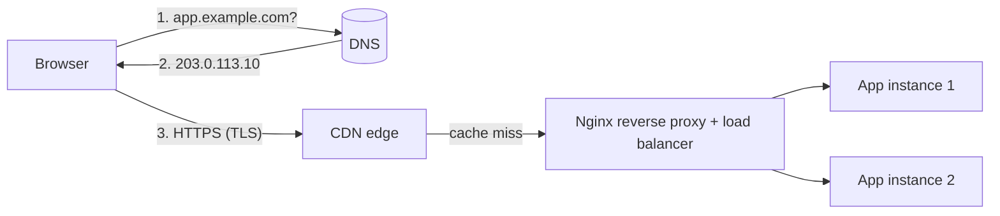

Between a user typing `app.example.com` and your FastAPI handler running, several pieces of
infrastructure each do one job: **DNS** turns the name into an address, **TLS** proves the server
is really yours and encrypts the traffic, a **reverse proxy** receives the connection and passes
it to your app, a **load balancer** spreads requests across instances, and a **CDN** may answer
before the request ever reaches you. This session explains each piece and ends with you wiring the
first three together yourself. Good reference reading: the
[Cloudflare Learning Center](https://www.cloudflare.com/learning/), the
[Let's Encrypt docs](https://letsencrypt.org/docs/) and the [Nginx docs](https://nginx.org/en/docs/).



## DNS records and propagation

DNS (the Domain Name System) is the internet's phone book, except no single book exists: it is a
hierarchy of servers, each responsible for part of the name. To resolve `app.example.com`, a
**recursive resolver** (your ISP's, or a public one like `1.1.1.1`) asks a **root server** who
handles `.com`, asks the `.com` servers who handles `example.com`, and finally asks
`example.com`'s **authoritative name server** for the record. The resolver caches every answer.

The record types you will use most:

| Type | Maps | Example |
|---|---|---|
| `A` | Name → IPv4 address | `app.example.com → 203.0.113.10` |
| `AAAA` | Name → IPv6 address | `app.example.com → 2001:db8::10` |
| `CNAME` | Name → another name (alias) | `www.example.com → example.com` |
| `MX` | Domain → mail servers (with priority) | `example.com → 10 mail.example.com` |
| `TXT` | Name → free text | SPF, domain-ownership checks |
| `NS` | Zone → its authoritative name servers | `example.com → ns1.provider.net` |
| `CAA` | Which CAs may issue certificates | `example.com → 0 issue "letsencrypt.org"` |

Every record has a **TTL** (time to live) in seconds: how long resolvers may cache it.
"**Propagation**" is not DNS actively pushing changes around the world; it is old cached answers
expiring. If your `A` record had a TTL of 86400 (one day), some users may keep reaching the old IP
for up to a day after you change it.

> [!TIP]
> Before a planned migration, lower the record's TTL (say to 300 seconds) at least one old-TTL
> period in advance. Then the cut-over takes minutes, and you can raise the TTL again afterwards.

> [!WARNING]
> A `CNAME` cannot coexist with other records on the same name, so you cannot put a plain `CNAME`
> on the bare apex domain (`example.com`). Many DNS providers offer a workaround called ALIAS,
> ANAME or CNAME flattening.

Debug with `dig`: `dig app.example.com A +short`, `dig example.com NS`, and
`dig @1.1.1.1 app.example.com` to ask a specific resolver.

## TLS certificates and Let's Encrypt

**TLS** (Transport Layer Security, the "S" in HTTPS) gives three guarantees: **confidentiality**
(nobody on the path can read the traffic), **integrity** (nobody can alter it undetected) and
**authentication** (you are talking to the real `app.example.com`, not an impostor).

Authentication rests on **certificates**. A certificate binds a domain name to a public key and is
signed by a **certificate authority** (CA) that browsers trust. It is like a passport: a trusted
government (the CA) vouches that this face (public key) belongs to this name. Browsers ship with a
list of trusted root CAs and verify a **chain**: your certificate is signed by an intermediate,
which is signed by a root.

During the **TLS handshake**, the server sends its certificate chain, the client verifies it and
checks the name matches, and both sides agree on fresh session keys. TLS 1.3 does this in one
round trip.

**Let's Encrypt** is a free, automated CA. It proves you control a domain with the **ACME**
protocol, using a challenge:

- **HTTP-01**: the CA asks you to serve a token at
  `http://<domain>/.well-known/acme-challenge/<token>`. Simple; needs port 80 reachable.
- **DNS-01**: you publish a token in a `TXT` record. Works without a public web server and is the
  only way to get **wildcard** certificates (`*.example.com`).

Let's Encrypt certificates are deliberately short-lived (90 days at the time of writing), so
renewal **must** be automated. The most common client, **Certbot**, installs a timer that renews
certificates well before expiry.

> [!NOTE]
> Terminology: "SSL" is TLS's obsolete predecessor; people still say "SSL certificate". **TLS
> termination** means the place where encrypted traffic is decrypted, often the reverse proxy or
> load balancer, after which traffic to the app may be plain HTTP on a private network.

## Reverse proxies (Nginx) and load balancing algorithms

A **forward proxy** sits in front of *clients* (a corporate proxy). A **reverse proxy** sits in
front of *servers*: clients connect to it, and it forwards requests to one or more backends. Think
of a hotel reception desk: guests only ever talk to reception, which routes requests to the right
staff member.

A reverse proxy such as **Nginx** typically handles:

- **TLS termination** and HTTP→HTTPS redirects.
- **Serving static files** efficiently, so your Python app does not.
- **Buffering** slow clients, so your app workers are not tied up by a phone on bad 3G.
- **Routing** by host or path (`/api` → FastAPI, `/` → Next.js).
- **Load balancing**, compression, rate limiting, request size limits.

A minimal Nginx configuration with two backends:

```nginx
upstream api_backend {
    least_conn;                 # pick the backend with fewest active connections
    server 127.0.0.1:8000;
    server 127.0.0.1:8001;
}

server {
    listen 80;
    server_name app.example.com;

    location / {
        proxy_pass http://api_backend;
        proxy_set_header Host $host;
        proxy_set_header X-Real-IP $remote_addr;
        proxy_set_header X-Forwarded-For $proxy_add_x_forwarded_for;
        proxy_set_header X-Forwarded-Proto $scheme;
    }
}
```

The `X-Forwarded-*` headers matter: without them, your app sees every request as coming from
`127.0.0.1` over HTTP, which breaks logging, rate limiting and redirect URLs.

Common **load balancing algorithms**:

| Algorithm | How it picks | Good for |
|---|---|---|
| Round robin (Nginx default) | Each backend in turn | Similar, short requests |
| Weighted round robin | In turn, proportional to weight | Backends of different sizes |
| Least connections | Fewest active connections | Requests of very different durations |
| IP hash / consistent hash | Hash of client IP or a key | Stickiness, cache locality |
| Random with two choices | Pick two at random, choose the less loaded | Many balancers, little shared state |

Load balancers also run **health checks** and stop sending traffic to unhealthy backends.
Open-source Nginx does this passively (marking a server failed after errors, via `max_fails` and
`fail_timeout`); cloud load balancers and some other proxies probe an endpoint such as `/health`
actively.

> [!WARNING]
> "Sticky sessions" (always sending a user to the same instance) are often a crutch for storing
> session state in process memory. Prefer stateless app instances with shared state in a database
> or Redis; session 4.5.2 explains why.

## CDNs

A **CDN** (content delivery network) is a worldwide network of caching servers called **edge**
locations or points of presence. Instead of every user in Tokyo fetching your images from a server
in Milan, they fetch them from an edge in Tokyo, which only goes back to your **origin** on a cache
miss. It is the difference between one central warehouse and a chain of local shops stocking the
popular items.

CDNs help with:

- **Latency**: fewer milliseconds of distance; TCP and TLS handshakes end at a nearby edge.
- **Offload**: most static traffic never reaches your servers.
- **Resilience**: absorbing traffic spikes and many DDoS attacks.

What gets cached, and for how long, is controlled by HTTP headers your origin sends, mainly
`Cache-Control` (for example `public, max-age=31536000, immutable` for fingerprinted assets like
`app.3f9a1c.js`, or `no-store` for private API responses). When content changes before it
expires, you **purge** (invalidate) it or, better, change its URL.

> [!EXAMPLE]
> Next.js build output puts a content hash in each static file name. Those files can be cached by
> the CDN "forever", because a new deploy produces new names. The HTML page that references them
> gets a short or no cache lifetime, so users pick up new deploys immediately.

## Practice: put a FastAPI app behind Nginx with HTTPS

You need a Linux server with a public IP and a domain (or subdomain) you control. Ubuntu is
assumed. No server? Do steps 1–3 locally, and skip the certificate.

### Step 1: Run the app on localhost only

```sh
python3 -m venv .venv && . .venv/bin/activate && pip install fastapi uvicorn
cat > main.py <<'EOF'
from fastapi import FastAPI, Request
app = FastAPI()

@app.get("/")
def root(request: Request):
    return {"client": request.client.host, "scheme": request.url.scheme,
            "forwarded_for": request.headers.get("x-forwarded-for")}
EOF
uvicorn main:app --host 127.0.0.1 --port 8000 --proxy-headers
```

Binding to `127.0.0.1` means only Nginx can reach it. (For anything longer than an experiment,
run it with the systemd unit from 4.1.4.)

### Step 2: Point DNS at the server

Create an `A` record `api.yourdomain.com → <server IP>` and wait for `dig +short
api.yourdomain.com` to return it.

### Step 3: Configure Nginx

```sh
sudo apt install -y nginx
sudo tee /etc/nginx/sites-available/api > /dev/null <<'EOF'
server {
    listen 80;
    server_name api.yourdomain.com;
    location / {
        proxy_pass http://127.0.0.1:8000;
        proxy_set_header Host $host;
        proxy_set_header X-Forwarded-For $proxy_add_x_forwarded_for;
        proxy_set_header X-Forwarded-Proto $scheme;
    }
}
EOF
sudo ln -s /etc/nginx/sites-available/api /etc/nginx/sites-enabled/
sudo nginx -t && sudo systemctl reload nginx
curl http://api.yourdomain.com/
```

`nginx -t` validates the configuration before you reload; always run it.

### Step 4: Get a certificate

Install Certbot following the instructions for your system on certbot.eff.org (linked from the
Let's Encrypt docs), open ports 80 and 443 in your firewall, then:

```sh
sudo certbot --nginx -d api.yourdomain.com
```

Certbot answers the HTTP-01 challenge, installs the certificate in your Nginx server block and can
add an HTTP→HTTPS redirect. Check renewal works with `sudo certbot renew --dry-run`.

### Step 5: Verify

`curl -v https://api.yourdomain.com/` should show the TLS handshake and a JSON body whose
`forwarded_for` is your own IP and whose `scheme` is `https`. Inspect the certificate's issuer and
expiry with `openssl s_client -connect api.yourdomain.com:443 -servername api.yourdomain.com
</dev/null | openssl x509 -noout -issuer -dates`.

```quiz
{"questions": [
  {"question": "You changed an A record an hour ago, but some users still reach the old server. What is the most likely cause?", "options": ["DNS changes take exactly 48 hours to propagate", "Resolvers cached the old answer and its TTL has not expired yet", "The certificate is invalid", "Nginx is caching DNS for the browser"], "answer": 1, "explanation": "Propagation is caches expiring. Lowering the TTL before a migration shortens this window."},
  {"question": "You need a certificate for *.example.com. Which ACME challenge must you use?", "options": ["HTTP-01", "DNS-01", "No challenge, wildcards are automatic", "TLS 1.0"], "answer": 1, "explanation": "Let's Encrypt only issues wildcard certificates via the DNS-01 challenge."},
  {"question": "Your app behind Nginx logs every client IP as 127.0.0.1. What is missing?", "options": ["A CDN", "An AAAA record", "Forwarding headers like X-Forwarded-For from Nginx, and the app trusting them", "A larger upstream block"], "answer": 2, "explanation": "The app's direct peer is Nginx. The original client IP must be passed in headers and read by the app."},
  {"question": "Requests to your API range from 5 ms to 30 s. Which load balancing algorithm is usually the better fit?", "options": ["Round robin", "Least connections", "Always the first server", "DNS round robin"], "answer": 1, "explanation": "With very uneven request durations, round robin can pile slow requests on one backend; least connections adapts to actual load."},
  {"question": "Why can fingerprinted static files like app.3f9a1c.js be cached by a CDN for a year?", "options": ["CDNs ignore cache headers for JavaScript", "Any change produces a new file name, so a cached copy is never stale", "Browsers never request JavaScript twice", "Because they are small"], "answer": 1, "explanation": "Content hashing makes the URL change whenever the content does, so long cache lifetimes are safe."}
]}
```
