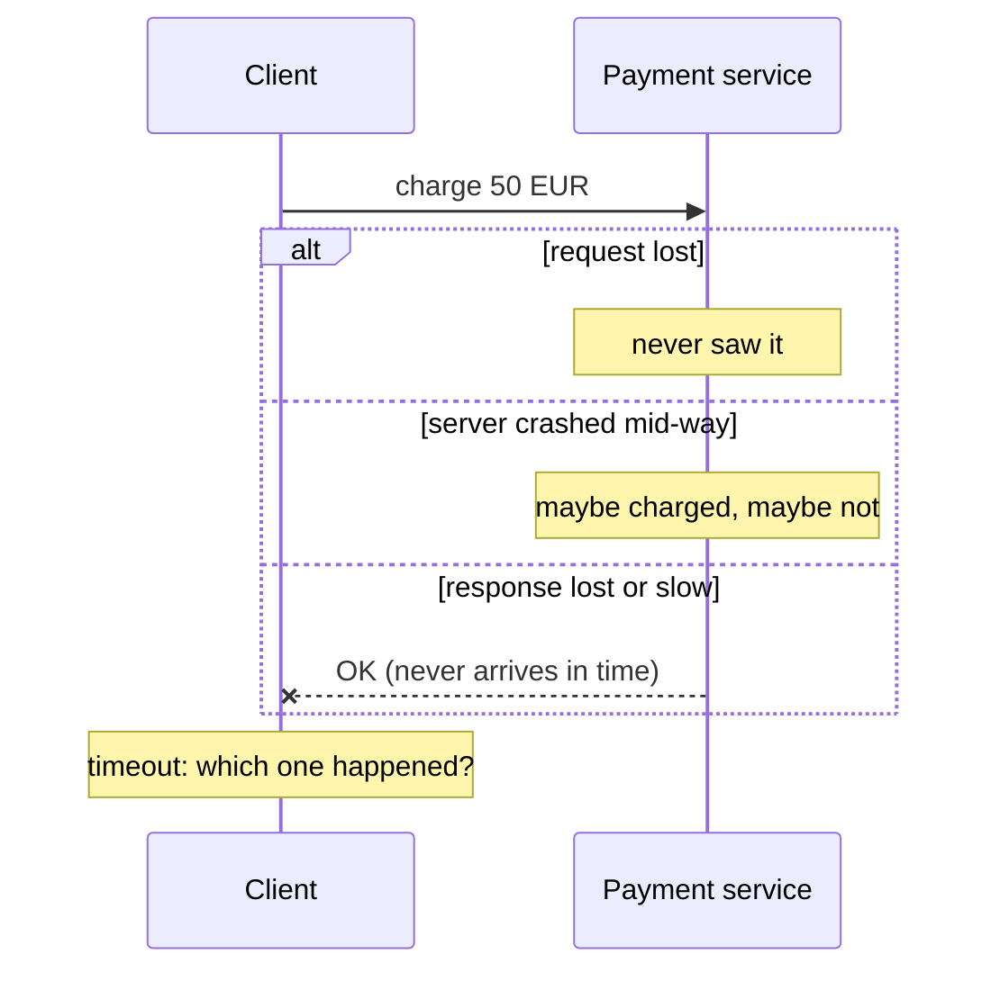
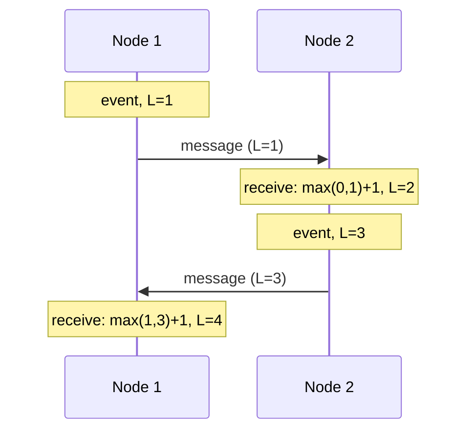
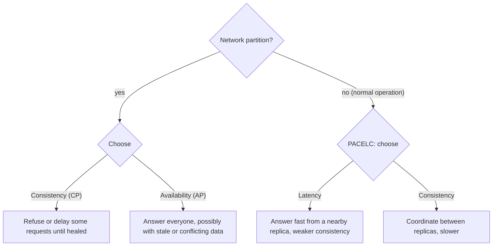

The moment your app has two services, a database and a cache, it is a **distributed system**:
several computers cooperating over a network, with no shared memory and no shared clock. That
changes the rules. On one machine, a function call either returns or crashes. Across a network,
a call can succeed, fail, or *you may never find out which*. This module teaches you to reason
about that world. Its main references are MIT's
[6.5840 Distributed Systems](https://pdos.csail.mit.edu/6.824/) course and Martin Kleppmann's
[Designing Data-Intensive Applications](https://dataintensive.net/) (DDIA), with a helpful
chapter-by-chapter summary in these [DDIA notes](https://github.com/keyvanakbary/learning-notes/blob/master/books/designing-data-intensive-applications.md).

## Partial failures, latency and the fallacies of distributed computing

On a single computer, failure is mostly all-or-nothing: if the machine dies, everything stops. In
a distributed system, **some parts fail while others keep running**: a **partial failure**. And
the nasty part is that the survivors often cannot tell what happened.

Imagine you send a letter asking a colleague to transfer money, and no reply comes. Maybe the
letter was lost. Maybe she did the transfer and the reply was lost. Maybe she is just slow. From
your side these look identical. A network call that times out has exactly this ambiguity:



A **timeout** is therefore not proof of failure, only a guess. If you retry, you might do the
work twice; if you do not, you might not do it at all. Designing operations to be safe to retry
(**idempotency**, session 4.4.4) is the standard answer.

**Latency** compounds too. A request that fans out to 20 services, each fast 99% of the time, will
hit at least one slow one surprisingly often. That is why "tail latency" (p99) matters and why you
will meet percentiles again in 4.5.4.

In the 1990s, engineers at Sun Microsystems listed the false assumptions newcomers make, known as
the **fallacies of distributed computing**:

1. The network is reliable.
2. Latency is zero.
3. Bandwidth is infinite.
4. The network is secure.
5. Topology doesn't change.
6. There is one administrator.
7. Transport cost is zero.
8. The network is homogeneous.

> [!WARNING]
> Code that calls another service as if it were a local function (no timeout, no retry policy, no
> plan for "maybe it happened") is assuming fallacies 1 and 2. It will work in development and
> fail in production at the worst moment.

> [!TIP]
> Every remote call should have an answer to three questions: what is the timeout, is it safe to
> retry, and what do we do if it ultimately fails?

## Clocks and ordering

Every server has its own clock, and no two agree exactly. Quartz crystals drift; NTP (Network Time
Protocol) corrects them, but only to within some milliseconds, and a correction can make the clock
**jump backwards**. So comparing timestamps from different machines to decide "which happened
first" is unreliable.

There are two kinds of clocks on a machine:

- **Time-of-day (wall-clock) time**: `time.time()` in Python. Meaningful across machines (roughly),
  but can jump.
- **Monotonic time**: `time.monotonic()`. Only ever moves forward, so it is right for measuring
  durations and timeouts, but meaningless across machines.

> [!EXAMPLE]
> Two users edit the same document on two servers. Server A's clock is 200 ms fast. A's later
> edit gets an *earlier* timestamp than B's, and a "last write wins" rule based on timestamps
> silently throws away the newer edit. DDIA describes exactly this failure mode.

Distributed systems often care less about *when* something happened than about **order** and
**causality**: did event A possibly influence event B? **Logical clocks** capture this without real
time:

- **Lamport timestamps**: each node keeps a counter. Increment it for every event; attach it to
  every message; on receiving a message, set your counter to `max(yours, received) + 1`. If A
  caused B, then A's timestamp is smaller than B's. They give a total order consistent with
  causality, but cannot tell you whether two events were truly concurrent.
- **Vector clocks** keep one counter per node and *can* detect concurrency, at the cost of larger
  metadata.



Google's Spanner (one of the 6.5840 papers) takes another route: GPS and atomic clocks with an
explicit **uncertainty interval**, waiting out the uncertainty before committing.

## CAP and PACELC

The **CAP theorem** concerns a system that stores replicated data. When a **network partition**
happens (some nodes cannot talk to others), the system must choose between:

- **Consistency** (here meaning *linearizability*: every read sees the latest write, as if there
  were one copy), or
- **Availability** (every request to a non-failed node gets a non-error response).

The **P** is not really optional: partitions happen whether you like it or not. So CAP is better
read as: *during a partition, choose C or A*.



Two cash machines of a bank lose their connection to each other. A **CP** design refuses
withdrawals until they reconnect (correct balances, unhappy customers). An **AP** design keeps
paying out and reconciles later (happy customers, possible overdrafts).

CAP only talks about partitions, which are rare. **PACELC** extends it: if **P**artition, choose
**A** or **C**; **E**lse (normal operation), choose **L**atency or **C**onsistency. This second
trade-off is the one you live with every day: waiting for replicas to agree costs milliseconds on
every request.

> [!NOTE]
> Treat CAP as a conversation starter, not a classification. Kleppmann argues in DDIA that
> labelling databases "CP" or "AP" is often misleading, because real systems offer different
> guarantees per operation and configuration. The useful question is: *what does this specific
> read or write guarantee, and what happens during a network fault?*

## Consistency models

A **consistency model** is a contract: what a reader can expect to see after writes happen. From
strongest to weakest, the ones you will meet:

| Model | Promise | Everyday analogy |
|---|---|---|
| **Linearizability** (strong) | Behaves as a single copy; once a write is acknowledged, every later read sees it | One shared whiteboard |
| **Sequential consistency** | All nodes see operations in the same order, which respects each client's order | A replayed meeting transcript |
| **Causal consistency** | If A could have caused B, everyone sees A before B; unrelated writes may appear in any order | You never see a reply before the question |
| **Read-your-writes** | You always see your own writes (others may lag) | Your own sent messages always show up |
| **Monotonic reads** | You never see data go "back in time" | A feed that never un-shows a post |
| **Eventual consistency** | If writes stop, replicas *eventually* converge | Gossip spreading through a village |

Stronger models are easier to program against but need coordination, which costs latency and
availability. Weaker models are fast and available but push complexity into your application
(handling stale reads, merging conflicts).

> [!EXAMPLE]
> A user changes their display name, the page reloads, and the old name shows. The write went to
> the primary database, the read went to a replica that lagged by 300 ms: an eventual-consistency
> read where the user expected **read-your-writes**. Session 4.4.2 shows the fixes.

## Practice: summarise one MIT 6.5840 lecture

Reading and explaining is how you build intuition for distributed systems, so this practice is a
study exercise.

### Step 1: Pick a lecture

Open the [6.5840 site](https://pdos.csail.mit.edu/6.824/) and its schedule. Good first choices
that connect to this module:

- **Introduction** (the MapReduce paper): why distribute at all, and how to hide failures.
- **GFS**: a real storage system that chose relaxed consistency for performance.
- **Consistency and Linearizability**: the precise definition behind "strong consistency".
- **ZooKeeper**: coordination, which you will meet again in 4.4.3.

### Step 2: Read the notes, then the paper's key sections

Read the lecture notes first (they explain *why the paper matters*), then the paper's abstract,
introduction and design sections. Do not aim to understand every detail.

### Step 3: Write a one-page summary from memory

Close the tabs and write, in your own words:

1. **Problem**: what were they trying to build, and why was it hard?
2. **Design**: the main components in three to five sentences, plus a Mermaid diagram.
3. **Failures**: which partial failures does it handle, and how?
4. **Trade-off**: where does it sit on consistency vs availability vs latency? What did they give
   up?
5. **Fallacies**: which of the eight fallacies does the design explicitly guard against?

### Step 4: Check and fill gaps

Reopen the notes and correct mistakes in a different colour. The gaps you find are exactly what to
review in a few days (retrieval practice from session 0.1.1).

### Step 5: Explain it out loud

Explain the design in two minutes to a friend or a rubber duck, then add your summary to your notes
repository.

```quiz
{"questions": [
  {"question": "Your call to another service times out. What can you conclude?", "options": ["The other service did not process the request", "The other service crashed", "Nothing certain: the request, the processing or the response may have been lost or delayed", "The network is down"], "answer": 2, "explanation": "Timeouts are ambiguous in distributed systems. Design for the possibility that the work happened."},
  {"question": "Which clock should you use to measure how long a request took on one machine?", "options": ["time.time()", "time.monotonic()", "A Lamport timestamp", "The database server's clock"], "answer": 1, "explanation": "Monotonic clocks never jump backwards, which makes them correct for durations. Wall-clock time can be adjusted by NTP."},
  {"question": "During a network partition, a database keeps accepting writes on both sides and reconciles later. In CAP terms, what did it choose?", "options": ["Consistency over availability", "Availability over consistency", "Partition tolerance over both", "Latency over partition tolerance"], "answer": 1, "explanation": "Accepting requests on both sides keeps the system available but allows divergent, possibly conflicting data."},
  {"question": "What does PACELC add to CAP?", "options": ["A fourth guarantee called durability", "The trade-off between latency and consistency during normal operation, when there is no partition", "A proof that CAP is wrong", "Rules for clock synchronisation"], "answer": 1, "explanation": "Partitions are rare; the latency vs consistency trade-off applies to every request."},
  {"question": "A user edits their profile and immediately sees the old version. Which guarantee was violated?", "options": ["Eventual consistency", "Read-your-writes", "Monotonic writes", "Partition tolerance"], "answer": 1, "explanation": "Read-your-writes promises a user always sees their own updates, even if other users see them later."}
]}
```
