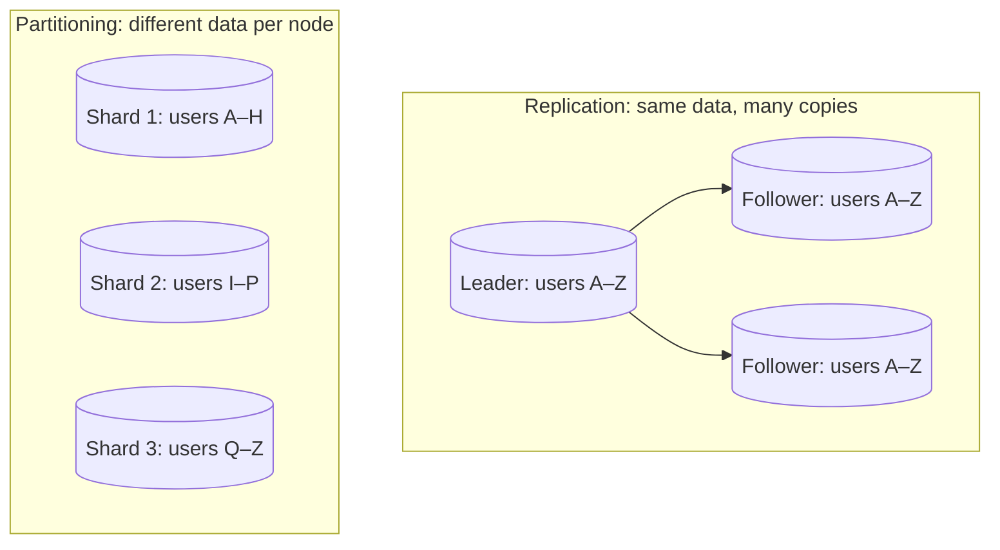
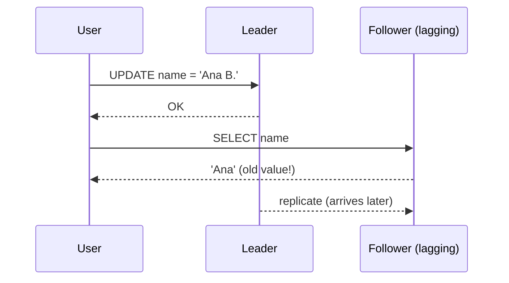
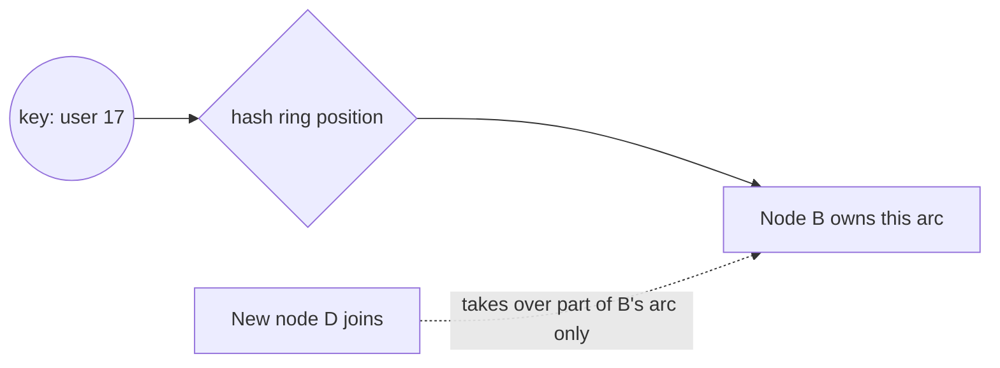

One database server has limits: it can die, it can only be in one place, and it can only handle
so much data and traffic. Two techniques get you past those limits. **Replication** keeps copies
of the same data on several machines, for fault tolerance, read scaling and lower latency.
**Partitioning** (also called **sharding**) splits the data into pieces stored on different
machines, for datasets or write loads too big for one node. Real systems usually combine both.
This session follows chapters 5 and 6 of
[Designing Data-Intensive Applications](https://dataintensive.net/), summarised in these
[DDIA notes](https://github.com/keyvanakbary/learning-notes/blob/master/books/designing-data-intensive-applications.md).



## Leader–follower and multi-leader replication

The simplest and most common setup is **leader–follower** replication (also called
primary–replica, or historically master–slave). One node, the **leader**, accepts all writes.
Every write goes into a **replication log** that the leader streams to **followers**, which apply
the same changes in the same order. Reads can go to the leader or to any follower.

Think of a teacher dictating to a class: only the teacher decides what is written; the students
copy in order, some a little behind.

**Synchronous vs asynchronous** replication is the key knob:

- **Synchronous**: the leader waits for a follower to confirm before acknowledging the write. No
  data loss if the leader dies, but a slow or dead follower blocks writes.
- **Asynchronous**: the leader acknowledges immediately and ships changes in the background. Fast
  and resilient to slow followers, but a leader crash can lose the last few acknowledged writes.
- Many setups are **semi-synchronous**: one follower synchronous, the rest asynchronous.

When the leader fails, a follower must be promoted: **failover**. It sounds simple and is full of
traps: how long to wait before declaring the leader dead, which follower is most up to date, what
happens to writes the old leader accepted but never replicated, and how to stop the old leader
from coming back thinking it is still in charge (**split brain**, two leaders accepting writes).

**Multi-leader** replication lets several nodes accept writes, each replicating to the others. It
is used for multiple data centres (each region writes locally) and offline-capable apps (each
device is a "leader"; think calendar sync). The price is **write conflicts**: two leaders may
change the same record concurrently. Resolution strategies include last-write-wins (simple, loses
data), merging values, or keeping both versions for the application or user to resolve.

There is also **leaderless** replication (Dynamo-style systems like Cassandra): clients write to
several replicas and read from several, using **quorums** (with n replicas, w write confirmations
and r read responses, `w + r > n` ensures reads overlap at least one replica with the latest write).

> [!NOTE]
> PostgreSQL's built-in **streaming replication** is leader–follower: the primary ships its
> write-ahead log (WAL, from session 4.1.3) to standbys, which replay it. Standbys can serve
> read-only queries (**hot standby**).

## Replication lag and read-your-writes

With asynchronous followers there is always some **replication lag**: the delay between a write
on the leader and its appearance on a follower. Normally milliseconds; under load or after a
network blip, seconds or minutes. Reading from followers gives you **eventual consistency**, and
lag produces visible anomalies:



Three guarantees fix the common anomalies:

- **Read-your-writes** (read-after-write): a user always sees their own writes.
- **Monotonic reads**: a user never sees data go backwards (reading a new value from one replica,
  then an older one from another).
- **Consistent prefix reads**: if writes happen in an order, readers see them in that order (no
  answer before its question).

Practical techniques for read-your-writes:

- **Read from the leader for anything the user may have just changed** (their own profile), and
  from followers for everything else.
- **Time-based routing**: for N seconds after a user writes, send their reads to the leader.
- **Version tracking**: remember the log position of the user's last write (in PostgreSQL, a WAL
  LSN) and only read from a replica that has replayed past it.
- **Sticky routing**: send each user's reads to the same replica, which gives monotonic reads.

> [!WARNING]
> Adding read replicas silently changes your app's consistency. Code that writes then immediately
> reads (create an order, redirect to the order page) will break intermittently. Audit those paths
> before you route reads to followers.

## Partitioning by key and by hash

When data or write traffic outgrows one machine, you split it. Each record belongs to exactly one
**partition**, chosen by a **partition key** (user id, tenant id, timestamp). The goal is to
spread data and load evenly; the risk is **skew**, where one partition gets far more than its
share.

**Partitioning by key range**: assign continuous ranges of keys to each partition, like
encyclopedia volumes (A–C, D–F, …).

- Range queries are efficient: "all orders from 1–7 March" hits one or a few partitions.
- But natural keys are rarely uniform. Partition by timestamp and *today's* partition gets every
  write: a **hot spot**.

**Partitioning by hash of key**: apply a hash function to the key and assign ranges of hash
values to partitions. A good hash scatters similar keys evenly.

- Load spreads well, even for sequential keys.
- But range queries over the original key must ask every partition (**scatter/gather**).

| | Key range | Hash of key |
|---|---|---|
| Range queries | Efficient | Must query all partitions |
| Even distribution | Depends on the data | Good by default |
| Hot-spot risk | Sequential keys (time) | A single very hot key |
| Examples | HBase, Bigtable, many time-series stores | Cassandra, DynamoDB, Redis Cluster |

A common compromise is a **compound key**: hash the first part, keep the rest sorted. For example
Cassandra hashes the partition key (`user_id`) and sorts rows within it by a clustering column
(`created_at`), so "this user's posts by date" is efficient.

> [!NOTE]
> Partitioning also complicates **secondary indexes** ("find all red cars" when you partitioned by
> car id). Either each partition indexes its own data (reads must query all partitions) or the
> index itself is partitioned by the indexed term (writes must update several partitions).

## Rebalancing and hot spots

Data grows, nodes are added and removed, so partitions must move: **rebalancing**. Requirements:
spread load fairly afterwards, keep serving during the move, and move no more data than necessary.

The naive approach, `partition = hash(key) % number_of_nodes`, is a trap: change the node count
from 10 to 11 and almost every key moves. Better strategies:

- **Fixed number of partitions**: create many more partitions than nodes (say 1,000 for 10 nodes)
  up front. Adding a node means moving whole partitions to it; keys never change partition.
  Elasticsearch shards and Redis Cluster's 16,384 hash slots work this way.
- **Dynamic partitioning**: split a partition when it grows too big, merge when it shrinks (HBase,
  MongoDB ranges).
- **Consistent hashing**: place nodes and keys on a hash ring; each key belongs to the next node
  clockwise. Adding a node only takes keys from its neighbour. **Virtual nodes** (each server owns
  many points on the ring) smooth out the distribution.



Hashing spreads *keys*, not *traffic*. One celebrity account with millions of followers is a
single key, so it lands on a single partition no matter how good the hash: a **hot key**. Fixes
include caching that key aggressively, or adding a random suffix (`celebrity_42#0..#9`) to spread
writes over ten partitions at the cost of reading all ten.

> [!TIP]
> Most teams should shard as late as possible. Vertical scaling, read replicas, caching and table
> partitioning inside one PostgreSQL instance go a long way, and cross-shard joins and transactions
> are expensive forever after.

## Practice: set up PostgreSQL streaming replication locally

You will run a primary and a hot standby in Docker, then watch writes replicate and measure lag.

### Step 1: Network and primary

```sh
docker network create pgrepl
docker run -d --name pg-primary --network pgrepl -e POSTGRES_PASSWORD=secret \
  postgres:17 -c wal_level=replica -c max_wal_senders=5
docker exec -it pg-primary psql -U postgres -c \
  "CREATE ROLE replicator WITH REPLICATION LOGIN PASSWORD 'replpass';"
docker exec pg-primary sh -c \
  "echo 'host replication replicator all scram-sha-256' >> /var/lib/postgresql/data/pg_hba.conf"
docker exec -it pg-primary psql -U postgres -c "SELECT pg_reload_conf();"
```

`wal_level=replica` is the default in modern PostgreSQL but stated here for clarity. The `pg_hba`
line allows the replicator to open replication connections.

### Step 2: Clone the primary into a standby

```sh
docker volume create pg-standby-data
docker run --rm --network pgrepl -v pg-standby-data:/var/lib/postgresql/data \
  -e PGPASSWORD=replpass postgres:17 \
  pg_basebackup -h pg-primary -U replicator -D /var/lib/postgresql/data -X stream -R -P
```

`pg_basebackup` copies the primary's data directory; `-X stream` streams WAL during the copy;
`-R` writes `standby.signal` and the connection settings so the copy starts as a standby.

### Step 3: Start the standby

```sh
docker run -d --name pg-standby --network pgrepl \
  -v pg-standby-data:/var/lib/postgresql/data postgres:17
```

If the container refuses to start because of directory ownership, run
`docker run --rm -v pg-standby-data:/d alpine chown -R 999:999 /d` and retry. (Check `docker logs
pg-standby`; the official image's postgres user is UID 999.)

### Step 4: Watch replication

```sh
docker exec -it pg-primary psql -U postgres -c \
  "CREATE TABLE notes(id serial PRIMARY KEY, body text); INSERT INTO notes(body) VALUES ('hello');"
docker exec -it pg-standby psql -U postgres -c "SELECT * FROM notes;"
docker exec -it pg-standby psql -U postgres -c "INSERT INTO notes(body) VALUES ('nope');"
docker exec -it pg-primary psql -U postgres -c \
  "SELECT client_addr, state, sent_lsn, replay_lsn, replay_lag FROM pg_stat_replication;"
```

The read works, the write fails with "cannot execute INSERT in a read-only transaction", and
`pg_stat_replication` on the primary shows the standby and its lag.

### Step 5: Experiment

- Insert 100,000 rows on the primary with `generate_series` and watch `replay_lag` while it runs.
- `docker pause pg-standby`, write on the primary, `docker unpause`, and watch it catch up.
- Promote the standby with `docker exec -it pg-standby psql -U postgres -c "SELECT pg_promote();"`
  and confirm it now accepts writes. In your notes, describe the split-brain risk if `pg-primary`
  were still taking writes.

Clean up with `docker rm -f pg-primary pg-standby && docker volume rm pg-standby-data && docker
network rm pgrepl`.

```quiz
{"questions": [
  {"question": "With asynchronous leader–follower replication, what can happen if the leader crashes right after acknowledging a write?", "options": ["Nothing, followers always have every acknowledged write", "The write may be lost because it had not yet reached any follower", "The followers become leaders automatically and keep all writes", "The write is duplicated"], "answer": 1, "explanation": "Asynchronous replication acknowledges before followers confirm, so the most recent writes can be lost on failover."},
  {"question": "After saving their settings, users sometimes see the old settings. Reads go to replicas. What is a correct fix?", "options": ["Increase the replica count", "Read the user's own recently changed data from the leader (read-your-writes routing)", "Switch to hash partitioning", "Disable the write-ahead log"], "answer": 1, "explanation": "Replication lag makes replicas stale; routing a user's reads of their own recent writes to the leader restores read-your-writes."},
  {"question": "An events table is range-partitioned by timestamp. What problem is likely?", "options": ["Range queries become slow", "All current writes hit the latest partition, creating a hot spot", "Data becomes unordered", "Replication stops working"], "answer": 1, "explanation": "Sequential keys concentrate writes on one partition; hashing or a compound key spreads them."},
  {"question": "Why is partition = hash(key) % N a poor rebalancing strategy?", "options": ["Hashing is too slow", "Changing N reassigns almost every key, forcing massive data movement", "It cannot handle string keys", "It only works with key ranges"], "answer": 1, "explanation": "Modulo depends on N, so adding a node remaps most keys. Fixed partitions or consistent hashing move far less."}
]}
```
