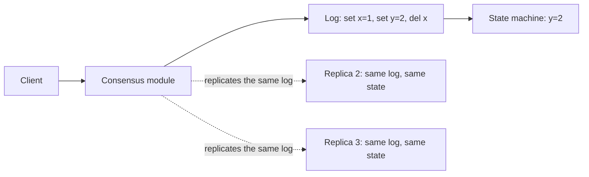
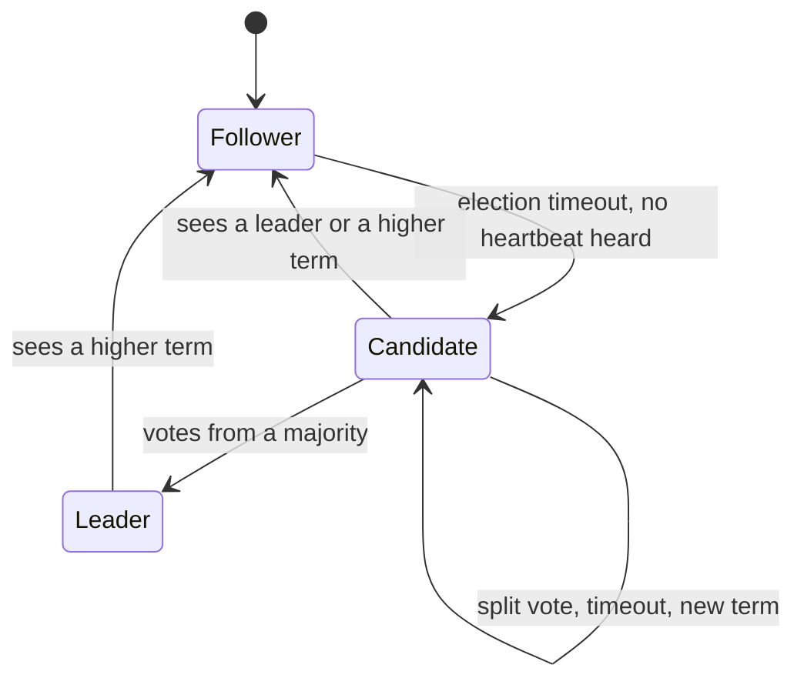
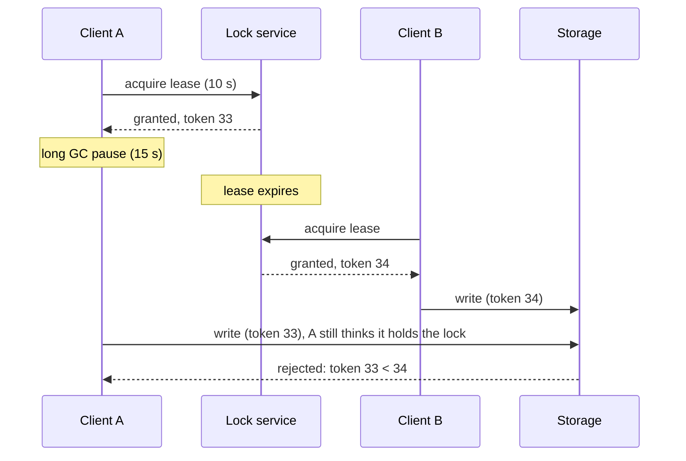

In the last session, failover sounded simple: "if the leader dies, promote a follower". But who
decides the leader is dead? What if two nodes both think they should lead? What if the network
splits the cluster in half? Getting a group of unreliable machines to **agree** on something, and
never take it back, is the **consensus** problem. You will rarely implement consensus yourself, but
you use it every day: Kubernetes stores its state in etcd, which runs Raft; Kafka's KRaft mode runs a
Raft-based protocol; many databases elect leaders with it. This session explains it in plain words,
based on [MIT 6.5840 Distributed Systems](https://pdos.csail.mit.edu/6.824/) (which has two
lectures and a lab on Raft) and [the Raft site](https://raft.github.io/).

## The consensus problem

A group of friends must choose one restaurant by text message. Some phones are on airplane mode,
some messages arrive late, and anyone may drop out. They need a procedure such that, in the end:

- **Agreement**: everyone who decides, decides on the *same* restaurant.
- **Validity**: the chosen restaurant was actually proposed by someone (no deciding "nothing").
- **Termination**: eventually a decision is made, as long as enough friends are reachable.

That is consensus. In systems, the "decision" is usually not a single value but an ordered
**log** of commands: "set x=1", "set y=2", "delete x". If every replica applies the same commands
in the same order to the same starting state, every replica ends in the same state. This is the
**replicated state machine** approach, and it is how you build a fault-tolerant key-value store,
lock service or configuration database.



Two ideas make consensus possible despite failures:

- **Majorities (quorums)**: a decision needs agreement from a majority, more than half of the
  nodes. Any two majorities overlap in at least one node, so two conflicting decisions can never
  both win. A cluster of 2f+1 nodes survives f failures: 3 nodes tolerate 1 failure, 5 tolerate 2.
- **Terms or epochs**: logical time that increases each time leadership changes, so a node can
  recognise and ignore messages from an outdated leader.

> [!NOTE]
> A famous result (FLP, 1985) proves no deterministic algorithm can *guarantee* termination in a
> fully asynchronous network where even one node may crash. Practical algorithms like Paxos and
> Raft keep safety (never disagree) always, and rely on timeouts to make progress when the network
> behaves reasonably.

> [!TIP]
> Clusters use an odd number of nodes because an even one adds cost without tolerance: 4 nodes
> need a majority of 3, so they still tolerate only 1 failure, the same as 3 nodes.

## Raft in plain words

Paxos, the classic consensus algorithm, is notoriously hard to understand. Raft (Ongaro and
Ousterhout, 2014) was designed explicitly for understandability and splits the problem into three
parts: **leader election**, **log replication** and **safety**.

Every node is in one of three roles: **follower**, **candidate** or **leader**. Time is divided
into numbered **terms**; each term has at most one leader.



**Leader election.** The leader sends regular **heartbeats** to followers. If a follower hears
nothing for its **election timeout** (randomised, for example 150–300 ms), it assumes the leader is
gone: it increments the term, becomes a candidate, votes for itself and asks the others for votes.
Each node votes for at most one candidate per term. A candidate with votes from a majority becomes
leader and starts sending heartbeats. The randomised timeouts make it unlikely that two followers
start elections at the same moment and split the vote; if they do, both time out and try again.

**Log replication.** Clients send commands to the leader. The leader appends each command to its
log and sends it to followers (`AppendEntries` messages, which double as heartbeats). Once a
**majority** has stored an entry, the leader marks it **committed**, applies it to its state
machine and answers the client. Followers learn the commit point in later messages and apply
committed entries too. A leader never overwrites its own log; when a follower's log disagrees,
the leader walks back to the last matching entry and overwrites the follower's conflicting
suffix.

**Safety.** The crucial rule: a node only votes for a candidate whose log is **at least as
up to date** as its own. Since a committed entry is on a majority, and a winning candidate needs
votes from a majority, the two majorities overlap, and the voter in the overlap refuses any
candidate missing that entry. So every new leader already has every committed entry: **committed
entries are never lost**.

> [!EXAMPLE]
> Five nodes, S1 is leader in term 3. The network splits {S1, S2} from {S3, S4, S5}. S1 keeps
> trying, but can never reach a majority, so nothing it accepts commits. On the other side S3 times
> out, starts term 4 and wins 3 votes. When the network heals, S1 sees term 4, steps down, and its
> uncommitted entries are replaced. Clients that never got an "OK" from S1 retry.

## Leader election, leases and distributed locks

Outside Raft's own internals, applications often need a single active instance: one scheduler
running cron jobs, one worker processing a partition. **Leader election** for applications is
usually built on top of a consensus-backed store (next section) with **leases**.

A **lease** is a lock with an expiry date, like renting a meeting room until 15:00. The holder must
renew it before it expires; if it crashes, the lease runs out and someone else can take over. That
avoids the classic problem with plain locks: a holder that dies holding the lock forever.

But leases rely on time, and time lies (session 4.4.1). The dangerous scenario:



Client A paused (garbage collection, a slow VM) past its lease, woke up still believing it held the
lock, and wrote. The fix, described in DDIA, is a **fencing token**: the lock service hands out a
number that increases with every grant, and the protected resource rejects writes carrying an older
token than the newest it has seen.

> [!WARNING]
> A distributed lock is only as safe as its handling of pauses, clock jumps and network delays. A
> lock used for *efficiency* (avoid doing a job twice) can tolerate rare double execution. A lock
> used for *correctness* (never double-charge) needs fencing tokens or, better, idempotent
> operations and database constraints.

> [!TIP]
> If your data already lives in PostgreSQL, you may not need a separate lock service: advisory
> locks (`pg_try_advisory_lock`) or `SELECT … FOR UPDATE SKIP LOCKED` work well for "only one worker
> handles this row" problems.

## Coordination services (etcd, ZooKeeper)

Implementing consensus correctly is extremely hard, so teams use **coordination services**: small,
strongly consistent databases built on consensus, designed to hold little data (configuration,
membership, locks, leader identity), not your application data.

- **etcd**: a key-value store using Raft, the brain of Kubernetes. It offers leases (keys that
  disappear when the lease expires), **watches** (get notified when a key changes) and
  compare-and-swap transactions.
- **ZooKeeper**: the older, widely used service (Hadoop, HBase, older Kafka). It uses its own
  consensus protocol (Zab), stores data in a tree of **znodes**, and offers **ephemeral nodes**
  (deleted automatically when the client session ends) and **sequential nodes** (with an increasing
  counter in the name). Its design is one of the 6.5840 papers.
- **Consul** (HashiCorp, also Raft-based) adds service discovery and health checking.

| Need | Typical recipe |
|---|---|
| Leader election | Create a key with a lease (etcd) or an ephemeral sequential node (ZooKeeper); the owner of the lowest/first one leads |
| Distributed lock | Same as election, plus fencing with the key's revision or the node's sequence number |
| Service discovery | Each instance registers itself with an ephemeral key; clients watch the prefix |
| Configuration | Store config under a key; services watch it and reload |

These services trade throughput for strong consistency: every write goes through the leader and a
majority. A 3- or 5-node cluster is typical. Many cloud and Kubernetes features (for example the
`Lease` objects controllers use for leader election) wrap all of this for you.

## Practice: visualise Raft and explain it in your own words

### Step 1: Watch the guided tour

Open [the Raft site](https://raft.github.io/). It links "The Secret Lives of Data" Raft walkthrough,
a guided animation of elections and replication; go through it once without taking notes.

### Step 2: Play with the live cluster

Back on the Raft site, the embedded **RaftScope** visualisation runs a five-server cluster in your
browser, with each server's term, role and log. Click a server to see the actions available (such
as stopping, restarting or forcing a timeout, and sending a client request) and try these
scenarios, pausing the simulation to read the state:

1. **Normal election**: reload and watch the first leader get elected. Note the term number.
2. **Leader crash**: stop the leader. Time how many "ticks" until a new leader appears and check
   that the term increased.
3. **Replication**: send a few requests to the leader and watch entries become committed once a
   majority stores them.
4. **Minority failure**: stop two followers. Do requests still commit? Stop a third: what happens?
5. **Rejoin**: restart a stopped server and watch the leader repair its log.

### Step 3: Explain it in writing

Without looking, write about half a page answering:

- Why do election timeouts need to be random?
- Why can a cluster of 5 tolerate exactly 2 failures?
- Why does the up-to-date-log voting rule guarantee committed entries survive a leader change?
- What happens to an entry the old leader accepted but never replicated to a majority?

### Step 4: Draw it

Draw a Mermaid sequence diagram of one client request: leader append, `AppendEntries` to
followers, majority acknowledgement, commit, reply. Compare with the paper's Figure 2 summary
(linked from the Raft site) and fix any step you missed.

```quiz
{"questions": [
  {"question": "Why do consensus clusters typically have 3 or 5 nodes rather than 4?", "options": ["Raft only works with odd numbers", "4 nodes need a majority of 3, so they tolerate 1 failure, the same as 3 nodes but with more cost", "Even numbers cause clock drift", "4 nodes cannot elect a leader"], "answer": 1, "explanation": "Fault tolerance is (n-1)/2 rounded down; adding a node to make an even number adds no extra tolerance."},
  {"question": "In Raft, when is a log entry considered committed?", "options": ["As soon as the leader appends it", "When a majority of servers have stored it", "When every server has stored it", "When the client acknowledges it"], "answer": 1, "explanation": "Majority storage guarantees any future leader will have the entry, so it can never be lost."},
  {"question": "A client held a lease, paused for 20 seconds, and then wrote to storage after another client had acquired the lock. What prevents corruption?", "options": ["Increasing the lease to 30 seconds", "A fencing token checked by the storage, rejecting writes with an older token", "Using wall-clock timestamps", "Retrying the write"], "answer": 1, "explanation": "Any lease length can be exceeded by a pause. The resource itself must reject stale lock holders."},
  {"question": "What is the main purpose of a service like etcd or ZooKeeper?", "options": ["Storing large volumes of application data cheaply", "Providing small, strongly consistent state for coordination: leader election, locks, configuration, membership", "Caching web pages", "Replacing the application database"], "answer": 1, "explanation": "Coordination services trade throughput for consistency and are meant for small, critical metadata."}
]}
```
