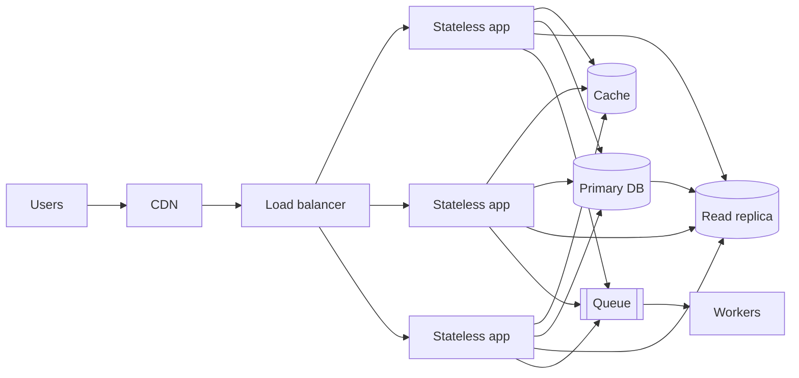

Most systems do not fail because of a clever bug; they fail because traffic grew past what one box
could handle, and nobody had made the next step easy. Scaling is not one technique but a toolbox
of building blocks: stateless servers behind load balancers, caches, CDNs, read replicas, shards
and queues. Each solves one specific bottleneck and adds its own complexity. This session tours the
toolbox with the [System Design Primer](https://github.com/donnemartin/system-design-primer) as the
map, and the performance and reliability pillars of
[AWS Well-Architected](https://aws.amazon.com/architecture/well-architected/) as the "why".



## Vertical vs horizontal scaling and statelessness

**Vertical scaling** (scaling up) means a bigger machine: more CPU, RAM, faster disks. **Horizontal
scaling** (scaling out) means more machines sharing the work. A restaurant can buy a bigger oven,
or open more kitchens.

| | Vertical | Horizontal |
|---|---|---|
| Effort | Change instance size | Redesign for many nodes |
| Limit | The biggest machine you can buy | Practically very high |
| Failure | One box is a single point of failure | Lose one node, others carry on |
| Cost curve | Gets expensive at the top end | Roughly linear |

Vertical scaling is underrated: a modern server with dozens of cores and hundreds of GB of RAM
runs a surprising amount of business. Scale up first while it is cheap, and scale out when you need
fault tolerance or hit the ceiling.

Horizontal scaling of **application servers** is easy only if they are **stateless**: any server
can handle any request because nothing about the user lives in a server's memory or local disk.
Move state out:

- **Sessions** → a shared store (Redis, the database) or signed tokens (JWT, signed cookies).
- **Uploaded files** → object storage (S3 or compatible), not the local disk.
- **Scheduled jobs** → one scheduler with leader election (4.4.3) or a job queue, not a cron on every
  node.

Then servers become cattle, not pets: add or remove them freely, put them in an autoscaling group,
replace a sick one without anyone noticing.

> [!WARNING]
> In-process caches and in-memory rate limit counters quietly break when you add a second server:
> each instance has its own copy, so limits double and caches disagree. Audit for hidden state
> before scaling out.

## Load balancing and CDNs

A **load balancer** spreads requests across healthy instances (you configured one in Nginx in
4.2.2). At scale it also provides:

- **Health checks** that remove failing instances automatically.
- **TLS termination** in one place.
- **Zero-downtime deploys**: drain an instance, update it, add it back.
- **Layer 4 vs layer 7**: an L4 balancer forwards TCP connections without reading them (fast,
  protocol-agnostic); an L7 balancer understands HTTP and can route by path, header or cookie.

The load balancer itself must not become the single point of failure: cloud load balancers are
managed and redundant; self-hosted ones run in pairs with a floating IP or behind DNS.

A **CDN** pushes static (and some dynamic) content to edge locations near users, so most requests
never reach your load balancer. For a typical web app, a CDN removes the bulk of bytes served:
images, JavaScript, CSS, video. It is often the cheapest, highest-impact scaling step.

> [!TIP]
> Order of operations for a growing web app: put static assets on a CDN, make app servers
> stateless behind a load balancer, add caching, then work on the database. Each step is cheaper
> than the next.

## Caching layers

A **cache** keeps the result of expensive work close at hand, like keeping the most-used tools on
your desk instead of in the garage. Caches exist at every layer: the browser, the CDN, the reverse
proxy, the application (in-memory or Redis/Memcached) and the database's own buffer cache.

The most common application pattern is **cache-aside** (lazy loading):

```python
def get_user(user_id: int) -> dict:
    key = f"user:{user_id}"
    if (cached := redis.get(key)) is not None:
        return json.loads(cached)                 # hit
    user = db.fetch_user(user_id)                 # miss: go to the source
    redis.set(key, json.dumps(user), ex=300)      # store with a 5-minute TTL
    return user
```

Other patterns: **write-through** (write to cache and database together, so the cache is always
warm) and **write-behind** (write to cache, flush to the database later; fast but risky).

The two hard parts:

- **Invalidation**: when data changes, the cached copy is stale. Options are short **TTLs**
  (tolerate bounded staleness), deleting the key on every write, or versioned keys. Choose per data
  type based on how stale it may be.
- **Stampedes**: a hot key expires and a thousand requests miss at once, all hammering the
  database. Mitigations: a lock so only one request recomputes, serving the stale value while
  refreshing, or adding random jitter to TTLs so keys do not expire together.

Measure the **hit ratio**. A cache with a 30% hit ratio adds a network hop to 70% of requests for
little benefit.

## Database scaling: read replicas, sharding

The database is usually the hardest component to scale because it holds state. Steps, cheapest
first:

1. **Optimise**: indexes, fixing N+1 queries, connection pooling (PgBouncer). Often a 10× win for
   free.
2. **Scale up** the database server.
3. **Cache** read-heavy queries (previous section).
4. **Read replicas**: route reads to followers (4.4.2). Scales reads nearly linearly, does nothing
   for writes, and introduces replication lag, so route read-your-writes paths to the primary.
5. **Functional partitioning**: separate databases per domain (users, orders, analytics) so each
   has its own capacity.
6. **Sharding**: split one dataset across many databases by a shard key (4.4.2). Scales writes and
   storage, at the cost of cross-shard queries, transactions and rebalancing.

**Choosing a shard key** is the critical decision. A good one spreads load evenly, matches your
access pattern (most queries touch one shard) and does not change. For a multi-tenant SaaS,
`tenant_id` is often ideal; for a URL shortener, the short code (hashed) works since every lookup is
by code.

> [!NOTE]
> Managed or distributed SQL databases (for example Citus for PostgreSQL, Vitess for MySQL, or
> natively distributed databases like CockroachDB and Spanner) automate much of sharding. They do
> not remove the need for a good shard or partition key.

## Asynchronism with queues

Not everything has to happen while the user waits. Sending an email, resizing an image, generating
a PDF, updating a search index: these can be put in a **queue** and done by **workers** a moment
later. The user gets "202 Accepted" immediately.

A restaurant works this way: the waiter takes your order and puts the ticket on the rail; cooks pick
tickets up at their own pace. The waiter is free to serve the next table.

Queues give you:

- **Lower latency** for users: the request only does the essential part.
- **Load levelling**: a traffic spike fills the queue instead of overwhelming the workers; they
  catch up afterwards.
- **Decoupling and resilience**: if the email provider is down, messages wait and are retried.
- **Independent scaling**: add workers when the queue grows.

Tools range from Redis-backed job queues (Celery, RQ, Dramatiq) to brokers (RabbitMQ, SQS) and logs
(Kafka). Remember 4.4.4: delivery is at-least-once, so jobs must be **idempotent**, and use the
outbox when the job must be enqueued atomically with a database change.

**Back pressure** matters: if producers outpace consumers forever, the queue grows without bound.
Monitor queue length and age of the oldest message, and decide what to do when it is too long
(scale workers, shed low-priority work, reject new requests with 429/503).

## Practice: scale your URL shortener to 100M users on paper

Take your design document from 4.5.1 and extend it with a "Scaling" section.

### Step 1: New numbers

Assume 100 million monthly active users who create 1 billion URLs per month and generate 100
billion redirects per month. Compute average and peak (×3) writes/s and reads/s, five-year storage,
and cache size if you keep the hottest 20% of a day's codes in memory.

### Step 2: Find the bottlenecks

For each component in your 4.5.1 diagram, write whether it survives the new load and why not.
Typically: app servers (scale out, stateless), cache (needs a cluster), database writes (now
hundreds of writes/s; still possible on one primary, but storage is now tens of TB).

### Step 3: Apply the building blocks

Redraw the architecture in Mermaid with: CDN or edge caching for redirects (if you use 301s or
short-TTL 302s), load balancer and autoscaled stateless API servers, a Redis cluster with
cache-aside on the redirect path, sharded storage keyed by short code with a fixed number of
logical partitions, and a queue for click analytics so redirects never wait on analytics writes.

### Step 4: Code generation at scale

Explain how codes stay unique across many API servers: random codes with a unique constraint per
shard, or ID ranges allocated to servers in blocks from a small coordination service.

### Step 5: Defend the trade-offs

Write a decision table: for each building block, which requirement it serves, what it costs
(money, complexity, consistency) and what metric would tell you it is needed. End with what you
would *not* build yet, and why.

```quiz
{"questions": [
  {"question": "You add a second app server and users start getting logged out randomly. What is the likely cause?", "options": ["The load balancer is too slow", "Sessions are stored in each server's memory, so the other server does not know them", "The database needs sharding", "The CDN is caching logins"], "answer": 1, "explanation": "Horizontal scaling requires stateless servers; session state must move to a shared store or signed tokens."},
  {"question": "A popular cache key expires and the database suddenly receives thousands of identical queries. What is this called and how can you mitigate it?", "options": ["Replication lag; add replicas", "A cache stampede; let one request recompute (lock) or serve stale while refreshing, and jitter TTLs", "A hot shard; reshard the database", "Back pressure; add a queue"], "answer": 1, "explanation": "Simultaneous misses on a hot key overload the source; coordination or stale-while-revalidate prevents it."},
  {"question": "Your database is overloaded by writes. Which step helps directly?", "options": ["Adding read replicas", "Adding a CDN", "Sharding or functionally partitioning the data so writes spread over several primaries", "Increasing cache TTLs"], "answer": 2, "explanation": "Replicas and caches scale reads. Spreading writes requires more primaries, i.e. partitioning."},
  {"question": "Why move sending confirmation emails to a queue and workers?", "options": ["Emails become exactly-once", "The user's request returns faster, spikes are absorbed and provider outages are retried later", "Queues make emails smaller", "It removes the need for idempotency"], "answer": 1, "explanation": "Asynchronous processing reduces latency and decouples the request from slow or failing dependencies; handlers must still be idempotent."}
]}
```
