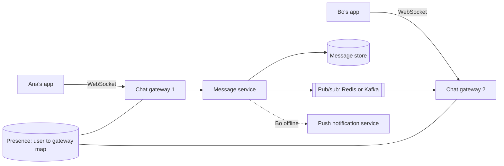
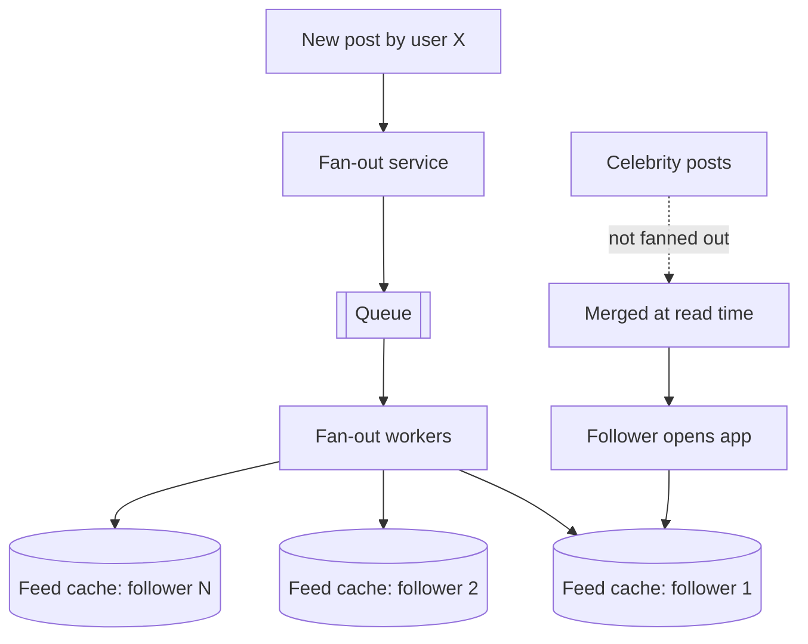
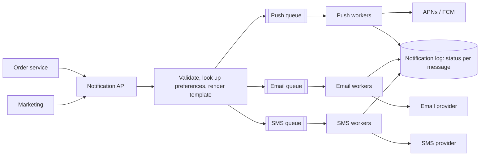

A small set of designs comes up again and again, in interviews and in real products: chat, feeds,
rate limiters and notifications. They are worth studying not because you will build WhatsApp, but
because each one isolates a recurring problem: pushing data to connected clients, precomputing
reads vs computing them on demand, counting under concurrency, and delivering reliably through
unreliable third parties. This session sketches each with the process from 4.5.1 and the building
blocks from 4.5.2, drawing on the [System Design Primer](https://github.com/donnemartin/system-design-primer)
and, for the data trade-offs, [Designing Data-Intensive Applications](https://dataintensive.net/)
(whose first chapter uses the Twitter home timeline as its running example).

> [!NOTE]
> Each sketch below is a starting point for discussion, not "the answer". In every case, first
> clarify requirements and estimate scale; the right design for 10,000 users differs from the one
> for 500 million.

## Chat system

**Requirements to clarify**: one-to-one and group chats? Group size limit? Online presence, read
receipts, message history across devices? Delivery latency target (sub-second)? Scale: daily active
users and messages per day?

**The core problem** is that the *server* must send data to clients when someone else writes.
Plain HTTP is request/response, so chat uses a long-lived connection:

- **WebSockets**: a full-duplex connection over a single TCP connection, upgraded from HTTP. The
  usual choice.
- Alternatives: **long polling** (the client asks, the server holds the request open until there is
  something to say) and **Server-Sent Events** (server-to-client only).



**Flow**: Ana sends a message over her WebSocket to gateway 1. The message service assigns an id,
**stores it first** (durability), then publishes it. A **presence/session registry** says Bo is
connected to gateway 2, which pushes the message down Bo's socket. If Bo is offline, a push
notification goes out and the message waits in storage; when Bo reconnects, his app asks for
everything after the last message id it has.

**Deep-dive topics**:

- **Gateways are stateful** (they hold sockets), so they scale differently from stateless APIs:
  each holds many thousands of idle connections, and clients must reconnect elsewhere when one dies.
- **Ordering**: per-conversation sequence numbers (assigned by the server, not client clocks; see
  4.4.1) so all members see the same order.
- **Storage**: write-heavy, append-only, queried by conversation and time range. A wide-column store
  partitioned by conversation id (Cassandra, as Discord famously did before migrating to ScyllaDB)
  or a partitioned relational table both work at different scales.
- **Delivery semantics**: at-least-once with client-generated message ids for deduplication
  (4.4.4), plus "delivered" and "read" acknowledgements.
- **Large groups**: fan-out per message grows with group size; cap group size or switch to a
  pull model for very large channels.

## News feed

**Requirements**: users follow others; the home feed shows recent posts from people you follow,
newest first (or ranked). Read-heavy: a feed is viewed far more often than posts are written.
Latency target for loading the feed: a couple of hundred milliseconds.

There are two fundamental approaches, and DDIA's discussion of Twitter's timeline is the classic
illustration:

**Fan-out on read (pull)**: when a user opens the feed, query the latest posts of everyone they
follow and merge them. Writes are cheap; reads are expensive (following 500 accounts means 500
lookups or a big query) and get slower as usage grows.

**Fan-out on write (push)**: when someone posts, insert the post id into a precomputed **feed
cache** (a per-user list, e.g. in Redis) of each of their followers. Reads are a single cheap list
lookup; writes are expensive for accounts with many followers.



**The hybrid** is what large systems converge on: push for normal accounts, pull for celebrities
(accounts with millions of followers), merging celebrity posts into the feed at read time. That
avoids writing one post into 50 million lists.

**Deep-dive topics**: storing only post ids in feed caches (hydrate the post content from a post
cache), capping feed length (keep the latest few hundred ids), pagination with cursors rather than
offsets, ranking (a separate scoring step over candidates), and handling deletes and unfollows
(filter at read time rather than rewriting millions of lists).

> [!TIP]
> When asked "push or pull?", answer with the read/write ratio and the follower distribution. The
> design follows from those two numbers.

## Rate limiter

**Requirements**: limit each client (API key, user, IP) to N requests per time window, across many
API servers; respond with HTTP **429 Too Many Requests** and a `Retry-After` header; add very
little latency; decide whether to fail open or closed if the limiter's store is down.

**Where**: in the API gateway or reverse proxy (Nginx has `limit_req`), as middleware in the app,
or both. Limits must be shared across instances, so counters usually live in **Redis**.

**Algorithms**:

| Algorithm | Idea | Pros | Cons |
|---|---|---|---|
| Fixed window | Count requests per calendar minute | Simple, one counter | Burst of 2N at window edges |
| Sliding window log | Store a timestamp per request; count those in the last 60 s | Exact | Memory per request |
| Sliding window counter | Weighted mix of current and previous window counts | Smooth, cheap | Approximate |
| Token bucket | Bucket of B tokens refilled at rate r; each request takes one | Allows controlled bursts, widely used | Two values to tune |
| Leaky bucket | Requests drain at a constant rate from a queue | Smooth output | Bursts are queued or dropped |

A fixed-window limiter in Redis is a few lines, and the atomic `INCR` avoids the race condition you
studied in 4.3.1:

```python
def allow(client_id: str, limit: int = 100, window: int = 60) -> bool:
    key = f"rl:{client_id}:{int(time.time() // window)}"
    count = redis.incr(key)             # atomic across all API servers
    if count == 1:
        redis.expire(key, window)       # clean up after the window
    return count <= limit
```

For token bucket or sliding windows, the read-compute-write must be atomic too; the usual approach
is a small **Lua script** executed by Redis in one step.

> [!WARNING]
> A limiter that does `GET`, compares in Python and then `SET`s is a check-then-act race: under
> concurrency, many requests read the same count and all pass. Use atomic operations or scripts.

**Deep-dive topics**: per-endpoint and per-plan limits, rate-limit headers so clients can back off,
distributed limits across regions (accept approximation), and fail-open vs fail-closed when Redis is
unavailable (most public APIs fail open to protect availability, with a local fallback limit).

## Notification system

**Requirements**: send notifications through several **channels** (mobile push via APNs and FCM,
email, SMS, in-app); triggered by many services; respect user preferences and quiet hours; avoid
duplicates; tolerate provider outages; volumes from thousands to millions per day, with bursts
(a marketing campaign).



**Key ideas**:

- **Decouple with a queue per channel**: a slow SMS provider must not delay push notifications.
  Each channel's workers scale independently.
- **Reliability**: at-least-once processing with retries and exponential backoff (4.5.5), a
  **dead-letter queue** for messages that keep failing, and a notification log recording each
  message's status.
- **Deduplication**: each notification carries an idempotency key (for example
  `order-123-shipped-email`); workers skip keys they have already sent. Users forgive a missing
  notification less than a duplicate SMS charge, but they hate both.
- **Preferences and compliance**: opt-outs, unsubscribe links, quiet hours and per-user rate limits
  (reuse the rate limiter) checked *before* enqueueing.
- **Priorities**: transactional messages (password reset) on a separate, higher-priority queue than
  marketing, so a campaign never delays a login code.
- **Device tokens**: store and refresh push tokens per device; remove tokens the providers report as
  invalid.

> [!EXAMPLE]
> Black Friday: marketing enqueues 5 million emails. Because password resets use a separate
> high-priority queue and their own workers, a user who forgot their password still gets the email
> in seconds, while the campaign drains over an hour within the provider's sending limits.

## Practice: write a design doc for one of them

Choose one of the four systems and write a design document of about two to four pages, the way you
would before building it at work.

### Step 1: Use a standard structure

```text
1. Context and goals          (what problem, for whom)
2. Requirements               (functional, non-functional with numbers, out of scope)
3. Estimates                  (traffic, storage, bandwidth, with assumptions)
4. API                        (endpoints or events, with examples)
5. Data model                 (tables or keys, partition keys)
6. High-level design          (Mermaid diagram + numbered request flows)
7. Deep dives                 (2–3 hardest parts, alternatives compared)
8. Failure modes              (what breaks, how we detect and recover)
9. Trade-offs and alternatives considered
10. Open questions and next steps
```

### Step 2: Fill sections 1–6

Reuse the sketch from this lesson only as a starting point. Change at least one requirement (for
example, chat with end-to-end encryption, or a feed ranked instead of chronological) so you must
think rather than copy.

### Step 3: Deep dives and failure modes

For each deep dive, compare at least two options in a small table. For failure modes, cover: a
node crash, a dependency outage (Redis, a third-party provider), a traffic spike of 10×, and a bad
deploy.

### Step 4: Review it

Read your document a day later (retrieval and fresh eyes), or ask a peer or the platform's tutor to
challenge it with three "what if" questions. Answer them in section 10.

```quiz
{"questions": [
  {"question": "Why do chat systems typically use WebSockets rather than plain HTTP requests?", "options": ["WebSockets are encrypted and HTTP is not", "The server needs to push new messages to connected clients without waiting for a request", "HTTP cannot carry text", "WebSockets remove the need for storage"], "answer": 1, "explanation": "Chat requires server-initiated delivery; a long-lived full-duplex connection makes that efficient."},
  {"question": "In a news feed, why use a hybrid of fan-out on write and fan-out on read?", "options": ["To reduce code size", "Pushing a celebrity's post into millions of feeds is too expensive, so their posts are merged at read time while normal users' posts are pushed", "Because pull is always faster", "To guarantee strong consistency"], "answer": 1, "explanation": "Fan-out on write makes reads cheap but explodes for accounts with huge follower counts; the hybrid handles both cases."},
  {"question": "A rate limiter reads the count from Redis, checks it in Python, then writes count+1. Under load, clients exceed their limit. Why?", "options": ["Redis is too slow", "It is a check-then-act race; concurrent requests read the same count. Use atomic INCR or a Lua script", "The window is too short", "The limiter should use a database instead"], "answer": 1, "explanation": "The read-compare-write must be atomic, or many requests pass based on the same stale count."},
  {"question": "In a notification system, why put password-reset messages on a separate queue from marketing emails?", "options": ["They use different email providers", "So a large campaign backlog never delays urgent transactional messages", "Marketing emails cannot be retried", "Queues have a maximum size"], "answer": 1, "explanation": "Priority isolation keeps critical, time-sensitive notifications fast regardless of bulk traffic."}
]}
```
