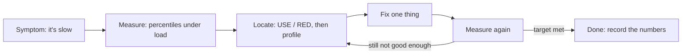
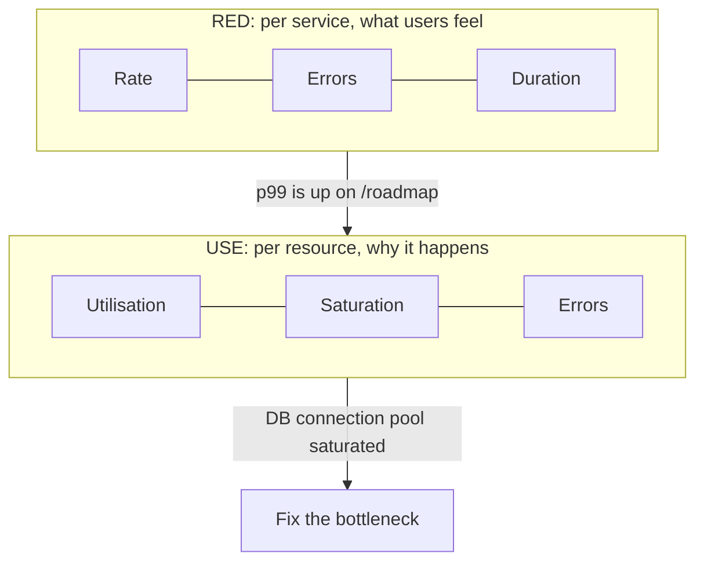

"The app feels slow" is not a bug report, it is a mood. Performance engineering turns that mood
into numbers: how slow, for whom, under what load, and where the time goes. The golden rule of the
whole session is **measure before you change anything**. Developers are famously bad at guessing
where a program spends its time, and an "optimisation" made on a hunch usually speeds up code that
was never the problem. This session gives you the vocabulary (latency, throughput, percentiles),
the tools (Python profilers, k6 or Locust) and two checklists (USE and RED) to work from data.



## Latency vs throughput, percentiles

Picture a motorway toll booth. **Latency** is how long one car waits from arriving to driving
through. **Throughput** is how many cars pass per minute. They are related but not the same thing:
opening more booths raises throughput without making any single car faster, and a booth that takes
cash slowly raises latency for everyone behind it.

In software:

- **Latency** (or response time) is the time one request takes, in milliseconds.
- **Throughput** is how many requests the system completes per second (RPS, or QPS for queries).
- **Concurrency** is how many requests are in flight at the same moment.

They are tied together by **Little's law**: concurrency = throughput x latency. If your API serves
200 requests/second at 50 ms each, about 10 requests are in flight at any moment. If latency
creeps up to 500 ms at the same traffic, 100 requests are in flight, and connection pools, worker
threads and memory start to run out. That is why a slow dependency so often turns into an outage.

### Why averages lie

Suppose 99 requests take 20 ms and one takes 5 seconds. The **average** is about 70 ms, which
describes nobody: 99 users saw 20 ms and one user saw 5 s. Use **percentiles** instead:

- **p50** (median): half of the requests were faster than this. The "typical" experience.
- **p95**: 95% were faster; 1 in 20 was slower.
- **p99**: 1 in 100 was slower. This is the **tail latency**.

> [!NOTE]
> The tail matters more than it looks. A single page load often triggers 20 or more requests
> (API calls, images, scripts). If each has a 1% chance of hitting p99, a large share of page
> loads include at least one slow request. Your heaviest users, who make the most requests, see
> the tail the most.

> [!WARNING]
> Never average percentiles across servers or time windows: the average of two p99s is not the
> p99 of the combined traffic. Compute percentiles from the raw data or from histograms, which is
> what tools like k6 and Prometheus do.

Throughput and latency trade off as load grows. At low load latency is flat. As you approach the
system's capacity, requests start to queue and latency shoots up, while throughput stops growing.
The point where the curve bends (the "knee") is your real capacity, and it is usually well below
the theoretical maximum.

## Profiling CPU and memory in Python

Load tests tell you _that_ an endpoint is slow; a **profiler** tells you _where inside the code_
the time goes. Think of it as a stopwatch attached to every function at once.

Python ships a deterministic profiler, `cProfile`, which records every function call and how long
it took. You can run a whole script under it from the command line:

```sh
python -m cProfile -o out.prof myscript.py     # save raw stats
python -m cProfile -s cumtime myscript.py      # or print a report sorted by cumulative time
```

Then read the saved file with `pstats`:

```python
import pstats
from pstats import SortKey

p = pstats.Stats("out.prof")
p.sort_stats(SortKey.CUMULATIVE).print_stats(15)  # top 15 functions by cumulative time
```

Two columns matter most:

- **tottime**: time spent _inside_ this function itself, excluding calls it made. High tottime
  means the function's own code is hot (a tight loop, heavy string building).
- **cumtime**: time including everything it called. High cumtime with low tottime means "the
  problem is somewhere below me", so follow the call tree down.

> [!NOTE]
> According to the [Python profilers docs](https://docs.python.org/3/library/profile.html), Python
> 3.15 moves the profilers into a new `profiling` package: `profiling.tracing` is the
> deterministic profiler (and `cProfile` stays as a backward-compatible alias), and
> `profiling.sampling` is a low-overhead statistical profiler suited to production. The old pure
> Python `profile` module is deprecated. On older versions, keep using `cProfile`.

**Deterministic vs sampling.** A deterministic profiler hooks every call, which is precise but
adds overhead and can distort very small, frequent functions. A **sampling** profiler peeks at the
call stack many times per second and counts where it finds the program. It is less precise per
call but cheap enough to run on a live server. Results are often drawn as a **flame graph**: each
bar is a function, its width is the share of samples, and the stack grows upward.

### Memory

For memory, the standard library has `tracemalloc`, which records where allocations come from:

```python
import tracemalloc

tracemalloc.start()
build_report()                      # the code you suspect
snapshot = tracemalloc.take_snapshot()
for stat in snapshot.statistics("lineno")[:10]:
    print(stat)                     # file:line, total size, number of blocks
```

Take two snapshots (before and after repeating an operation many times) and compare them with
`snapshot2.compare_to(snapshot1, "lineno")` to spot a leak: a line whose memory keeps growing.

> [!WARNING]
> In async code (FastAPI, asyncio), cumulative time includes time a coroutine spent _waiting_ on
> the database or network. A handler with huge cumtime may be idle, not busy. Check whether the
> time is CPU (tottime in your own functions) or waiting (time inside I/O and event-loop calls)
> before deciding what to fix.

## Load testing with k6 or Locust

A profiler looks at one request; a **load test** sends many at once to see how the system behaves
under realistic traffic. It answers questions like "what is our p95 at 100 RPS?" and "at what
load does the error rate climb?"

The two popular open-source tools differ mainly in language:

| | k6 | Locust |
|---|---|---|
| Scripts written in | JavaScript | Python |
| Engine | Go binary, very efficient per machine | Python, scales with workers |
| Pass/fail thresholds | Built in | Via code or plugins |
| UI | CLI output, Grafana integration | Web UI with live charts |

A minimal [k6](https://grafana.com/docs/k6/latest/) script defines **virtual users** (VUs), each
running the default function in a loop, plus **thresholds** that make the test fail if your
targets are missed:

```javascript
import http from "k6/http";
import { check, sleep } from "k6";

export const options = {
  vus: 20,
  duration: "30s",
  thresholds: {
    http_req_duration: ["p(95)<300"], // 95% of requests under 300 ms
    http_req_failed: ["rate<0.01"],   // less than 1% errors
  },
};

export default function () {
  const res = http.get("http://localhost:8000/roadmap");
  check(res, { "status is 200": (r) => r.status === 200 });
  sleep(1); // think time, like a real user
}
```

Common test shapes:

- **Smoke test**: a handful of users for a minute, just to check the script and the system work.
- **Load test**: expected normal traffic, to confirm you meet your targets.
- **Stress test**: ramp beyond normal until something breaks, to find the knee.
- **Soak test**: normal traffic for hours, to find leaks and slow degradation.
- **Spike test**: a sudden jump, like a marketing email going out.

> [!TIP]
> Run the load generator on a different machine (or at least a different container) from the
> system under test, and watch its own CPU. If the load generator is maxed out, you are measuring
> the generator, not your API.

> [!WARNING]
> Load tests against tiny, empty databases lie. A query that takes 1 ms on 100 rows may take
> 2 seconds on 10 million. Test against realistic data volumes, and never against production
> without explicit agreement from whoever runs it.

## The USE and RED methods

When a system is slow, there are hundreds of graphs you could look at. Two short checklists keep
you from wandering.

**The USE method**, from [Brendan Gregg](https://www.brendangregg.com/usemethod.html), is for
**resources** (CPU, memory, disks, network interfaces, but also software resources like
connection pools and thread pools). For _every_ resource, check:

- **Utilisation**: how busy it is (for example, CPU at 90%).
- **Saturation**: how much extra work is queued waiting for it (run queue length, pool wait
  time, swapping).
- **Errors**: error events (failed disk operations, dropped packets, pool timeouts).

Its power is completeness: by walking through every resource you avoid the "streetlight effect" of
only checking the graphs you happen to have.

**The RED method**, popularised by Tom Wilkie for request-driven services, is the user-facing
counterpart. For every **service** (or endpoint), track:

- **Rate**: requests per second.
- **Errors**: failed requests per second.
- **Duration**: the latency distribution (percentiles, not averages).



> [!EXAMPLE]
> RED shows the `/sessions/{id}` endpoint's p99 jumped from 80 ms to 900 ms while its rate stayed
> flat. USE on the API container shows CPU at 30% (not the problem), but the database connection
> pool has requests waiting (saturation). USE on the database shows one query doing a sequential
> scan. Adding the missing index fixes the duration. Neither checklist alone would have got you
> there as quickly.

Use RED on dashboards and alerts (it describes what users experience), and USE when investigating
(it finds the resource behind the symptom).

## Practice: load-test an API, find and fix the bottleneck

You will load-test your local YouCanDoIt API, profile it, change one thing, and prove with numbers
whether it helped. Budget about 90 minutes. Start the stack with `docker compose up -d --build`.

### Step 1: Write the k6 script

Save this as `load.js` in a scratch folder (not in the repo):

```javascript
import http from "k6/http";
import { check, sleep } from "k6";

const BASE = __ENV.BASE || "http://api:8000";

export const options = {
  stages: [
    { duration: "20s", target: 10 },  // ramp up
    { duration: "40s", target: 50 },  // push harder
    { duration: "20s", target: 0 },   // ramp down
  ],
  thresholds: { http_req_duration: ["p(95)<300"], http_req_failed: ["rate<0.01"] },
};

export default function () {
  const r1 = http.get(`${BASE}/roadmap`);
  const r2 = http.get(`${BASE}/sessions/4.5.4`);
  check(r1, { "roadmap 200": (r) => r.status === 200 });
  check(r2, { "session 200": (r) => r.status === 200 });
  sleep(0.5);
}
```

### Step 2: Run it from a container on the Compose network

k6 is distributed as a Docker image, so you don't need to install anything. Joining the Compose
network lets it reach the API by its service name:

```sh
docker run --rm -i --network youcandoit_default grafana/k6 run - < load.js
```

Write down the baseline: `http_reqs` (throughput), `http_req_duration` p(50), p(90), p(95) and
max, and whether the thresholds passed. While it runs, watch `docker stats` in another terminal:
that is a quick USE check on CPU and memory for the `api` and `db` containers.

### Step 3: Profile the hot endpoint

Run a second copy of the API under `cProfile` on another port, inside the API container:

```sh
docker compose exec api python -m cProfile -o /tmp/api.prof \
  -m uvicorn app.main:app --host 0.0.0.0 --port 8001
```

In another terminal, point k6 at it with `-e BASE=http://api:8001`. When k6 finishes, stop the
profiled server with Ctrl+C so the stats file is written, then read it:

```sh
docker compose exec api python -c "import pstats; pstats.Stats('/tmp/api.prof').sort_stats('cumulative').print_stats(25)"
```

Look for your own functions (in `app/`) near the top, then compare their tottime and cumtime.
Is the time spent in your Python code, in SQLAlchemy building objects, or waiting on the
database? Is the roadmap tree rebuilt from the database on every request?

### Step 4: Form one hypothesis and change one thing

Pick the single biggest cost and write your hypothesis down, for example: "`/roadmap` rebuilds the
full tree from several queries on every call; the curriculum only changes on startup, so caching
the result should cut p95 substantially." Other candidates: a missing index, N+1 queries, loading
columns you don't need. Make one change in a throwaway branch.

> [!TIP]
> One change per experiment. If you change three things and p95 improves, you won't know which
> one helped, or whether one of them made things worse.

### Step 5: Measure again and record

Re-run Step 2 with identical settings and fill in a table:

| Metric | Before | After |
|---|---|---|
| Requests/s | | |
| p50 | | |
| p95 | | |
| p99 / max | | |
| Error rate | | |
| API CPU at peak (docker stats) | | |

Write two sentences: what the bottleneck was and how you know, and whether the fix is worth its
cost (a cache adds an invalidation problem; an index slows writes). If the numbers did not move,
that is a valid result: your hypothesis was wrong, and the data saved you from shipping a
pointless change.

```quiz
{"questions": [
  {"question": "An endpoint has an average latency of 60 ms, but some users complain it is very slow. What should you look at first?", "options": ["The p95 and p99 latency, because the average hides the slow tail", "The minimum latency, to see the best case", "Only the throughput in requests per second", "Nothing: an average of 60 ms means the endpoint is fast"], "answer": 0, "explanation": "Averages mix fast and slow requests into a number that describes no one. Tail percentiles show how often and how badly users hit slow responses."},
  {"question": "Your API handles 100 requests/second. A database slowdown raises latency from 50 ms to 1 s at the same traffic. Using Little's law, what happens to concurrency?", "options": ["It stays at about 5 requests in flight", "It drops because fewer requests finish", "It rises from about 5 to about 100 requests in flight, which can exhaust pools and workers", "Little's law does not apply to web servers"], "answer": 2, "explanation": "Concurrency = throughput x latency: 100 x 0.05 = 5 before, 100 x 1 = 100 after. That is why slow dependencies cause pool exhaustion and cascading failures."},
  {"question": "In a cProfile report, a function has high cumtime but almost zero tottime. What does that tell you?", "options": ["The function's own code is the bottleneck", "The time is spent in functions it calls, so you should follow the call tree down", "The profiler is broken", "The function is never called"], "answer": 1, "explanation": "tottime excludes callees; cumtime includes them. High cumtime with low tottime means the cost lives below this function."},
  {"question": "RED shows p99 rising on one endpoint. Which next step applies the USE method?", "options": ["Add more alerts on the endpoint's p99", "Rewrite the endpoint in a faster language", "Increase the load-test duration", "Check utilisation, saturation and errors for each resource the endpoint uses, such as CPU, the DB connection pool and disk"], "answer": 3, "explanation": "RED describes the user-facing symptom; USE walks every resource to find the one that is busy, queued or erroring."},
  {"question": "During a load test the k6 container is at 100% CPU and latency looks high. What is the most likely problem?", "options": ["The API is definitely the bottleneck", "The load generator itself is saturated, so the measurements are unreliable", "The thresholds are too strict", "The test needs more virtual users"], "answer": 1, "explanation": "If the generator cannot keep up, you are measuring the tool. Give it more resources or run it elsewhere before trusting the numbers."}
]}
```
