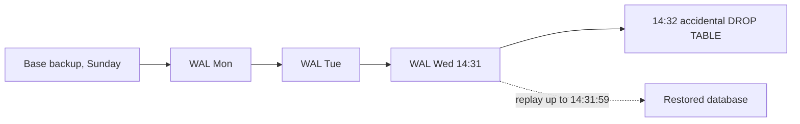
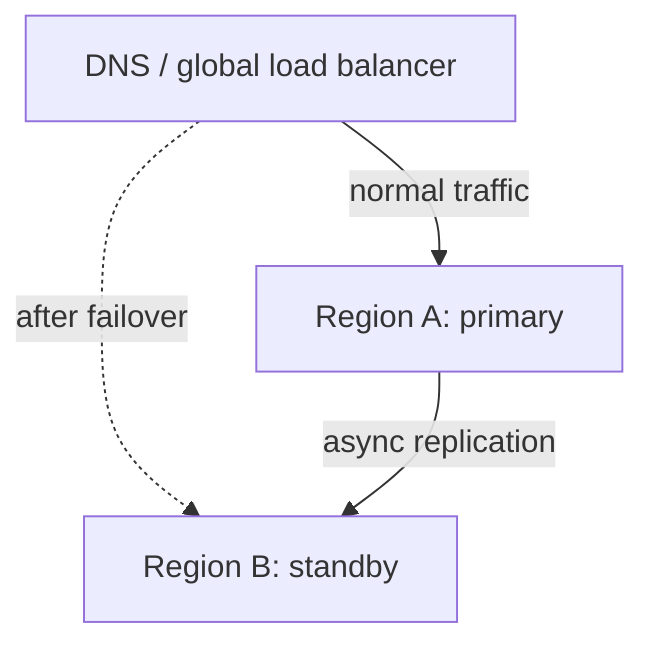

Reliability patterns (4.5.5) keep small failures small. Disaster recovery is about the big ones:
the database volume is deleted, a region goes dark, ransomware encrypts your servers, or someone
runs `DROP TABLE` in the wrong terminal. Business continuity asks how the organisation keeps
working while that happens. The uncomfortable truth behind this whole session is a line every
operator learns eventually: **nobody wants backups, everybody wants restores**. A backup you have
never restored is a hope, not a plan. This session covers the two numbers that drive every
decision (RPO and RTO), backup strategies for PostgreSQL, multi-region failover, and runbooks,
then you'll back up and restore the YouCanDoIt database yourself.


## RPO and RTO

Imagine you're writing a long document and your laptop dies. Two questions matter: how much work
was lost since you last saved, and how long until you can carry on working? Those are exactly the
two disaster recovery targets.

- **RPO (Recovery Point Objective)**: the maximum amount of data, measured in time, you can afford
  to lose. An RPO of 24 hours means a nightly backup is acceptable; an RPO of 5 minutes means you
  need continuous replication or log archiving.
- **RTO (Recovery Time Objective)**: the maximum time the service may be down before it is
  restored. An RTO of 4 hours allows a person to follow a runbook and restore from backup; an RTO
  of 1 minute needs automated failover to a standby that is already running.

Both are **business decisions** expressed in technical terms. Lower numbers cost more, roughly
exponentially, so they should be set per system, based on what an hour of downtime or of lost
data actually costs.

| System | Sensible RPO | Sensible RTO | Why |
|---|---|---|---|
| Payments ledger | Seconds | Minutes | Lost transactions are lost money and trust |
| Internal wiki | 24 hours | 1 day | Annoying, but people can wait |
| Analytics warehouse | 24 hours | Days | Can be rebuilt from sources |
| A personal learning app | 24 hours | Hours | Losing a day of ticked boxes is fine |

> [!NOTE]
> RPO and RTO are _objectives_, like SLOs. What you can actually achieve is measured by testing:
> your real recovery point is the age of your newest restorable backup, and your real recovery
> time is how long the last restore drill took, end to end.

## Backup strategies and restore drills

The [PostgreSQL backup documentation](https://www.postgresql.org/docs/current/backup.html)
describes three fundamentally different approaches, and the same ideas apply to most databases.

**1. SQL dump (`pg_dump`).** Produces a file that can recreate one database: schema plus data.
It takes a consistent snapshot even while the database is in use, and works across PostgreSQL
versions, which makes it the easiest choice for small and medium databases and for migrations.
The custom format (`-Fc`) is compressed and restored with `pg_restore`, which can also restore
selected tables. `pg_dump` covers a single database; roles and other cluster-wide objects need
`pg_dumpall --globals-only`. The limit: your RPO is the time between dumps, and dumping and
restoring a very large database is slow.

**2. File system level backup.** Copy the database's data directory. It only gives a usable
result if the server is stopped or if you use a consistent snapshot of the volume. Fast for large
data, but tied to the exact PostgreSQL major version.

**3. Continuous archiving and point-in-time recovery (PITR).** Take a base backup
(`pg_basebackup`), then continuously archive the **write-ahead log (WAL)**, the journal of every
change. To restore, you replay the WAL on top of the base backup up to any moment you choose,
such as "one second before the bad `DROP TABLE`". This is how you get RPOs measured in seconds or
minutes, and it is what managed databases' "restore to point in time" feature does for you.



### Rules that make backups trustworthy

- **3-2-1**: keep at least 3 copies of your data, on 2 different kinds of storage, with 1 copy
  off-site (another region or provider).
- **Separate the blast radius**: backups in the same account, with the same credentials, can be
  deleted by the same attacker or the same mistake. Use separate accounts, immutable or
  write-once storage, and restricted delete permissions.
- **Encrypt** backups and keep the keys somewhere you can reach during a disaster.
- **Monitor** them: alert when a backup job fails or the newest backup is older than your RPO.
- **Replicas are not backups.** A replica copies a `DELETE` within milliseconds. It protects
  against hardware failure, not against mistakes.

> [!WARNING]
> The most common backup failure is discovering, during an incident, that backups were silently
> empty, missing a database, or impossible to restore without a forgotten password. The only cure
> is a **restore drill**: regularly restore into a fresh environment, check the data, and time it.
> If you don't test restores, you don't know your RTO.

A good drill restores into an isolated environment, runs sanity checks (row counts, recent
records present, the app starts against it), records how long each step took, and updates the
runbook with anything that surprised you.

## Multi-region and failover

Backups protect against data loss. Keeping the _service_ running through the loss of a whole data
centre or cloud region requires capacity somewhere else. The reliability pillar of
[AWS Well-Architected](https://aws.amazon.com/architecture/well-architected/) describes a ladder
of disaster recovery strategies, each trading cost for lower RPO and RTO:

| Strategy | What runs in the second region | RPO / RTO | Cost |
|---|---|---|---|
| Backup and restore | Only backups | Hours / hours | Lowest |
| Pilot light | Data replicated, core services off or minimal | Minutes / tens of minutes | Low |
| Warm standby | A scaled-down full copy, running | Seconds-minutes / minutes | Medium |
| Multi-site active/active | Full capacity, serving traffic | Near zero / near zero | Highest |



Things that make failover hard in practice:

- **Replication lag**: with asynchronous replication (4.4.2), the standby is slightly behind, so
  failing over loses the last few seconds of writes. That lag _is_ your RPO.
- **Split brain**: if both regions think they are the primary, they accept conflicting writes.
  Failover needs fencing or a consensus-based decision (4.4.3), and often a human confirmation.
- **Hidden dependencies**: the standby region needs secrets, DNS, container images, third-party
  allow-lists and capacity quotas too. These are typically discovered during the first real
  failover unless a drill finds them first.
- **Failing back**: returning to the original region after the incident is a second migration,
  and needs its own plan.

> [!TIP]
> Most teams don't need active/active. Start with reliable, tested backups and infrastructure as
> code (Track 5), which together let you rebuild in another region. Move up the ladder only when
> the business case for a lower RTO justifies the cost and complexity.

## Runbooks

A **runbook** is a step-by-step guide for handling a specific operational situation: "restore the
database from backup", "fail over to region B", "rotate a leaked key". It is written calmly in
advance so that, at 3 a.m. under stress, the person on call follows a checklist instead of
improvising. The [Google SRE Book](https://sre.google/sre-book/table-of-contents/) chapters on
emergency response and incident management stress that preparation and practice, not heroics,
are what shorten outages.

A useful runbook contains:

1. **When to use it**: the symptoms or alerts that lead here.
2. **Prerequisites**: access, tools and credentials needed, and where to find them.
3. **Steps**: exact, copy-pasteable commands, with the expected output of each one.
4. **Verification**: how to confirm it worked (queries, health checks, SLI dashboards).
5. **Rollback or escalation**: what to do if a step fails, and who to call.
6. **Last tested**: date and person of the most recent drill.

> [!EXAMPLE]
> A weak runbook says "restore the DB from the latest backup". A strong one says: "1. Find the
> newest file in `backups/` and note its timestamp (this is your recovery point). 2. Run
> `pg_restore ...` (command below); it takes about 2 minutes for the current data size.
> 3. Check that `SELECT count(*) FROM completions` is non-zero and the newest `completed_at` is
> close to the backup time."

> [!TIP]
> Treat runbooks like code: keep them in the repository, review changes, and update them after
> every drill and incident. Steps that are always identical are good candidates to automate into
> a script, which the runbook then simply tells you to run.

## Practice: back up and restore the YouCanDoIt database

You'll take a logical backup of the local database, restore it into a separate database, verify
it, time it, and turn what you did into a runbook. Budget about 60 minutes. Start the stack with
`docker compose up -d` and tick a few subchapters in the web app so there is progress to protect.

### Step 1: Decide what needs protecting

Look at the tables in `apps/api/app/models.py`. The curriculum tables (`tracks`, `modules`,
`sessions`, `subchapters`) are rebuilt from `ROADMAP.md` every time the API starts, and the RAG
`documents` and `chunks` can be re-indexed from the sources. The irreplaceable data is your
`completions` (your progress, XP and streaks are derived from it) and your `articles` favourites.
Write down an RPO and RTO for the app based on that, for example "RPO 24 h, RTO 1 h".

### Step 2: Take a backup

`pg_dump` runs inside the `db` container. The `-T` flag disables the terminal, so the binary
dump arrives in your file unchanged:

```sh
mkdir -p ~/ycdi-backups
docker compose exec -T db pg_dump -U ycdi -Fc ycdi > ~/ycdi-backups/ycdi-$(date +%Y%m%d-%H%M).dump
ls -lh ~/ycdi-backups
```

Keep backups outside the repository: they contain your data and should never be committed.

### Step 3: Restore into a scratch database, and time it

Restoring into a separate database lets you test without touching the live one:

```sh
docker compose exec db createdb -U ycdi ycdi_restore
time docker compose exec -T db pg_restore -U ycdi -d ycdi_restore --no-owner \
  < ~/ycdi-backups/<your-file>.dump
```

The database image includes the `pgvector` extension, so the `vector` columns restore cleanly.
Note the elapsed time: that is the core of your measured RTO.

### Step 4: Verify the restore

Compare the live and restored databases:

```sh
for db in ycdi ycdi_restore; do
  docker compose exec db psql -U ycdi -d $db -tAc \
    "SELECT '$db', (SELECT count(*) FROM completions), (SELECT max(completed_at) FROM completions)"
done
```

The counts should match, and the newest `completed_at` tells you the recovery point. Now tick one
more subchapter in the app and run the query again: the live database moves ahead while the
restored copy stays at the backup time. That gap is exactly what your RPO describes.

> [!WARNING]
> Don't test restores with `docker compose down -v`: the `-v` deletes the `pgdata` volume, and if
> your backup turns out to be broken, the data is gone. Always prove a backup restores _before_
> you rely on it.

### Step 5: Clean up and write the runbook

Drop the scratch database with `docker compose exec db dropdb -U ycdi ycdi_restore`. Then write
`runbook-restore.md` in your notes with the six parts from the Runbooks section: when to use it,
prerequisites, the exact commands from Steps 2 to 4, the verification query, what to do if
`pg_restore` reports errors, and today's date as "last tested".

### Stretch goals

- Schedule the Step 2 command nightly (cron on Linux, `launchd` on macOS) and delete dumps older
  than 14 days.
- Copy each dump to a second location, such as an external disk or a cloud bucket, to satisfy
  3-2-1.
- Read the "Continuous Archiving and Point-in-Time Recovery" chapter of the PostgreSQL docs and
  sketch how you would get the RPO down to 5 minutes.

```quiz
{"questions": [
  {"question": "A team takes a full database backup every night at 02:00. A disk failure destroys the database at 17:00. What is the worst-case data loss, and which target does it relate to?", "options": ["About 15 hours of data, related to the RPO", "About 15 hours of downtime, related to the RTO", "No data loss, because a backup exists", "One day of downtime, related to the SLA"], "answer": 0, "explanation": "RPO is about how much data you can lose, measured in time since the last recoverable point. Everything written after 02:00 is lost."},
  {"question": "Why is a streaming read replica not a substitute for backups?", "options": ["Replicas cannot be queried", "Replicas are always in a different format", "A replica faithfully copies mistakes like an accidental DELETE within moments, so it cannot bring back lost data", "Replicas are too expensive to keep"], "answer": 2, "explanation": "Replication protects against hardware failure. Protection against human error, bugs and ransomware needs point-in-time copies kept separately."},
  {"question": "A company needs an RPO of a few minutes for its main PostgreSQL database. Which approach fits best?", "options": ["A weekly pg_dump", "A base backup plus continuous WAL archiving, enabling point-in-time recovery", "Copying the data directory while the server is running, without a snapshot", "Exporting tables to CSV once a month"], "answer": 1, "explanation": "Continuous archiving replays the write-ahead log up to a chosen moment, so the possible data loss shrinks to the archiving interval."},
  {"question": "The business asks for an RTO of under one minute if a whole region fails. Which DR strategy is the minimum that can realistically meet it?", "options": ["Backup and restore", "Pilot light with services switched off", "A runbook that rebuilds the infrastructure by hand", "A warm standby or active/active setup already running in another region"], "answer": 3, "explanation": "Restoring or starting services takes far longer than a minute. Only capacity that is already running elsewhere can take over that quickly."},
  {"question": "Your backups have run every night for a year without errors, but you have never restored one. What do you actually know about your RTO?", "options": ["Nothing reliable; only a timed restore drill tells you if and how fast you can recover", "It equals the time it takes to create the backup", "It is guaranteed to be under one hour", "It is zero, because backups exist"], "answer": 0, "explanation": "A backup that has never been restored might be empty, incomplete or unusable. Restore drills both validate the backup and measure the real recovery time."}
]}
```
