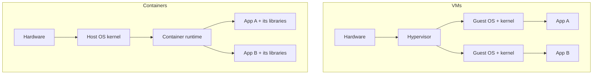
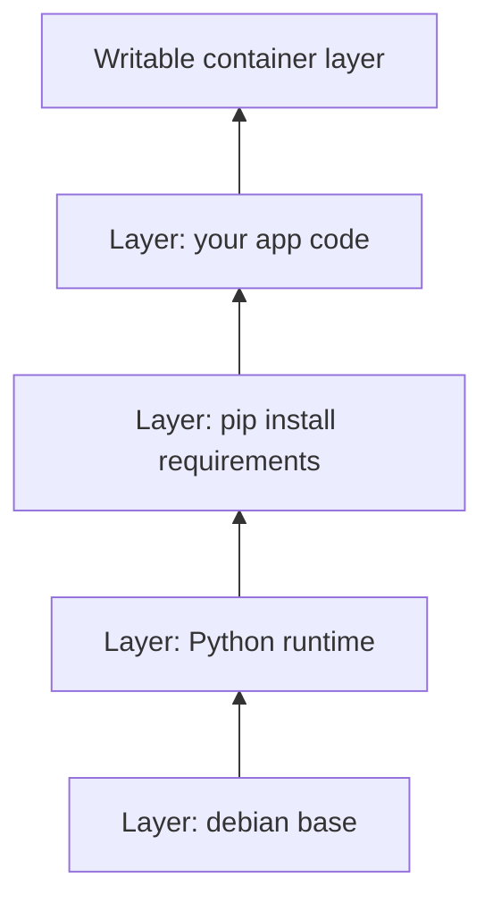
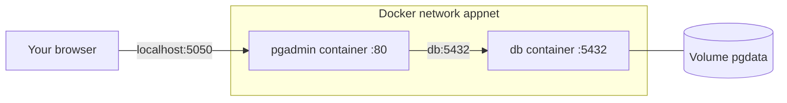

"It works on my machine" is one of the oldest jokes in software. Your laptop has Python 3.12, the
server has 3.9; your colleague installed PostgreSQL 16, production runs 14. Containers end the joke
by shipping the application _together with_ the environment it needs. This session explains what a
container really is under the hood, then gets your hands dirty: running, inspecting, debugging and
connecting containers, following the official [Docker — Get started](https://docs.docker.com/get-started/)
guide.

## Containers vs VMs: namespaces and cgroups

Picture an apartment building. A **virtual machine** is a separate house: its own foundations,
plumbing and electricity. A **container** is an apartment: it has its own front door, its own rooms
and its own meter, but it shares the building's foundations and pipes with everybody else.

In technical terms:

- A **virtual machine (VM)** runs a full guest operating system, kernel included, on top of a
  **hypervisor** that emulates hardware. Booting takes tens of seconds and each VM uses gigabytes.
- A **container** is just an ordinary process on the host, running on the host's kernel, which the
  kernel has been told to _isolate_. It starts in milliseconds and adds almost no overhead.



The isolation comes from two Linux kernel features:

- **Namespaces** control what a process can _see_. A PID namespace gives the container its own
  process list (your app is PID 1 inside it). A network namespace gives it its own network
  interfaces and ports. A mount namespace gives it its own filesystem tree. There are also UTS
  (hostname), IPC and user namespaces.
- **Control groups (cgroups)** control what a process can _use_: CPU time, memory, disk I/O, number
  of processes. `docker run --memory 512m --cpus 1` is a cgroup setting under the hood.

> [!NOTE]
> Containers are a Linux feature. On macOS and Windows, Docker Desktop quietly runs a small Linux VM
> and your containers live inside it. That is why bind-mounted files can be slower on a Mac.

> [!WARNING]
> Because containers share the host kernel, the isolation is weaker than a VM's. A kernel exploit
> inside a container can affect the host. That is why you never run untrusted code in a container
> as if it were a sandbox, and why running as root inside containers is discouraged (see 5.1.2).

## Images, layers and registries

If a container is a running apartment, an **image** is the blueprint plus the furniture packed in
boxes. More precisely, an image is a read-only bundle of a filesystem (your app, its libraries, a
minimal OS userland) and some metadata (which command to run, which port it listens on).

Images are made of **layers**. Each instruction in a Dockerfile that changes files produces a new
layer, stacked on the previous ones. When you start a container, Docker adds a thin **writable
layer** on top; everything the container writes goes there and disappears when the container is
removed.



Layers are shared and cached. If ten images all start `FROM python:3.12-slim`, the base layers are
stored once on disk and downloaded once.

A **registry** is a server that stores images, like GitHub for images. Docker Hub is the default;
others include GitHub Container Registry (`ghcr.io`), Amazon ECR and Google Artifact Registry. An
image reference reads `registry/repository:tag`:

```sh
docker pull postgres:17                   # Docker Hub, official image, tag 17
docker pull ghcr.io/someorg/api:1.4.2     # GitHub Container Registry
docker image ls                           # what is on your machine
```

> [!TIP]
> A tag is a movable label: `postgres:17` today may point to a different image next month. In
> production, pin a specific version (`postgres:17.4`) or even the immutable digest
> (`postgres@sha256:...`) so builds are reproducible.

## Running, stopping and inspecting containers

The core loop is small. Learn these commands until they are muscle memory:

```sh
docker run -d --name web -p 8080:80 nginx   # start in the background
docker ps                                    # running containers (-a for all)
docker logs -f web                           # follow its stdout/stderr
docker exec -it web sh                       # open a shell inside it
docker inspect web                           # full JSON: IP, mounts, env, state
docker stop web                              # SIGTERM, then SIGKILL after a timeout
docker start web                             # start it again, same writable layer
docker rm web                                # delete it (and its writable layer)
```

Key `docker run` flags:

| Flag | Meaning |
| ---- | ------- |
| `-d` | detached: run in the background |
| `--name` | a friendly name instead of a random one |
| `-p 8080:80` | publish container port 80 on host port 8080 |
| `-e KEY=value` | set an environment variable |
| `-v name:/path` | mount a volume |
| `--rm` | delete the container automatically when it exits |
| `-it` | interactive terminal (for shells) |

> [!EXAMPLE]
> A container keeps exiting immediately. Debug it in this order:
> 1. `docker ps -a` shows the status `Exited (1)`.
> 2. `docker logs <name>` shows the error, for example "POSTGRES_PASSWORD is not specified".
> 3. Fix the flag and run again. If the logs are empty, `docker inspect <name>` shows the command
>    and the exit code, and `docker run -it --entrypoint sh <image>` lets you look around inside.

A container lives exactly as long as its main process (PID 1). When that process exits, the
container stops. This is why you don't "start a service in the background" inside a container: the
main process _is_ the service.

## Volumes and networking

The writable layer is disposable. Delete the container and the data goes with it, which is great
for apps and terrible for databases. **Volumes** solve this by storing data outside the container's
lifecycle:

- **Named volumes** (`-v pgdata:/var/lib/postgresql/data`): managed by Docker, the right choice for
  databases.
- **Bind mounts** (`-v "$PWD":/app`): map a host folder into the container, ideal for live code
  editing in development.
- **tmpfs mounts**: in memory only, for scratch data you never want on disk.

For **networking**, each container gets its own network namespace. Publishing a port (`-p`)
forwards a host port into the container. Containers can also talk to each other directly over a
Docker network:

```sh
docker network create appnet
docker run -d --name db --network appnet -e POSTGRES_PASSWORD=secret postgres:17
docker run --rm --network appnet postgres:17 pg_isready -h db
```

On a **user-defined network** like `appnet`, Docker runs a small DNS server, so containers reach
each other by name (`db`). Inside the network, use the container port (5432), not the published
host port.



> [!WARNING]
> `localhost` inside a container means _that container_, not your laptop and not another container.
> This is the single most common Docker networking mistake. Use the other container's name.

## Practice: run PostgreSQL and pgAdmin in containers

Goal: a PostgreSQL server with persistent data and a pgAdmin web UI, both in containers, talking
over a private network.

### Step 1: Create a network and a volume

```sh
docker network create pgnet
docker volume create pgdata
```

### Step 2: Start PostgreSQL

```sh
docker run -d --name db --network pgnet \
  -e POSTGRES_PASSWORD=devpassword -e POSTGRES_DB=todo \
  -v pgdata:/var/lib/postgresql/data \
  -p 5432:5432 postgres:17
docker logs -f db    # wait for "database system is ready to accept connections", then Ctrl+C
```

### Step 3: Start pgAdmin

```sh
docker run -d --name pgadmin --network pgnet \
  -e PGADMIN_DEFAULT_EMAIL=me@example.com -e PGADMIN_DEFAULT_PASSWORD=devpassword \
  -p 5050:80 dpage/pgadmin4
```

Open `http://localhost:5050`, log in, and register a server with host **`db`**, port `5432`, user
`postgres`, password `devpassword`.

### Step 4: Prove persistence

Create a table and insert a row from pgAdmin (or with
`docker exec -it db psql -U postgres -d todo`). Then destroy and recreate the database container:

```sh
docker rm -f db
# re-run the Step 2 command
docker exec -it db psql -U postgres -d todo -c '\dt'
```

Your table is still there because it lives in the `pgdata` volume, not in the container.

### Step 5: Inspect and clean up

Run `docker inspect db` and find the IP address, the mount and the environment variables. Check
`docker stats` to see live CPU and memory use (cgroups at work). When finished:

```sh
docker rm -f db pgadmin
docker network rm pgnet
docker volume rm pgdata    # only when you really want to delete the data
```

> [!TIP]
> Typing these flags by hand gets old fast. In session 5.1.3 you will describe the same setup in a
> single `compose.yaml` file.
