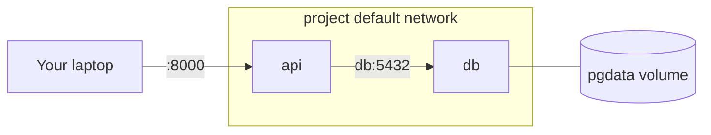
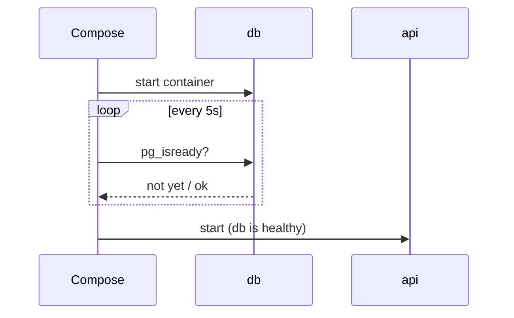

In 5.1.1 you started PostgreSQL and pgAdmin with two long `docker run` commands, a network and a
volume. Now imagine doing that for an API, a database, a cache, a worker and a frontend, every
morning, on every teammate's laptop. **Docker Compose** replaces those commands with one file you
commit to Git and one command: `docker compose up`. This session follows the
[Docker Compose docs](https://docs.docker.com/compose/). YouCanDoIt itself runs this way, so its
`docker-compose.yml` is a real example you can read alongside.

## Services, networks and volumes in Compose

If `docker run` is ordering one dish, Compose is handing the kitchen the whole menu for the table.
The file (`compose.yaml` or `docker-compose.yml`) declares three kinds of things:

- **Services**: each one becomes one or more containers from an image or a build.
- **Networks**: Compose creates a default network for the project automatically, so every service
  can reach every other by its **service name**.
- **Volumes**: named volumes that survive `docker compose down`.

```yaml
services:
  api:
    build: ./api              # build from ./api/Dockerfile
    ports:
      - "8000:8000"
    environment:
      DATABASE_URL: postgresql://postgres:secret@db:5432/todo
  db:
    image: postgres:17
    environment:
      POSTGRES_PASSWORD: secret
      POSTGRES_DB: todo
    volumes:
      - pgdata:/var/lib/postgresql/data

volumes:
  pgdata:
```

Note `@db:5432` in the URL: `db` is the service name, resolved by Compose's network DNS. Only
`api` publishes a port to your laptop; the database is reachable from other services but not from
outside, which is a sensible default.



The everyday commands:

```sh
docker compose up -d          # create and start everything in the background
docker compose ps             # status of each service
docker compose logs -f api    # follow one service's logs
docker compose exec db psql -U postgres   # shell into a running service
docker compose up -d --build  # rebuild images after code/Dockerfile changes
docker compose down           # stop and remove containers and the network
docker compose down -v        # ...and delete named volumes (data!)
```

> [!WARNING]
> `docker compose down -v` deletes your database volume. It's handy for a clean slate and a
> disaster when typed out of habit. Use plain `down` by default.

## Health checks and dependencies

`depends_on` controls start order. On its own it only waits for the dependency's container to
**start**, not for the program inside to be **ready**. PostgreSQL takes a few seconds to initialise,
so an API that connects immediately will crash on first boot.

The fix is a **health check** on the dependency and a **condition** on the dependent:

```yaml
services:
  db:
    image: postgres:17
    healthcheck:
      test: ["CMD-SHELL", "pg_isready -U postgres"]
      interval: 5s
      timeout: 3s
      retries: 10
  api:
    build: ./api
    depends_on:
      db:
        condition: service_healthy
```

Now Compose starts `db`, runs `pg_isready` every 5 seconds, and only starts `api` once the check
passes. Other conditions are `service_started` (the default) and `service_completed_successfully`,
useful for one-shot jobs like migrations.



> [!TIP]
> Health checks are not only for startup. `docker compose ps` shows `healthy`/`unhealthy`, which is
> often the fastest way to spot which piece of a broken stack is the problem. Your app should still
> retry its database connection: in production, databases restart too.

## Environment variables and profiles

Configuration belongs in the environment, not in code (the twelve-factor idea you met in Track 3).
Compose gives you several ways to set it:

- `environment:` inline values in the file.
- `env_file: .env.api` to load a file of `KEY=value` lines into the container.
- **Interpolation**: `${VAR}` in the Compose file is replaced with a value from your shell or from a
  `.env` file next to the Compose file. `${VAR:-default}` supplies a fallback.

```yaml
services:
  api:
    image: todo-api:${TAG:-latest}
    environment:
      LOG_LEVEL: ${LOG_LEVEL:-info}
      DATABASE_URL: postgresql://postgres:${DB_PASSWORD}@db:5432/todo
```

> [!WARNING]
> The `.env` file holds real secrets on your machine. Add it to `.gitignore` and commit a
> `.env.example` with placeholder values instead. Compose is a development and small-deployment tool;
> production secrets belong in a secret manager (see 5.3.5).

**Profiles** let you mark optional services that only start when asked:

```yaml
services:
  pgadmin:
    image: dpage/pgadmin4
    profiles: ["tools"]
```

`docker compose up` ignores `pgadmin`; `docker compose --profile tools up` includes it. Use profiles
for admin UIs, load generators or a local LLM that not every developer needs.

## Development workflow with bind mounts

In development you want to edit code and see the change immediately, without rebuilding the image.
A **bind mount** maps your source folder over the code inside the container, and a reloading server
picks up changes:

```yaml
services:
  api:
    build: ./api
    command: uvicorn app.main:app --host 0.0.0.0 --reload
    volumes:
      - ./api:/app
```

That is how YouCanDoIt runs its tests: `docker compose run --rm -v "$PWD/apps/api:/app" api pytest`
mounts the current code into a one-off container.

A common pattern is a base `compose.yaml` close to production plus a `compose.override.yaml` with
dev-only settings (bind mounts, `--reload`, debug ports). Compose merges the override automatically
when it exists.

> [!NOTE]
> Newer Compose versions also offer `develop.watch` (`docker compose watch`), which syncs files or
> rebuilds on change without a bind mount. Bind mounts remain the simplest option and work
> everywhere.

> [!WARNING]
> A bind mount hides whatever the image had at that path. If your image installed `node_modules`
> into `/app/node_modules` and you mount `./web:/app`, the installed modules vanish. Add an anonymous
> volume (`- /app/node_modules`) to keep them.

## Practice: Compose stack for API + Postgres + Redis

Build a stack with your FastAPI to-do API (from 5.1.2), PostgreSQL and Redis, with health checks and
a dev workflow.

### Step 1: Write compose.yaml

```yaml
services:
  api:
    build: ./api
    ports: ["8000:8000"]
    environment:
      DATABASE_URL: postgresql://postgres:${DB_PASSWORD:-devpassword}@db:5432/todo
      REDIS_URL: redis://cache:6379/0
    depends_on:
      db: { condition: service_healthy }
      cache: { condition: service_healthy }

  db:
    image: postgres:17
    environment:
      POSTGRES_PASSWORD: ${DB_PASSWORD:-devpassword}
      POSTGRES_DB: todo
    volumes: [pgdata:/var/lib/postgresql/data]
    healthcheck:
      test: ["CMD-SHELL", "pg_isready -U postgres"]
      interval: 5s
      retries: 10

  cache:
    image: redis:7
    healthcheck:
      test: ["CMD", "redis-cli", "ping"]
      interval: 5s
      retries: 10

  pgadmin:
    image: dpage/pgadmin4
    profiles: ["tools"]
    ports: ["5050:80"]
    environment:
      PGADMIN_DEFAULT_EMAIL: me@example.com
      PGADMIN_DEFAULT_PASSWORD: devpassword

volumes:
  pgdata:
```

### Step 2: Use Redis in the API

Add a tiny feature that needs the cache, for example caching `GET /todos` for 10 seconds or a hit
counter with `redis.incr("hits")`. Read `REDIS_URL` from the environment.

### Step 3: Add the dev override

Create `compose.override.yaml` with a bind mount of `./api:/app` and
`command: uvicorn app.main:app --host 0.0.0.0 --reload`. Edit a route and check that the change is
live without rebuilding.

### Step 4: Run and break it on purpose

```sh
docker compose up -d --build
docker compose ps                 # all healthy?
curl localhost:8000/todos
docker compose stop cache         # what does the API do now?
docker compose logs api
docker compose start cache
docker compose --profile tools up -d
```

Decide how your API should behave when Redis is down (fail, or skip the cache and hit the database)
and implement that.

### Step 5: Clean up

`docker compose down` keeps your data; confirm by bringing the stack back up. Commit
`compose.yaml`, `compose.override.yaml` and `.env.example`, never `.env`.
