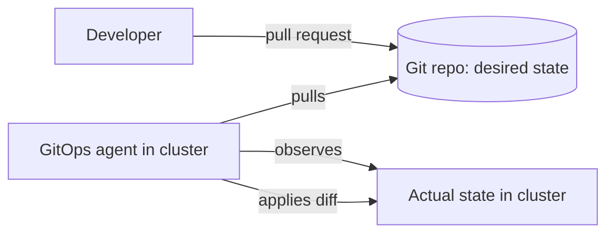
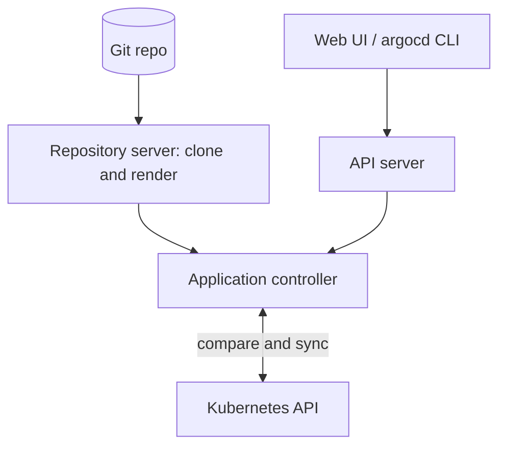
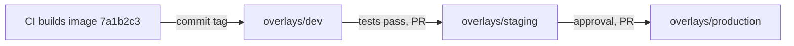

In 5.2.2 your pipeline _pushed_ deployments: CI held the credentials and ran a command against
production. GitOps flips the direction. Git holds a description of what production should look
like, and an agent running inside the cluster continuously _pulls_ that description and makes
reality match it. Deploying becomes "merge a pull request", rolling back becomes "revert a commit",
and "what is running in production?" has a single, auditable answer. This session follows the
[OpenGitOps](https://opengitops.dev/) principles and the [Argo CD docs](https://argo-cd.readthedocs.io/en/stable/).

> [!NOTE]
> This session uses a little Kubernetes (Deployments, Services, `kubectl`). If they are new to you,
> skim 5.5.1 first, or just follow the commands: the GitOps ideas don't depend on the details.

## GitOps principles

Think of a thermostat. You don't turn the heating on and off yourself; you write down the desired
temperature, and the thermostat keeps measuring the room and correcting it. GitOps is a thermostat
for infrastructure, with Git as the dial.

The OpenGitOps project (part of the CNCF) defines four principles:

1. **Declarative.** The desired state of the system is expressed declaratively: "three replicas of
   image `api:3f9c2a1`", not a script of commands to get there.
2. **Versioned and immutable.** That desired state is stored in a way that keeps a complete version
   history and can't be silently changed. In practice: Git.
3. **Pulled automatically.** Software agents automatically pull the desired state from the source,
   rather than an external system pushing into the environment.
4. **Continuously reconciled.** Agents continuously observe the actual state and try to apply the
   desired state, correcting **drift** (any difference between the two).



What this buys you:

- **Audit trail for free.** Every change to production is a commit with an author, a review and a
  message.
- **Easy rollback.** `git revert` and the agent undoes the change.
- **Fewer credentials outside the cluster.** CI no longer needs admin access to production; the agent
  inside the cluster does the applying.
- **Drift correction.** Someone runs `kubectl edit` at 2 a.m. to "just fix it"? The agent notices
  and either reverts it or flags it.

> [!WARNING]
> GitOps doesn't make Git magically safe. If anyone can push straight to the config repo's main
> branch, anyone can change production. Branch protection and required reviews are part of the
> design, not an extra.

## Argo CD architecture

**Argo CD** is a popular GitOps agent for Kubernetes. It runs inside the cluster as a few components:

- **API server**: serves the web UI, the `argocd` CLI and the API; handles authentication and RBAC.
- **Repository server**: clones your Git repositories and renders the manifests, whether they are
  plain YAML, Kustomize or Helm charts (5.5.3).
- **Application controller**: the reconciliation loop. It compares the rendered desired state with
  the live state in the cluster, reports the result and, if configured, syncs.



The unit of work is an **Application**, itself a Kubernetes resource that says "take this path in
this repo at this revision, and deploy it to this cluster and namespace":

```yaml
apiVersion: argoproj.io/v1alpha1
kind: Application
metadata:
  name: todo-api
  namespace: argocd
spec:
  project: default
  source:
    repoURL: https://github.com/you/todo-config
    targetRevision: main
    path: apps/todo-api
  destination:
    server: https://kubernetes.default.svc
    namespace: todo
  syncPolicy:
    automated:
      prune: true
      selfHeal: true
```

Two statuses tell you everything:

- **Sync status**: `Synced` (live matches Git) or `OutOfSync`.
- **Health status**: `Healthy`, `Progressing`, `Degraded`, `Missing`... whether the resources are
  actually working.

With `automated`, Argo CD syncs whenever Git changes. `prune: true` deletes resources you removed
from Git; `selfHeal: true` reverts manual changes made in the cluster.

> [!TIP]
> Keep application code and deployment config in **separate repos** (or at least separate folders
> with separate permissions). CI builds the image from the app repo, then opens a commit in the
> config repo that bumps the image tag. Argo CD watches only the config repo.

## Environments and promotion

Most teams have at least `dev`, `staging` and `production`. In GitOps each environment is simply a
different desired state in Git, and **promotion** is a commit that copies a change from one to the
next.

A common layout uses Kustomize overlays: one shared base and a small patch per environment.

```text
todo-config/
  apps/todo-api/
    base/             deployment.yaml, service.yaml, kustomization.yaml
    overlays/
      dev/            kustomization.yaml  (image tag 7a1b2c3, 1 replica)
      staging/        kustomization.yaml  (image tag 3f9c2a1, 2 replicas)
      production/     kustomization.yaml  (image tag 3f9c2a1, 4 replicas)
```

Each overlay gets its own Argo CD Application. The flow:



Choices you will meet:

- **Folders per environment vs branches per environment.** Folders on one branch are generally
  preferred: branches drift apart and merging between them gets messy.
- **Automatic vs manual promotion.** Dev often updates automatically on every build; production
  promotion is a reviewed pull request.
- **Tooling.** Argo CD Image Updater or CI scripts can write the new tag into Git for you; the
  ApplicationSet controller can generate one Application per environment or per cluster from a
  template.

> [!EXAMPLE]
> Production is broken after a promotion. Instead of logging into the cluster, you open the config
> repo and `git revert` the promotion commit. Argo CD sees the change, syncs back to the previous
> image tag, and the incident timeline shows exactly who changed what and when.

## Practice: deploy to a local Kubernetes cluster with Argo CD

You need Docker, `kubectl` and `kind` (or minikube). See 5.5.1 for installation details.

### Step 1: Create a cluster and install Argo CD

```sh
kind create cluster --name gitops
kubectl create namespace argocd
kubectl apply -n argocd -f https://raw.githubusercontent.com/argoproj/argo-cd/stable/manifests/install.yaml
kubectl -n argocd get pods -w        # wait until all are Running
```

### Step 2: Open the UI

```sh
kubectl -n argocd port-forward svc/argocd-server 8080:443
kubectl -n argocd get secret argocd-initial-admin-secret \
  -o jsonpath="{.data.password}" | base64 -d; echo
```

Browse to `https://localhost:8080` (accept the self-signed certificate) and log in as `admin`.

### Step 3: Create a config repo

Make a public GitHub repo `todo-config` with `apps/todo-api/deployment.yaml` and `service.yaml`
for any small image (your API from GHCR, or `nginx` to start). Use 1 replica.

### Step 4: Create the Application

Save the Application manifest from the architecture section (with your repo URL) as `app.yaml`, then:

```sh
kubectl create namespace todo
kubectl apply -f app.yaml
```

Watch it go from `OutOfSync` to `Synced` and `Healthy` in the UI.

### Step 5: Exercise the loop

1. **Deploy by commit**: change `replicas: 1` to `3` in Git and push. Within a few minutes (or
   after clicking Refresh) three pods appear.
2. **Self-heal**: run `kubectl -n todo scale deployment/todo-api --replicas=1`. Argo CD puts it
   back to 3.
3. **Rollback by revert**: `git revert HEAD && git push`. Back to 1 replica.

### Step 6: Clean up

`kind delete cluster --name gitops`. Write three lines in your notes on how this differs from the
push-based deploy you built in 5.2.2.
