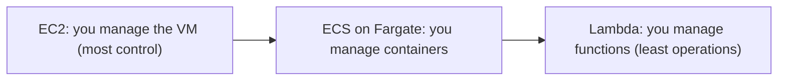
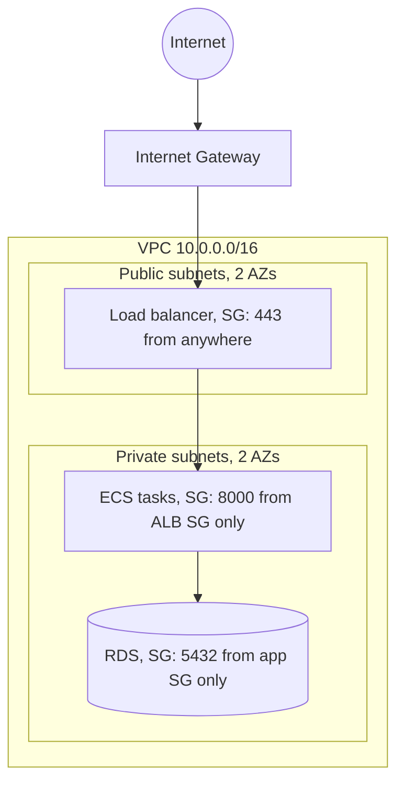

AWS has more than two hundred services, which is intimidating until you notice that most real
applications use the same dozen. This session covers that core: identity, compute, storage,
databases and networking, the building blocks behind nearly every AWS architecture diagram. Then you
deploy your API and, just as important, delete everything afterwards. Free learning material is on
[AWS Skill Builder](https://skillbuilder.aws/) and in the
[AWS Cloud Practitioner path](https://aws.amazon.com/training/learn-about/cloud-practitioner/).

## IAM: users, roles and least privilege

**IAM** (Identity and Access Management) answers one question for every API call: _who_ is asking,
and _are they allowed_? Picture a hotel. The front desk checks your identity once, then gives you a
key card that opens only your room, the gym and the breakfast hall.

The core concepts:

- **Root user**: the email you signed up with. It can do anything, including close the account.
  Protect it with MFA and then stop using it.
- **IAM users / IAM Identity Center users**: people who log in. Prefer Identity Center (single
  sign-on with short-lived credentials) over long-lived access keys.
- **Roles**: identities that are _assumed_ temporarily, by a service (an EC2 instance, a Lambda
  function), a CI pipeline, or a person. They hand out short-lived credentials, so there is no
  secret to leak.
- **Policies**: JSON documents attached to users, groups or roles that allow or deny actions on
  resources.

```json
{
  "Version": "2012-10-17",
  "Statement": [{
    "Effect": "Allow",
    "Action": ["s3:GetObject", "s3:PutObject"],
    "Resource": "arn:aws:s3:::todo-uploads/*"
  }]
}
```

This policy allows reading and writing objects in one bucket and nothing else. That is **least
privilege**: grant exactly the permissions a job needs. Everything not explicitly allowed is denied,
and an explicit deny beats any allow.

> [!WARNING]
> Never put access keys in code, in a Docker image or in Git. Bots scan public repositories for AWS
> keys within minutes. Your app should get credentials from its **role** (EC2 instance profile, ECS
> task role, Lambda execution role), and your CI should use OIDC federation to assume a role rather
> than storing keys as secrets.

## Compute: EC2, containers (ECS/Fargate), Lambda

AWS offers compute at three levels of abstraction, matching the service models from 5.3.1:

- **EC2** (Elastic Compute Cloud): virtual machines. You choose an instance type (CPU and memory,
  like `t3.micro`), an OS image (AMI), and you manage everything from the OS up. Maximum control.
- **ECS** (Elastic Container Service): runs your Docker containers. You describe a **task
  definition** (image, CPU, memory, env vars, role) and a **service** (how many copies, behind which
  load balancer). With the **Fargate** launch type, AWS provides the servers; you never see a VM.
  (EKS is the managed Kubernetes alternative; see Module 5.5.)
- **Lambda**: functions run on events, billed per request and per millisecond, no servers at all
  (5.3.4).



| You want... | Pick |
| ----------- | ---- |
| Full control, custom software, GPUs | EC2 |
| Your existing Docker image, always on, no servers | ECS on Fargate (or App Runner) |
| Short, event-driven pieces of code | Lambda |

To survive failures and spread load, you put compute behind an **Application Load Balancer (ALB)**
in several availability zones, and optionally use **Auto Scaling** to add or remove capacity.

## Storage: S3, EBS

Two storage services you will use from day one, and they're very different:

- **S3** (Simple Storage Service) is **object storage**. You put and get whole files ("objects") by
  key in a **bucket**, over HTTPS. Practically unlimited, designed for very high durability, cheap,
  and accessible from anywhere with the right permissions. Use it for uploads, backups, static
  websites, logs and data lakes. You can't mount it like a disk or edit a byte in the middle of a
  file.
- **EBS** (Elastic Block Store) is **block storage**: a virtual hard disk attached to one EC2
  instance in one AZ. Use it for the OS disk and anything that needs a real filesystem with low
  latency, like a self-managed database.

Analogy: S3 is a warehouse where you hand items over a counter by ticket number; EBS is a drawer in
your own desk.

> [!TIP]
> S3 buckets are private by default and **Block Public Access** is on by default for new buckets.
> Keep it that way. To let browsers upload or download files directly, use **presigned URLs**:
> short-lived links your API generates for one object.

S3 also has **storage classes** (Standard, Infrequent Access, Glacier) that trade retrieval speed
for price, and lifecycle rules to move old objects to cheaper classes automatically.

## Databases: RDS, DynamoDB

- **RDS** (Relational Database Service) runs managed PostgreSQL, MySQL, MariaDB, SQL Server or
  Oracle. AWS handles installation, patching, automated backups, point-in-time recovery and, with
  **Multi-AZ**, a standby replica in another zone with automatic failover. You still design schemas
  and indexes. **Aurora** is AWS's own PostgreSQL/MySQL-compatible engine with a distributed storage
  layer.
- **DynamoDB** is a managed **key-value and document** database. You define a partition key (and
  optionally a sort key), and it delivers consistent single-digit-millisecond reads at almost any
  scale, with on-demand pricing per request. The catch: you must design the table around your
  access patterns up front, because there are no joins and ad-hoc queries are limited.

| Need | Choose |
| ---- | ------ |
| Relational data, joins, transactions, SQL (your to-do API) | RDS PostgreSQL |
| Massive scale, simple known access patterns, serverless pricing | DynamoDB |

> [!NOTE]
> This is the same SQL vs NoSQL trade-off from Track 3, with AWS doing the operations. When unsure,
> start with PostgreSQL.

## Networking: VPC, subnets, security groups

A **VPC** (Virtual Private Cloud) is your own private network inside AWS, with an IP range you pick
(for example `10.0.0.0/16`). Think of it as the floor plan of your office building:

- **Subnets** are rooms, each in one AZ, each with a smaller IP range.
  - **Public subnets** have a route to an **Internet Gateway**: resources there can be reached from
    the internet (load balancers, bastion hosts).
  - **Private subnets** have no direct inbound route from the internet: put app servers and
    databases here. For outbound access (downloading packages), they use a **NAT gateway**.
- **Route tables** decide where traffic leaving a subnet goes.
- **Security groups** are stateful firewalls attached to resources. Rules say what may come in,
  from where, on which port. Return traffic is allowed automatically.



The pattern above is the standard three-tier layout. Security groups can reference **other security
groups** as a source ("allow 5432 from the app's group"), which is cleaner and safer than IP ranges.

> [!WARNING]
> A database security group allowing `0.0.0.0/0` on port 5432 makes your database reachable by the
> whole internet. Bots try default passwords on exposed databases constantly.

## Practice: deploy the API with the free tier and tear it down

Goal: run your to-do API on AWS with a managed database, verify it, and delete everything.

> [!WARNING]
> Before starting, create an **AWS Budget** with an email alert at a few dollars (Billing console,
> Budgets). Free tier offers and their limits change over time, so read the current terms for each
> service you use. NAT gateways and load balancers are not free and bill by the hour; this exercise
> avoids them.

### Step 1: Secure the account

Enable MFA on the root user. Create an admin user in IAM Identity Center and use that from now on.
Install the AWS CLI and run `aws configure sso`.

### Step 2: Push your image

Create an ECR repository and push the image from 5.1.2:

```sh
aws ecr create-repository --repository-name todo-api
aws ecr get-login-password | docker login --username AWS --password-stdin <account>.dkr.ecr.<region>.amazonaws.com
docker tag todo:slim <account>.dkr.ecr.<region>.amazonaws.com/todo-api:v1
docker push <account>.dkr.ecr.<region>.amazonaws.com/todo-api:v1
```

### Step 3: Create the database

In the RDS console, create a PostgreSQL instance using the free tier template, smallest instance
class, single AZ, **no public access**. Note the endpoint. Create a security group `todo-db` that
allows 5432 only from a group `todo-app`.

### Step 4: Run the API

The simplest path: launch a small EC2 instance in the `todo-app` security group (allow 8000 from
your IP only), install Docker, pull the image and run it with `DATABASE_URL` pointing to RDS. Give
the instance a role with `AmazonEC2ContainerRegistryReadOnly` instead of copying keys. Open
`http://<public-ip>:8000/docs` and create a to-do.

### Step 5: Tear it down and verify

Terminate the EC2 instance, delete the RDS instance (skip the final snapshot for this exercise),
delete the ECR repository and any Elastic IPs or volumes left behind. Check the **Billing** console
and **Resource Groups & Tag Editor** for leftovers the next day. Write down every resource you
created: it is your first infrastructure inventory, and in 5.4.1 you'll codify it with Terraform.
