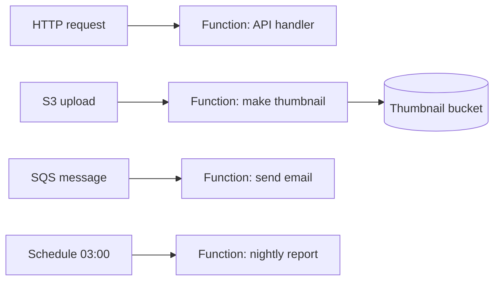
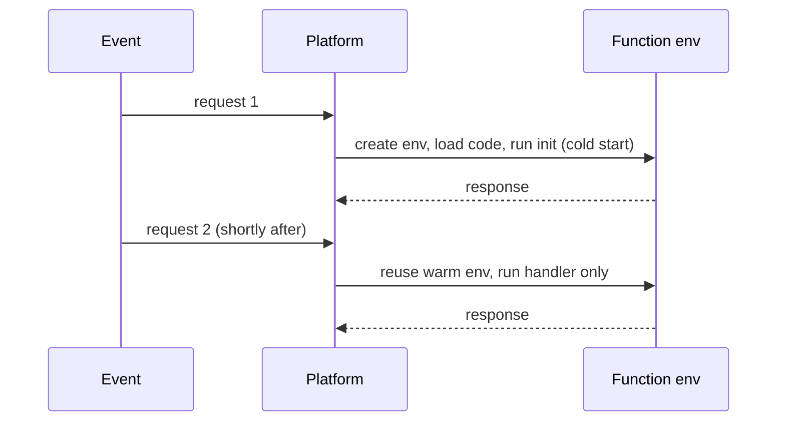
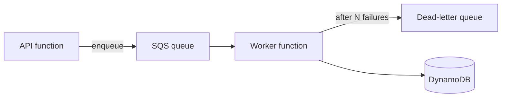

"Serverless" is a slightly misleading name: there are still servers, you just never see, size, patch
or pay for them while idle. You upload a function, tell the platform which events should run it,
and it handles the rest, from zero invocations a day to thousands per second. This session explains
the model, its sharp edges, and the managed databases and queues that pair with it, using
[AWS Lambda](https://docs.aws.amazon.com/lambda/) as the main example and
[microservices.io](https://microservices.io/) for the architectural view.

## Functions as a service and event triggers

Think of a taxi versus owning a car. Owning a car (a server) means paying for it even while it's
parked, and doing the maintenance. A taxi (a function) appears when you need a ride, you pay per
trip, and someone else services the engine.

With **Functions as a Service (FaaS)** you write a handler, a function that receives an **event**
and returns a result:

```python
def handler(event, context):
    name = event.get("name", "world")
    return {"statusCode": 200, "body": f"Hello, {name}"}
```

The platform runs it in response to **triggers**:

- **HTTP requests** via an API gateway or a function URL.
- **File uploads** to object storage (an S3 `ObjectCreated` event).
- **Queue messages** (SQS), **streams** (Kinesis, DynamoDB Streams).
- **Schedules** (every night at 03:00, like a cloud cron).
- **Events from other services** via an event bus (EventBridge).



This makes serverless a natural fit for **event-driven architecture**: small pieces of code that
react to things happening, glued together by managed services. On microservices.io, serverless
deployment is listed as one of the deployment patterns for services, alongside deploying them as
containers or VMs.

> [!NOTE]
> Functions should be **stateless**. Each invocation may run in a fresh environment, so anything you
> need to keep (sessions, files, counters) goes to a database, cache or object store, never to local
> memory or disk.

Good fits: glue code between services, file and image processing, webhooks, scheduled jobs, APIs
with spiky or low traffic. Poor fits: long-running jobs, steady high-throughput workloads (often
cheaper on containers), and anything needing GPUs or persistent connections like WebSockets
servers.

## Cold starts, limits and pricing

When a function hasn't run recently, the platform must create an **execution environment**:
allocate a micro-VM, download your code, start the runtime, run your initialisation (imports,
database clients). That delay is a **cold start**. Later requests reuse the warm environment and
skip it.



Cold starts range from well under a second for small Python or Node functions to several seconds
for large packages or heavy runtimes. Ways to reduce them:

- Keep the deployment package small; import only what you need.
- Do expensive setup (SDK clients, connections) **outside** the handler, so warm calls reuse it.
- Use provisioned concurrency (keeps environments warm, at a cost) for latency-sensitive paths.

**Limits** to know for Lambda (check the docs, they evolve):

| Limit | Lambda |
| ----- | ------ |
| Max run time per invocation | 15 minutes |
| Memory | 128 MB to 10,240 MB (CPU scales with memory) |
| Temporary disk `/tmp` | 512 MB by default, configurable up to 10 GB |
| Concurrency | an account-level regional quota, raisable on request |

**Pricing** is per request plus per **GB-second** (memory allocated times duration). Idle costs
nothing, which is wonderful for side projects and spiky traffic. At constant high load, though, an
always-on container is often cheaper.

> [!WARNING]
> Serverless scales _fast_, and so does the bill. A bug that makes a function trigger itself (for
> example writing its output into the same bucket that triggers it) can run millions of times in
> minutes. Always set a budget alert and think about recursion.

## Serverless databases and queues

A function that opens a new PostgreSQL connection on every invocation, multiplied by a thousand
concurrent invocations, will exhaust a traditional database's connection limit. Serverless compute
pairs best with services that are also pay-per-use and connection-friendly:

- **Serverless databases**: DynamoDB (on-demand mode), Aurora Serverless, Neon (serverless Postgres,
  which you'll meet in 5.3.5), Firestore. For classic PostgreSQL, put a connection pooler in front
  (RDS Proxy, PgBouncer).
- **Queues**: SQS between producers and functions absorbs bursts and retries failures. Messages that
  keep failing go to a **dead-letter queue** for inspection instead of being lost or retried forever.
- **Pub/sub and event buses**: SNS, EventBridge fan one event out to many consumers.
- **Object storage**: S3 for files, which can itself emit events.



> [!TIP]
> Queue-triggered functions may receive the same message more than once (at-least-once delivery).
> Make handlers **idempotent**: processing a message twice must give the same result as once, for
> example by checking whether that order ID was already handled.

## Practice: an image-thumbnail function triggered by uploads

Goal: uploading an image to one S3 bucket automatically produces a 200-pixel thumbnail in another.
This is the classic Lambda tutorial pattern; the [AWS Lambda docs](https://docs.aws.amazon.com/lambda/)
include a walkthrough you can follow alongside.

### Step 1: Create two buckets

`todo-uploads-<you>` (source) and `todo-thumbs-<you>` (destination). Using **two** buckets is what
prevents infinite recursion.

### Step 2: Write the function

```python
import io
import os
import urllib.parse

import boto3
from PIL import Image

s3 = boto3.client("s3")  # created once per environment, reused on warm calls
DEST = os.environ["DEST_BUCKET"]


def handler(event, context):
    for record in event["Records"]:
        bucket = record["s3"]["bucket"]["name"]
        key = urllib.parse.unquote_plus(record["s3"]["object"]["key"])
        obj = s3.get_object(Bucket=bucket, Key=key)
        img = Image.open(io.BytesIO(obj["Body"].read()))
        img.thumbnail((200, 200))
        out = io.BytesIO()
        img.save(out, format="PNG")
        s3.put_object(Bucket=DEST, Key=f"thumb-{key}.png", Body=out.getvalue())
```

Pillow is not in the Lambda Python runtime, so package it: either a zip with dependencies built for
Linux, a Lambda layer, or a container image (the Dockerfile skills from 5.1.2 apply).

### Step 3: Permissions

Create an execution role with the basic logging policy plus `s3:GetObject` on the source bucket and
`s3:PutObject` on the destination bucket only. Least privilege, as in 5.3.2.

### Step 4: Wire the trigger and test

Add an S3 trigger on the source bucket for `ObjectCreated` events. Upload a photo and check the
destination bucket. Then open the function's logs in CloudWatch and find the `Init Duration` line on
the first call: that is your cold start.

### Step 5: Explore the edges

Upload a 30 MB image and a non-image file. What happens? Add error handling, raise the memory and
compare duration and cost per call. Finally, delete the function, the role and both buckets.
