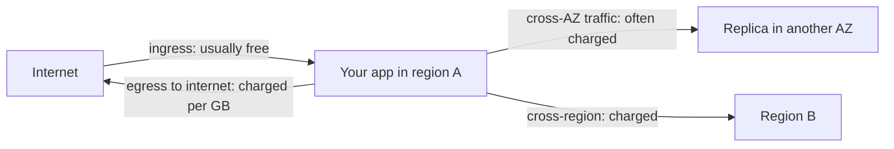
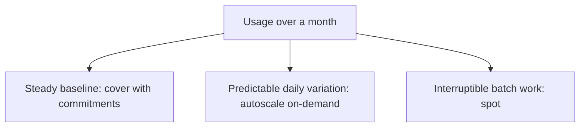

Every engineer who has used the cloud long enough has a story about a surprise bill: the test cluster
nobody turned off, the debug logs that ingested a terabyte, the NAT gateway quietly billing by the
hour. Cost is now an engineering concern, not just finance's: the architecture choices you make
decide the bill. This session covers what drives cost, how to see it, and how to reduce it, based
on the [FinOps Foundation](https://www.finops.org/introduction/what-is-finops/) and the cost
optimisation pillar of the [AWS Well-Architected Framework](https://aws.amazon.com/architecture/well-architected/).

> [!NOTE]
> **FinOps** is the practice of bringing financial accountability to variable cloud spend, so that
> engineering, finance and business teams make cost-aware decisions together. The FinOps Foundation
> describes it as a cycle: **Inform** (see where money goes), **Optimize** (reduce waste), **Operate**
> (make it continuous). The AWS Well-Architected Framework treats **cost optimisation** as one of its
> six pillars, alongside security, reliability, performance efficiency, operational excellence and
> sustainability.

## Cost drivers: compute, storage, egress

Think of a cloud bill like a household utility bill: some things you pay for by the hour (heating),
some by volume (water), and some by what leaves the house (postage). Three categories dominate
nearly every bill.

**Compute** is usually the biggest line. You pay for capacity _allocated_, not capacity _used_: a VM
running at 5% CPU costs the same as one at 95%. Drivers: instance size, number of instances, hours
running, and managed services priced by size (databases, Kubernetes nodes, load balancers).

**Storage** is cheap per GB but grows silently: database storage and its backups, snapshots nobody
deletes, logs kept forever, old container images, S3 objects in the most expensive storage class.

**Egress** (data transfer _out_) is the sneaky one. Data coming in is generally free; data going out
to the internet, and often between regions or availability zones, is charged per GB.

Less obvious drivers worth knowing:

- **Managed networking**: NAT gateways and load balancers bill per hour _and_ per GB processed.
- **Requests**: per-request pricing (S3 operations, Lambda, API gateways) adds up at scale.
- **Observability**: log ingestion and metric cardinality can rival compute costs.
- **Idle resources**: forgotten dev environments, unattached disks, unused elastic IPs.

> [!EXAMPLE]
> A team serves 50 TB of video per month directly from object storage to users. The storage costs a
> little; the egress costs far more. Putting a CDN in front reduces origin egress and often lowers
> the per-GB price, while making the videos faster for users.

## Budgets, alerts and tagging

You can't optimise what you can't see. The first FinOps phase, **Inform**, is about visibility and
allocation.

**Budgets and alerts.** Every provider lets you set a monthly budget and get alerts at thresholds,
for example at 50%, 80% and 100% of actual spend, and when the _forecast_ exceeds the budget. Forecast
alerts are the useful ones: they warn you mid-month, while there is still time to act.

> [!TIP]
> Create a budget alert on day one of any cloud account, even a personal one. It takes two minutes and
> it's the cheapest insurance in tech. Note that alerts warn you; they don't stop spending.

**Tagging** (labels on Google Cloud) attaches key-value metadata to resources, so you can slice the
bill:

| Tag | Example | Answers |
| --- | ------- | ------- |
| `project` | `todo-app` | What does this product cost? |
| `env` | `prod`, `staging`, `dev` | Is dev costing more than prod? |
| `owner` | `team-platform` | Who do I ask about this resource? |
| `cost-center` | `cc-1234` | Which budget pays for it? |

Without tags, you see "EC2: $4,000" and nobody knows whose it is. With them, you see "staging of
project X: $1,800, owned by team Y", and the conversation becomes easy. Enforce tags with policy
(AWS tag policies, Azure Policy) and in infrastructure as code (5.4.1), rather than relying on memory.

**Showback and chargeback.** Once costs are allocated, showing each team its spend (showback), or
billing it to their budget (chargeback), creates the accountability FinOps aims for: the people who
make the architecture decisions see their cost.

## Right-sizing and reserved capacity

The **Optimize** phase has two levers: use less (usage optimisation) and pay less for what you use
(rate optimisation). Do them in that order: there's no point committing to a discount on servers
you shouldn't be running.

**Use less:**

- **Right-sizing**: match instance size to actual usage. If a database server's CPU never exceeds
  15% and memory 30%, a smaller size likely suffices. Providers' recommendation tools (AWS Compute
  Optimizer, Azure Advisor) suggest candidates from real metrics.
- **Turn things off**: schedule dev and staging environments to stop at night and weekends (that's
  roughly two thirds of the hours in a week).
- **Autoscaling**: run for today's load, not for the peak, and scale out when needed (5.5.4).
- **Delete waste**: unattached volumes, old snapshots, orphaned load balancers.
- **Lifecycle policies**: move old objects to cheaper storage classes and expire logs.
- **Architecture**: serverless for spiky low-volume workloads, a CDN to cut egress, caching to cut
  database size.

**Pay less for the same usage:**

- **Reserved instances / savings plans / committed use discounts**: commit to a steady baseline for
  one or three years for a substantial discount versus on-demand.
- **Spot / preemptible capacity** for interruptible work (batch jobs, CI runners).

> [!WARNING]
> Commitments are a bet on the future. Commit only to the baseline you are confident about (the
> load you have at 3 a.m. every night), and only after right-sizing. Committing to oversized
> servers locks in waste for years.

Cost is a trade-off, not a number to minimise blindly. Removing the standby database saves money
and costs availability. The Well-Architected cost pillar frames it as delivering business value at
the lowest price point, not simply the lowest price.

## Practice: estimate the monthly cost of your architecture

Take the cloud design you've been building since 5.3.1 (to-do API, PostgreSQL, uploads bucket,
possibly the thumbnail function) and produce a monthly estimate.

### Step 1: Write down your assumptions

Traffic (requests per month), data stored (GB), data served to users (GB egress), number of
environments, hours each environment runs. Estimates are only as good as their assumptions, so make
them explicit, like the back-of-the-envelope method from system design.

### Step 2: Price each component

Use the provider's official calculator (AWS Pricing Calculator, Azure Pricing Calculator or Google
Cloud Pricing Calculator) and build a table:

| Component | Size | Hours/month | Unit price | Monthly |
| --------- | ---- | ----------- | ---------- | ------- |
| API (2 containers) | 0.5 vCPU, 1 GB | 730 each | from calculator | ... |
| PostgreSQL | small, multi-AZ? | 730 | ... | ... |
| Storage + backups | 20 GB | n/a | ... | ... |
| Load balancer | 1 | 730 | ... | ... |
| Egress | 50 GB | n/a | ... | ... |
| Staging | same, 50 h/week | ~217 | ... | ... |

### Step 3: Find the top three lines

Sort by cost. Usually two or three items make up most of the bill: that's where to focus.

### Step 4: Write three optimisations

For each, give the saving and the trade-off. For example "stop staging outside working hours: saves
about 70% of staging compute; staging unavailable at night", or "single-AZ database in staging:
cheaper, no failover".

### Step 5: Compare with the PaaS version

Price the same app on the PaaS setup from 5.3.5. Note where the PaaS is cheaper (small scale, no
load balancer or NAT) and where raw cloud would win (larger steady load). Add a tagging scheme and a
budget threshold to the document.
