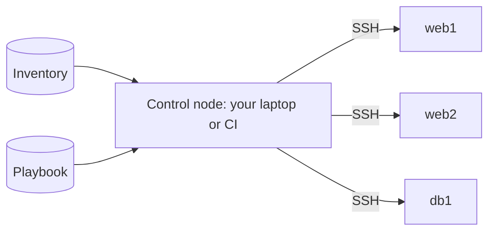
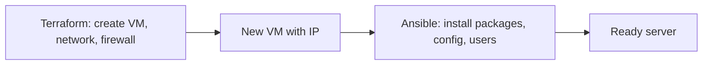

Terraform is great at creating a server. It's much less suited to what happens _inside_ it: installing
packages, writing config files, managing users, restarting services. That is **configuration
management**, and Ansible is its most popular tool: agentless, written in readable YAML, and run over
plain SSH. This session covers the core concepts from the [Ansible docs](https://docs.ansible.com/)
and where Ansible fits next to Terraform and containers.

## Inventories and playbooks

Imagine you manage twenty restaurants and want the same menu, the same oven temperature and the same
opening hours in all of them. You could phone each one and dictate the changes, or send one written
instruction sheet to all of them at once. Ansible is the instruction sheet, plus the courier.

Ansible runs on your machine (the **control node**) and connects to **managed nodes** over SSH. There
is no agent to install on the servers: just SSH and Python.



The **inventory** lists the hosts and groups them:

```ini
[web]
web1.example.com
web2.example.com

[db]
db1.example.com ansible_user=admin

[prod:children]
web
db
```

(YAML inventories work too, and dynamic inventory plugins can read hosts straight from AWS, Azure
or GCP, so you don't maintain the list by hand.)

A **playbook** is a YAML file with one or more **plays**. Each play targets a group of hosts and runs
a list of **tasks**; each task calls a **module** (Ansible's word for a unit of work: install a
package, copy a file, manage a service):

```yaml
- name: Configure web servers
  hosts: web
  become: true            # use sudo
  tasks:
    - name: Install nginx
      ansible.builtin.apt:
        name: nginx
        state: present
        update_cache: true

    - name: Ensure nginx is running and starts on boot
      ansible.builtin.service:
        name: nginx
        state: started
        enabled: true
```

Run it:

```sh
ansible -i inventory.ini web -m ping        # ad-hoc: check connectivity
ansible-playbook -i inventory.ini site.yml  # run the playbook
```

> [!NOTE]
> Ansible connects to hosts in parallel and runs each task across all of them before moving to the
> next task. Output shows `ok` (already correct), `changed` (Ansible changed something), `failed` or
> `skipping` per host.

## Idempotent tasks and roles

**Idempotent** means running something once or ten times gives the same result. Look at the tasks
above: they don't say "install nginx", they say "nginx should be **present**". If it's already
installed, Ansible reports `ok` and does nothing. That's the difference from a shell script:

| Shell script | Ansible task |
| ------------ | ------------ |
| `echo "x" >> /etc/conf` appends again on every run | `lineinfile` ensures the line exists exactly once |
| `useradd deploy` fails the second time | `user: name=deploy state=present` is fine every time |
| You write the checks yourself | Modules check current state for you |

Because playbooks are idempotent, you can run them repeatedly: to configure new servers, to fix
drift on old ones, or on a schedule. A second run that reports `changed=0` is your proof the server
matches the description.

> [!WARNING]
> `ansible.builtin.command` and `shell` tasks are **not** idempotent by default: Ansible can't know
> what your command does, so it runs it every time and reports `changed`. Prefer a dedicated module;
> if you must use `command`, add `creates:` or `changed_when:` so it behaves.

**Handlers** run only when notified by a task that changed something, typically "restart nginx if
its config changed":

```yaml
  tasks:
    - name: Deploy nginx site config
      ansible.builtin.template:
        src: site.conf.j2
        dest: /etc/nginx/sites-available/default
      notify: Reload nginx
  handlers:
    - name: Reload nginx
      ansible.builtin.service:
        name: nginx
        state: reloaded
```

Templates use **Jinja2**, with **variables** that can be set per group or host
(`group_vars/web.yml`, `host_vars/web1.yml`). Secrets go in files encrypted with **Ansible Vault**
(`ansible-vault encrypt group_vars/prod/secrets.yml`).

**Roles** package tasks, handlers, templates, files and default variables into a reusable unit with a
standard layout, like Terraform modules:

```text
roles/nginx/
  tasks/main.yml
  handlers/main.yml
  templates/site.conf.j2
  defaults/main.yml
```

A playbook then reads like a table of contents:

```yaml
- hosts: web
  become: true
  roles:
    - common
    - nginx
```

Community roles and collections are shared on **Ansible Galaxy**.

## Ansible vs Terraform

They overlap a little and complement each other a lot. Analogy: Terraform builds the house and
connects the utilities; Ansible furnishes the rooms.

| | Terraform | Ansible |
| - | --------- | ------- |
| Main job | Provision infrastructure (networks, VMs, databases, DNS) | Configure what runs on servers (packages, files, services) |
| Style | Declarative, with a dependency graph | Procedural list of mostly declarative tasks, run in order |
| State | Keeps a state file | Stateless: inspects the hosts each run |
| Agent | None, calls cloud APIs | None, uses SSH |
| Typical trigger | Infrastructure change | New server, config change, patching |



> [!TIP]
> Where does Ansible fit in a container world? If everything runs as containers on a managed
> platform or Kubernetes, the "inside the server" layer mostly moves into Dockerfiles and you may
> not need Ansible at all. It still shines for VMs, bare metal, network devices, and the hosts that
> run your clusters.

A common alternative for VMs is **immutable infrastructure**: bake a machine image with everything
installed (using a tool like Packer, possibly running Ansible inside the build), then replace servers
instead of reconfiguring them. Same idea as containers: rebuild, don't patch in place.

## Practice: configure a VM with Nginx using Ansible

You need a Linux VM you can SSH into: a local one (Multipass, Vagrant, UTM) or a small cloud VM.
Install Ansible on your machine (`pipx install ansible` or your package manager).

### Step 1: Inventory and connectivity

```ini
[web]
myvm ansible_host=192.168.64.5 ansible_user=ubuntu
```

`ansible -i inventory.ini web -m ping` should answer `pong`.

### Step 2: Write the playbook

Create `site.yml` that, on the `web` group with `become: true`:

1. Installs `nginx` with the `apt` module.
2. Deploys a Jinja2 template `index.html.j2` to `/var/www/html/index.html`, showing
   `{{ inventory_hostname }}` and a variable `site_title` from `group_vars/web.yml`.
3. Ensures nginx is started and enabled.
4. Uses a handler to reload nginx when the template changes.

### Step 3: Run it twice

```sh
ansible-playbook -i inventory.ini site.yml
ansible-playbook -i inventory.ini site.yml   # expect changed=0
curl http://192.168.64.5
```

The second run reporting `changed=0` is the idempotency check.

### Step 4: Change and observe

Change `site_title`, rerun with `--diff` to see exactly what changes in the file, and confirm only
the template task and the handler run. Try `--check` (dry run) before applying.

### Step 5: Refactor into a role

Move the tasks, handler and template into `roles/nginx/` and reduce `site.yml` to a `roles:` list.
Rerun: still `changed=0`. Commit everything except secrets; if you add any, encrypt them with
Ansible Vault.
