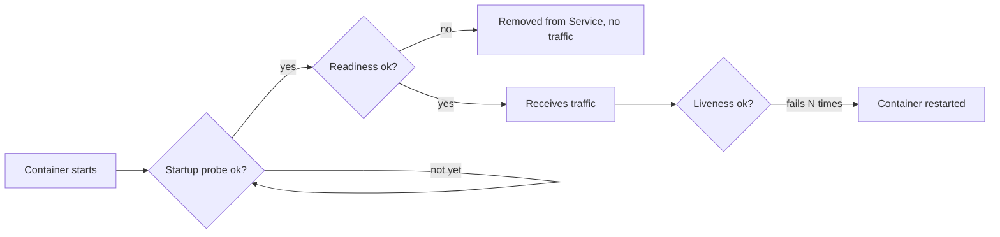
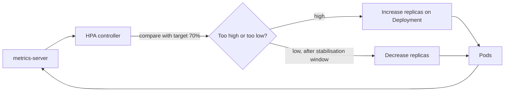

Getting an app running on Kubernetes is the easy part. Keeping it running when a pod hangs, a node
runs out of memory, traffic triples at 9 a.m. or the platform team drains nodes for an upgrade is
where operations skill shows. This session covers the four tools that make workloads resilient:
health probes, resource requests and limits, autoscaling, and safe rollouts with disruption budgets.
The references are the [Kubernetes docs](https://kubernetes.io/docs/home/) and the
[Google SRE Workbook](https://sre.google/workbook/table-of-contents/), whose chapters on managing load
explain why these mechanisms matter in practice.

## Liveness, readiness and startup probes

Kubernetes knows when a container's _process_ dies. It doesn't know when your app is alive but
useless: deadlocked, stuck waiting on a database, or still loading a model. **Probes** let the
kubelet ask your app directly. There are three, answering different questions:

| Probe | Question | On failure |
| ----- | -------- | ---------- |
| **Startup** | Has the app finished starting? | Keep waiting (up to a limit), then restart. Other probes are paused until it succeeds. |
| **Readiness** | Can this pod serve traffic _right now_? | Remove the pod from Service endpoints. **No restart.** |
| **Liveness** | Is the app healthy, or stuck beyond recovery? | **Restart** the container. |

An analogy: readiness is a shop's "open/closed" sign: when the shelves are being restocked you flip
it to closed, but nobody is fired. Liveness is a manager checking whether the shopkeeper is
responsive at all; if not, they're replaced.

```yaml
      containers:
        - name: api
          image: todo:slim
          startupProbe:
            httpGet: { path: /health, port: 8000 }
            periodSeconds: 5
            failureThreshold: 24        # up to 2 minutes to start
          readinessProbe:
            httpGet: { path: /ready, port: 8000 }
            periodSeconds: 5
          livenessProbe:
            httpGet: { path: /health, port: 8000 }
            periodSeconds: 10
            failureThreshold: 3
```

Probes can be `httpGet`, `tcpSocket`, `grpc` or `exec` (run a command in the container).



> [!WARNING]
> Never make a **liveness** probe depend on external systems such as the database. If the database
> has a blip, every pod fails liveness at once and Kubernetes restarts your entire fleet, turning a
> small outage into a big one. Dependency checks belong in **readiness** (stop sending me traffic),
> and liveness should only check that the process itself responds.

## Requests, limits and quality of service

Each container can declare how much CPU and memory it needs:

```yaml
          resources:
            requests: { cpu: 250m, memory: 256Mi }
            limits:   { memory: 512Mi }
```

- **Requests** are a reservation. The scheduler only places a pod on a node with that much
  _unreserved_ capacity. `250m` means 250 millicores, a quarter of a CPU.
- **Limits** are a ceiling enforced by cgroups (5.1.1). Above its **CPU** limit a container is
  **throttled** (slowed down). Above its **memory** limit it is **killed** (`OOMKilled`) and
  restarted.

Think of a restaurant: the request is your table reservation (guaranteed seats), the limit is the
maximum the kitchen will serve you. Memory over the limit gets you escorted out.

From these settings Kubernetes assigns each pod a **Quality of Service (QoS) class**, which decides
who gets evicted first when a node runs short of memory:

| QoS class | When | Eviction priority |
| --------- | ---- | ----------------- |
| **Guaranteed** | every container has CPU and memory requests equal to limits | evicted last |
| **Burstable** | at least one request or limit set, but not Guaranteed | in between |
| **BestEffort** | no requests or limits at all | evicted first |

> [!TIP]
> Practical defaults for a web API: always set CPU and memory **requests** based on observed usage,
> set a memory **limit** (often equal to the request, so memory behaviour is predictable), and think
> twice before a tight CPU limit, which can throttle latency-sensitive apps even when the node has
> spare CPU. Measure with `kubectl top pods` (requires metrics-server) and adjust.

> [!EXAMPLE]
> Pods keep restarting with `OOMKilled` in `kubectl describe pod`. Either the limit is too low for
> real usage, or the app has a memory leak. Check memory over time in your metrics (5.6.2): a
> sawtooth that climbs until each restart means a leak; a flat line just above the limit means the
> limit is wrong.

## Horizontal Pod Autoscaler

Scaling by hand doesn't work at 3 a.m. The **Horizontal Pod Autoscaler (HPA)** adjusts a
Deployment's replica count automatically based on metrics, typically average CPU utilisation
relative to the **request**:

```yaml
apiVersion: autoscaling/v2
kind: HorizontalPodAutoscaler
metadata:
  name: todo-api
spec:
  scaleTargetRef:
    apiVersion: apps/v1
    kind: Deployment
    name: todo-api
  minReplicas: 2
  maxReplicas: 10
  metrics:
    - type: Resource
      resource:
        name: cpu
        target: { type: Utilization, averageUtilization: 70 }
```

The control loop is roughly:
`desired replicas = ceil(current replicas × current metric / target metric)`. With 3 pods at 140% of
their CPU request and a 70% target, it wants `ceil(3 × 140 / 70) = 6`.



Things to know:

- HPA needs **metrics-server** installed, and **CPU requests** set (utilisation is a percentage of
  the request).
- It can scale on memory, or on custom and external metrics (requests per second, queue length) with
  an adapter, often a better signal than CPU for I/O-bound APIs.
- Scale-down is deliberately slow (a stabilisation window, five minutes by default) to avoid
  flapping.
- HPA adds pods, not nodes. When nodes are full, a **cluster autoscaler** (or Karpenter on AWS) adds
  nodes. The Vertical Pod Autoscaler adjusts requests instead of replica counts.

> [!NOTE]
> Autoscaling reacts in tens of seconds to minutes. It doesn't protect against a sudden spike that
> arrives faster than new pods can start. The SRE Workbook's advice on managing load applies: keep
> headroom, make startup fast, and shed or queue excess load gracefully rather than falling over.

## Rolling updates and disruption budgets

A Deployment updates pods with a **rolling update**, controlled by two settings:

```yaml
spec:
  strategy:
    type: RollingUpdate
    rollingUpdate:
      maxSurge: 1          # at most 1 extra pod above the desired count
      maxUnavailable: 0    # never go below the desired count of ready pods
```

With `maxUnavailable: 0`, a new pod must become **ready** (readiness probe!) before an old one is
removed, so capacity never drops. Defaults are 25% each. Readiness probes are what make rolling
updates safe: without them, Kubernetes sends traffic to pods that haven't finished starting.

Two more pieces complete zero-downtime deploys:

- **Graceful shutdown**: when a pod is terminated it receives `SIGTERM`, is removed from endpoints,
  and has `terminationGracePeriodSeconds` (30 by default) to finish in-flight requests before
  `SIGKILL`. Your app should handle `SIGTERM` (uvicorn does) and the exec-form `CMD` from 5.1.2
  ensures it receives it.
- **PodDisruptionBudget (PDB)**: protects against _voluntary_ disruptions, like node drains during
  cluster upgrades:

```yaml
apiVersion: policy/v1
kind: PodDisruptionBudget
metadata:
  name: todo-api
spec:
  minAvailable: 2
  selector:
    matchLabels: { app: todo-api }
```

When an administrator runs `kubectl drain`, evictions that would leave fewer than 2 ready pods are
refused until replacements are ready elsewhere. PDBs don't protect against involuntary failures (a
node crashing); only replicas spread across nodes and zones do.

> [!WARNING]
> A PDB with `minAvailable` equal to your replica count (say 2 of 2) blocks every drain forever, and
> the platform team will not thank you. Leave room for at least one pod to move.

## Practice: autoscale your API under load

Use your kind cluster and the API from 5.5.2 (or the Helm chart from 5.5.3).

### Step 1: Install metrics-server

```sh
kubectl apply -f https://github.com/kubernetes-sigs/metrics-server/releases/latest/download/components.yaml
kubectl -n kube-system patch deployment metrics-server --type=json \
  -p='[{"op":"add","path":"/spec/template/spec/containers/0/args/-","value":"--kubelet-insecure-tls"}]'
kubectl top nodes        # works after a minute
```

The insecure-TLS flag is only for local kind clusters, whose kubelet certificates aren't signed for
this.

### Step 2: Harden the Deployment

Add a startup, readiness and liveness probe (readiness checks the database, liveness doesn't), CPU
and memory requests, a memory limit, and the rolling-update strategy above. Add a PDB with
`minAvailable: 1`.

### Step 3: Add the HPA

Apply the HPA from this lesson (2 to 10 replicas, 70% CPU), then `kubectl get hpa -w` in one
terminal.

### Step 4: Generate load

```sh
kubectl run load --rm -it --image=busybox:1.36 --restart=Never -- \
  /bin/sh -c "while true; do wget -q -O- http://todo-api/todos > /dev/null; done"
```

Run two or three of these. Watch the CPU percentage climb and replicas increase. Stop the load and
watch the slower scale-down.

### Step 5: Deploy during load

While under load, roll out a new image tag. Confirm with `kubectl rollout status` and your load
generator's output that no requests failed. Then remove the readiness probe, repeat, and note what
changes. Write up your observations: thresholds, timings, and what you would tune.
