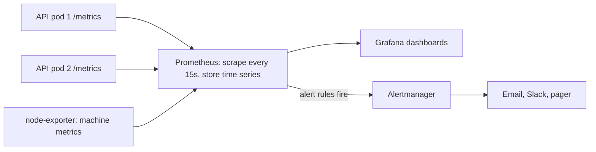
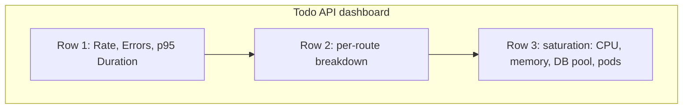

Logs tell you _what happened_ to individual requests. They are a poor way to answer "is the API
slower than yesterday?" or "what fraction of requests fail right now?", because you'd have to read
and count millions of lines. **Metrics** answer those questions cheaply: numbers sampled over time,
aggregated, graphed and alerted on. This session covers the metric types, Prometheus and its query
language, Grafana dashboards, and how to alert on what users actually feel, following the
[Prometheus overview](https://prometheus.io/docs/introduction/overview/) and the
[Grafana docs](https://grafana.com/docs/grafana/latest/).

## Metric types: counters, gauges, histograms

Think of a car's dashboard. The **odometer** only goes up. The **fuel gauge** goes up and down. And
if you wanted to know how your journey times are spread across a month, you'd sort them into
buckets: under 10 minutes, 10–20, 20–30. Those are the three metric types you'll use most.

**Counter**: a number that only increases (or resets to zero when the process restarts). Total
requests, total errors, bytes sent. You almost never look at the raw value; you look at its
**rate** of increase: requests per second.

**Gauge**: a value that goes up and down. Current memory use, queue length, active connections,
temperature.

**Histogram**: counts observations (typically durations or sizes) into configurable **buckets**,
plus a total sum and count. From the buckets you can estimate **percentiles** like p95 latency, and
because buckets from many instances can be added together, you can compute percentiles across your
whole fleet.

(Prometheus also has a **summary** type, which computes quantiles in the client; summaries can't be
aggregated across instances, so histograms are usually preferred.)

| Question | Type |
| -------- | ---- |
| How many orders have been placed? | counter |
| How many jobs are waiting right now? | gauge |
| How long do requests take (p50, p95, p99)? | histogram |

Metrics carry **labels** (dimensions), for example
`http_requests_total{method="POST", route="/todos", status="201"}`. Each unique label combination is a
separate **time series**.

> [!WARNING]
> Never use unbounded values as labels: user IDs, emails, full URLs with IDs (`/todos/981`). Each
> new value creates a new time series and can overwhelm Prometheus. Use the route template
> (`/todos/{id}`) instead. It's the same cardinality trap as Loki labels in 5.6.1.

> [!NOTE]
> Why not just average latency? Averages hide pain. If 95 requests take 50 ms and 5 take 5 seconds,
> the average is about 300 ms, which describes nobody's experience. The p95 and p99 show the slow
> tail that real users hit.

## Prometheus scraping and PromQL

**Prometheus** is an open-source monitoring system and time-series database, a CNCF graduated
project. Its defining design choice is **pull**: your services expose their current metrics over
HTTP at `/metrics`, and Prometheus **scrapes** them on a schedule (for example every 15 seconds).



The `/metrics` endpoint is plain text:

```text
# TYPE http_requests_total counter
http_requests_total{method="GET",route="/todos",status="200"} 1027
# TYPE http_request_duration_seconds histogram
http_request_duration_seconds_bucket{route="/todos",le="0.1"} 950
http_request_duration_seconds_bucket{route="/todos",le="0.5"} 1019
http_request_duration_seconds_bucket{route="/todos",le="+Inf"} 1027
```

Prometheus finds targets through static config or **service discovery** (Kubernetes pods,
cloud instances), and **exporters** expose metrics for software you didn't write: node-exporter for
machines, postgres-exporter, redis-exporter.

**PromQL** is the query language. A few patterns cover most dashboards:

```text
# requests per second, over the last 5 minutes, per route
sum by (route) (rate(http_requests_total[5m]))

# error ratio: share of requests with a 5xx status
sum(rate(http_requests_total{status=~"5.."}[5m]))
  / sum(rate(http_requests_total[5m]))

# p95 latency from a histogram, across all pods
histogram_quantile(0.95, sum by (le) (rate(http_request_duration_seconds_bucket[5m])))
```

`rate(counter[5m])` turns an ever-growing counter into per-second change and handles restarts.
`sum by (label)` aggregates series, keeping only the labels you name.

> [!TIP]
> Always `rate()` before you `sum()` counters, never the other way round. Summing raw counters from
> pods that restart at different times produces nonsense drops; `rate` handles resets per series
> first.

## Grafana dashboards

**Grafana** is the visualisation layer. It connects to **data sources** (Prometheus, Loki, Tempo,
SQL databases, cloud monitoring) and displays queries as panels on **dashboards**.

What makes a dashboard useful rather than decorative:

- **Start with the user's view.** Top row: request rate, error ratio, p95 latency for the service.
  If those look fine, users are probably fine.
- **Then the causes.** Lower rows: CPU, memory, database connections, queue lengths, per-route
  breakdowns.
- **Variables** (drop-downs for environment, service, pod) make one dashboard serve every
  environment.
- **Consistent units and thresholds**: seconds as seconds, percentages as percentages, and coloured
  thresholds so red means something.
- **Link logs and metrics.** Grafana can jump from a spike on a panel to the Loki logs for the same
  time range.



> [!TIP]
> Treat dashboards as code. Export them as JSON and keep them in Git, or provision them from files,
> so a lost Grafana instance or an accidental edit doesn't erase your team's investigative tools.

## Alerting on symptoms (RED, golden signals)

The fastest way to burn out an on-call engineer is to alert on everything: CPU above 80%, one pod
restarted, disk 60% full. Most of those don't affect users. The better rule, from Google's SRE
practice: **alert on symptoms, not causes**. Page a human when users are hurting; use dashboards to
find out why.

Two widely used checklists of symptoms:

- **The four golden signals** (Google SRE book): **latency**, **traffic**, **errors**,
  **saturation** (how full the most constrained resource is).
- **The RED method** for request-driven services: **Rate**, **Errors**, **Duration**.

| Alert | Symptom or cause? | Page someone? |
| ----- | ----------------- | ------------- |
| 5xx error ratio above 2% for 10 minutes | symptom | yes |
| p95 latency above 1 s for 10 minutes | symptom | yes |
| One pod restarted | cause | no, dashboard |
| CPU at 85% | cause | no, unless it's causing latency |
| Disk will be full in 4 hours (predicted) | imminent symptom | yes, or a ticket |

A Prometheus alert rule:

```yaml
groups:
  - name: todo-api
    rules:
      - alert: HighErrorRatio
        expr: |
          sum(rate(http_requests_total{status=~"5.."}[5m]))
            / sum(rate(http_requests_total[5m])) > 0.02
        for: 10m
        labels:
          severity: page
        annotations:
          summary: "Todo API 5xx ratio above 2% for 10 minutes"
          runbook: "https://example.com/runbooks/todo-api-errors"
```

The `for:` clause avoids paging for brief spikes. **Alertmanager** then groups, deduplicates,
silences and routes alerts to email, chat or a pager. Grafana has its own alerting too.

> [!NOTE]
> The mature version of this is alerting on **SLOs**: define "99.5% of requests succeed within 500 ms
> over 30 days" and alert on how fast you're burning the error budget. Session 5.6.5 and the SRE
> material go further.

## Practice: dashboard for API latency and errors

Goal: a Grafana dashboard showing rate, errors and duration for your to-do API, and an alert that
fires when you break it.

### Step 1: Instrument the API

```python
import time

from prometheus_client import Counter, Histogram, make_asgi_app

REQUESTS = Counter("http_requests_total", "HTTP requests", ["method", "route", "status"])
LATENCY = Histogram("http_request_duration_seconds", "Request duration", ["route"])

app.mount("/metrics", make_asgi_app())


@app.middleware("http")
async def metrics(request, call_next):
    start = time.perf_counter()
    response = await call_next(request)
    route = request.scope.get("route")
    path = route.path if route else "unmatched"   # template, not raw URL
    LATENCY.labels(path).observe(time.perf_counter() - start)
    REQUESTS.labels(request.method, path, str(response.status_code)).inc()
    return response
```

Libraries such as `prometheus-fastapi-instrumentator` do this for you; writing it once teaches you
what they do. Check `curl localhost:8000/metrics`.

### Step 2: Add Prometheus and Grafana

Add both to your Compose stack, with a `prometheus.yml` scraping `api:8000` every 15 seconds. Open
Prometheus's Targets page and confirm the API is `UP`.

### Step 3: Build the dashboard

In Grafana, add Prometheus as a data source and create panels for request rate per route, 5xx ratio
and p50/p95/p99 latency, using the PromQL from this lesson. Save the dashboard JSON in your repo.

### Step 4: Add an endpoint to break things

Add `/chaos?fail=0.3&delay=0.8` that randomly returns 500 or sleeps. Drive traffic with a loop of
`curl` requests or a load tool.

### Step 5: Alert

Add the `HighErrorRatio` rule (use `for: 1m` for testing) and a latency rule. Trigger them through
`/chaos`, watch them go from pending to firing in Prometheus's Alerts page, then stop the chaos and
watch them resolve.
