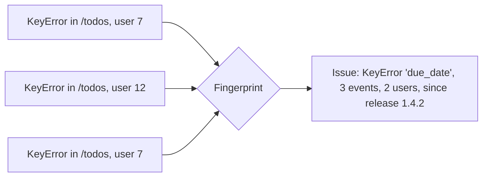
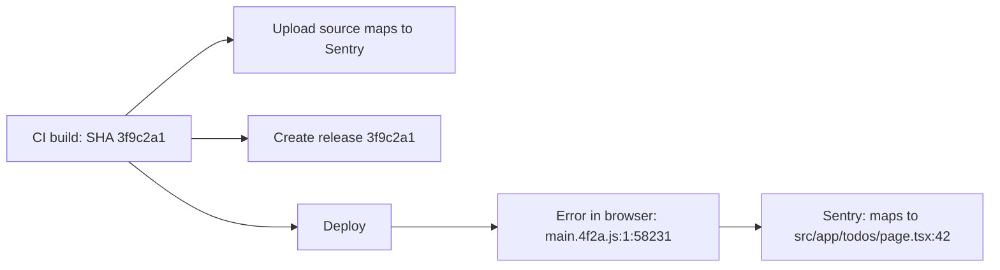
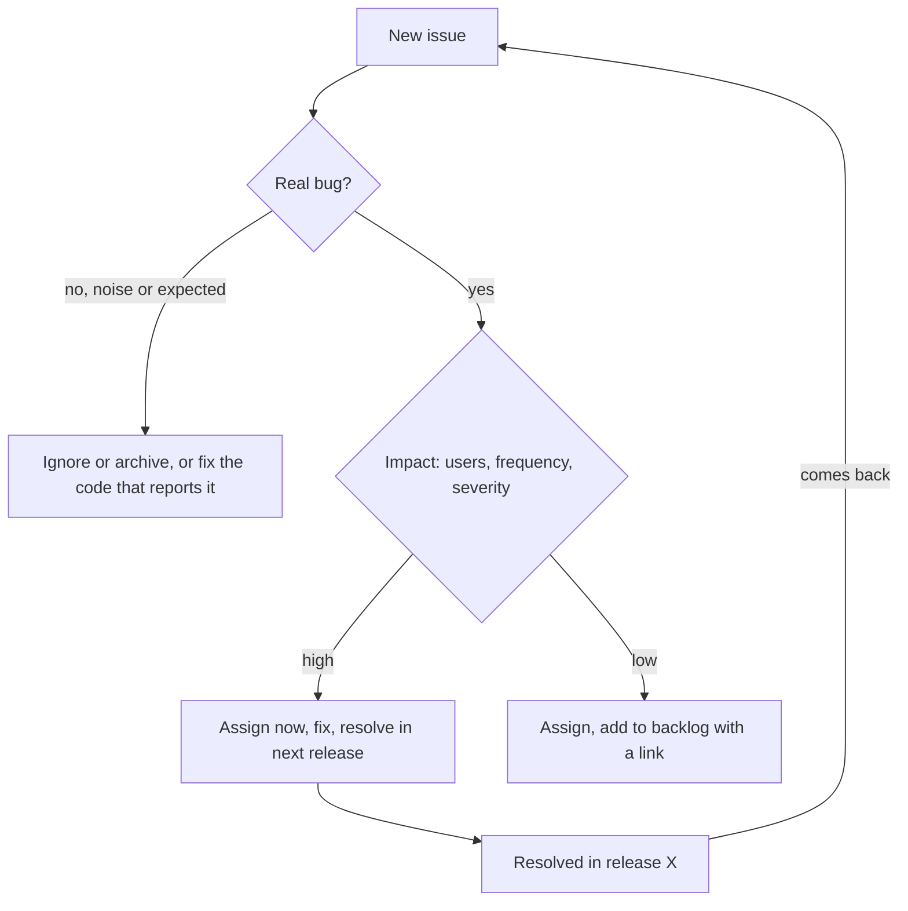

Your logs (5.6.1) record everything, your metrics (5.6.2) tell you the error rate went up, and your
traces (5.6.3) show where time goes. But when an exception fires in production, you want something
more direct: the stack trace, the exact line, the request, the user's browser, the release that
introduced it, and a single entry no matter whether it happened once or ten thousand times. That's
**error tracking**, and Sentry is the best-known tool for it. This session follows the
[Sentry docs](https://docs.sentry.io/) and the
[Sentry FastAPI integration](https://docs.sentry.io/platforms/python/integrations/fastapi/).

## Error tracking vs logging

Logging is a security camera that records everything. Error tracking is a smoke alarm with a
dossier: it only goes off for problems, and when it does it hands you everything about them.

The key difference is **grouping**. If a bug throws the same `KeyError` 4,000 times in an hour, your
logs contain 4,000 stack traces. An error tracker groups them into **one issue** by fingerprint
(exception type, stack frames), with a count, the first and last time seen, how many users were
affected and which releases.

| | Logs | Error tracking |
| - | ---- | -------------- |
| Records | every event you choose to log | exceptions and explicit error messages |
| Unit | one line per event | one **issue** grouping many occurrences |
| Context | what you put in the line | automatic: stack trace with local variables, request, user, browser, breadcrumbs |
| Workflow | search when investigating | assign, resolve, ignore, regressions reopen |
| Alerting | via log queries | built in: new issue, regression, spike |

**Breadcrumbs** are a short trail of events leading up to the error (recent log messages, HTTP
calls, database queries, clicks in the browser), recorded automatically. They often explain _how_ the
user got into the broken state.



> [!NOTE]
> Error tracking complements logs and metrics; it doesn't replace them. A slow endpoint that never
> throws won't appear as an error, and a bug that returns wrong data silently won't either.

## Sentry SDK for FastAPI and Next.js

Sentry's SDKs hook into your framework, catch unhandled exceptions, and send them with context to a
Sentry project identified by a **DSN** (Data Source Name: a URL that tells the SDK where to send
events; it's not a secret in the same sense as an API key, but keep it in configuration anyway).

**FastAPI.** Install `sentry-sdk` and initialise it before creating the app. The FastAPI
integration is enabled automatically when FastAPI is installed:

```python
import os

import sentry_sdk

sentry_sdk.init(
    dsn=os.environ.get("SENTRY_DSN"),          # no DSN: the SDK does nothing (handy for tests)
    environment=os.environ.get("ENV", "dev"),
    release=os.environ.get("GIT_SHA"),
    traces_sample_rate=0.1,                    # performance monitoring for 10% of requests
    send_default_pii=False,                    # don't send IPs, cookies, user data by default
)
```

From then on, unhandled exceptions in your routes become Sentry events with the request URL,
method, headers (scrubbed), and the stack trace with local variables. You can add context yourself:

```python
sentry_sdk.set_user({"id": current_user.id})     # an ID, not an email
sentry_sdk.set_tag("plan", "free")
sentry_sdk.capture_exception(exc)                 # report a handled exception
sentry_sdk.capture_message("Quota nearly exceeded", level="warning")
```

> [!WARNING]
> By default the FastAPI integration does **not** report `HTTPException` responses with 4xx status
> codes, only server errors (5xx) and unhandled exceptions. That's usually what you want: a 404 is
> the client's problem, not a bug. If you raise 500s deliberately, they'll be reported.

**Next.js.** The `@sentry/nextjs` SDK covers the browser, the Node.js server and the edge runtime.
The setup wizard (`npx @sentry/wizard@latest -i nextjs`) creates the config files for each runtime,
hooks into Next.js's `instrumentation` file, and wraps `next.config` so source maps are uploaded at
build time. Browser errors then show up next to API errors in the same Sentry organisation.

> [!TIP]
> Use separate Sentry projects for frontend and backend, but the same `release` value (the Git SHA)
> and `environment` names. Then you can see "release 3f9c2a1 introduced issues in both web and api"
> at a glance.

## Releases, source maps and performance monitoring

**Releases.** Tagging every event with a `release` (ideally the commit SHA) unlocks:

- **"First seen in"**: which deploy introduced an issue.
- **Regression detection**: an issue you resolved reappears in a newer release, and Sentry reopens
  it and alerts you.
- **Suspect commits**: with your repository connected, Sentry suggests which commit and author
  likely caused it.
- **Release health**: crash-free sessions and users per release, which pairs naturally with the
  canary releases from 5.2.2.

Create the release from CI, where the SHA is known, with `sentry-cli` or the Sentry GitHub Action.

**Source maps.** Your production JavaScript is minified: a stack trace pointing at `main.4f2a.js:1:58231`
is useless. **Source maps** translate positions back to your original TypeScript files and lines. The
build uploads them to Sentry (the Next.js SDK does this for you with an auth token in CI), and Sentry
uses them to show readable stack traces. Usually you don't serve the maps publicly; upload them to
Sentry and delete them from the deployed output.



**Performance monitoring.** With `traces_sample_rate` set, Sentry records transactions and spans,
similar to OpenTelemetry traces (5.6.3): slow endpoints, slow database queries, N+1 query patterns.
Keep the sample rate modest in production; it costs quota.

> [!NOTE]
> If you already run OpenTelemetry, Sentry can work alongside it. Many teams use Sentry mainly for
> errors and OTel with Tempo or Jaeger for tracing. Either way, include the trace ID in error context
> so you can jump between them.

## Alert rules and triage workflow

An error tracker full of thousands of unresolved issues nobody looks at is just an expensive log.
The value comes from a **workflow**.

**Alert rules.** Typical useful alerts:

- **A new issue** appears in production (something that never happened before).
- **A regression**: a resolved issue comes back.
- **A spike**: an issue occurs more than N times in M minutes, or affects more than X users.
- **Metric alerts**: crash-free session rate below a threshold, or error count for a release above
  baseline.

Route them to a team channel, and only page on-call (5.6.5) for high-impact ones.

**Triage** is regular, short and owned. A weekly or daily slot where someone goes through new issues:



- **Assign** every real issue to a person or team (code owners can do this automatically).
- **Resolve "in next release"** when you merge the fix, so a reappearance after deploy counts as a
  regression.
- **Ignore** with conditions ("until it happens 100 more times") for known, accepted noise.
- **Reduce noise at the source**: if an expected condition is reported as an error, change the code.

> [!TIP]
> Treat "zero untriaged issues" as the goal, not "zero issues". Every issue should have a decision:
> fixing, scheduled, or deliberately ignored.

## Practice: integrate Sentry into YouCanDoIt

Goal: errors from both the FastAPI API and the Next.js web app of this platform appear in Sentry,
tagged with release and environment, and an alert fires for a new issue. Do this on a branch; a free
Sentry developer plan is enough.

### Step 1: Create projects

Create a Sentry organisation with two projects, `ycdi-api` (Python, FastAPI) and `ycdi-web`
(Next.js). Copy each DSN.

### Step 2: Backend

Add `sentry-sdk` to the API's dependencies and call `sentry_sdk.init` at the top of `app/main.py`,
reading `SENTRY_DSN`, `ENV` and `GIT_SHA` from the environment. Add `SENTRY_DSN` to the API service in
`docker-compose.yml` from your `.env`. Leave it unset in tests, so the SDK stays inactive.

### Step 3: Frontend

In `apps/web`, run the Sentry wizard for Next.js, then read the generated files and check them
against your Next.js version's instrumentation docs. Keep the auth token used for source maps only in
CI secrets.

### Step 4: Trigger errors

Add a temporary debug route that raises `ZeroDivisionError`, and a temporary button in the web app
that throws. Trigger each twice. In Sentry, confirm they are grouped into one issue each, with
readable stack traces, the environment and the release.

### Step 5: Alerting and triage

Create an alert rule "a new issue is created, environment production, notify email". Resolve one
issue "in next release", deploy a new SHA that still throws, and watch it become a regression. Write
a five-line triage routine for the project in your notes, then remove the debug route and
button.
