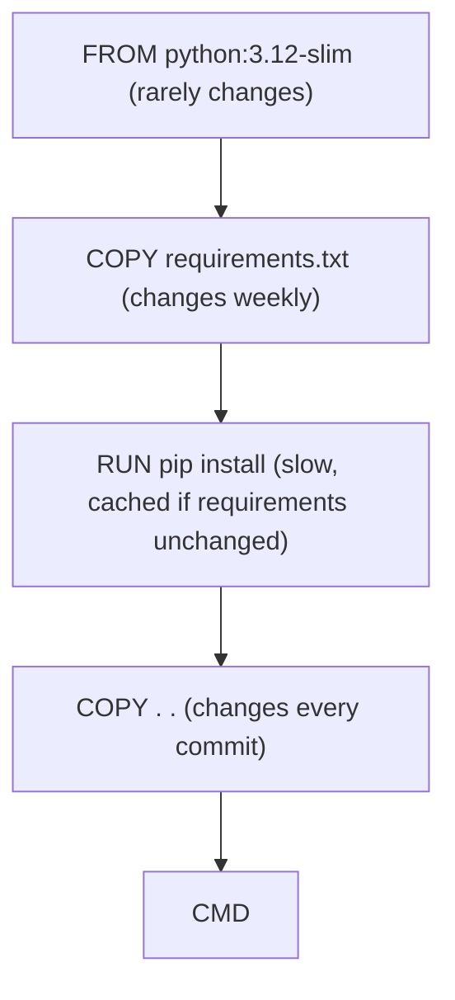

Anyone can write a Dockerfile that works. Writing one that builds in seconds instead of minutes,
produces a 150 MB image instead of 1.2 GB, and doesn't hand an attacker root access is a skill that
quietly separates junior from senior engineers. This session walks through the instructions, then
applies the ideas from Docker's [build best practices](https://docs.docker.com/build/building/best-practices/)
and the [OWASP Docker Security Cheat Sheet](https://cheatsheetseries.owasp.org/cheatsheets/Docker_Security_Cheat_Sheet.html).

## Dockerfile instructions

A Dockerfile is a recipe: a list of steps that turn a base image into your application image. Each
step runs in order, and most of them produce a new layer.

```dockerfile
FROM python:3.12-slim
WORKDIR /app
ENV PYTHONUNBUFFERED=1
COPY requirements.txt .
RUN pip install --no-cache-dir -r requirements.txt
COPY . .
EXPOSE 8000
USER 10001
CMD ["uvicorn", "app.main:app", "--host", "0.0.0.0", "--port", "8000"]
```

Docker comments must sit on their own line starting with `#`; a `#` after an instruction is not a
comment. The table explains each line:

| Instruction | What it does |
| ----------- | ------------ |
| `FROM` | Base image. Every Dockerfile (or stage) starts with one. |
| `WORKDIR` | Sets the working directory for later instructions and the container. |
| `COPY` | Copies files from the build context into the image. Prefer it over `ADD`. |
| `RUN` | Executes a command at **build** time; its file changes become a layer. |
| `ENV` / `ARG` | `ENV` persists into the running container; `ARG` exists only during the build. |
| `EXPOSE` | Documents the port. It does not publish it; `-p` does. |
| `USER` | Switches the user for later instructions and the running process. |
| `CMD` / `ENTRYPOINT` | What runs when the container **starts**. |

> [!NOTE]
> `RUN` happens once, when you build. `CMD` happens every time a container starts. Confusing them is
> a classic beginner bug: `RUN uvicorn ...` would hang the build forever.

Use the **exec form** (`CMD ["uvicorn", "..."]`, a JSON array) rather than the shell form
(`CMD uvicorn ...`). With the exec form your app is PID 1 and receives `SIGTERM` directly when
`docker stop` is called, so it can shut down gracefully. With the shell form, a shell sits in between
and may not forward the signal.

## Layer caching and build order

Docker caches each layer. When you rebuild, it walks the instructions top to bottom and reuses the
cached layer as long as the instruction and its inputs are unchanged. As soon as one step changes,
**that step and every step after it** are rebuilt.

Think of it as a stack of plates: to change the third plate you must lift off everything above it.
So the rule is: **put what changes rarely at the top and what changes often at the bottom.**



> [!EXAMPLE]
> Bad order:
> `COPY . .` then `RUN pip install -r requirements.txt`.
> Every time you edit one line of Python, the copy layer changes, so pip reinstalls everything:
> two minutes per build.
>
> Good order: copy only `requirements.txt`, install, _then_ copy the code. Editing code now only
> rebuilds the last layer: two seconds.

Other caching habits from the best-practices guide:

- **Combine related commands** in one `RUN` and clean up in the same step, because a file deleted
  in a later layer still exists in the earlier one:
  `RUN apt-get update && apt-get install -y --no-install-recommends curl && rm -rf /var/lib/apt/lists/*`
- **Pin versions** of base images and packages, so a rebuild next month gives the same result.
- **Use cache mounts** for package managers when you can
  (`RUN --mount=type=cache,target=/root/.cache/pip pip install ...`), which keeps the download cache
  between builds without putting it in the image.

## Multi-stage builds and slim base images

Building software needs tools that running it doesn't: compilers, headers, build caches. A
**multi-stage build** uses one stage to build and a second, clean stage to run, copying only the
results across. It's like cooking in a full kitchen, then serving only the plate.

```dockerfile
# ---- build stage ----
FROM python:3.12-slim AS build
RUN python -m venv /venv
ENV PATH="/venv/bin:$PATH"
COPY requirements.txt .
RUN pip install --no-cache-dir -r requirements.txt

# ---- runtime stage ----
FROM python:3.12-slim
COPY --from=build /venv /venv
ENV PATH="/venv/bin:$PATH"
WORKDIR /app
COPY app/ ./app/
CMD ["uvicorn", "app.main:app", "--host", "0.0.0.0", "--port", "8000"]
```

Only the final stage ends up in the image. If a package needs `gcc` to compile, install `gcc` in the
build stage and it never ships.

**Base image choice** matters as much:

| Base | Approx. size | Notes |
| ---- | ------------ | ----- |
| `python:3.12` | ~1 GB | Full Debian with build tools. Convenient, big. |
| `python:3.12-slim` | ~150 MB | Minimal Debian. The usual sweet spot for Python. |
| `python:3.12-alpine` | ~50 MB | musl libc; many Python wheels must compile, builds get slower. |
| distroless / scratch | tiny | No shell or package manager. Great for Go binaries, harder to debug. |

> [!TIP]
> Smaller images aren't just about disk. They pull faster during deploys and autoscaling, and every
> package you don't ship is a vulnerability you don't have to patch.

## Non-root users and .dockerignore

By default the process in a container runs as **root**. Combined with the shared kernel from 5.1.1,
that means a bug in your app plus a container escape equals root on the host. The OWASP cheat sheet
lists running as a non-root user among its first rules.

```dockerfile
RUN useradd --create-home --uid 10001 appuser
USER appuser
```

Other OWASP recommendations worth adopting from day one:

- Don't mount the Docker socket (`/var/run/docker.sock`) into containers: it's equivalent to root
  on the host.
- Drop capabilities you don't need (`--cap-drop ALL`) and use `--security-opt no-new-privileges`.
- Use a read-only root filesystem where possible (`--read-only`).
- Never bake secrets into images. Anything in a layer can be extracted with `docker history` or by
  unpacking the image, even if a later layer deletes it.
- Scan images for known vulnerabilities (for example with `docker scout` or Trivy).

The **build context** is the folder you send to the builder (the `.` in `docker build .`). A
`.dockerignore` file excludes things from it, which keeps builds fast, keeps caches stable and keeps
secrets out:

```text
.git
.venv
__pycache__/
*.pyc
.env
tests/
node_modules/
```

> [!WARNING]
> Without a `.dockerignore`, `COPY . .` copies your `.env` file with real credentials into the
> image. Push that image to a public registry and your secrets are public.

## Practice: containerise the FastAPI to-do API under 200 MB

Use the to-do API from Track 3 (any small FastAPI app works). Target: an image under 200 MB that
runs as a non-root user.

### Step 1: Start naive and measure

```dockerfile
FROM python:3.12
WORKDIR /app
COPY . .
RUN pip install -r requirements.txt
CMD uvicorn app.main:app --host 0.0.0.0
```

```sh
docker build -t todo:naive .
docker image ls todo
```

Note the size (likely around 1 GB) and how long a rebuild takes after editing one Python file.

### Step 2: Add a .dockerignore

Create the file from the previous section. Rebuild and notice the smaller "transferring context"
step.

### Step 3: Write the optimised Dockerfile

```dockerfile
FROM python:3.12-slim AS build
RUN python -m venv /venv
ENV PATH="/venv/bin:$PATH"
COPY requirements.txt .
RUN pip install --no-cache-dir -r requirements.txt

FROM python:3.12-slim
ENV PATH="/venv/bin:$PATH" PYTHONUNBUFFERED=1
RUN useradd --uid 10001 --no-create-home appuser
COPY --from=build /venv /venv
WORKDIR /app
COPY app/ ./app/
USER appuser
EXPOSE 8000
CMD ["uvicorn", "app.main:app", "--host", "0.0.0.0", "--port", "8000"]
```

### Step 4: Verify

```sh
docker build -t todo:slim .
docker image ls todo                         # compare sizes
docker run --rm -d -p 8000:8000 --name todo todo:slim
curl localhost:8000/docs                     # the app answers
docker exec todo whoami                      # appuser, not root
docker history todo:slim                     # see each layer's size
docker stop todo
```

### Step 5: Test the cache

Change one line in `app/main.py` and rebuild. Only the `COPY app/` layer and below should rebuild;
the pip layer should say `CACHED`. Write down the before/after size and rebuild time in your notes.

```quiz
{"questions": [
  {"question": "You edit a single Python file and the rebuild reinstalls all pip packages. What is the most likely cause?", "options": ["The base image is not pinned", "The code is copied before requirements are installed, so the code change invalidates the pip layer", "pip has no cache", "EXPOSE is missing"], "answer": 1, "explanation": "A changed layer invalidates every layer after it. Copy requirements.txt and install first, then copy the code."},
  {"question": "What ends up in the final image of a multi-stage build?", "options": ["Every stage, stacked", "Only the first stage", "Only the last stage plus whatever you explicitly COPY --from earlier stages", "Only the build tools"], "answer": 2, "explanation": "Earlier stages are scratch space. The final image contains only the last stage and the artifacts you copy into it."},
  {"question": "A Dockerfile does RUN echo $TOKEN > /tmp/t then, in a later RUN, rm /tmp/t. Is the secret safe?", "options": ["No: the file still exists in the earlier layer and can be extracted from the image", "Yes, rm removes it from the image", "Yes, because /tmp is never saved", "Only if the image is private"], "answer": 0, "explanation": "Layers are immutable. Deleting in a later layer hides the file but the earlier layer still contains it. Never put secrets in build layers."},
  {"question": "Why use the exec form CMD [\"uvicorn\", ...] instead of CMD uvicorn ...?", "options": ["It makes the image smaller", "It is required for EXPOSE to work", "It runs faster at build time", "Your app becomes PID 1 and receives SIGTERM directly for a graceful shutdown"], "answer": 3, "explanation": "The shell form wraps your command in /bin/sh -c, which may not forward signals, so docker stop ends with a hard kill."},
  {"question": "Which change most reduces risk if an attacker exploits a bug in your containerised app?", "options": ["Adding EXPOSE", "Running the process as a non-root user", "Using ARG instead of ENV", "Using the full python base image"], "answer": 1, "explanation": "A non-root process limits what an attacker can do inside the container and makes escaping to the host much harder."}
]}
```
