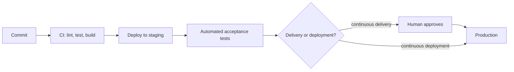
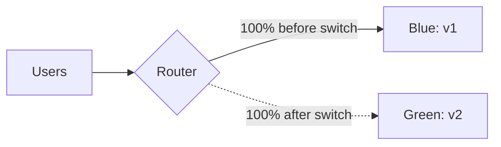
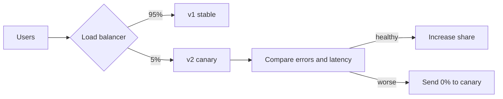
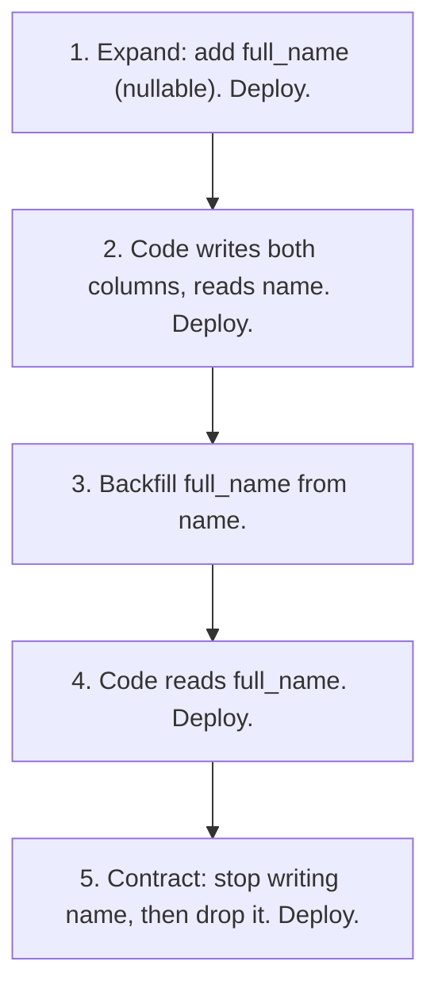

Continuous integration (5.2.1) gives you a tested, built artifact on every merge. The next question
is: how does that artifact reach users, and what happens when it's broken? This session covers the
practices that make releases boring, in the good sense: always-deployable software, release
strategies that limit the blast radius, feature flags that separate deploying from releasing, and
rollbacks that work even when the database changed. The main references are Martin Fowler's
articles on [Continuous Delivery](https://martinfowler.com/bliki/ContinuousDelivery.html) and
[Feature Toggles](https://martinfowler.com/articles/feature-toggles.html).

## Continuous delivery vs deployment

The two terms differ by a single button.

- **Continuous delivery**: every change that passes the pipeline is _releasable_. Fowler's test is
  whether the software can be deployed to production at any time, and whether the team prioritises
  keeping it that way over new features. A human still decides _when_ to push the button.
- **Continuous deployment**: there is no button. Every change that passes the pipeline goes to
  production automatically.



An analogy: a restaurant kitchen practising continuous delivery always has every dish ready to
plate; whether it goes out now is the head waiter's call. Continuous deployment sends each plate out
the moment it's ready.

Why bother? Fowler lists the benefits: lower deployment risk (small changes are easy to debug),
believable progress (done means deployed, not "done on my branch"), and faster user feedback.
Releasing once a quarter means every release contains a quarter's worth of things that can break at
once.

> [!NOTE]
> The prerequisite for both is a **deployment pipeline**: the automated path from commit to
> production, where each stage (unit tests, integration tests, staging deploy) increases confidence.
> The same artifact (for example the image tagged with the commit SHA) moves through every stage. You
> never rebuild for production.

## Blue/green and canary releases

Even well-tested changes can fail in production: real traffic, real data, real scale. Release
strategies limit how many users are affected and how fast you can undo.

**Rolling update**: replace instances a few at a time. It's the default in Kubernetes (5.5.4) and
cheap, but for a while old and new versions run side by side, and rollback means rolling again.

**Blue/green**: run two complete environments. Blue serves traffic with version 1; you deploy
version 2 to green, test it privately, then switch the router so all traffic goes to green. Blue
stays idle as an instant rollback target.



**Canary**: send a small slice of traffic (say 5%) to the new version, watch its error rate and
latency, then widen to 25%, 50%, 100%. The name comes from the canaries miners carried to detect
gas: a few users feel a bad release before everybody does.



| Strategy | Extra cost | Rollback speed | Exposes bad release to |
| -------- | ---------- | -------------- | ---------------------- |
| Rolling | none | minutes | growing share during rollout |
| Blue/green | double capacity during release | seconds (switch back) | everyone, at the switch |
| Canary | small | seconds | a small slice first |

> [!TIP]
> A canary is only as good as its metrics. Decide _before_ the release what "healthy" means, for
> example "error rate within 0.5 percentage points of stable, p95 latency within 10%", and automate
> the comparison. You will build these metrics in Module 5.6.

## Feature flags and dark launches

Blue/green and canary decide which _version of the code_ users hit. **Feature flags** (also called
feature toggles) decide which _behaviour_ users see inside the same version:

```python
if flags.is_enabled("new-checkout", user=current_user):
    return new_checkout(cart)
return old_checkout(cart)
```

This separates **deploying** (code is on the servers) from **releasing** (users see it). You can
merge unfinished work behind a flag that is off, which keeps branches short (good for CI), then turn
the feature on for staff, then 10% of users, then everyone, without a deploy.

Fowler's article sorts toggles into four categories with very different lifetimes:

| Category | Purpose | Lifetime |
| -------- | ------- | -------- |
| Release toggles | hide unfinished features | days to weeks |
| Experiment toggles | A/B tests | as long as the experiment |
| Ops toggles | kill switches for expensive features under load | can be long |
| Permission toggles | features for premium or internal users | long |

A **dark launch** runs new code in production without users seeing the result. For example, the new
search engine receives a copy of each real query and its results are logged and compared, but users
still get the old results. You learn about performance under real load with zero user impact.

> [!WARNING]
> Flags are debt. Each one doubles the paths through your code and complicates testing. Fowler
> recommends treating release toggles as inventory with a carrying cost: give each one an owner and
> an expiry date, and delete it (and the dead branch) as soon as the feature is fully on.

## Rollbacks and database changes

Rolling back code is easy: redeploy the previous image tag. Rolling back a **database** is not,
because data written by the new version may not fit the old schema, and you can't un-delete a
column's contents.

The safe approach is to make every schema change **backward compatible** with the code version that
is currently running, using the **expand and contract** pattern (also called parallel change). To
rename a column `name` to `full_name`:



At every step, the previous code version still works against the current schema, so any single
deploy can be rolled back safely. It takes more deploys, which is exactly why continuous delivery
makes it practical: deploys are cheap.

> [!EXAMPLE]
> A team ships "drop column `legacy_status`" in the same release as the code that stops using it.
> The release has a bug and they roll back the code. The old code queries `legacy_status`, which no
> longer exists, so now the rollback is broken too. Splitting it into "stop using" (release 1) and
> "drop" (release 2, a week later) would have kept rollback safe.

> [!TIP]
> Run migrations as a separate step _before_ the new code starts (Alembic's `upgrade head`, as
> YouCanDoIt's API container does), and make them additive. Sometimes "roll forward" with a quick fix
> is safer than rolling back, but you want that to be a choice, not your only option.

## Practice: automatic deploy on merge to main

Goal: extend your CI pipeline from 5.2.1 so every merge to `main` deploys automatically, with a
health check and a one-command rollback.

### Step 1: Pick a target

Use a free PaaS that can deploy a Docker image or a repo (Render, Fly.io; see 5.3.5), or a small VM
running Docker Compose. You need a way to trigger a deploy from CI: a deploy hook URL, a CLI
(`flyctl deploy`), or SSH.

### Step 2: Add a deploy job

```yaml
  deploy:
    needs: image
    if: github.ref == 'refs/heads/main'
    runs-on: ubuntu-latest
    environment: production
    steps:
      - name: Trigger deploy of this commit's image
        run: curl -fsS -X POST "${{ secrets.DEPLOY_HOOK_URL }}"
      - name: Smoke test
        run: |
          for i in $(seq 1 30); do
            curl -fsS https://your-app.example.com/health && exit 0
            sleep 10
          done
          exit 1
```

The `environment: production` line lets you add protection rules in GitHub (for example a required
reviewer, which turns this into continuous _delivery_).

### Step 3: Add a feature flag

Add an environment variable such as `FEATURE_TAGS=false` and hide a small new feature behind it.
Merge with the flag off, confirm the deploy, then flip the variable on without changing the code.

### Step 4: Practise a rollback

Merge a change that makes `/health` fail. Watch the smoke test go red. Roll back by redeploying the
previous image SHA (most platforms keep previous deploys one click away). Write a short
`ROLLBACK.md` explaining the steps.

### Step 5: Try expand and contract

Add a new nullable column with an Alembic migration in one PR, and start using it in a second PR.
Confirm that rolling back the second deploy still works.

```quiz
{"questions": [
  {"question": "What distinguishes continuous delivery from continuous deployment?", "options": ["Delivery has no automated tests", "In delivery every change is releasable but a human chooses when to release; in deployment every passing change goes to production automatically", "Deployment is only for mobile apps", "They are synonyms"], "answer": 1, "explanation": "Both rely on an automated pipeline. The difference is whether the final step to production is manual or automatic."},
  {"question": "You want to expose a risky new version to as few users as possible while measuring real behaviour. Which strategy fits best?", "options": ["Blue/green", "Big-bang release", "Canary", "Recreate (stop all, start all)"], "answer": 2, "explanation": "A canary sends a small share of traffic to the new version and widens it only if the metrics look healthy."},
  {"question": "What do feature flags let you separate?", "options": ["Deploying code from releasing the feature to users", "Frontend from backend", "Tests from production", "Staging from CI"], "answer": 0, "explanation": "Code can be deployed with the feature off, then enabled gradually without a new deploy."},
  {"question": "Why is 'drop the old column in the same release that stops using it' risky?", "options": ["Dropping columns is slow", "Migrations cannot drop columns", "Feature flags stop working", "If you roll back the code, the old version still needs the dropped column"], "answer": 3, "explanation": "Expand and contract keeps each schema compatible with the previous code version so rollbacks stay safe."},
  {"question": "Why should the same image be promoted from staging to production rather than rebuilt?", "options": ["Rebuilding is not possible", "Production registries are read-only", "So that what you tested is exactly what you ship", "Images expire after staging"], "answer": 2, "explanation": "Rebuilding can pull different dependencies or base layers. Promoting one artifact guarantees the tested bits are the deployed bits."}
]}
```
