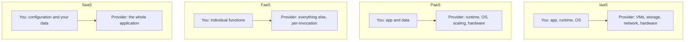
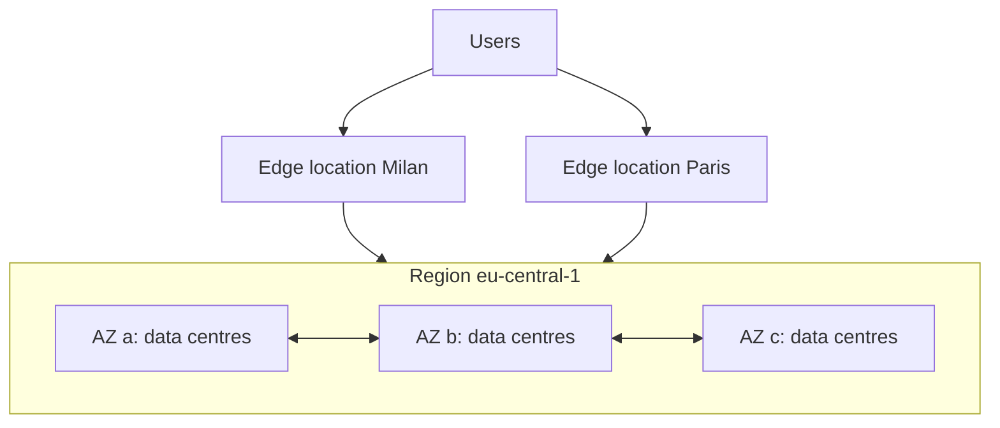

Until now everything has run on your laptop. Real users need your software running somewhere that is
always on, reachable from anywhere, and able to grow. For most companies today that place is "the
cloud". This session builds the mental model behind every cloud provider: what you're actually
renting, how responsibility is split, and how you're billed. The material lines up with the
[AWS Cloud Practitioner path](https://aws.amazon.com/training/learn-about/cloud-practitioner/) and
the [Azure Fundamentals cloud concepts](https://learn.microsoft.com/en-us/training/paths/microsoft-azure-fundamentals-describe-cloud-concepts/)
modules, so it also prepares you for those entry-level certifications.

## What the cloud is and why it won

The cloud is renting computing (servers, storage, databases, networks) over the internet, on demand,
and paying for what you use. Think electricity: a century ago, factories ran their own generators;
then the grid arrived and they plugged in. You don't build a power plant to run a kettle, and you no
longer buy a rack of servers to launch a web app.

Before the cloud, launching a product meant:

1. Guess how many servers you'd need in a year.
2. Order them and wait weeks for delivery.
3. Rack them in a data centre, wire the network, install the OS.
4. Pay for all of it even if the product flopped, or run out of capacity if it succeeded.

The cloud replaced that with an API call that returns a server in a minute. The reasons it won map
onto the benefits both AWS and Azure training emphasise:

- **Capital expense becomes operational expense.** No upfront hardware purchase; a monthly bill
  instead (CapEx to OpEx).
- **Elasticity.** Scale up for Black Friday, scale down on Sunday night. Pay for the peak only during
  the peak.
- **Speed and agility.** Experiments cost minutes and a few dollars, not a procurement process.
- **Global reach.** Deploy close to users in other continents without opening an office there.
- **Economies of scale.** Providers buy hardware and energy at a scale no single company can.
- **Managed services.** Someone else patches the database, rotates disks and handles failover.

> [!NOTE]
> "Cloud" doesn't only mean public cloud. **Private cloud** is cloud-style self-service on your own
> hardware; **hybrid cloud** mixes both, common in banks and governments that must keep some data
> on-premises.

> [!WARNING]
> The cloud is not automatically cheaper. A steady workload running 24/7 for years can cost more in
> the cloud than on owned hardware. The win is flexibility and speed; cost needs active management
> (5.3.6).

## Service models: IaaS, PaaS, SaaS, FaaS

The service models differ in **how much of the stack you manage**. The classic analogy is pizza:

- **On-premises**: make pizza at home. You buy the oven, the ingredients, everything.
- **IaaS** (Infrastructure as a Service): you rent a kitchen with an oven. You still cook.
- **PaaS** (Platform as a Service): you order delivery. You just set the table.
- **SaaS** (Software as a Service): you eat at a restaurant. You just eat.



| Model | You manage | Examples |
| ----- | ---------- | -------- |
| IaaS | OS, runtime, app, data | AWS EC2, Azure Virtual Machines, Google Compute Engine |
| PaaS | app and data | Render, Heroku, Azure App Service, Google App Engine |
| FaaS (serverless) | function code | AWS Lambda, Azure Functions, Google Cloud Functions |
| SaaS | settings and data | Gmail, Slack, GitHub, Salesforce |

**FaaS** sits beyond PaaS: you upload single functions that run in response to events, and you pay
per call and per millisecond rather than for an always-on server. Session 5.3.4 covers it.

Managed databases (AWS RDS, Neon) and managed Kubernetes (EKS, AKS, GKE) are somewhere between IaaS
and PaaS. Don't worry about exact labels; the useful question is always "what do I still have to
operate?"

> [!TIP]
> The further up you go, the less control and the less work. A good default for a small team is the
> highest level that meets your needs, moving down only when you hit a real limit.

## Regions, availability zones and edge

Cloud providers own data centres around the world, organised in a hierarchy:

- A **region** is a geographic area, such as Frankfurt or Northern Virginia, with its own services
  and prices. Your data stays in the region you choose, which matters for latency and for laws like
  GDPR.
- An **availability zone (AZ)** is one or more data centres inside a region, with independent power,
  cooling and networking, connected to the other AZs by fast links. A region usually has three or
  more.
- **Edge locations** (points of presence) are many smaller sites close to users, used by CDNs and
  DNS to cache content and terminate connections near the user.



Design consequences:

- **Spread across AZs** for high availability. If one data centre loses power, instances in the
  other AZs keep serving. Managed databases offer a multi-AZ option that keeps a standby replica in
  another zone.
- **Multi-region** protects against a whole-region outage and serves global users faster, but it's
  much harder (data replication, consistency) and more expensive. Most apps start in one region.
- **Choose the region near your users** and where the law allows the data to live.

> [!EXAMPLE]
> An Italian learning app with EU users: deploy in an EU region (Milan, Frankfurt or Paris), run the
> API on two or more AZs behind a load balancer, use a multi-AZ database, and put a CDN in front for
> static assets. That covers the failure of a single data centre without the cost of multi-region.

## Shared responsibility and pricing models

Who secures what? The **shared responsibility model** splits it: the provider is responsible for
security **of** the cloud (physical data centres, hardware, the virtualisation layer), and you are
responsible for security **in** the cloud (your data, your identities and permissions, your
configuration). The split moves with the service model:

| Responsibility | IaaS | PaaS | SaaS |
| -------------- | ---- | ---- | ---- |
| Physical security, hardware | provider | provider | provider |
| OS patching | **you** | provider | provider |
| Runtime and app patching | **you** | **you** (your app) | provider |
| Network config, firewall rules | **you** | shared | provider |
| Identity and access | **you** | **you** | **you** |
| Your data | **you** | **you** | **you** |

> [!WARNING]
> Data and identities are _always_ your responsibility. Most cloud breaches are not the provider
> being hacked; they are a customer leaving a storage bucket public or an access key in a public
> repo.

**Pricing models** you'll meet everywhere:

- **Pay-as-you-go / on-demand**: per second, hour, GB or request. No commitment, highest unit price.
- **Reserved capacity / savings plans**: commit to one or three years of usage for a large discount.
- **Spot / preemptible**: spare capacity at a deep discount that can be taken back at short notice.
  Good for batch jobs, bad for your only database.
- **Free tiers**: limited free usage for learning and small projects.

Three things tend to dominate a bill: compute hours, stored data and **egress** (data leaving the
provider's network). Ingress is usually free. Session 5.3.6 goes deeper.

## Practice: map YouCanDoIt's components to cloud services

YouCanDoIt runs locally with Docker Compose: PostgreSQL with pgvector, Ollama for embeddings and
local LLMs, a FastAPI API with a scheduler, and a Next.js web app. Your task is to design how it
would run in the cloud.

### Step 1: List the components

Open `docker-compose.yml` in this repository and list every service, plus anything implicit: the
mounted `ROADMAP.md` and `content/`, secrets like `ANTHROPIC_API_KEY`, scheduled jobs.

### Step 2: Choose a service model for each

For each component, fill in a table like this, justifying the model choice:

| Component | Needs | Model | AWS | Azure | GCP |
| --------- | ----- | ----- | --- | ----- | --- |
| Next.js web | SSR, CDN | PaaS | Amplify / App Runner | App Service / Static Web Apps | Cloud Run |
| FastAPI API | container, always on | PaaS / containers | ECS Fargate / App Runner | Container Apps | Cloud Run |
| PostgreSQL + pgvector | managed, backups | managed DB | RDS for PostgreSQL | Azure Database for PostgreSQL | Cloud SQL |
| Ollama | GPU or skip | IaaS or SaaS LLM | ? | ? | ? |

Fill the remaining rows yourself. Ollama is the interesting one: a GPU VM (IaaS, expensive), or
switching to a hosted model API (SaaS) since the app already supports Anthropic.

### Step 3: Place it on the map

Pick a region and justify it (users, data location). Decide which components need more than one AZ.

### Step 4: Draw the shared responsibility line

For your design, list three things _you_ must secure (for example database credentials, IAM roles,
the public endpoints) and three the provider handles.

### Step 5: Rough pricing model

Mark each component as on-demand, reserved, spot or free tier, and note where egress happens. Keep
the document: you'll redraw it for AWS in 5.3.2, for Azure and GCP in 5.3.3, and cost it in 5.3.6.

```quiz
{"questions": [
  {"question": "A startup expects traffic to spike unpredictably. Which cloud benefit addresses this most directly?", "options": ["Shared responsibility", "Elasticity: scaling capacity up and down on demand and paying for what is used", "Reserved instances", "Private cloud"], "answer": 1, "explanation": "Elasticity lets capacity follow demand instead of buying hardware for the peak in advance."},
  {"question": "You deploy your API on a PaaS. Who patches the operating system?", "options": ["You", "Nobody", "The provider", "Your users"], "answer": 2, "explanation": "On PaaS the provider manages the OS and runtime; you manage your application code and data."},
  {"question": "Why run your API in at least two availability zones?", "options": ["So a failure of one data centre doesn't take the service down", "To serve users on other continents faster", "To reduce egress costs", "Because a region has only one AZ"], "answer": 0, "explanation": "AZs have independent power and networking; spreading across them protects against a single-site failure."},
  {"question": "A company's S3 bucket with customer data was left publicly readable. Under the shared responsibility model, whose failure is it?", "options": ["The provider's, since it hosts the bucket", "Shared equally", "Nobody's; public buckets are a feature", "The customer's: data and access configuration are always the customer's responsibility"], "answer": 3, "explanation": "The provider secures the infrastructure; configuring access to your data is your job in every service model."},
  {"question": "Which workload is the best fit for spot/preemptible instances?", "options": ["The production database", "A nightly batch job that can be retried if interrupted", "The login service", "A single always-on web server"], "answer": 1, "explanation": "Spot capacity is cheap but can be reclaimed, so it suits interruptible, retryable work."}
]}
```
