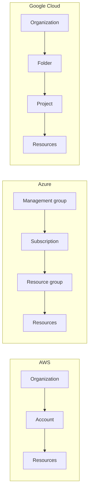
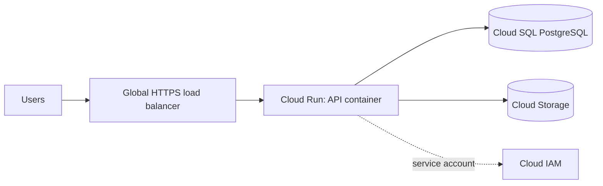

Learning AWS first doesn't lock you into AWS. The three big providers solve the same problems with
similar building blocks under different names, and once you can translate between them, your
architecture skills become portable. Job ads often ask for "AWS or Azure or GCP experience"; what
they really want is someone who understands the concepts and can learn the console. This session
gives you the translation table plus the distinctive parts of each, drawing on
[Azure Fundamentals](https://learn.microsoft.com/en-us/credentials/certifications/azure-fundamentals/),
[Google Cloud training](https://cloud.google.com/learn/training) and
[Google Skills](https://www.skills.google/).

## Service mapping across providers

The analogy: AWS, Azure and Google Cloud are three supermarket chains. The aisles are arranged
differently and the house brands have different names, but they all sell bread, milk and eggs. Learn
the categories, then the brand names.

| Category | AWS | Azure | Google Cloud |
| -------- | --- | ----- | ------------ |
| Virtual machines | EC2 | Virtual Machines | Compute Engine |
| Managed containers (serverless) | ECS on Fargate, App Runner | Container Apps | Cloud Run |
| Managed Kubernetes | EKS | AKS | GKE |
| Functions | Lambda | Azure Functions | Cloud Run functions (formerly Cloud Functions) |
| PaaS for web apps | Elastic Beanstalk | App Service | App Engine |
| Object storage | S3 | Blob Storage | Cloud Storage |
| Block storage | EBS | Managed Disks | Persistent Disk |
| Managed PostgreSQL | RDS / Aurora | Azure Database for PostgreSQL | Cloud SQL / AlloyDB |
| NoSQL key-value/document | DynamoDB | Cosmos DB | Firestore / Bigtable |
| Private network | VPC | Virtual Network (VNet) | VPC |
| Firewall rules | Security groups, NACLs | Network security groups | VPC firewall rules |
| Identity and access | IAM | Microsoft Entra ID + Azure RBAC | Cloud IAM |
| Container registry | ECR | Container Registry | Artifact Registry |
| Queue | SQS | Queue Storage / Service Bus | Pub/Sub |
| Monitoring and logs | CloudWatch | Azure Monitor | Cloud Monitoring and Logging |
| Infrastructure as code (native) | CloudFormation | ARM / Bicep | Deployment Manager / Infrastructure Manager |

> [!NOTE]
> Product names change. Google, for example, merged Cloud Functions into Cloud Run. Treat any
> mapping table, including this one, as a starting point and check the current docs before you
> commit to a design.

Equivalents aren't identical. Some differences that matter in real designs:

- **Network scope.** An AWS VPC lives in one region; a Google Cloud VPC is **global**, with subnets
  in regions. Azure VNets are regional, like AWS.
- **Organising resources.** AWS uses accounts (grouped in an Organization). Azure uses
  subscriptions and **resource groups**. Google Cloud uses **projects** inside folders and an
  organisation.
- **Identity.** Azure is tightly integrated with Microsoft Entra ID (formerly Azure Active
  Directory), which many companies already use for Office 365 logins.



## Azure fundamentals (AZ-900 topics)

The AZ-900 exam (Microsoft Azure Fundamentals) checks broad understanding rather than hands-on
skill. Its topics map to three areas:

**1. Cloud concepts.** The same ideas as 5.3.1: benefits of cloud, IaaS/PaaS/SaaS, public, private
and hybrid cloud, shared responsibility, consumption-based pricing.

**2. Azure architecture and services.**

- **Regions, region pairs and availability zones.** Many Azure regions are paired with another
  region in the same geography for disaster recovery and staggered updates.
- **Resource hierarchy**: management groups, subscriptions, resource groups, resources. A
  **resource group** is a container for resources that share a lifecycle: delete the group and
  everything inside goes. It's a very handy way to clean up a practice project.
- **Core services**: Virtual Machines, App Service, Container Apps, AKS, Functions; Blob Storage
  and Azure Files; Azure SQL and Cosmos DB; Virtual Networks, VPN Gateway and ExpressRoute for
  private connections to on-premises.
- **Identity**: Microsoft Entra ID for users and single sign-on, conditional access, MFA; **Azure
  RBAC** to grant roles at a scope (subscription, resource group or resource).

**3. Management and governance.**

- **Cost management**: pricing calculator, cost analysis, budgets, tags.
- **Azure Policy**: rules such as "only these regions" or "every resource must have an owner tag".
- **Resource locks** to prevent accidental deletion.
- **Infrastructure as code** with ARM templates and Bicep; **Azure Monitor**, Log Analytics and
  Application Insights for observability.

> [!TIP]
> For a learner, the resource group is Azure's best feature: put everything for an exercise in one
> resource group and delete it at the end. One click, no forgotten resources.

## Google Cloud fundamentals

Google Cloud is smaller than AWS and Azure by market share but strong in data, analytics, machine
learning and Kubernetes (Kubernetes itself came out of Google). The essentials:

- **Projects** are the basic unit: every resource belongs to one project, which also carries
  billing and the enabled APIs. Create a project per exercise and shut it down afterwards.
- **Compute**: Compute Engine VMs, **GKE** (including Autopilot mode, where Google manages nodes),
  and **Cloud Run**, which runs any container image, scales to zero and bills per use. Cloud Run is
  often the easiest way to host a containerised API on any of the three clouds.
- **Data**: Cloud Storage, Cloud SQL (PostgreSQL, MySQL, SQL Server), Firestore, Spanner (globally
  distributed relational), and **BigQuery**, a serverless data warehouse where you query terabytes
  with SQL and pay per data scanned.
- **AI**: Vertex AI for training and serving models and accessing Google's models.
- **Networking**: a global VPC, and a global load balancer with a single anycast IP.
- **IAM**: roles granted to principals (users, groups, **service accounts**) on resources, inherited
  down the organisation, folder and project hierarchy.



> [!NOTE]
> Google's free learning paths and hands-on labs are on [Google Skills](https://www.skills.google/);
> the entry-level certification is Cloud Digital Leader, the hands-on one is Associate Cloud
> Engineer.

## Practice: redraw your AWS architecture for Azure and GCP

Take the AWS design you built in 5.3.2 (to-do API container, PostgreSQL, uploads bucket, private
networking, IAM role) and translate it.

### Step 1: Write the AWS version as a component list

One line per component, with its role: "ALB, public, terminates HTTPS", "ECS Fargate service, 2
tasks, private subnets, task role with S3 access", and so on.

### Step 2: Translate component by component

Use the mapping table, then check each choice against the provider's docs. For each row, note one
**real difference**: for example "Cloud Run scales to zero by default, so the first request after
idle is slower" or "Azure groups everything in one resource group".

### Step 3: Redraw the diagrams

Draw the Azure and GCP versions as Mermaid flowcharts, in the same layout as your AWS diagram so the
differences jump out. Include identity: role vs managed identity vs service account.

### Step 4: Compare

Write a short table: ease of setup, networking model, identity model, and anything that would push
you to one provider (existing Microsoft 365 contracts, BigQuery for analytics, team experience).

### Step 5 (optional): Deploy on one of them

If you have free credits, deploy the API container to Azure Container Apps or Cloud Run, connect it
to a managed PostgreSQL, then delete the resource group or shut down the project.

> [!EXAMPLE]
> A minimal GCP translation: ALB + ECS Fargate becomes Cloud Run (which includes HTTPS);
> RDS becomes Cloud SQL, reached through the Cloud SQL connector; S3 becomes Cloud Storage; the ECS
> task role becomes a service account attached to the Cloud Run service.

```quiz
{"questions": [
  {"question": "Which pair are equivalent object storage services?", "options": ["AWS EBS and Azure Blob Storage", "AWS S3 and Google Cloud Storage", "AWS S3 and Google Persistent Disk", "Azure Managed Disks and Google Cloud Storage"], "answer": 1, "explanation": "S3, Azure Blob Storage and Google Cloud Storage are object stores; EBS, Managed Disks and Persistent Disk are block storage."},
  {"question": "You want to clean up everything from an Azure exercise in one step. What should you have used?", "options": ["A single resource group for all the exercise's resources", "Azure Policy", "A region pair", "Entra ID"], "answer": 0, "explanation": "Deleting a resource group deletes every resource inside it."},
  {"question": "What is a notable networking difference of Google Cloud compared with AWS?", "options": ["Google Cloud has no firewall", "Google Cloud VPCs cannot have subnets", "A Google Cloud VPC is global, with regional subnets, while an AWS VPC is regional", "AWS VPCs are global"], "answer": 2, "explanation": "This affects how you design multi-region networks on each provider."},
  {"question": "In your AWS design the API used an ECS task role to access S3. What is the GCP equivalent?", "options": ["An API key in an environment variable", "A public bucket", "A firewall rule", "A service account attached to the Cloud Run service, granted a role on the bucket"], "answer": 3, "explanation": "Each provider has a workload identity mechanism: AWS roles, Azure managed identities, Google service accounts."},
  {"question": "Why should you treat a cross-cloud mapping table as a starting point only?", "options": ["Equivalent services differ in limits, defaults and features, and names change over time", "The tables are always wrong", "Providers forbid comparisons", "Only AWS has real services"], "answer": 0, "explanation": "Equivalents solve the same problem but rarely behave identically, so verify against current docs."}
]}
```
