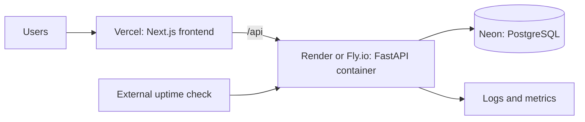
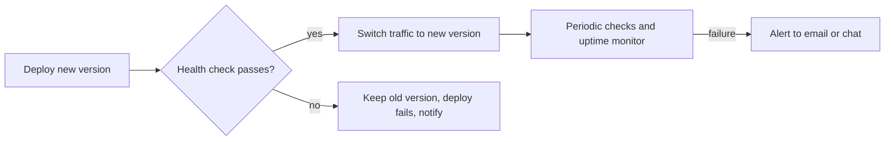

In 5.3.2 you assembled a deployment from raw AWS parts: registry, VM, database, security groups,
roles. That's valuable knowledge, and also a lot of work for a side project or a small team. A
**Platform as a Service** (PaaS) hides most of it: connect a Git repo or an image, set some
environment variables, and you get HTTPS, deploys and logs. This session shows how to pick a PaaS,
handle configuration and secrets properly, and add the observability you need to sleep at night,
with the docs of [Render](https://render.com/docs), [Fly.io](https://fly.io/docs/),
[Vercel](https://vercel.com/docs) and [Neon](https://neon.com/docs/introduction).

## PaaS options: Render, Fly.io, Vercel, Neon

A PaaS is a serviced apartment: furniture, cleaning and utilities included, you bring your
suitcase. You give up some control (you can't knock down walls) in exchange for not dealing with the
plumbing. Each of these four specialises in something:

| Platform | Best at | How you deploy |
| -------- | ------- | -------------- |
| **Render** | web services, workers, cron jobs, managed Postgres and key-value | Connect a Git repo (native runtime or Dockerfile) or a prebuilt image; optional `render.yaml` blueprint |
| **Fly.io** | running containers as lightweight VMs ("Machines") close to users in many regions | `fly launch` and `fly deploy` with a `fly.toml` config |
| **Vercel** | frontends, especially Next.js, with previews per pull request and edge delivery | Connect a Git repo; every push gets a preview URL |
| **Neon** | serverless PostgreSQL: storage separated from compute, scale to zero, database **branching** | Create a project, copy the connection string |

A typical full-stack split for a project like the to-do app or YouCanDoIt:



> [!WARNING]
> Free tiers change often and have limits that matter: free web services may **sleep after a
> period of inactivity** (the first request then takes many seconds), free databases may have
> storage caps or expiry dates, and some platforms have reduced or removed free plans for new
> accounts. Read the current pricing page before you choose, and don't host anything important on a
> plan that can be deleted.

> [!TIP]
> Neon's database **branches** are copy-on-write clones of your database created in seconds. Give
> each pull request its own branch and your preview deployments get realistic data without touching
> production.

How to choose: Vercel for a Next.js frontend is the path of least resistance. For a Python API in a
container, Render is the simplest; Fly.io gives more control over regions and machines. For
PostgreSQL, a managed service such as Neon (or Render's own Postgres) beats running a database
yourself.

## Environment configuration and secrets

The same image runs in development, preview and production; only **configuration** changes. That
is the twelve-factor rule "store config in the environment", and every PaaS supports it:

- **Plain config**: `LOG_LEVEL=info`, `ALLOWED_ORIGINS=https://todo.example.com`.
- **Secrets**: `DATABASE_URL`, `ANTHROPIC_API_KEY`, `SENTRY_DSN`. Set them in the platform's
  dashboard or CLI (`fly secrets set KEY=value`), never in the repo.
- **Per-environment values**: Vercel distinguishes Production, Preview and Development variables;
  Render has environment groups you can share across services.

Your app should read settings in one place and **fail fast** if a required one is missing, as
YouCanDoIt does with pydantic-settings:

```python
from pydantic_settings import BaseSettings


class Settings(BaseSettings):
    database_url: str          # required: startup fails clearly if absent
    log_level: str = "info"
    sentry_dsn: str | None = None


settings = Settings()
```

> [!WARNING]
> Frontend frameworks expose some variables to the **browser**. In Next.js, anything prefixed
> `NEXT_PUBLIC_` is baked into the JavaScript bundle and visible to every visitor. Never put a secret
> there; keep secrets on the server side (which is why YouCanDoIt's browser calls go through a
> server-side `/api` proxy).

Other habits that pay off:

- Keep a `.env.example` listing every variable with fake values. It documents what the app needs.
- Use different credentials per environment, so a leaked preview key can't touch production.
- Rotate a secret immediately if it ever lands in Git, even in a deleted commit.

## Logs, health checks and alerting on PaaS

Deploying is half the job. The other half is knowing when it breaks before your users tell you.
Three tools, in order of importance:

**1. Health checks.** An endpoint like `GET /health` that returns 200 when the app can serve
requests. The platform calls it during deploys (a new version only receives traffic once healthy,
which gives you zero-downtime deploys) and periodically afterwards (restarting unhealthy instances).
Render lets you set a health check path per service; Fly.io defines checks in `fly.toml`.

```python
@app.get("/health")
async def health(db: AsyncSession = Depends(get_db)):
    await db.execute(text("SELECT 1"))   # proves the DB is reachable too
    return {"status": "ok"}
```

> [!TIP]
> Keep health checks cheap and honest. Checking the database is reasonable; calling a slow external
> API on every check is not, because a third-party hiccup would make the platform restart your
> healthy app.

**2. Logs.** Write to stdout/stderr and the platform collects them: `fly logs`, Render's log tab,
Vercel's runtime logs. Built-in retention is usually short, so for anything serious you stream logs
to a log service (Render and Fly.io support log streaming). Structured JSON logs (5.6.1) make
searching easy.

**3. Alerting.** Two kinds:

- **Platform notifications**: failed deploys, crashed instances (email, Slack).
- **External uptime monitoring**: a service outside your platform requests `/health` every minute
  and alerts you when it fails. "Outside" matters: if the platform itself is down, its own alerts may
  be down too.



## Practice: deploy the to-do app to a free PaaS with monitoring

Goal: the to-do API (and frontend, if you built one) running publicly with a managed database,
secrets handled properly, health checks, logs and an alert that actually fires.

### Step 1: Database

Create a Neon project (or a Render Postgres instance). Copy the connection string. Run your Alembic
migrations against it from your laptop once: `DATABASE_URL=... alembic upgrade head`.

### Step 2: API

Deploy the API container from 5.1.2:

- **Render**: New Web Service, connect your repo, choose Docker, set `DATABASE_URL` as a secret
  environment variable and the health check path to `/health`.
- **Fly.io**: `fly launch` (detects the Dockerfile), `fly secrets set DATABASE_URL=...`, add an HTTP
  check on `/health` in `fly.toml`, then `fly deploy`.

Open the public URL and create a to-do.

### Step 3: Frontend (optional)

Import the frontend repo into Vercel and set the API URL as an environment variable. Open a pull
request and check you get a preview URL.

### Step 4: Monitoring

1. Confirm the logs show your requests.
2. Set up a free external uptime monitor on `https://<your-api>/health` with email alerts.
3. Make `/health` return 500 (an environment flag like `FORCE_UNHEALTHY=true` is handy) and confirm
   the alert arrives. Then fix it and confirm the recovery notice.

### Step 5: Write the runbook

In your repo's README, document: where it's deployed, how to see logs, how to roll back, which
secrets exist (names only), and who gets alerts. You will expand this into a real runbook in 5.6.5.

```quiz
{"questions": [
  {"question": "Why does a health check endpoint enable zero-downtime deploys on a PaaS?", "options": ["It makes the app start faster", "The platform only switches traffic to the new version once its health check passes", "It disables logging during deploys", "It caches responses"], "answer": 1, "explanation": "The old version keeps serving until the new one proves healthy; a failing new version never receives traffic."},
  {"question": "Where must you never put an API secret in a Next.js app?", "options": ["A server-side environment variable", "The platform's secret store", "A NEXT_PUBLIC_ environment variable", "A server-side API route"], "answer": 2, "explanation": "NEXT_PUBLIC_ variables are embedded in the browser bundle and visible to anyone."},
  {"question": "Why should uptime monitoring run from outside your hosting platform?", "options": ["If the platform has an outage, its own alerting may fail along with your app", "Platforms forbid internal monitoring", "External monitors are always free", "It reduces latency"], "answer": 0, "explanation": "An independent checker sees what users see, including platform-wide failures."},
  {"question": "Your health check calls a third-party payment API. What can go wrong?", "options": ["Nothing, it is more thorough", "The response will be cached", "Logs will be lost", "A third-party slowdown makes your healthy app look unhealthy and get restarted"], "answer": 3, "explanation": "Health checks should test what your app controls, like its own database connection, and stay cheap."},
  {"question": "What does Neon's database branching give you for preview deployments?", "options": ["Faster production queries", "A quick copy-on-write clone so each preview has realistic data without touching production", "Automatic schema migrations", "Free GPU access"], "answer": 1, "explanation": "Branches share storage with their parent until they diverge, so they are created in seconds."}
]}
```
