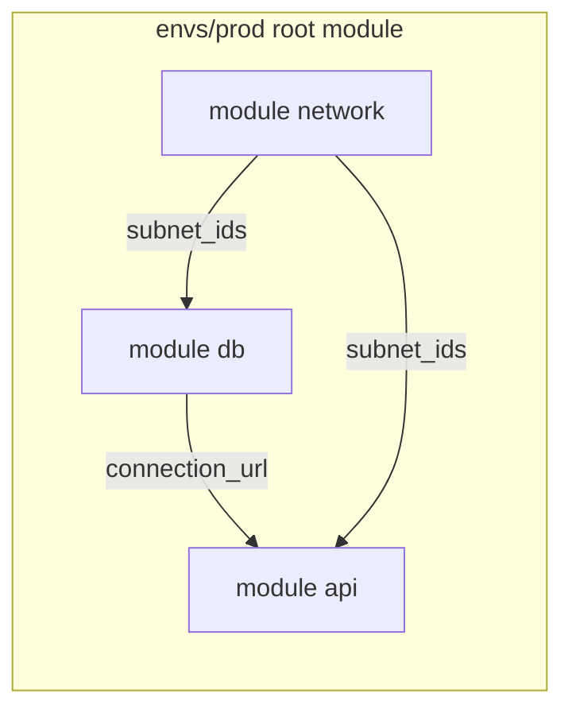
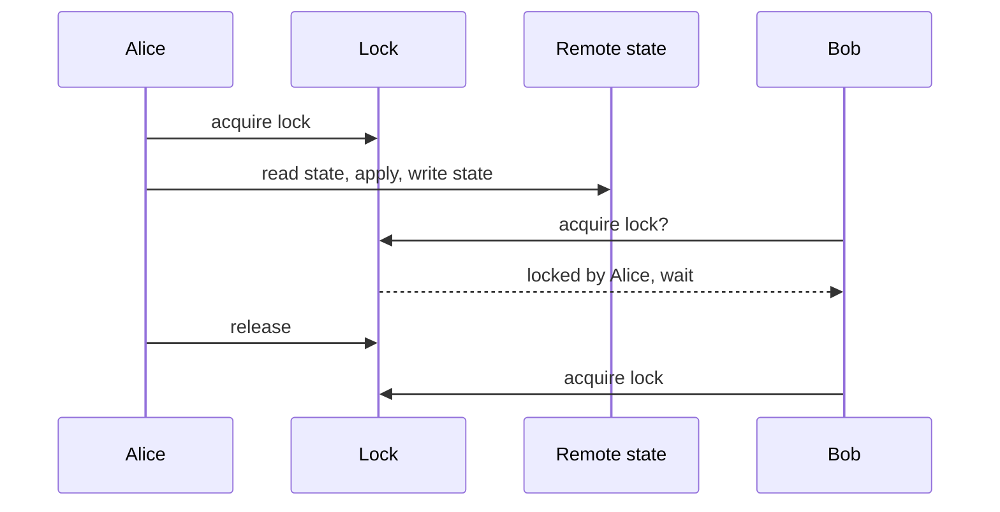
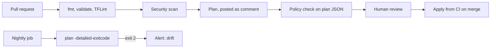

One `main.tf` with a dozen resources is pleasant. Three environments, five teams and four hundred
resources in one file is not: plans take minutes, a typo in dev can touch production, and two
people applying at once corrupt the state. This session covers the techniques teams use to keep
Terraform manageable as it grows: modules, remote state with locking, environment separation, and
guardrails against bad changes and drift. The reference is the [Terraform docs](https://developer.hashicorp.com/terraform/docs).

## Modules and composition

A **module** is a folder of `.tf` files with inputs (variables) and outputs. In fact every Terraform
folder is already a module, the **root module**. Calling another folder from it is like calling a
function: you pass arguments and get return values, without caring about the internals.

```text
infra/
  modules/
    web-service/       variables.tf, main.tf, outputs.tf
    postgres/          variables.tf, main.tf, outputs.tf
  envs/
    dev/main.tf        calls both modules with small sizes
    prod/main.tf       calls both modules with large sizes
```

```hcl
module "db" {
  source        = "../../modules/postgres"
  name          = "todo-prod"
  instance_size = "large"
  multi_az      = true
}

module "api" {
  source       = "../../modules/web-service"
  name         = "todo-api"
  image        = "ghcr.io/you/todo-api:3f9c2a1"
  replicas     = 3
  database_url = module.db.connection_url
}
```

Notice `module.db.connection_url`: one module's output feeds another's input. That is
**composition**: small modules that each do one thing, wired together in the root module, rather
than one giant module with fifty flags.



Good module habits:

- **A clear interface.** Few, well-named variables with types, descriptions and validation; outputs
  for anything a caller may need.
- **Sensible defaults** that encode your organisation's standards (encryption on, tags required).
- **Versioned sources.** Point to a Git tag or a registry version
  (`source = "git::https://github.com/org/modules.git//postgres?ref=v1.4.0"`) so a module change
  doesn't silently change every environment.
- **Don't wrap one resource in a module** just to rename it. Modules earn their keep when they bundle
  several resources that belong together.

> [!TIP]
> The public Terraform Registry has well-maintained community modules (for example for AWS VPCs).
> Reading their `variables.tf` is a good way to learn what a solid module interface looks like, even
> if you write your own.

## Remote state and locking

In 5.4.1 your state lived in a local file. In a team that breaks immediately: each person has a
different copy, and nobody knows which one is true. A **backend** stores state remotely:

```hcl
terraform {
  backend "s3" {
    bucket       = "acme-terraform-state"
    key          = "todo/prod/terraform.tfstate"
    region       = "eu-central-1"
    encrypt      = true
    use_lockfile = true
  }
}
```

A remote backend gives you:

- **One source of truth**, shared by everyone and by CI.
- **Locking**: while one `apply` runs, others wait or fail instead of writing at the same time. Think
  of the "occupied" sign on a meeting-room door. Recent Terraform versions can lock with a lock file
  in S3 itself; older setups used a DynamoDB table for this.
- **Encryption and access control**, important because state can contain secrets.
- **Versioning** (enable it on the bucket) so you can recover a previous state after a mistake.

Other backends work the same way: Azure Storage, Google Cloud Storage, HCP Terraform, or PostgreSQL.



**Splitting state.** Put everything in one state and every plan touches everything: slow, and the
blast radius of a mistake is everything. Split by environment and by lifecycle (network, data,
applications), each with its own state key. To read outputs across states, use the
`terraform_remote_state` data source or, better, look the resources up with data sources.

> [!WARNING]
> If a lock gets stuck (a crashed CI job), `terraform force-unlock <id>` releases it. Only use it
> after confirming nobody is actually applying, or you'll get the corruption the lock was protecting
> you from.

## Workspaces and environment separation

You need dev, staging and production that look alike but are isolated. Two common approaches:

**1. CLI workspaces.** One configuration, several named states:

```sh
terraform workspace new staging
terraform workspace select staging
terraform apply -var-file=staging.tfvars
```

Inside the code, `terraform.workspace` gives the current name (`"todo-${terraform.workspace}"`).
It's quick, but all environments share the same code version and backend, and it's easy to apply
in the wrong one. The Terraform docs note that workspaces alone are not a good fit when environments
need different credentials or strong isolation.

**2. Directory per environment** (the layout in the modules section). Each environment has its own
root module, backend key and variables, calling shared modules pinned to versions. You can test
module `v1.5.0` in dev while prod stays on `v1.4.0`, then promote by bumping the version in prod's
folder. More files, much clearer.

| | Workspaces | Directory per env |
| - | ---------- | ----------------- |
| Code duplication | none | small (thin root modules) |
| Different module versions per env | no | yes |
| Separate credentials and accounts | awkward | natural |
| Risk of applying to the wrong env | higher | lower |

> [!NOTE]
> Many organisations go further and use a **separate cloud account (or subscription, or project) per
> environment**. Then a mistake in dev physically cannot touch production resources.

## Policy and drift detection

At scale you want guardrails that don't depend on reviewers spotting everything.

**Static checks in CI** on every pull request:

- `terraform fmt -check` and `terraform validate`.
- Linters like **TFLint** catch provider-specific mistakes (invalid instance types).
- Security scanners like **Checkov** or **Trivy** flag public buckets, unencrypted disks, `0.0.0.0/0`
  on SSH.
- **Post the plan** as a PR comment, so reviewers review the actual diff, not just the code.

**Policy as code** evaluates the plan against rules: "no resources outside EU regions", "every
resource has an `owner` tag", "no instance larger than X without approval". Options include
HashiCorp **Sentinel** (in HCP Terraform) and **Open Policy Agent** (OPA, with tools like Conftest)
reading `terraform show -json` output. Terraform itself supports `validation` blocks on variables and
`precondition`/`postcondition` checks on resources for simpler rules.

**Drift detection** finds manual changes. Schedule a job (nightly in CI) that runs:

```sh
terraform plan -detailed-exitcode
# exit code 0 = no changes, 1 = error, 2 = changes present (drift or unapplied code)
```

When the exit code is 2, alert the team. Then decide: if the manual change was right, put it into
code; if not, apply to revert it. `terraform plan -refresh-only` shows what changed in reality
without proposing to change your resources.



## Practice: refactor your Terraform into reusable modules

Start from the Docker-provider configuration of 5.4.1.

### Step 1: Extract modules

Create `modules/postgres` (network attachment, volume, container; inputs `name`, `password`,
`network`; output `host`) and `modules/api` (image, container, port; inputs `image`, `port`,
`database_url`, `network`). Add `description` and `type` to every variable, and a `validation` that
the port is between 1024 and 65535.

### Step 2: Create two environments

Create `envs/dev` and `envs/staging`, each with a thin `main.tf` calling both modules with different
names and ports (8000 and 8001) and its own network. Run both: two isolated stacks side by side.

### Step 3: Move state without destroying anything

Your old root module's resources now have new addresses (`module.db.docker_container.db`). Add
`moved` blocks so Terraform renames them in state instead of destroying and recreating:

```hcl
moved {
  from = docker_container.db
  to   = module.db.docker_container.db
}
```

Run `plan` and confirm it says "has moved to" and shows no destroys.

### Step 4: Add guardrails

Add a CI workflow (5.2.1) that runs `terraform fmt -check`, `terraform validate` and TFLint on
pull requests. Bonus: a scheduled job running `plan -detailed-exitcode` for dev.

### Step 5: Simulate drift

Stop the dev API container by hand, run the drift check, and note the exit code. Re-apply to fix it.

```quiz
{"questions": [
  {"question": "Why use a remote backend with locking instead of a local state file in a team?", "options": ["Remote state makes applies faster", "It gives one shared source of truth and prevents two applies from writing state at the same time", "Local state cannot store outputs", "Locking encrypts the plan"], "answer": 1, "explanation": "Without a shared, locked state, team members overwrite each other's view of reality and corrupt it."},
  {"question": "You want dev to test module v1.5.0 while prod stays on v1.4.0. Which setup supports this naturally?", "options": ["CLI workspaces sharing one configuration", "One giant root module", "A directory per environment with version-pinned module sources", "Running terraform force-unlock"], "answer": 2, "explanation": "Each environment's root module pins its own module version and can be promoted independently."},
  {"question": "What does exit code 2 from terraform plan -detailed-exitcode indicate?", "options": ["The plan contains changes, for example drift", "An error occurred", "No changes", "The lock is held"], "answer": 0, "explanation": "0 means no changes, 1 an error and 2 a non-empty diff, which makes it ideal for scheduled drift checks."},
  {"question": "After moving resources into a module, plan wants to destroy and recreate them. How do you avoid that?", "options": ["Delete the state file", "Use terraform destroy first", "Rename the module", "Add moved blocks mapping old addresses to new ones"], "answer": 3, "explanation": "moved blocks tell Terraform the resource is the same object at a new address."},
  {"question": "What is policy as code good for in a Terraform pipeline?", "options": ["Formatting HCL files", "Automatically rejecting plans that break rules, such as missing tags or forbidden regions", "Replacing state locking", "Downloading providers"], "answer": 1, "explanation": "Policies evaluate the planned changes against organisational rules before anything is applied."}
]}
```
