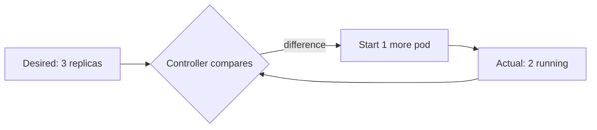
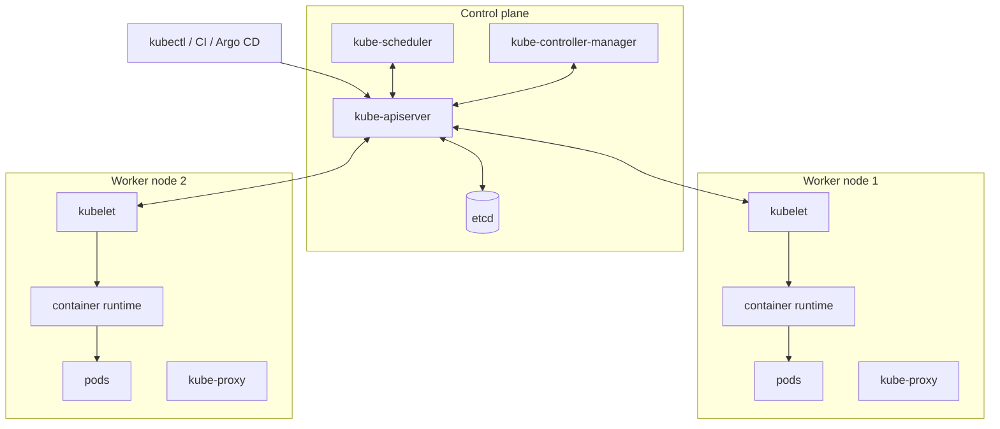
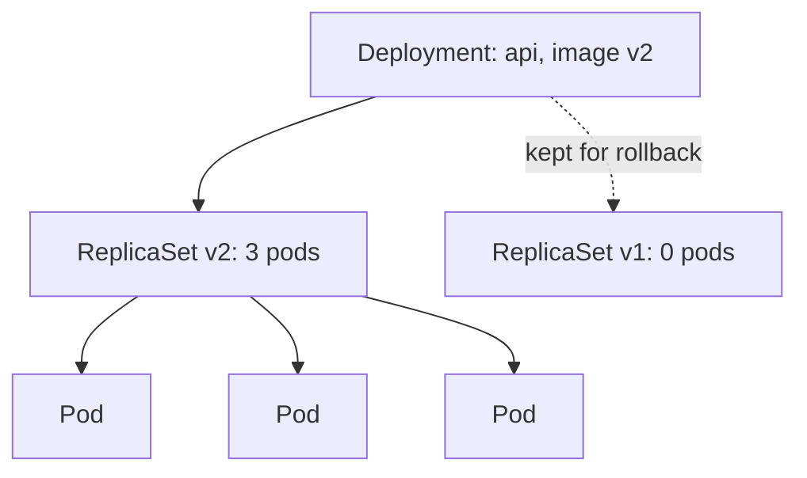

Docker Compose runs a handful of containers on one machine. What happens when you need hundreds of
containers across dozens of machines, restarted automatically when they crash, moved when a machine
dies, and updated without downtime? That's the job of a **container orchestrator**, and Kubernetes
(often written **K8s**) is the industry standard. This session builds the mental model: why
orchestration exists, how a cluster is organised, and the first objects you'll use, following the
[Kubernetes Basics tutorial](https://kubernetes.io/docs/tutorials/kubernetes-basics/) and the
[Kubernetes docs](https://kubernetes.io/docs/home/).

## Why orchestration

Think of an orchestra. Each musician (container) knows their part, but someone has to decide who
plays where, bring in a substitute when a violinist falls ill, and make sure the whole thing sounds
right. With five musicians you can coordinate by eye; with five hundred you need a conductor.

On one server, `docker run --restart always` and Compose cover a lot. At larger scale you need
answers to questions they don't handle:

- **Scheduling**: which machine has enough CPU and memory for this container?
- **Self-healing**: a container crashes or a machine dies; who starts replacements, where?
- **Scaling**: traffic doubles; who adds copies and spreads load across them?
- **Service discovery and load balancing**: copies come and go with changing IPs; how do clients find
  them?
- **Rolling updates and rollbacks**: how do you replace version 1 with version 2 without downtime?
- **Configuration and secrets**: how do you give the same image different settings per environment?

Kubernetes answers all of these with one idea: the **declarative desired state** you met in GitOps
and Terraform. You tell the cluster "I want 3 copies of `api:v2`", and **controllers** continuously
compare that with reality and fix any difference. If a copy dies, the controller notices there are 2
and starts a third. No human in the loop.



> [!WARNING]
> Kubernetes is powerful and complex. For a small app, a PaaS (5.3.5) or a single VM with Compose is
> often the better choice. Learn Kubernetes because many companies run it and its ideas are
> everywhere, but don't adopt it for a side project just because big companies do.

## Control plane and nodes

A Kubernetes **cluster** has two kinds of parts: the **control plane** (the brain) and **worker
nodes** (the muscle).



Control plane components:

- **kube-apiserver**: the front door. Every action, from `kubectl` or from internal components, is a
  call to this REST API. It validates requests and stores the results.
- **etcd**: a consistent, distributed key-value store holding all cluster state. If the API server is
  the front desk, etcd is the ledger. Back it up.
- **kube-scheduler**: watches for new pods with no node assigned and picks a node, based on the
  resources requested, constraints and spreading.
- **kube-controller-manager**: runs the controllers, the reconciliation loops (Deployment controller,
  ReplicaSet controller, Node controller...).

Each worker node runs:

- **kubelet**: the node agent. It receives pod assignments from the API server, asks the container
  runtime to start the containers, and reports status back.
- **Container runtime**: actually runs containers (containerd or CRI-O, using the same images you
  build with Docker).
- **kube-proxy**: programs networking rules so Services (5.5.2) route traffic to the right pods.

> [!NOTE]
> Components never talk to each other directly; everything goes through the API server, and
> controllers _watch_ for changes. This loose coupling is why Kubernetes is so extensible: tools like
> Argo CD simply add their own controllers.

On managed services (EKS, AKS, GKE) the provider runs the control plane for you; you manage nodes, or
not even those in modes like GKE Autopilot.

## Pods, ReplicaSets and Deployments

Three nested objects run your application.

A **Pod** is the smallest deployable unit: one or more containers that share a network namespace
(same IP, they reach each other on `localhost`) and can share volumes. Most pods have one main
container. Pods are **ephemeral**: they get a new IP when recreated, and are never "repaired", only
replaced.

A **ReplicaSet** keeps a specified number of identical pods running. Delete one and it creates a
replacement.

A **Deployment** manages ReplicaSets to give you declarative updates: change the image and it creates
a new ReplicaSet, scaling it up while scaling the old one down (a rolling update), and it keeps old
ReplicaSets for rollback. **You create Deployments**; you almost never create pods or ReplicaSets
directly.



Objects are described in YAML manifests with the same four top-level fields:

```yaml
apiVersion: apps/v1
kind: Deployment
metadata:
  name: todo-api
  labels: { app: todo-api }
spec:
  replicas: 3
  selector:
    matchLabels: { app: todo-api }
  template:                       # the pod template
    metadata:
      labels: { app: todo-api }
    spec:
      containers:
        - name: api
          image: todo:slim
          ports:
            - containerPort: 8000
```

**Labels** are key-value tags; **selectors** find objects by label. The Deployment finds its pods via
`selector.matchLabels`, which must match the pod template's labels. This label-based wiring is
everywhere in Kubernetes.

Useful commands:

```sh
kubectl apply -f deployment.yaml          # create or update from a file
kubectl get deployments,rs,pods           # list
kubectl describe pod <name>               # details and recent events (debugging!)
kubectl logs <pod> [-f]                   # container logs
kubectl rollout status deployment/todo-api
kubectl rollout undo deployment/todo-api  # back to the previous ReplicaSet
```

> [!TIP]
> When something doesn't start, `kubectl describe pod` and its **Events** section at the bottom
> answer most questions: `ImagePullBackOff` (wrong image name or no access), `CrashLoopBackOff` (the
> app keeps exiting: read `kubectl logs --previous`), `Pending` (no node has enough resources).

## Running a local cluster with kind or minikube

You don't need a cloud account to learn Kubernetes:

- **kind** (Kubernetes IN Docker) runs each cluster node as a Docker container. Fast to create and
  destroy, great for CI and experiments.
- **minikube** runs a single-node cluster in a VM or container, with handy add-ons (dashboard,
  ingress) enabled by a command.
- Docker Desktop and Rancher Desktop also include a one-click Kubernetes.

All of them give you a real API server; `kubectl` works the same as against a production cluster.
`kubectl config get-contexts` lists the clusters you can talk to, and `kubectl config use-context`
switches between them.

> [!WARNING]
> Always check which context is active before running destructive commands. More than one engineer
> has deleted something in production thinking they were pointing at their local cluster. Showing the
> current context in your shell prompt helps.

## Practice: deploy your API to kind

Install `kubectl` and `kind`, and have Docker running.

### Step 1: Create the cluster

```sh
kind create cluster --name dev
kubectl cluster-info
kubectl get nodes
```

### Step 2: Load your image

kind nodes can't see your local Docker images, so load the image from 5.1.2 into the cluster:

```sh
kind load docker-image todo:slim --name dev
```

### Step 3: Deploy

Save the Deployment manifest above as `deployment.yaml`, add `imagePullPolicy: IfNotPresent` to the
container (so Kubernetes uses the loaded image), and apply it. For now, run the API with a SQLite or
in-memory setting, or set `DATABASE_URL` via `env:` to a database you'll add in 5.5.2.

```sh
kubectl apply -f deployment.yaml
kubectl get pods -w
```

### Step 4: Reach it

```sh
kubectl port-forward deployment/todo-api 8000:8000
curl localhost:8000/docs
```

### Step 5: Watch self-healing, scaling and rollback

1. Delete a pod (`kubectl delete pod <name>`) and watch a replacement appear.
2. `kubectl scale deployment/todo-api --replicas=5`, then edit the YAML back to 3 and re-apply.
3. Set the image to a tag that doesn't exist, apply, watch `ImagePullBackOff` in
   `kubectl describe pod`, then `kubectl rollout undo deployment/todo-api`.
4. Explain each event in your notes in terms of controllers and desired state.

Keep the cluster for 5.5.2, or delete it with `kind delete cluster --name dev`.

```quiz
{"questions": [
  {"question": "A node running two of your pods dies. What brings the replica count back to the desired number?", "options": ["The kubelet on the dead node", "A controller notices fewer pods than desired and the scheduler places replacements on healthy nodes", "etcd restarts the containers", "Nothing, you must recreate them manually"], "answer": 1, "explanation": "Reconciliation loops compare desired and actual state; the scheduler assigns the new pods to nodes."},
  {"question": "Which component stores the entire cluster state?", "options": ["kube-proxy", "kubelet", "etcd", "The container runtime"], "answer": 2, "explanation": "etcd is the cluster's key-value store; the API server is the only component that talks to it."},
  {"question": "Why do you normally create a Deployment rather than Pods directly?", "options": ["A Deployment manages ReplicaSets that keep pods running and enables rolling updates and rollbacks", "Pods cannot run containers", "Deployments are faster to start", "Pods require a cloud provider"], "answer": 0, "explanation": "Bare pods aren't replaced if they die and have no update strategy."},
  {"question": "A pod shows CrashLoopBackOff. What is the best first debugging step?", "options": ["Delete the cluster", "Increase replicas", "Change the image registry", "Read the logs of the previous container run with kubectl logs --previous"], "answer": 3, "explanation": "CrashLoopBackOff means the container keeps exiting; its logs usually say why."},
  {"question": "How does a Deployment know which pods belong to it?", "options": ["By pod name prefix", "Through a label selector matching the pod template's labels", "By node", "By image name"], "answer": 1, "explanation": "Labels and selectors are the general wiring mechanism in Kubernetes."}
]}
```
