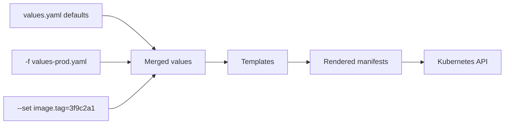
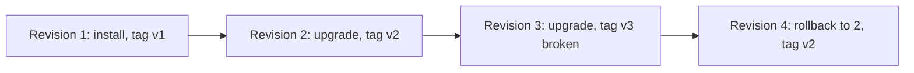

By the end of 5.5.2 your API needed a Deployment, a Service, a ConfigMap, a Secret, maybe an
Ingress: five YAML files, with the image tag, the app name and the port repeated in several of them.
Now make a staging and a production copy with different replica counts and hostnames, and you're
copy-pasting YAML and hoping you changed every occurrence. **Helm** is the package manager for
Kubernetes: it turns those files into a parameterised, versioned **chart** you install with one
command. This session follows the [Helm docs](https://helm.sh/docs/).

## Charts, values and templates

Think of a chart like a form letter. The letter's text is fixed ("Dear {{ name }}, your order of
{{ quantity }} items..."), and for each recipient you supply a small set of values. Helm renders the
letter (Kubernetes manifests) from a template plus values, then sends it to the cluster.

A **chart** is a folder with a fixed structure:

```text
todo-api/
  Chart.yaml          # name, chart version, app version, dependencies
  values.yaml         # default configuration values
  templates/          # manifest templates
    deployment.yaml
    service.yaml
    ingress.yaml
    _helpers.tpl      # reusable template snippets
    NOTES.txt         # message printed after install
  charts/             # dependency charts (e.g. a database)
```

`Chart.yaml` has two versions that mean different things:

```yaml
apiVersion: v2
name: todo-api
version: 0.3.0        # the chart's own version (packaging changes)
appVersion: "1.4.2"   # the version of the app it deploys
```

**Values** are the knobs. `values.yaml` holds defaults:

```yaml
replicaCount: 2
image:
  repository: ghcr.io/you/todo-api
  tag: ""             # empty: fall back to appVersion
service:
  port: 80
ingress:
  enabled: false
  host: todo.example.com
```

**Templates** are manifests with Go template expressions:

```yaml
apiVersion: apps/v1
kind: Deployment
metadata:
  name: {{ .Release.Name }}-api
  labels:
    app: {{ .Release.Name }}-api
spec:
  replicas: {{ .Values.replicaCount }}
  selector:
    matchLabels:
      app: {{ .Release.Name }}-api
  template:
    metadata:
      labels:
        app: {{ .Release.Name }}-api
    spec:
      containers:
        - name: api
          image: "{{ .Values.image.repository }}:{{ .Values.image.tag | default .Chart.AppVersion }}"
          ports:
            - containerPort: 8000
```

Built-in objects you'll use most: `.Values` (merged values), `.Release.Name` and
`.Release.Namespace`, `.Chart.Version` and `.Chart.AppVersion`. Control structures like
`{{- if .Values.ingress.enabled }} ... {{- end }}` include whole resources conditionally, and
`{{ include "todo-api.labels" . | nindent 4 }}` reuses snippets from `_helpers.tpl`.

Values are layered, last one wins:



So one chart serves every environment: `values-staging.yaml` and `values-prod.yaml` hold only what
differs.

> [!TIP]
> `helm template ./todo-api -f values-prod.yaml` renders the manifests locally without touching a
> cluster, and `helm lint` catches structural mistakes. Read the rendered output whenever a template
> misbehaves; YAML indentation inside templates is the classic bug, which is what `nindent` is for.

> [!NOTE]
> Charts are shared through repositories and, increasingly, OCI registries (the same registries that
> store images): `helm install db oci://registry-1.docker.io/bitnamicharts/postgresql`. Well-known
> software (PostgreSQL, Redis, Prometheus, Argo CD) is usually installed from a community chart
> rather than hand-written YAML.

## Releases, upgrades and rollbacks

Installing a chart creates a **release**: a named instance of that chart in a namespace. The same
chart can be installed several times under different release names (`todo-staging`, `todo-prod`).

```sh
helm install todo ./todo-api -n todo --create-namespace -f values-dev.yaml
helm list -n todo                       # releases in the namespace
helm status todo -n todo
helm upgrade todo ./todo-api -n todo --set image.tag=3f9c2a1
helm history todo -n todo               # numbered revisions
helm rollback todo 1 -n todo            # back to revision 1
helm uninstall todo -n todo
```

Every install, upgrade or rollback creates a new numbered **revision**. Helm stores each revision's
rendered manifests and values in the cluster (as Secrets in the release's namespace), which is what
makes `helm rollback` possible: it re-applies an earlier revision's manifests as a new revision.



Useful flags for safer upgrades:

- `helm upgrade --install` installs if missing, upgrades otherwise: ideal for CI, which doesn't need
  to know whether it's the first deploy.
- `--atomic` (renamed `--rollback-on-failure` in Helm 4) waits for resources to become ready and
  rolls back automatically if they don't.
- `--wait` and `--timeout 5m` wait for readiness before reporting success.
- `helm diff upgrade` (a popular plugin) shows what an upgrade would change, like `terraform plan`.

> [!WARNING]
> `helm rollback` restores Kubernetes manifests, not your data. If version 3 ran a destructive
> database migration, rolling back the chart doesn't undo it. The expand-and-contract discipline
> from 5.2.2 still applies.

> [!NOTE]
> Helm and GitOps combine naturally: Argo CD (5.2.3) can render a chart from Git with a values file
> per environment. Then Argo CD, not `helm upgrade`, applies the result, and Git history replaces
> `helm history` as the record of changes.

## Practice: write a Helm chart for your API

Turn your manifests from 5.5.2 into a chart.

### Step 1: Scaffold

```sh
helm create todo-api
```

This generates a working example chart. Read every file, then delete what you don't need (for
example `hpa.yaml` for now, `serviceaccount.yaml` if unused).

### Step 2: Template your manifests

Replace the generated Deployment and Service with your own, parameterising at least: image
repository and tag, replica count, service port, resources, an `env` map, and the names of the
ConfigMap and Secret. Add an `ingress.enabled` toggle around the Ingress template.

### Step 3: Render and lint

```sh
helm lint ./todo-api
helm template todo ./todo-api | less
helm template todo ./todo-api --set ingress.enabled=true | grep -A5 "kind: Ingress"
```

### Step 4: Install, upgrade, break, roll back

```sh
helm upgrade --install todo ./todo-api -n todo --create-namespace
helm upgrade todo ./todo-api -n todo --set replicaCount=3
helm upgrade todo ./todo-api -n todo --set image.tag=does-not-exist
helm history todo -n todo
helm rollback todo 2 -n todo
```

Watch the pods at each step (`kubectl get pods -n todo -w`).

### Step 5: Environments

Create `values-staging.yaml` and `values-prod.yaml` that differ only in replicas, resources and
ingress host. Install both as separate releases in separate namespaces. Bump `version` in
`Chart.yaml` and add a short `README.md` documenting every value.

```quiz
{"questions": [
  {"question": "What problem does Helm mainly solve compared to raw YAML manifests?", "options": ["It replaces the Kubernetes API", "It parameterises and versions sets of manifests so one chart can be installed for many environments", "It builds Docker images", "It encrypts Secrets"], "answer": 1, "explanation": "Templates plus values remove copy-paste and give you releases with history."},
  {"question": "values.yaml sets replicaCount: 2, values-prod.yaml sets 4, and you pass --set replicaCount=6. What is used?", "options": ["2", "4", "6", "Helm errors on conflicts"], "answer": 2, "explanation": "Later sources override earlier ones: defaults, then -f files in order, then --set."},
  {"question": "What is the difference between version and appVersion in Chart.yaml?", "options": ["version is the chart package's version; appVersion is the version of the application it deploys", "They must always be equal", "appVersion is the Kubernetes version", "version is the Helm CLI version"], "answer": 0, "explanation": "You can change the chart (new template) without changing the app, and vice versa."},
  {"question": "Revision 3 of a release broke the app. What does helm rollback todo 2 do?", "options": ["Deletes revisions 2 and 3", "Restores the database to revision 2", "Reverts the Git repository", "Applies revision 2's manifests again, recorded as a new revision 4"], "answer": 3, "explanation": "Rollback re-applies stored manifests as a new revision. It doesn't touch data."},
  {"question": "Why is helm upgrade --install useful in CI pipelines?", "options": ["It skips templates", "It installs the release if it doesn't exist and upgrades it otherwise", "It always deletes the release first", "It disables rollbacks"], "answer": 1, "explanation": "The same command works for the first and every later deploy."}
]}
```
