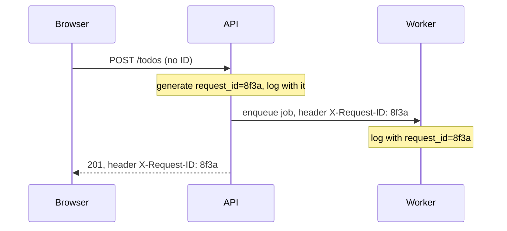
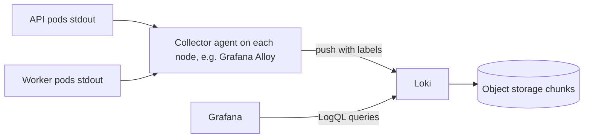

It's 2 a.m., users report errors, and you open the logs. You find ten thousand lines of
`Processing request...` and `Done`, with no user ID, no request ID and no way to tell which lines
belong together. Good logs turn that into a two-minute search. This module is about
**observability**, being able to understand what your system is doing from the outside, and logs
are its oldest pillar (metrics and traces follow in 5.6.2 and 5.6.3). This session follows the
[Python logging HOWTO](https://docs.python.org/3/howto/logging.html) and the
[Grafana Loki docs](https://grafana.com/docs/loki/latest/).

## Log levels and what to log

A log is a ship's logbook: a timestamped record of what happened, written for someone who wasn't
there. Like a logbook, its value depends on writing the right things at the right level of detail.

Python's standard levels, from least to most severe, with the HOWTO's guidance on when to use them:

| Level | Use for | Example |
| ----- | ------- | ------- |
| `DEBUG` | detailed information for diagnosing problems | "cache miss for key todos:42" |
| `INFO` | confirmation that things work as expected | "user 42 created todo 981" |
| `WARNING` | something unexpected, or a problem soon; the app still works | "retrying payment API, attempt 2" |
| `ERROR` | a function failed to do its job | "failed to send email to user 42" |
| `CRITICAL` | the program itself may be unable to continue | "cannot connect to database at startup" |

Production usually runs at `INFO`; you switch a service to `DEBUG` briefly while investigating.

**What to log:**

- Significant business events (created, paid, deleted), with IDs.
- Calls to external systems that fail or are slow, with duration and outcome.
- Errors, with the exception and stack trace (`logger.exception(...)` inside `except`).
- Start-up configuration (minus secrets) and shutdown.
- Security-relevant events: logins, permission denials, admin actions.

**What not to log:**

- Secrets and credentials: passwords, tokens, API keys, full card numbers.
- Personal data you don't need (GDPR applies to logs too).
- Every successful step of every request: noise drowns signal and costs money to store.

> [!WARNING]
> Logging a whole request body or settings object "for debugging" is how passwords and tokens end up
> in log storage that dozens of people can search. Log IDs and specific fields, not whole objects.

The HOWTO's core pattern is one logger per module, named after it, and configuration only at the
application's entry point:

```python
import logging

logger = logging.getLogger(__name__)   # e.g. "app.routes.todos"


def create_todo(user_id: int, title: str) -> None:
    logger.info("todo created", extra={"user_id": user_id})
```

Libraries create loggers but never configure handlers; the application decides where logs go and
in what format.

> [!TIP]
> Pass values as arguments, not pre-formatted strings: `logger.debug("loaded %s rows", n)`. The
> string is only built if the level is enabled. With structured logging (next section) prefer
> `extra=` fields over interpolating values into the message.

## Structured JSON logs

Compare two log lines about the same event:

```text
2026-10-19 14:03:22 INFO User 42 created todo 981 in 35ms
```

```json
{"ts": "2026-10-19T14:03:22Z", "level": "INFO", "logger": "app.todos", "msg": "todo created", "user_id": 42, "todo_id": 981, "duration_ms": 35, "request_id": "8f3a..."}
```

The first is pleasant to read and painful to query: to find slow requests you'd need a regex for
every message format. The second is **structured**: every field has a name, so a log system can
filter `duration_ms > 500` or count errors by `user_id` directly. Machines read logs far more often
than people do.

The standard library can emit JSON with a small formatter:

```python
import json
import logging


class JsonFormatter(logging.Formatter):
    STANDARD = set(vars(logging.makeLogRecord({})))  # attributes every record has

    def format(self, record: logging.LogRecord) -> str:
        data = {
            "ts": self.formatTime(record, "%Y-%m-%dT%H:%M:%S%z"),
            "level": record.levelname,
            "logger": record.name,
            "msg": record.getMessage(),
        }
        data |= {k: v for k, v in vars(record).items() if k not in self.STANDARD}  # extra= fields
        if record.exc_info:
            data["exc"] = self.formatException(record.exc_info)
        return json.dumps(data, default=str)
```

Libraries like `structlog` or `python-json-logger` do the same with more features. Whatever you
use, keep field names consistent across services (`request_id`, not `requestId` in one and `rid` in
another) so you can search everything at once.

> [!NOTE]
> In containers, write logs to **stdout**, one event per line, and let the platform collect them
> (the twelve-factor "logs as event streams" idea). Don't manage log files and rotation inside the
> container.

## Correlation and request IDs

One user click can produce twenty log lines across the API, a worker and a payment service. A
**request ID** (or correlation ID) is a unique identifier attached to every log line produced while
handling that request, like a parcel tracking number stamped on every scan.



The recipe:

1. At the edge (middleware), read an incoming `X-Request-ID` header or generate a UUID.
2. Store it in a **context variable** (`contextvars`), which is safe with async code: each request
   sees its own value.
3. Add it to every log record with a `logging.Filter`.
4. Pass it on in headers to downstream services and job payloads, and return it in the response so
   users and support can quote it.

```python
import contextvars
import logging
import uuid

request_id = contextvars.ContextVar("request_id", default="-")


class RequestIdFilter(logging.Filter):
    def filter(self, record: logging.LogRecord) -> bool:
        record.request_id = request_id.get()
        return True


@app.middleware("http")
async def add_request_id(request, call_next):
    rid = request.headers.get("x-request-id") or uuid.uuid4().hex
    token = request_id.set(rid)
    try:
        response = await call_next(request)
    finally:
        request_id.reset(token)
    response.headers["x-request-id"] = rid
    return response
```

> [!TIP]
> Once you adopt OpenTelemetry (5.6.3), the **trace ID** plays this role across services, and log
> records can include it automatically, letting you jump from a log line to the full trace.

## Log aggregation (Loki)

With many pods on many nodes, `kubectl logs` one pod at a time doesn't scale, and logs vanish when
pods are replaced. **Log aggregation** ships all logs to one place where you can search them.

Popular options include the Elastic stack, cloud services (CloudWatch Logs, Azure Monitor, Cloud
Logging) and **Grafana Loki**. Loki's design choice: it **indexes only labels** (a small set like
`app`, `namespace`, `level`), not the full text. Log content is compressed and stored in chunks,
often in object storage. That makes it cheaper to run than full-text indexing, at the cost of
scanning content at query time.



Queries use **LogQL**: a label selector, then filters and parsers.

```text
{app="todo-api"} |= "timeout"
{app="todo-api"} | json | level="ERROR" | duration_ms > 500
sum by (level) (count_over_time({app="todo-api"} | json [5m]))
```

The last one turns logs into a metric (errors per level over 5 minutes), which you can graph and
alert on.

> [!WARNING]
> Don't turn high-cardinality values (user IDs, request IDs) into Loki **labels**: every unique label
> combination creates a new stream and performance collapses. Keep them as fields inside the JSON
> line and filter with `| json`.

## Practice: structured logging in the FastAPI app

Goal: your to-do API logs one JSON line per event to stdout, with a request ID on every line, and
you can search them in Loki.

### Step 1: Configure logging at startup

In your app's entry point, configure the root logger once: a `StreamHandler` to stdout with the
`JsonFormatter` and the `RequestIdFilter`, level from an environment variable (`LOG_LEVEL`, default
`INFO`). Make uvicorn's loggers use the same handler, or disable its access log and write your own.

### Step 2: Add the middleware

Add the request-ID middleware from this lesson, plus one access-log line per request with method,
path, status code and `duration_ms`.

### Step 3: Log the right things

Add `INFO` logs for create/delete with IDs, a `WARNING` for validation failures, and
`logger.exception` in an error handler. Grep your code for anything that might log a password or
token.

### Step 4: Ship to Loki

Add Loki and Grafana to your Compose stack (5.1.3) using the images and example configuration from
the Loki docs' getting-started guide, with Grafana Alloy (or the Docker Loki logging driver) to ship
container logs. In Grafana, add Loki as a data source.

### Step 5: Investigate

Generate traffic including some errors, then answer with LogQL: which requests took over 200 ms?
How many errors in the last 15 minutes? Pick one `request_id` and show every line for it.

```quiz
{"questions": [
  {"question": "Your payment provider call failed but a retry succeeded. Which level fits best?", "options": ["DEBUG", "WARNING", "CRITICAL", "No log at all"], "answer": 1, "explanation": "Something unexpected happened but the app still did its job: that's a warning."},
  {"question": "What is the main advantage of structured JSON logs over free-text lines?", "options": ["They are shorter", "They are more readable for humans", "Every value is a named field, so log systems can filter and aggregate without regexes", "They are encrypted"], "answer": 2, "explanation": "Structure makes logs queryable data rather than text to parse."},
  {"question": "Why store the request ID in a contextvars.ContextVar rather than a global variable in an async app?", "options": ["Each concurrent request sees its own value, while a global would be overwritten by other requests", "ContextVars are faster", "Globals can't hold strings", "Loki requires it"], "answer": 0, "explanation": "Async servers interleave many requests on one thread; context variables keep values per task."},
  {"question": "Why should a user ID not be a Loki label?", "options": ["Labels can't contain numbers", "Loki would reject the log line", "User IDs are secret", "High-cardinality labels create a huge number of streams and degrade performance"], "answer": 3, "explanation": "Keep labels low-cardinality and filter on high-cardinality fields inside the log line."},
  {"question": "Which of these should never be logged?", "options": ["The ID of the todo that was deleted", "The user's session token", "The duration of a slow database query", "The HTTP status code"], "answer": 1, "explanation": "Credentials in logs are a security incident waiting to happen; log identifiers, not secrets."}
]}
```
