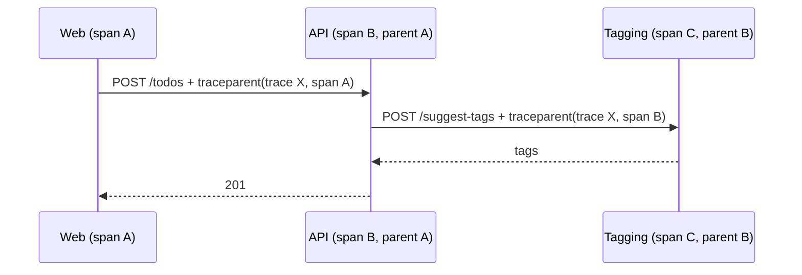
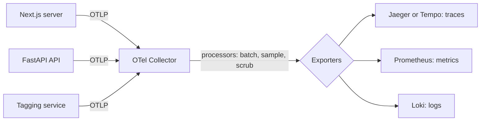

A user says "saving a to-do sometimes takes four seconds". Your metrics confirm p99 latency is bad;
your logs show the request came in and eventually finished. But where did the four seconds go? The
frontend server, the API, a slow SQL query, a call to an external service? In a system of several
services, **distributed tracing** answers that question by recording the whole journey of one
request as a timeline. This session covers the concepts and the vendor-neutral standard for
collecting them, using the [OpenTelemetry docs](https://opentelemetry.io/docs/) and the
[OpenTelemetry Python](https://opentelemetry.io/docs/languages/python/) guide.

## Traces, spans and context propagation

Think of a parcel delivery. The tracking page shows every leg: picked up, sorting centre, truck,
local depot, delivered, each with a start and end time. A **trace** is that tracking page for one
request; each leg is a **span**.

- A **span** is one timed operation: an incoming HTTP request, a database query, a call to another
  service. It has a name, start and end times, a status (ok or error), **attributes** (key-value
  details like `http.route` or `db.statement`) and optional **events** (timestamped notes, such as an
  exception).
- A **trace** is a tree of spans sharing one **trace ID**. Each span has its own span ID and the ID
  of its **parent**.

Visualised as a waterfall, the slow part jumps out:

```mermaid
gantt
  title Trace 4bf9... POST /todos (total 4.1 s)
  dateFormat x
  axisFormat %L ms
  section web
  Next.js server action      :0, 4100
  section api
  POST /todos                :50, 4050
  auth check                 :60, 90
  INSERT todos (Postgres)    :100, 130
  call tagging service       :140, 4000
  section tagging
  POST /suggest-tags         :160, 3980
```

In this trace, the database is fast and the tagging service is the problem. No amount of log
reading would have made that so obvious.

**Context propagation** is what links spans across services. When the API calls another service, it
adds the trace ID and its own span ID to the outgoing request headers. The standard format is the
W3C Trace Context `traceparent` header:

```text
traceparent: 00-4bf92f3577b34da6a3ce929d0e0e4736-00f067aa0ba902b7-01
```

The four dash-separated parts are the version (`00`), the trace ID, the parent span ID and flags
(`01` means sampled).

The receiving service reads the header and creates its spans as children in the same trace. If any
hop drops the header (a hand-rolled HTTP client, a message queue without propagation), the trace
breaks into disconnected pieces.



> [!NOTE]
> Tracing every request can be expensive at high volume, so systems usually **sample**: for example
> keep 10% of traces, decided at the start so all spans of a kept trace are recorded together. More
> advanced tail-based sampling decides after the trace finishes, keeping all errors and slow traces.

## OpenTelemetry SDK and auto-instrumentation

**OpenTelemetry** (OTel) is a CNCF project that standardises how applications produce telemetry:
traces, metrics and logs. It provides APIs and SDKs for many languages, a wire protocol (**OTLP**),
and the Collector. The point is to be **vendor-neutral**: instrument once, then send the data to
Jaeger, Grafana Tempo, Datadog, Honeycomb or a cloud provider, and switch without changing code.

There are two ways to instrument:

**Auto-instrumentation (zero-code)** uses instrumentation libraries that patch popular frameworks
and clients (FastAPI, Flask, requests, httpx, SQLAlchemy, psycopg, Redis...) so you get spans
without touching your code. In Python:

```sh
pip install opentelemetry-distro opentelemetry-exporter-otlp
opentelemetry-bootstrap -a install     # installs instrumentations for libraries it finds
export OTEL_SERVICE_NAME=todo-api
export OTEL_EXPORTER_OTLP_ENDPOINT=http://localhost:4317
opentelemetry-instrument uvicorn app.main:app --host 0.0.0.0
```

**Manual instrumentation** adds spans and attributes for your own business logic, where
auto-instrumentation can't see:

```python
from opentelemetry import trace

tracer = trace.get_tracer(__name__)


def suggest_tags(title: str) -> list[str]:
    with tracer.start_as_current_span("suggest_tags") as span:
        span.set_attribute("todo.title_length", len(title))
        tags = call_tagging_service(title)
        span.set_attribute("todo.tag_count", len(tags))
        return tags
```

Spans started inside another span automatically become its children, thanks to the same context
variables you used for request IDs in 5.6.1.

> [!TIP]
> Start with auto-instrumentation everywhere: it gives you HTTP and database spans for free. Add
> manual spans only around the parts you actually need to understand, with attributes that would
> help you debug (IDs, sizes, cache hit or miss), never secrets or personal data.

**Resource attributes** describe who produced the telemetry: `service.name`, `service.version`,
`deployment.environment`. Set `service.name` at minimum, or every service shows up as
"unknown_service".

> [!EXAMPLE]
> Linking logs to traces: with the OTel logging instrumentation enabled, Python log records get
> `otelTraceID` and `otelSpanID` attributes. Include them in your JSON logs (5.6.1) and Grafana can
> jump from a log line straight to its trace.

## Collectors and backends (Jaeger, Tempo)

Applications could send telemetry straight to a backend, but production setups usually put an
**OpenTelemetry Collector** in between. The Collector is a standalone process with a pipeline of:

- **Receivers**: accept data (OTLP over gRPC on port 4317 or HTTP on 4318, plus other formats).
- **Processors**: batch, sample, filter, add or remove attributes (for example drop
  sensitive fields).
- **Exporters**: send data to one or more backends.



Benefits: apps only know one endpoint, you can change backends by editing Collector config, and
retries, batching and sampling move out of your app.

**Backends** store and display traces:

- **Jaeger**: an open-source tracing platform (CNCF) with a UI to search traces and view
  waterfalls. Its all-in-one image accepts OTLP directly, perfect for local development.
- **Grafana Tempo**: a trace store designed for cheap object storage, queried from Grafana. It sits
  naturally next to Prometheus and Loki, so metrics, logs and traces share one UI.
- Commercial services (Honeycomb, Datadog, cloud providers' tracing) accept OTLP too.

## Practice: trace a request from frontend to database

Goal: one trace showing a request from your Next.js frontend through the FastAPI API to PostgreSQL.

### Step 1: Run Jaeger

Add to your Compose stack:

```yaml
  jaeger:
    image: jaegertracing/all-in-one:latest
    ports: ["16686:16686"]      # UI
    environment:
      COLLECTOR_OTLP_ENABLED: "true"
```

### Step 2: Instrument the API

Install the OTel distro and run `opentelemetry-bootstrap -a install` in your image build. Change the
API command to `opentelemetry-instrument uvicorn ...` and set `OTEL_SERVICE_NAME=todo-api`,
`OTEL_EXPORTER_OTLP_ENDPOINT=http://jaeger:4317` and `OTEL_TRACES_EXPORTER=otlp`. Make a few
requests and find them in the Jaeger UI at `http://localhost:16686`: you should see the HTTP span
with SQL child spans.

### Step 3: Instrument the frontend server

Next.js supports OpenTelemetry through an `instrumentation.ts` file at the project root (check the
OpenTelemetry guide in your Next.js version's docs). With the `@vercel/otel` package:

```ts
import { registerOTel } from "@vercel/otel";

export function register() {
  registerOTel({ serviceName: "todo-web" });
}
```

Point it at the same endpoint (`OTEL_EXPORTER_OTLP_ENDPOINT`). Server-side `fetch` calls to the API
now carry `traceparent`.

### Step 4: Find the end-to-end trace

Load a page that fetches to-dos. In Jaeger, search for service `todo-web` and open the trace. You
should see web, then API, then database spans in one waterfall. If the API spans appear as a separate
trace, propagation is broken: check that the call goes through an instrumented client.

### Step 5: Add a slow span and find it

Add a manual span around a deliberately slow function (`time.sleep(0.5)` behind a query parameter)
with an attribute explaining why. Find it in the waterfall, then write down how you'd have found the
same problem with only logs and metrics.

```quiz
{"questions": [
  {"question": "What links spans produced by two different services into the same trace?", "options": ["They run on the same host", "The calling service propagates the trace ID and its span ID in request headers such as traceparent", "They share a database", "The backend guesses by timestamp"], "answer": 1, "explanation": "Context propagation passes the trace context with each call so the receiver's spans become children."},
  {"question": "A trace waterfall shows the API span takes 4 s, the SQL span 30 ms, and a call to another service 3.8 s. Where should you look first?", "options": ["The database indexes", "The API's CPU", "The other service being called", "The browser"], "answer": 2, "explanation": "The waterfall shows where time goes; here nearly all of it is in the downstream call."},
  {"question": "What is the main benefit of OpenTelemetry being vendor-neutral?", "options": ["You instrument once and can send data to different backends without changing application code", "It is faster than any vendor SDK", "It stores traces itself", "It only works with Jaeger"], "answer": 0, "explanation": "OTel standardises the APIs and the OTLP protocol, decoupling instrumentation from storage."},
  {"question": "Why put an OpenTelemetry Collector between apps and the backend?", "options": ["Apps can't export directly", "It replaces the need for spans", "It is required for auto-instrumentation", "It centralises batching, sampling, scrubbing and routing, so backends can change without touching apps"], "answer": 3, "explanation": "The Collector's receiver-processor-exporter pipeline moves telemetry plumbing out of your services."},
  {"question": "When should you add manual spans on top of auto-instrumentation?", "options": ["Around every function", "Around business logic you need to understand that auto-instrumentation can't see", "Never", "Only in tests"], "answer": 1, "explanation": "Auto-instrumentation covers frameworks and clients; manual spans add your domain-specific steps and attributes."}
]}
```
