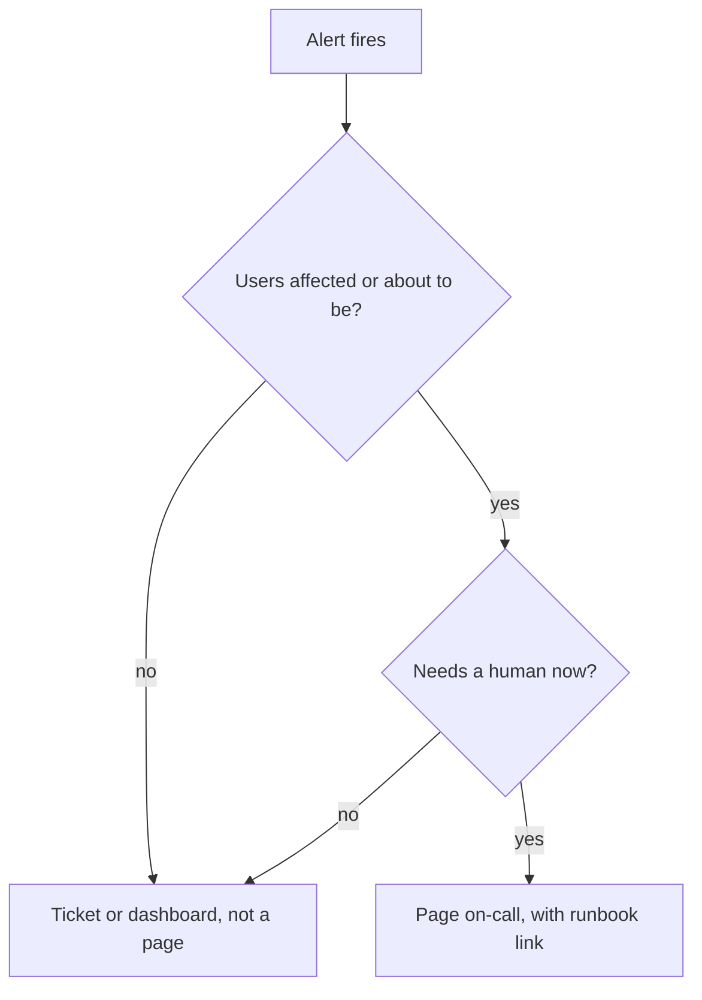
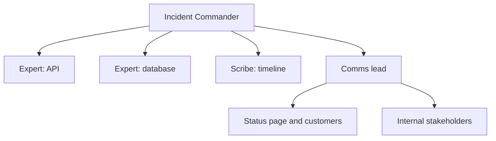
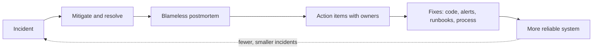

Everything in this track, from health checks and canaries to dashboards and alerts, reduces how
often things break. It never gets that number to zero. Sooner or later a pager goes off at 3 a.m.,
and what happens next depends less on technical brilliance than on preparation: sane on-call
rotations, clear roles, written runbooks and a culture that learns from failure instead of punishing
it. This session draws on the [Google SRE Book](https://sre.google/sre-book/table-of-contents/) and
the [PagerDuty Incident Response](https://response.pagerduty.com/) guide, both free and both
excellent.

## On-call practices and alert fatigue

**On-call** means being the person who responds when production needs a human, for a set period
(often a week), usually in a rotation. Done well, it's manageable and even educational. Done badly,
it burns people out and makes systems _less_ reliable, because exhausted engineers make mistakes.

Practices that make on-call sustainable:

- **A rotation with enough people.** A rotation of two means being on call every other week. Aim for
  enough people that each is on call rarely, and use a **secondary** as backup for the primary.
- **Follow the sun** when teams span time zones, so nobody is paged at night routinely.
- **Bounded load.** The SRE Book argues for capping operational work so engineers have most of their
  time for engineering, and a small number of incidents per shift, so each one can be handled
  properly and followed up.
- **Handoffs.** At the end of a shift, write down what happened, what's ongoing and what to watch.
- **Compensation and recovery.** Time off after a rough night is not a perk; it prevents mistakes.

**Alert fatigue** is what happens when people receive too many alerts, especially ones that don't
need action. Like the boy who cried wolf, alerts that are usually noise train responders to ignore
or snooze them, and the real one gets missed.

Every page should be:

1. **Actionable**: a human must do something now. If the answer is "wait and see", it's not a page.
2. **Urgent**: it can't wait until morning. Otherwise, make it a ticket.
3. **About a symptom users feel** (5.6.2): error ratio, latency, unavailability.
4. **Linked to a runbook** explaining what to do.



> [!TIP]
> Review alerts regularly: for every page last week, was it actionable? Delete or demote the ones that
> weren't. Fixing noisy alerts is real reliability work, and it's the fastest way to improve
> on-call life.

## Incident roles and communication

An **incident** is an unplanned disruption or degradation that needs a coordinated response. Without
structure, everyone jumps in at once: five people debugging the same thing, nobody updating the
status page, nobody knowing who decided to roll back. Both the SRE Book and the PagerDuty guide
borrow from emergency services (the Incident Command System used by firefighters): separate the
roles.

| Role | Responsibility |
| ---- | -------------- |
| **Incident Commander (IC)** | Coordinates, makes decisions, delegates. Does **not** debug. |
| **Subject matter experts / operations** | Investigate and fix, reporting to the IC. |
| **Scribe** | Records the timeline: what was observed, decided and done, and when. |
| **Communications lead / liaison** | Updates stakeholders, support and the status page on a regular cadence. |

In a small team one person may hold several roles, but the IC role should be explicit. The PagerDuty
guide stresses that the IC's job is to keep the response moving: ask for status, make decisions
(even imperfect ones), and assign clear tasks to named people ("Ana, roll back the API to the
previous release and report back in 5 minutes").



**Priorities during an incident**, in order:

1. **Mitigate**: stop the bleeding. Roll back, fail over, turn off the feature flag, add capacity.
   Root cause can wait.
2. **Communicate**: regular updates, even "no news, still investigating, next update in 30 minutes".
3. **Resolve**: confirm metrics are back to normal before declaring it over.
4. **Learn**: the postmortem, later.

> [!WARNING]
> The most common incident mistake is debugging the root cause while users are still affected. If a
> deploy happened 20 minutes before the errors began, roll back first and ask questions afterwards.
> Mitigation beats diagnosis.

> [!TIP]
> Declare incidents early and generously. Declaring something that turns out minor costs a few
> minutes; failing to declare a real one costs coordination when you need it most. Have a
> **severity scale** (for example SEV1 to SEV3) defined in advance so nobody debates it mid-crisis.

## Runbooks

A **runbook** (or playbook) is a written procedure for handling a specific alert or task. It's the
checklist pilots use: not because pilots don't know how to fly, but because stress makes everyone
forget steps.

A good runbook for an alert contains:

- **What the alert means** in plain words, and the user impact.
- **How to verify** it's real: which dashboard, which query, which log search.
- **Mitigation steps**, most likely first, with exact commands.
- **Escalation**: who to call if the steps don't work.
- **Links**: dashboards, logs, the service's architecture diagram.

```markdown
### Alert: HighErrorRatio (todo-api)

**Meaning:** more than 2% of API requests return 5xx for 10 minutes. Users can't save to-dos.

**Verify:** Grafana "Todo API" dashboard, top row. Loki: `{app="todo-api"} | json | level="ERROR"`.

**Mitigate:**
1. Recent deploy (check the deploy log)? Roll back: `helm rollback todo <previous> -n todo`.
2. Database errors in logs? Check the DB dashboard: connections, CPU, storage.
3. One pod only? `kubectl delete pod <pod>` and watch.

**Escalate:** database owner on the secondary rotation if the DB is saturated.
```

Runbooks must be maintained: after every incident, update the runbook you used. The best runbooks
eventually become automation, since a step a human does the same way every time can usually be
scripted.

## Blameless postmortems

After the incident, you write a **postmortem**: a document describing what happened, its impact,
the timeline, the contributing causes, and the actions that will prevent recurrence or reduce impact
next time. The SRE Book's chapter on postmortem culture makes the key point: postmortems must be
**blameless**.

Blameless means you assume everyone acted with good intentions on the information they had, and you
look for the **system** conditions that made the failure possible. "Engineer X ran the wrong command"
is a dead end: next time someone else runs it. "The command could delete production with no
confirmation, and staging and production consoles looked identical" leads to fixes.

Why blameless works: if people are punished for mistakes, they hide them, and the organisation stops
learning. If they're thanked for surfacing them, you find out about problems early.

A typical postmortem structure:

1. **Summary**: two or three sentences.
2. **Impact**: who was affected, how, for how long; numbers if possible.
3. **Timeline**: timestamps of detection, key decisions, mitigation, resolution (the scribe's notes).
4. **Root causes and contributing factors**: usually several, rarely one. Techniques like asking
   "why?" repeatedly help, but stop at system causes, not people.
5. **What went well / what went poorly / where we got lucky.**
6. **Action items**: specific, owned, with priority and tracking tickets.



> [!WARNING]
> A postmortem without completed action items is theatre. Track the actions like any other work,
> and review them. "Be more careful" is not an action item; "add a confirmation prompt and a
> production colour scheme to the admin console" is.

## Practice: write a postmortem for a simulated outage

Run a small game day on your own stack (Compose or kind), then write the postmortem.

### Step 1: Prepare

Make sure you have the pieces from this module: JSON logs, the Grafana dashboard with RED metrics,
the `HighErrorRatio` alert, and Sentry. Write a runbook for `HighErrorRatio` using the template
above.

### Step 2: Break it

Pick one scenario (or ask a friend to pick one without telling you):

- Deploy a version with a bug in `POST /todos` (raise for titles over 20 characters).
- Stop the database container.
- Set the database connection pool to 1 and generate load.
- Fill the cache's memory or remove the Redis service.

Start a timer. Generate realistic traffic.

### Step 3: Respond as if it were real

Act as IC and responder. Write timeline notes as you go (time, what you saw, what you did). Use the
alert, dashboard, logs, traces and Sentry. Mitigate first, then find the cause. Post "status
updates" into a text file every ten minutes.

### Step 4: Write the postmortem

Use the six-part structure. Be specific: "detected at 14:07 by HighErrorRatio, 6 minutes after the
deploy; mitigated at 14:15 by rollback". Find at least two contributing factors and three action
items with owners (you) and priorities.

### Step 5: Close the loop

Implement one action item: improve the alert, add the missing dashboard panel, or update the
runbook with a step you needed. Keep the postmortem in your repo; it's a strong talking point in
senior interviews.

```quiz
{"questions": [
  {"question": "Which alert should page an on-call engineer at night?", "options": ["Disk usage on a log server reached 60%", "Checkout error ratio is 8% for 10 minutes", "A single pod restarted and recovered", "CPU on a batch node is at 90%"], "answer": 1, "explanation": "Pages should be urgent, actionable and about user-facing symptoms; the others are tickets or dashboard items."},
  {"question": "What is the Incident Commander's main job during an incident?", "options": ["Debug the hardest technical problem personally", "Write the postmortem", "Coordinate the response, make decisions and delegate tasks", "Update the status page only"], "answer": 2, "explanation": "The IC keeps the response organised and moving; others investigate and fix."},
  {"question": "Errors started right after a deploy 20 minutes ago. What should you do first?", "options": ["Roll back to mitigate, then investigate the cause", "Read the diff until you find the bug", "Wait to see if it resolves itself", "Start the postmortem"], "answer": 0, "explanation": "Mitigation comes before diagnosis while users are affected."},
  {"question": "Why should postmortems be blameless?", "options": ["Because nobody is ever at fault", "To make the document shorter", "Because managers prefer it", "Blame makes people hide mistakes, while focusing on system causes produces fixes that prevent recurrence"], "answer": 3, "explanation": "Blameless culture keeps information flowing and targets the conditions that allowed the failure."},
  {"question": "Which is a good postmortem action item?", "options": ["Be more careful when deploying", "Add a required readiness probe check to the deploy pipeline, owned by Ana, due next sprint", "Try not to let it happen again", "Blame the database"], "answer": 1, "explanation": "Action items should be specific, owned, scheduled and change the system."}
]}
```
