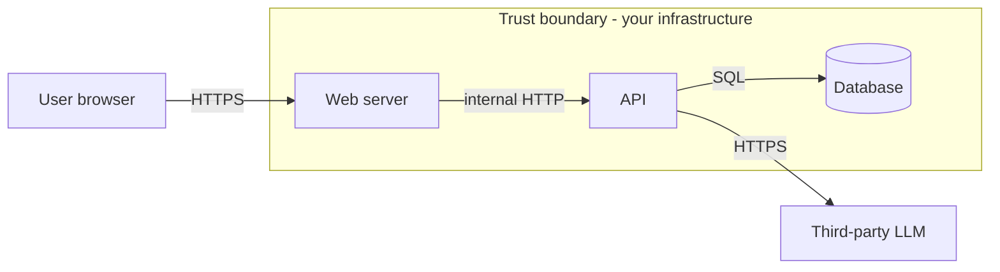
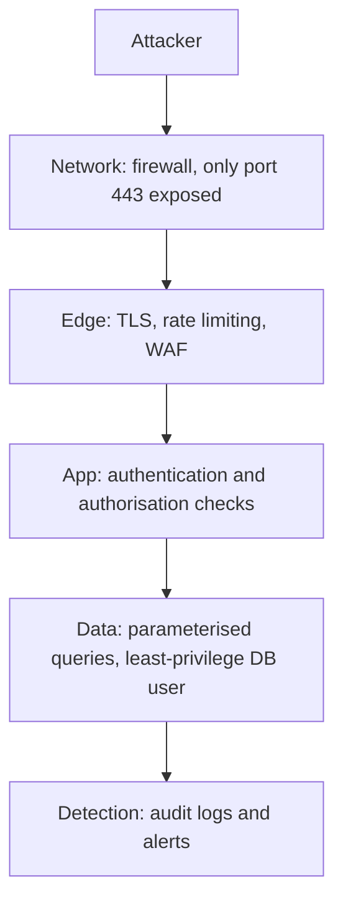
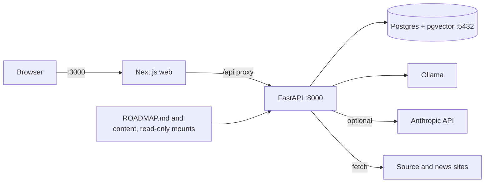

Most security bugs are not clever. They are ordinary design decisions nobody questioned: an
endpoint that trusts an ID from the URL, a database port left open "just for development", a log
line that prints a token. This session teaches the habit that catches those decisions early:
before you write code, ask _what are we protecting, from whom, and what could go wrong?_ That
habit is called the security mindset, and its structured form is **threat modelling**.

## CIA triad and attack surface

Think of a bank vault. You want three things: nobody unauthorised can _see_ what is inside, nobody
can _tamper_ with it, and the rightful owner can _get in_ when they need to. Those three goals are
the **CIA triad**:

| Goal | Plain meaning | Typical failure | Typical control |
| --- | --- | --- | --- |
| **Confidentiality** | Only the right people can read it | Leaked database dump, token in a log | Access control, encryption |
| **Integrity** | Nobody can change it undetected | Attacker edits another user's order | Authorisation, signatures, checksums |
| **Availability** | It works when needed | Server knocked over by a flood of requests | Rate limits, redundancy, backups |

Every security requirement you will ever meet maps to one or more of these. "Users must not see
other users' progress" is confidentiality. "Progress cannot be forged" is integrity. "The tutor
must still answer when Ollama is slow" is availability.

The **attack surface** is the sum of all the places where an attacker can interact with your
system: every HTTP endpoint, every form field, every file upload, every open port, every
dependency, every person with a password. Analogy: a house's attack surface is its doors,
windows, letterbox and the people who hold keys. Fewer, better-guarded openings mean fewer ways in.

> [!NOTE]
> An **asset** is something worth protecting (data, money, reputation, uptime). A **threat** is
> something that could harm an asset. A **vulnerability** is a weakness that lets a threat happen.
> A **mitigation** (or control) reduces the likelihood or impact. **Risk** is roughly likelihood
> times impact.

> [!TIP]
> Reducing attack surface is often the cheapest security win. Delete the unused endpoint, close
> the debug port, remove the dependency you no longer call. Code that does not exist cannot be
> exploited.

## Threat modelling with STRIDE

Threat modelling sounds formal, but the
[OWASP Threat Modeling Cheat Sheet](https://cheatsheetseries.owasp.org/cheatsheets/Threat_Modeling_Cheat_Sheet.html)
boils it down to four questions:

1. **What are we working on?** Draw the system.
2. **What can go wrong?** Brainstorm threats.
3. **What are we going to do about it?** Choose mitigations.
4. **Did we do a good enough job?** Review and revisit.

For step 1 you draw a **data flow diagram (DFD)**: the processes, the data stores, the external
actors, and the arrows between them. Then you draw **trust boundaries**: lines where data passes
from something you control less to something you control more (browser to server, server to a
third-party API). Most threats live on those lines.

For step 2, a blank page is hard, so you use a checklist. **STRIDE**, created at Microsoft, is the
most common one. Each letter is a threat category, and each violates a security property:

| Letter | Threat | What it looks like | Property violated |
| --- | --- | --- | --- |
| **S** | Spoofing | Pretending to be another user or service | Authentication |
| **T** | Tampering | Modifying data in transit or at rest | Integrity |
| **R** | Repudiation | "I never did that", and you cannot prove otherwise | Non-repudiation (audit logs) |
| **I** | Information disclosure | Data seen by someone who should not see it | Confidentiality |
| **D** | Denial of service | Making the system unavailable | Availability |
| **E** | Elevation of privilege | A normal user acting as an admin | Authorisation |

You walk through each element and each arrow in your diagram and ask the six STRIDE questions.
Not every letter applies everywhere; that is fine.

> [!EXAMPLE]
> Arrow "User browser to Web server". **S**: can someone reuse a stolen session cookie?
> **T**: can a request body be modified? (Yes, by the user themselves, so the server must
> validate it.) **I**: is the traffic encrypted? **D**: can one client send 10,000 requests a
> second? Each "yes, possibly" becomes a row in your threat list with a mitigation.

> [!WARNING]
> Threat modelling is not a one-off document for an auditor. A model that is never revisited goes
> stale the moment you add a feature. Revisit it whenever you add a trust boundary: a new external
> service, a new kind of user, a new upload.

## Security by design and defence in depth

**Security by design** means security is a requirement from the first sketch, like performance
or accessibility, not a patch applied after the pen test. Concretely:

- **Secure defaults.** New accounts get the least privileges; new endpoints require
  authentication unless someone explicitly opts out.
- **Least privilege.** Every user, service and database role gets only the permissions it needs.
  The API's database user does not need to `DROP TABLE`.
- **Fail securely.** When something errors, deny access rather than allowing it. An exception in
  the permission check must mean "403", never "carry on".
- **Don't trust input.** Anything that crosses a trust boundary is validated on the server side.
- **Keep it simple.** Complex security logic hides bugs. Use well-known libraries and patterns.

**Defence in depth** is the castle model: a moat, then walls, then guards, then a locked keep.
Any single layer can fail, so you stack independent layers so that one failure is not a breach.

> [!EXAMPLE]
> Defence in depth against SQL injection: the code uses parameterised queries (layer 1); the
> database user cannot read the `admin_secrets` schema (layer 2); the database is not reachable
> from the internet (layer 3); unusual query errors trigger an alert (layer 4). A single bug in
> layer 1 no longer means a full data breach.

> [!TIP]
> When you design a control, ask "and if this fails, what stops the attacker next?" If the answer
> is "nothing", you have found where to add a layer.

## Practice: threat model YouCanDoIt

Let's apply the four questions to the platform you are using. Allow about 60 minutes and write the
result into a Markdown file in your notes (for example `threat-model.md`).

### Step 1: What are we working on?

Read `docker-compose.yml` and the architecture section of `CLAUDE.md`. Draw the data flow:

Mark trust boundaries: browser to web, API to the public internet (news feeds, source pages,
Anthropic), and your laptop's network to the published ports.

### Step 2: List assets

Write a short list. Suggested starting point: learning progress (completions), favourite articles,
the Anthropic API key in `.env`, the database password, the host machine itself, and availability
of the tutor.

### Step 3: Walk STRIDE over each element

Fill a table with at least eight rows. Some prompts to get you going:

| Element | STRIDE | Threat | Current state | Mitigation |
| --- | --- | --- | --- | --- |
| API endpoints | S, E | No authentication: anyone who can reach `:8000` can mark progress or trigger `POST /articles/refresh` | Single-user, local | Bind ports to `127.0.0.1`, or add auth before exposing it |
| Postgres | I, T | Port `5432` published with password `ycdi` | Dev convenience | Don't publish the port; use a strong secret from `.env` |
| RAG fetcher | T, I | A fetched page contains prompt-injection text that steers the tutor | Pages are untrusted input | Treat LLM output as untrusted; never let it trigger actions |
| `POST /ai/tutor` | D | Long prompts or many calls exhaust the LLM or your Anthropic budget | No limit | Rate limit; cap input length |
| `.env` | I | API key committed by accident | `.env` is optional | Ensure `.env` is git-ignored; secret scanning |
| Rendered lessons | T | Malicious Markdown/Mermaid in content leads to XSS | Content is your own repo | Keep sanitising in the renderer; review content PRs |

### Step 4: Rank and decide

For each row, give likelihood and impact a 1–3 score and multiply. For a local, single-user app
many risks score low today, and that is a valid conclusion. Write which ones you would fix
_before_ deploying it on a public server.

### Step 5: Schedule a revisit

Add a line at the top: "Revisit when we add login, a public deployment, or a new external
service." You will revisit this model in later sessions when you add authentication (6.3.1) and
harden the containers (6.4.3).

> [!TIP]
> Threat modelling as a pair works better than alone: one person plays the attacker and keeps
> asking "what if?", the other answers from the design. Ten minutes per feature in a planning
> meeting is often enough.
