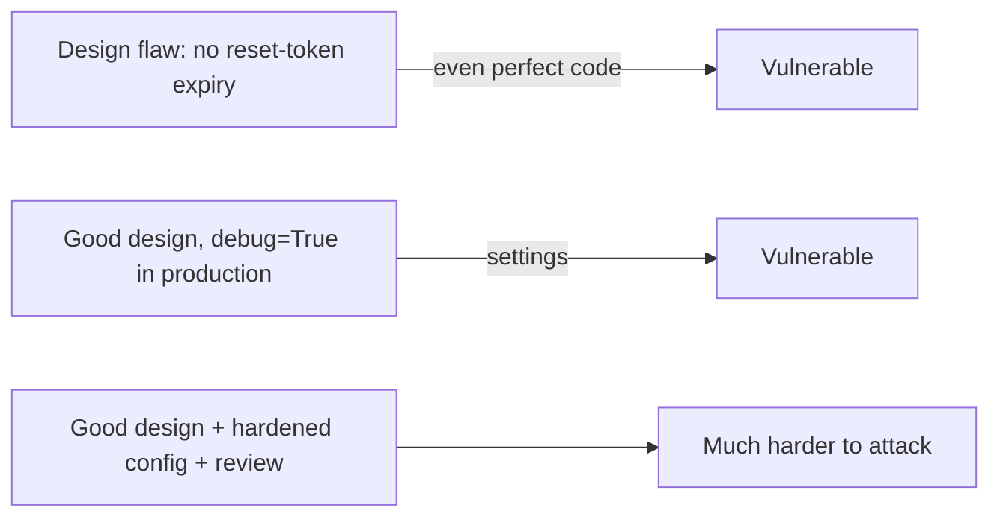

The [OWASP Top 10](https://top10.owasp.org/) is the industry's shared shortlist of the most critical
web application security risks. It is built from data contributed by security firms plus a
community survey, and it is updated every few years. It is not a complete checklist, but it is
the vocabulary every security conversation, job interview and audit report uses. The current
edition is **OWASP Top 10:2025**:

| ID | Category |
| --- | --- |
| A01 | Broken Access Control |
| A02 | Security Misconfiguration |
| A03 | Software Supply Chain Failures |
| A04 | Cryptographic Failures |
| A05 | Injection |
| A06 | Insecure Design |
| A07 | Authentication Failures |
| A08 | Software or Data Integrity Failures |
| A09 | Security Logging and Alerting Failures |
| A10 | Mishandling of Exceptional Conditions |

This session covers the categories you will hit most often as a developer. Authentication gets its
own sessions in Module 6.3, and supply chain gets 6.4.2.

> [!NOTE]
> Each category is a family of weaknesses, catalogued as CWEs (Common Weakness Enumeration). For
> example "Injection" includes SQL injection, OS command injection and cross-site scripting. The
> [OWASP Cheat Sheet Series](https://cheatsheetseries.owasp.org/) has a practical "how to prevent it"
> page for almost every one.

## Broken access control

Number one, and for good reason. **Authentication** answers "who are you?"; **access control**
(authorisation) answers "are you allowed to do _this_, to _this thing_?" Broken access control
means the second question is missing or answered wrongly.

Analogy: a hotel checks your ID at reception (authentication), but your key card then opens every
room on the floor. The check-in worked; the access control didn't.

Typical forms:

- **IDOR (insecure direct object reference)**: `GET /invoices/1043` returns invoice 1043 to anyone
  logged in, because the code never checks it belongs to the caller.
- **Missing function-level checks**: the "Delete user" button is hidden for normal users, but the
  `DELETE /users/{id}` endpoint does not check the role.
- **Trusting the client**: a `role=admin` field in a cookie or request body that the server
  believes.
- **CORS misconfiguration**: allowing any origin with credentials.

```python
# Vulnerable: any logged-in user can read any invoice
@router.get("/invoices/{invoice_id}")
async def get_invoice(invoice_id: int, user=Depends(current_user), db=Depends(get_db)):
    return await db.get(Invoice, invoice_id)

# Fixed: scope the query to the owner, and return 404 rather than revealing existence
@router.get("/invoices/{invoice_id}")
async def get_invoice(invoice_id: int, user=Depends(current_user), db=Depends(get_db)):
    invoice = await db.scalar(
        select(Invoice).where(Invoice.id == invoice_id, Invoice.owner_id == user.id)
    )
    if invoice is None:
        raise HTTPException(404)
    return invoice
```

> [!TIP]
> Deny by default. Put the authorisation check in one shared dependency or policy function rather
> than repeating `if user.is_admin` in every handler, and write a test that calls each endpoint as
> the _wrong_ user.

## Cryptographic failures

This category is about sensitive data exposed because cryptography was missing, weak or misused.
The focus is the data, not the maths. Ask: what data here is sensitive (passwords, health data,
payment details, tokens), and is it protected in transit and at rest?

Common failures:

- Traffic over plain HTTP, or TLS without HSTS so the first request can be downgraded.
- Passwords stored with fast hashes (MD5, SHA-1, unsalted SHA-256) instead of Argon2id or bcrypt.
- Hard-coded or default encryption keys, keys committed to git.
- Weak randomness: using `random` instead of `secrets` for tokens.
- Old algorithms and modes (DES, RC4, AES-ECB).
- Sensitive data cached or logged in clear text.

> [!EXAMPLE]
> A password-reset token generated with `random.randint(100000, 999999)` is predictable and has
> only a million possibilities. `secrets.token_urlsafe(32)` gives 256 bits from a cryptographically
> secure source. Same line count, completely different security.

> [!WARNING]
> The best protection for sensitive data is often not storing it at all. If you don't need the
> full card number or the date of birth, don't collect it. This links directly to GDPR's data
> minimisation (session 6.5.1).

## Injection

Injection happens when untrusted input is sent to an interpreter (a SQL engine, a shell, the
browser's HTML parser, an LDAP server) as part of a command, so the input changes the _meaning_ of
the command instead of being treated as data.

Analogy: a form letter that says "Pay ___ euros to Ada". If you fill the blank with "100 euros to
Ada. Also pay 10,000", and the clerk reads the whole sentence as instructions, you've injected.

```python
# SQL injection
db.execute(f"SELECT * FROM users WHERE email = '{email}'")         # vulnerable
db.execute(text("SELECT * FROM users WHERE email = :e"), {"e": email})  # safe

# OS command injection
os.system(f"convert {filename} out.png")                  # vulnerable: filename = "a.png; rm -rf ~"
subprocess.run(["convert", filename, "out.png"], check=True)  # safe: no shell parsing
```

The universal fix is the same idea in every context: **keep code and data separate**. Use
parameterised queries, argument lists instead of shell strings, and context-aware output encoding
for HTML. Input validation (allow-lists, types, lengths) is a valuable extra layer but not the main
defence. Session 6.2.2 covers SQL injection in depth and 6.2.3 covers XSS.

> [!NOTE]
> LLM applications have their own variant: **prompt injection**, where text in a document or user
> message overrides your instructions. The fix is similar in spirit: treat model output as
> untrusted data, never as a command with privileges.

## Insecure design and misconfiguration

These two are paired because both are failures _outside_ the individual line of code.

**Insecure design** is a flaw in the plan itself: even a perfect implementation would be
vulnerable. Examples: a password-reset flow based on "security questions" whose answers are on
social media; a booking system with no limit on how many seats one user can hold; a coupon that
can be applied any number of times. You can't patch your way out of these; you need threat
modelling (session 6.1.1) and abuse cases in your requirements ("as an attacker, I want to...").

**Security misconfiguration** is a correct design deployed with unsafe settings:

- Default credentials left in place (`admin/admin`, a database password of `postgres`).
- Debug mode on in production, showing stack traces and environment variables.
- Unnecessary ports, services or sample apps exposed.
- Missing security headers, permissive CORS, directory listing enabled.
- Cloud storage buckets readable by the world.



> [!TIP]
> Make the secure configuration the _automated_ one. If production settings come from a reviewed
> file or environment and are checked in CI, nobody can forget to turn debug off by hand.

## Vulnerable components and logging failures

**Vulnerable and outdated components** (broadened in 2025 into _Software Supply Chain Failures_)
means your own code is fine, but a library, base image or build tool you depend on has a known
vulnerability, or has been compromised. Modern apps are mostly other people's code: a fresh
Next.js project pulls in hundreds of packages. Defences: know what you depend on (lock files,
SBOMs), get alerted when a CVE lands (Dependabot, `npm audit`, `pip-audit`, Trivy), update
regularly, and remove what you don't use. Session 6.4.2 goes deeper.

**Security logging and alerting failures** is about _detection_. Most breaches are discovered late,
often by a third party. If your app does not log failed logins, permission denials and admin
actions, and nobody is alerted when they spike, an attacker can probe for weeks unnoticed.

Good security logging:

- Records **who, what, when, from where, and the outcome** for logins, access-control failures,
  input-validation failures and high-value actions.
- **Never** logs secrets: passwords, tokens, full card numbers, session cookies.
- Is protected from tampering and stored centrally, with alerts on suspicious patterns.
- Is **encoded safely**, so an attacker can't inject fake log lines with newlines.

> [!WARNING]
> Logging the whole request body "for debugging" is a classic way to put passwords and tokens into
> a log system that far more people can read than your database.

## Practice: audit a sample app against the Top 10

You'll audit two apps: an intentionally vulnerable one to train your eye, then your own. Allow
about 90 minutes.

### Step 1: Run OWASP Juice Shop locally

OWASP Juice Shop is a deliberately insecure web shop
for training. Run it only on your machine:

```sh
docker run --rm -p 127.0.0.1:3001:3000 bkimminich/juice-shop
```

Open `http://localhost:3001`, open your browser's DevTools Network tab, and use the shop normally:
register, log in, add items to the basket.

### Step 2: Hunt for three categories

Try to find, using only the browser and DevTools:

1. **Broken access control**: look at the basket request. Does it include an ID? What happens if you
   change it?
2. **Injection**: try a single quote `'` in the login email field. Does the error message reveal
   anything about the query?
3. **Misconfiguration**: try paths a careless deployment might expose (the app's own score board
   hints at some). Do error pages leak stack traces?

Write down what you tried and what happened. The goal is the habit of questioning every request,
not completing every challenge.

### Step 3: Audit your own project

Pick the to-do API you built in earlier tracks (or YouCanDoIt's API). Fill this table honestly:

| Category | Question to ask | Finding | Fix |
| --- | --- | --- | --- |
| A01 Access control | Does every endpoint that takes an ID check ownership or role? | | |
| A02 Misconfiguration | Debug off? Default passwords? Which ports are published? | | |
| A03 Supply chain | Lock files committed? Any known CVEs (`npm audit`, `pip-audit`)? | | |
| A04 Crypto | HTTPS? Password hashing algorithm? Random tokens from `secrets`? | | |
| A05 Injection | Any f-strings in SQL? Any `shell=True`? Any `dangerouslySetInnerHTML`? | | |
| A06 Design | What abuse cases exist (spam, unlimited LLM calls)? | | |
| A09 Logging | Are failed logins and 403s logged? Are secrets kept out of logs? | | |

```sh
# quick automated hints for the table
grep -rnE "execute\(f\"|text\(f\"|shell=True" --include=*.py .
grep -rn "dangerouslySetInnerHTML" --include=*.tsx .
npm audit --omit=dev
pip install pip-audit && pip-audit
```

### Step 4: Prioritise

Rank findings by likelihood and impact and pick the top three to fix this week. Turn each into an
issue with a short description of the risk, not just the fix: "anyone on the LAN can reset my
progress", not "add auth".
