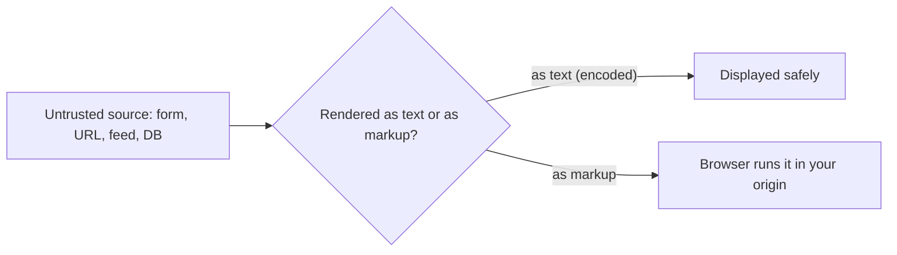
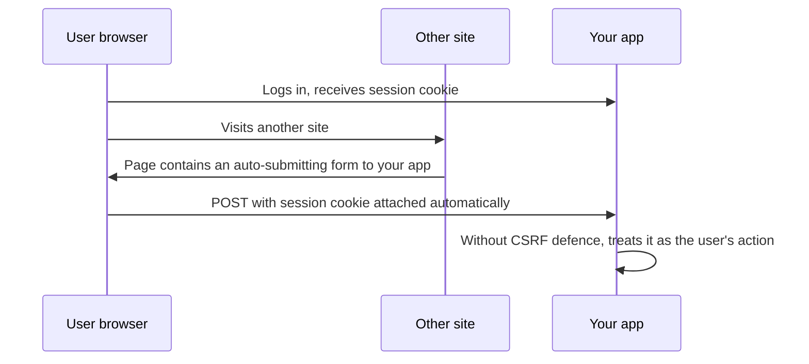

The browser is a shared, hostile environment. Your page runs next to other tabs, extensions and
third-party scripts, and the browser automatically attaches cookies to requests. Two classic
attacks abuse that: **cross-site scripting (XSS)**, where attacker-controlled script runs _inside_
your page, and **cross-site request forgery (CSRF)**, where another site makes the user's browser
send requests _to_ your site. This session explains both, the defences modern frameworks give you
for free, and the headers that add extra layers.

## Stored, reflected and DOM XSS

XSS happens when data from an untrusted source ends up in a page in a way the browser interprets
as code. Once script runs in your origin, it can do anything the user can: read the page, call your
API with their cookies, change what they see. Analogy: a noticeboard where anyone can pin a note,
and the building's staff obey any note that is phrased as an instruction.

There are three flavours, distinguished by _where_ the untrusted data comes from and _where_ it is
turned into markup:

| Type | Where the payload lives | Where it becomes markup | Example source |
| --- | --- | --- | --- |
| **Stored** | Saved in your database | Server or client rendering | A comment, a profile bio, an article title from an RSS feed |
| **Reflected** | In the request itself | The server echoes it into the response | A search page that prints "Results for ..." |
| **DOM-based** | In the URL fragment, `postMessage`, `localStorage` | Client-side JavaScript | Code that copies `location.hash` into `innerHTML` |



Stored XSS is usually the most damaging because it hits every visitor, not just one tricked user.

> [!NOTE]
> YouCanDoIt pulls news from external feeds. Article titles and summaries are **untrusted input**,
> even if the feeds are reputable: a compromised feed would make them a stored-XSS source if they
> were ever rendered as raw HTML.

## Output encoding and React's protections (and dangerouslySetInnerHTML)

The core defence, per the
[OWASP XSS Prevention Cheat Sheet](https://cheatsheetseries.owasp.org/cheatsheets/Cross_Site_Scripting_Prevention_Cheat_Sheet.html),
is **context-aware output encoding**: when you put data into a page, convert the characters that
have special meaning in that context so they are displayed rather than interpreted. In an HTML
body, `<` becomes `&lt;`; inside an attribute, quotes are encoded too; inside a URL, values are
percent-encoded. Different contexts need different encoding, which is why hand-rolled escaping
often fails.

Modern frameworks do this for you. In React, anything you render with curly braces is encoded as
text:

```tsx
// Safe: React encodes the string, so markup is shown as literal characters
<h2>{article.title}</h2>
```

You lose that protection when you step outside the framework:

- **`dangerouslySetInnerHTML`**: inserts raw HTML. The name is a warning.
- **Direct DOM APIs**: `element.innerHTML = ...`, `document.write`, `insertAdjacentHTML`.
- **URLs in `href` or `src`** built from user data: a `javascript:` URL is code. Allow only
  `http:`/`https:` (and maybe `mailto:`) schemes.
- **Server-side templates** with autoescaping turned off, or marked "safe".

If you must render user-provided HTML (Markdown output, a rich-text editor), **sanitise** it with a
maintained library such as DOMPurify, with an allow-list of tags and attributes:

```tsx
import DOMPurify from "dompurify";

const clean = DOMPurify.sanitize(markdownHtml, { USE_PROFILES: { html: true } });
return <div dangerouslySetInnerHTML={{ __html: clean }} />;
```

> [!WARNING]
> Sanitise on output, right before rendering, not only on input. Data stored "clean" years ago may
> be rendered later by a different component in a different context.

> [!TIP]
> Make `dangerouslySetInnerHTML` rare enough that every use gets reviewed. A quick
> `grep -rn dangerouslySetInnerHTML` in code review shows exactly where your XSS risk is
> concentrated.

## Content Security Policy

Encoding prevents XSS; a **Content Security Policy (CSP)** limits the damage when prevention fails.
It is an HTTP response header that tells the browser which sources of scripts, styles, images,
frames and connections are allowed for this page. Analogy: a guest list at the door. Even if
someone sneaks a script onto the page, the browser refuses to run it unless it's on the list.

From [MDN's CSP guide](https://developer.mozilla.org/en-US/docs/Web/HTTP/Guides/CSP), the key
directives:

| Directive | Controls | Typical value |
| --- | --- | --- |
| `default-src` | Fallback for everything | `'self'` |
| `script-src` | JavaScript | `'self'` plus a per-request nonce, or hashes |
| `style-src` | CSS | `'self'` |
| `img-src` | Images | `'self' data: https:` |
| `connect-src` | `fetch`, WebSocket | `'self'` |
| `object-src` | Plugins | `'none'` |
| `base-uri` | `<base>` tag | `'self'` |
| `frame-ancestors` | Who may frame your page (clickjacking) | `'none'` |
| `form-action` | Where forms may submit | `'self'` |

A **strict CSP** uses a random **nonce** generated per response: only `<script>` tags carrying that
nonce run, so injected inline script fails. `'unsafe-inline'` in `script-src` disables most of that
benefit; it is a compromise you should know you are making.

> [!TIP]
> Roll out with `Content-Security-Policy-Report-Only` first. The browser reports violations in
> the console (and optionally to an endpoint) without blocking anything, so you can fix legitimate
> sources before enforcing.

## CSRF and SameSite cookies

CSRF exploits a browser habit: when a request goes to `yourbank.example`, the browser attaches
`yourbank.example`'s cookies, _no matter which site triggered the request_. So a page on another
site can cause the logged-in user's browser to submit a state-changing request to your app, and
your server sees a valid session. The attacker can't read the response; they just need the side
effect.



Defences, from the
[OWASP CSRF Prevention Cheat Sheet](https://cheatsheetseries.owasp.org/cheatsheets/Cross-Site_Request_Forgery_Prevention_Cheat_Sheet.html):

- **Never change state on `GET`.** Safe methods must be safe.
- **`SameSite` cookies.** `SameSite=Lax` (the default in modern browsers when unset) stops cookies
  being sent on cross-site subrequests and cross-site `POST`s, while still allowing top-level
  navigation links. `SameSite=Strict` is stronger but logs users out when they arrive from an
  external link.
- **CSRF tokens.** A random token tied to the session, included in forms or a header and checked by
  the server. Frameworks provide this.
- **Check `Origin` / `Sec-Fetch-Site` headers** on state-changing requests.
- **Custom headers for APIs.** Requiring a header such as `Content-Type: application/json` or
  `X-Requested-With` forces a CORS preflight for cross-origin requests.

> [!NOTE]
> If your API authenticates with a bearer token in the `Authorization` header (not a cookie), the
> browser doesn't attach it automatically, so classic CSRF doesn't apply. The trade-off is that the
> token must live somewhere script can read it, which makes XSS more dangerous. Session 6.3.1
> discusses that trade-off.

Set session cookies with all three flags: `HttpOnly` (script can't read it), `Secure` (HTTPS only)
and `SameSite=Lax` or `Strict`.

## Security headers

Beyond CSP, a handful of response headers switch on browser protections. They are cheap and
belong on every app:

| Header | Purpose | Suggested value |
| --- | --- | --- |
| `Strict-Transport-Security` | Force HTTPS for future visits | `max-age=63072000; includeSubDomains` |
| `X-Content-Type-Options` | Stop MIME sniffing | `nosniff` |
| `Referrer-Policy` | Limit URL leakage to other sites | `strict-origin-when-cross-origin` |
| `Permissions-Policy` | Disable unneeded browser features | `camera=(), microphone=(), geolocation=()` |
| `Content-Security-Policy` with `frame-ancestors` | Clickjacking protection | `frame-ancestors 'none'` |

`X-Frame-Options: DENY` is the older clickjacking header; keep it for old browsers if you like,
but `frame-ancestors` supersedes it.

> [!WARNING]
> Only send HSTS once HTTPS works everywhere on the domain (and subdomains if you include them).
> Browsers remember it for `max-age` seconds, so a mistake is hard to undo.

## Practice: add CSP and security headers to a Next.js app

You'll add headers to YouCanDoIt's web app (or any Next.js 16 app) and verify them. Allow about 60
minutes. Next.js 16 documents two approaches: a static header in `next.config.ts`, or a per-request
nonce generated in `proxy.ts` (the file formerly called middleware). Nonces require every page to be
dynamically rendered and are incompatible with partial prerendering, so start with the static
approach.

### Step 1: Inventory what the page loads

Run the app, open DevTools, and list in the Network tab every origin the page loads scripts,
styles, fonts and images from, and every origin it calls with `fetch`. In YouCanDoIt, the browser
only calls `/api/*` on the same origin, which makes `connect-src 'self'` realistic.

### Step 2: Add the headers in report-only mode

Edit `apps/web/next.config.ts`:

```ts
import type { NextConfig } from "next";

const isDev = process.env.NODE_ENV === "development";

const csp = `
  default-src 'self';
  script-src 'self' 'unsafe-inline'${isDev ? " 'unsafe-eval'" : ""};
  style-src 'self' 'unsafe-inline';
  img-src 'self' blob: data: https:;
  font-src 'self';
  connect-src 'self';
  object-src 'none';
  base-uri 'self';
  form-action 'self';
  frame-ancestors 'none';
`.replace(/\s{2,}/g, " ").trim();

const nextConfig: NextConfig = {
  // ...existing options...
  async headers() {
    return [
      {
        source: "/(.*)",
        headers: [
          { key: "Content-Security-Policy-Report-Only", value: csp },
          { key: "X-Content-Type-Options", value: "nosniff" },
          { key: "Referrer-Policy", value: "strict-origin-when-cross-origin" },
          { key: "Permissions-Policy", value: "camera=(), microphone=(), geolocation=()" },
        ],
      },
    ];
  },
};

export default nextConfig;
```

`'unsafe-eval'` is only needed in development (React uses `eval` for debugging there). The static
approach needs `'unsafe-inline'` for the framework's inline scripts; note that as a known trade-off.

### Step 3: Check for violations

Rebuild (`docker compose up -d --build web`) and browse every page: roadmap, a session with a
Mermaid diagram, the articles page, the tutor. Watch the console for
"Content-Security-Policy-Report-Only" violations. Fix each one by adjusting the policy or the code,
not by adding `*`.

### Step 4: Verify the headers

```sh
curl -sI http://localhost:3000/ | grep -iE "content-security|x-content|referrer|permissions"
```

### Step 5: Enforce

When the console is clean, rename the key to `Content-Security-Policy`, rebuild, and click through
again. Add `Strict-Transport-Security` only in the environment that actually serves HTTPS.

### Step 6: Write it down

In your notes, list which directives you chose, the trade-offs you accepted (`'unsafe-inline'`),
and what would need to change to move to nonces.
